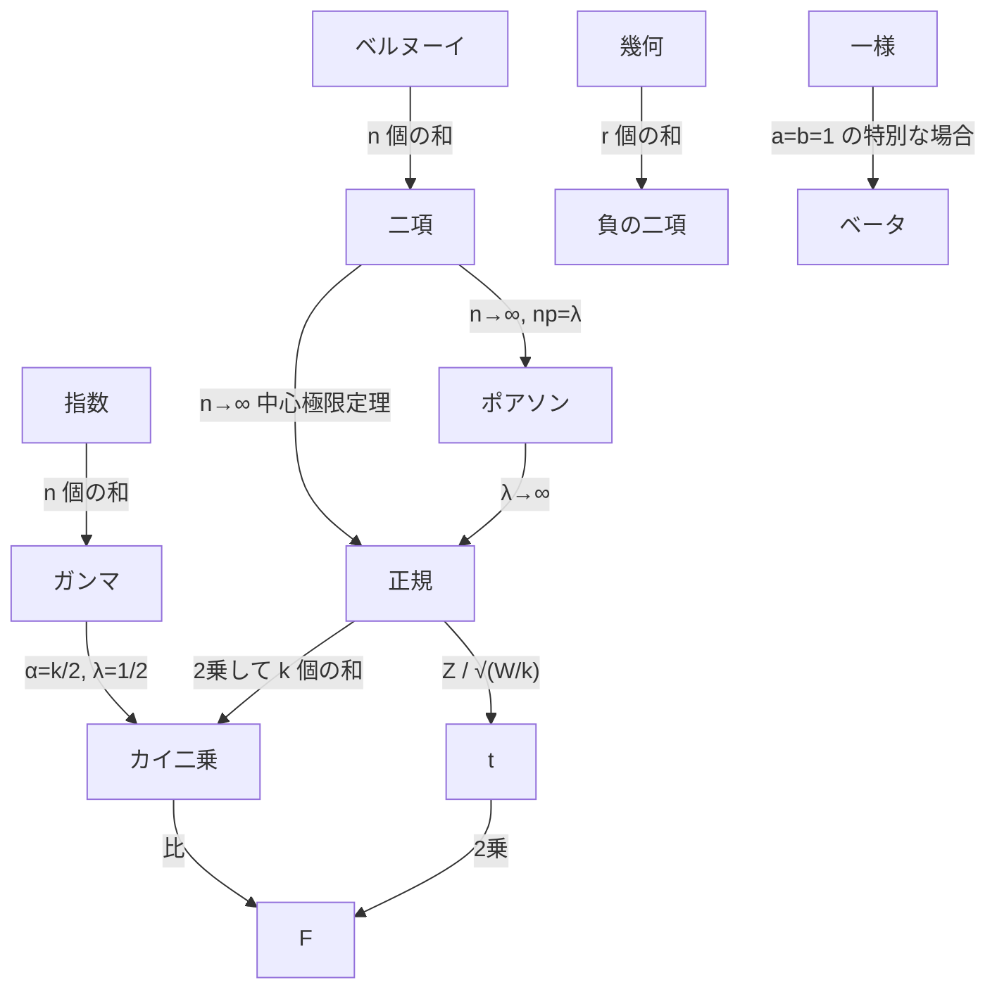

# 付録B 確率分布一覧と数表

本教材に登場する確率分布の性質と、推定・検定で使う数表をまとめます。

## B.1 離散分布 { #discrete }

| 分布 | 記号 | 確率関数 $P(X = k)$ | とりうる値 | 期待値 | 分散 | 積率母関数 | 章 |
|---|---|---|---|---|---|---|---|
| ベルヌーイ | $\mathrm{Bern}(p)$ | $p^k(1-p)^{1-k}$ | $0, 1$ | $p$ | $p(1-p)$ | $1 - p + pe^t$ | 7 |
| 二項 | $B(n, p)$ | $\binom{n}{k}p^k(1-p)^{n-k}$ | $0, \dots, n$ | $np$ | $np(1-p)$ | $(1 - p + pe^t)^n$ | 7 |
| ポアソン | $Po(\lambda)$ | $e^{-\lambda}\frac{\lambda^k}{k!}$ | $0, 1, 2, \dots$ | $\lambda$ | $\lambda$ | $e^{\lambda(e^t - 1)}$ | 7 |
| 幾何 | $Ge(p)$ | $p(1-p)^k$ | $0, 1, 2, \dots$ | $\frac{1-p}{p}$ | $\frac{1-p}{p^2}$ | $\frac{p}{1 - (1-p)e^t}$ | 7 |
| 負の二項 | $NB(r, p)$ | $\binom{k+r-1}{k}p^r(1-p)^k$ | $0, 1, 2, \dots$ | $\frac{r(1-p)}{p}$ | $\frac{r(1-p)}{p^2}$ | $\left(\frac{p}{1 - (1-p)e^t}\right)^r$ | 7 |
| 超幾何 | $HG(N, M, n)$ | $\frac{\binom{M}{k}\binom{N-M}{n-k}}{\binom{N}{n}}$ | $\max(0, n-N+M), \dots, \min(n, M)$ | $n\frac{M}{N}$ | $n\frac{M}{N}\left(1 - \frac{M}{N}\right)\frac{N-n}{N-1}$ | — | 7 |
| 離散一様 | — | $\frac{1}{n}$ | $1, \dots, n$ | $\frac{n+1}{2}$ | $\frac{n^2-1}{12}$ | $\frac{e^t(e^{nt} - 1)}{n(e^t - 1)}$ | 6 |

（幾何分布・負の二項分布は「成功するまでの **失敗の回数**」として定義しています。積率母関数は $(1-p)e^t < 1$ の範囲で存在します。）

## B.2 連続分布 { #continuous }

| 分布 | 記号 | 密度関数 $f(x)$ | とりうる値 | 期待値 | 分散 | 積率母関数 | 章 |
|---|---|---|---|---|---|---|---|
| 一様 | $U(a, b)$ | $\frac{1}{b - a}$ | $a \le x \le b$ | $\frac{a+b}{2}$ | $\frac{(b-a)^2}{12}$ | $\frac{e^{bt} - e^{at}}{(b-a)t}$ | 8 |
| 正規 | $N(\mu, \sigma^2)$ | $\frac{1}{\sqrt{2\pi}\sigma}e^{-\frac{(x-\mu)^2}{2\sigma^2}}$ | 実数全体 | $\mu$ | $\sigma^2$ | $e^{\mu t + \sigma^2 t^2/2}$ | 8 |
| 指数 | $Ex(\lambda)$ | $\lambda e^{-\lambda x}$ | $x \ge 0$ | $\frac{1}{\lambda}$ | $\frac{1}{\lambda^2}$ | $\frac{\lambda}{\lambda - t}$ | 8 |
| ガンマ | $Ga(\alpha, \lambda)$ | $\frac{\lambda^\alpha}{\Gamma(\alpha)}x^{\alpha-1}e^{-\lambda x}$ | $x > 0$ | $\frac{\alpha}{\lambda}$ | $\frac{\alpha}{\lambda^2}$ | $\left(\frac{\lambda}{\lambda - t}\right)^\alpha$ | 8 |
| ベータ | $Be(a, b)$ | $\frac{x^{a-1}(1-x)^{b-1}}{B(a, b)}$ | $0 < x < 1$ | $\frac{a}{a+b}$ | $\frac{ab}{(a+b)^2(a+b+1)}$ | — | 8 |
| 対数正規 | $LN(\mu, \sigma^2)$ | $\frac{1}{\sqrt{2\pi}\sigma x}e^{-\frac{(\log x-\mu)^2}{2\sigma^2}}$ | $x > 0$ | $e^{\mu + \sigma^2/2}$ | $e^{2\mu + \sigma^2}(e^{\sigma^2} - 1)$ | 存在しない | 8 |
| カイ二乗 | $\chi^2(k)$ | $\frac{x^{k/2-1}e^{-x/2}}{2^{k/2}\Gamma(k/2)}$ | $x > 0$ | $k$ | $2k$ | $(1 - 2t)^{-k/2}$ | 13 |
| $t$ | $t(k)$ | $\frac{\Gamma(\frac{k+1}{2})}{\sqrt{k\pi}\Gamma(\frac{k}{2})}\left(1 + \frac{x^2}{k}\right)^{-\frac{k+1}{2}}$ | 実数全体 | $0$（$k > 1$） | $\frac{k}{k-2}$（$k > 2$） | 存在しない | 13 |
| $F$ | $F(m, n)$ | （省略） | $x > 0$ | $\frac{n}{n-2}$（$n > 2$） | $\frac{2n^2(m+n-2)}{m(n-2)^2(n-4)}$（$n > 4$） | 存在しない | 13 |
| コーシー | — | $\frac{1}{\pi(1 + x^2)}$ | 実数全体 | 存在しない | 存在しない | 存在しない | 8 |

（ガンマ分布は率 $\lambda$ を使った流儀で書いています。積率母関数は $t < \lambda$、$t < 1/2$ などの範囲で存在します。）

### 分布どうしの関係

<!-- tables:start -->

## B.3 数表 { #tables }

以下の数表は Python（SciPy）で計算した値です（`scripts/make_tables.py` で再生成できます）。実際の分析では、ソフトウェアで直接 $p$ 値やパーセント点を計算するのがふつうです。

### 標準正規分布表（上側確率） { #normal-table }

表の値は $Q(z) = P(Z \ge z) = 1 - \Phi(z)$ です。行が $z$ の小数第1位まで、列が小数第2位を表します。
例：$z = 1.96$ なら「1.9 の行」と「0.06 の列」の交点 0.0250 を読みます。

| $z$ | 0.00 | 0.01 | 0.02 | 0.03 | 0.04 | 0.05 | 0.06 | 0.07 | 0.08 | 0.09 |
|---|---:|---:|---:|---:|---:|---:|---:|---:|---:|---:|
| 0.0 | 0.5000 | 0.4960 | 0.4920 | 0.4880 | 0.4840 | 0.4801 | 0.4761 | 0.4721 | 0.4681 | 0.4641 |
| 0.1 | 0.4602 | 0.4562 | 0.4522 | 0.4483 | 0.4443 | 0.4404 | 0.4364 | 0.4325 | 0.4286 | 0.4247 |
| 0.2 | 0.4207 | 0.4168 | 0.4129 | 0.4090 | 0.4052 | 0.4013 | 0.3974 | 0.3936 | 0.3897 | 0.3859 |
| 0.3 | 0.3821 | 0.3783 | 0.3745 | 0.3707 | 0.3669 | 0.3632 | 0.3594 | 0.3557 | 0.3520 | 0.3483 |
| 0.4 | 0.3446 | 0.3409 | 0.3372 | 0.3336 | 0.3300 | 0.3264 | 0.3228 | 0.3192 | 0.3156 | 0.3121 |
| 0.5 | 0.3085 | 0.3050 | 0.3015 | 0.2981 | 0.2946 | 0.2912 | 0.2877 | 0.2843 | 0.2810 | 0.2776 |
| 0.6 | 0.2743 | 0.2709 | 0.2676 | 0.2643 | 0.2611 | 0.2578 | 0.2546 | 0.2514 | 0.2483 | 0.2451 |
| 0.7 | 0.2420 | 0.2389 | 0.2358 | 0.2327 | 0.2296 | 0.2266 | 0.2236 | 0.2206 | 0.2177 | 0.2148 |
| 0.8 | 0.2119 | 0.2090 | 0.2061 | 0.2033 | 0.2005 | 0.1977 | 0.1949 | 0.1922 | 0.1894 | 0.1867 |
| 0.9 | 0.1841 | 0.1814 | 0.1788 | 0.1762 | 0.1736 | 0.1711 | 0.1685 | 0.1660 | 0.1635 | 0.1611 |
| 1.0 | 0.1587 | 0.1562 | 0.1539 | 0.1515 | 0.1492 | 0.1469 | 0.1446 | 0.1423 | 0.1401 | 0.1379 |
| 1.1 | 0.1357 | 0.1335 | 0.1314 | 0.1292 | 0.1271 | 0.1251 | 0.1230 | 0.1210 | 0.1190 | 0.1170 |
| 1.2 | 0.1151 | 0.1131 | 0.1112 | 0.1093 | 0.1075 | 0.1056 | 0.1038 | 0.1020 | 0.1003 | 0.0985 |
| 1.3 | 0.0968 | 0.0951 | 0.0934 | 0.0918 | 0.0901 | 0.0885 | 0.0869 | 0.0853 | 0.0838 | 0.0823 |
| 1.4 | 0.0808 | 0.0793 | 0.0778 | 0.0764 | 0.0749 | 0.0735 | 0.0721 | 0.0708 | 0.0694 | 0.0681 |
| 1.5 | 0.0668 | 0.0655 | 0.0643 | 0.0630 | 0.0618 | 0.0606 | 0.0594 | 0.0582 | 0.0571 | 0.0559 |
| 1.6 | 0.0548 | 0.0537 | 0.0526 | 0.0516 | 0.0505 | 0.0495 | 0.0485 | 0.0475 | 0.0465 | 0.0455 |
| 1.7 | 0.0446 | 0.0436 | 0.0427 | 0.0418 | 0.0409 | 0.0401 | 0.0392 | 0.0384 | 0.0375 | 0.0367 |
| 1.8 | 0.0359 | 0.0351 | 0.0344 | 0.0336 | 0.0329 | 0.0322 | 0.0314 | 0.0307 | 0.0301 | 0.0294 |
| 1.9 | 0.0287 | 0.0281 | 0.0274 | 0.0268 | 0.0262 | 0.0256 | 0.0250 | 0.0244 | 0.0239 | 0.0233 |
| 2.0 | 0.0228 | 0.0222 | 0.0217 | 0.0212 | 0.0207 | 0.0202 | 0.0197 | 0.0192 | 0.0188 | 0.0183 |
| 2.1 | 0.0179 | 0.0174 | 0.0170 | 0.0166 | 0.0162 | 0.0158 | 0.0154 | 0.0150 | 0.0146 | 0.0143 |
| 2.2 | 0.0139 | 0.0136 | 0.0132 | 0.0129 | 0.0125 | 0.0122 | 0.0119 | 0.0116 | 0.0113 | 0.0110 |
| 2.3 | 0.0107 | 0.0104 | 0.0102 | 0.0099 | 0.0096 | 0.0094 | 0.0091 | 0.0089 | 0.0087 | 0.0084 |
| 2.4 | 0.0082 | 0.0080 | 0.0078 | 0.0075 | 0.0073 | 0.0071 | 0.0069 | 0.0068 | 0.0066 | 0.0064 |
| 2.5 | 0.0062 | 0.0060 | 0.0059 | 0.0057 | 0.0055 | 0.0054 | 0.0052 | 0.0051 | 0.0049 | 0.0048 |
| 2.6 | 0.0047 | 0.0045 | 0.0044 | 0.0043 | 0.0041 | 0.0040 | 0.0039 | 0.0038 | 0.0037 | 0.0036 |
| 2.7 | 0.0035 | 0.0034 | 0.0033 | 0.0032 | 0.0031 | 0.0030 | 0.0029 | 0.0028 | 0.0027 | 0.0026 |
| 2.8 | 0.0026 | 0.0025 | 0.0024 | 0.0023 | 0.0023 | 0.0022 | 0.0021 | 0.0021 | 0.0020 | 0.0019 |
| 2.9 | 0.0019 | 0.0018 | 0.0018 | 0.0017 | 0.0016 | 0.0016 | 0.0015 | 0.0015 | 0.0014 | 0.0014 |
| 3.0 | 0.0013 | 0.0013 | 0.0013 | 0.0012 | 0.0012 | 0.0011 | 0.0011 | 0.0011 | 0.0010 | 0.0010 |
| 3.1 | 0.0010 | 0.0009 | 0.0009 | 0.0009 | 0.0008 | 0.0008 | 0.0008 | 0.0008 | 0.0007 | 0.0007 |
| 3.2 | 0.0007 | 0.0007 | 0.0006 | 0.0006 | 0.0006 | 0.0006 | 0.0006 | 0.0005 | 0.0005 | 0.0005 |
| 3.3 | 0.0005 | 0.0005 | 0.0005 | 0.0004 | 0.0004 | 0.0004 | 0.0004 | 0.0004 | 0.0004 | 0.0003 |
| 3.4 | 0.0003 | 0.0003 | 0.0003 | 0.0003 | 0.0003 | 0.0003 | 0.0003 | 0.0003 | 0.0003 | 0.0002 |

### $t$ 分布表（上側パーセント点） { #t-table }

表の値は $P(T \ge t_\alpha(k)) = \alpha$ となる $t_\alpha(k)$ です。両側検定・95%信頼区間には $\alpha = 0.025$ の列を使います。

| 自由度 $k$ | $\alpha$ = 0.1 | $\alpha$ = 0.05 | $\alpha$ = 0.025 | $\alpha$ = 0.01 | $\alpha$ = 0.005 |
|---:|---:|---:|---:|---:|---:|
| 1 | 3.078 | 6.314 | 12.706 | 31.821 | 63.657 |
| 2 | 1.886 | 2.920 | 4.303 | 6.965 | 9.925 |
| 3 | 1.638 | 2.353 | 3.182 | 4.541 | 5.841 |
| 4 | 1.533 | 2.132 | 2.776 | 3.747 | 4.604 |
| 5 | 1.476 | 2.015 | 2.571 | 3.365 | 4.032 |
| 6 | 1.440 | 1.943 | 2.447 | 3.143 | 3.707 |
| 7 | 1.415 | 1.895 | 2.365 | 2.998 | 3.499 |
| 8 | 1.397 | 1.860 | 2.306 | 2.896 | 3.355 |
| 9 | 1.383 | 1.833 | 2.262 | 2.821 | 3.250 |
| 10 | 1.372 | 1.812 | 2.228 | 2.764 | 3.169 |
| 11 | 1.363 | 1.796 | 2.201 | 2.718 | 3.106 |
| 12 | 1.356 | 1.782 | 2.179 | 2.681 | 3.055 |
| 13 | 1.350 | 1.771 | 2.160 | 2.650 | 3.012 |
| 14 | 1.345 | 1.761 | 2.145 | 2.624 | 2.977 |
| 15 | 1.341 | 1.753 | 2.131 | 2.602 | 2.947 |
| 16 | 1.337 | 1.746 | 2.120 | 2.583 | 2.921 |
| 17 | 1.333 | 1.740 | 2.110 | 2.567 | 2.898 |
| 18 | 1.330 | 1.734 | 2.101 | 2.552 | 2.878 |
| 19 | 1.328 | 1.729 | 2.093 | 2.539 | 2.861 |
| 20 | 1.325 | 1.725 | 2.086 | 2.528 | 2.845 |
| 21 | 1.323 | 1.721 | 2.080 | 2.518 | 2.831 |
| 22 | 1.321 | 1.717 | 2.074 | 2.508 | 2.819 |
| 23 | 1.319 | 1.714 | 2.069 | 2.500 | 2.807 |
| 24 | 1.318 | 1.711 | 2.064 | 2.492 | 2.797 |
| 25 | 1.316 | 1.708 | 2.060 | 2.485 | 2.787 |
| 26 | 1.315 | 1.706 | 2.056 | 2.479 | 2.779 |
| 27 | 1.314 | 1.703 | 2.052 | 2.473 | 2.771 |
| 28 | 1.313 | 1.701 | 2.048 | 2.467 | 2.763 |
| 29 | 1.311 | 1.699 | 2.045 | 2.462 | 2.756 |
| 30 | 1.310 | 1.697 | 2.042 | 2.457 | 2.750 |
| 40 | 1.303 | 1.684 | 2.021 | 2.423 | 2.704 |
| 60 | 1.296 | 1.671 | 2.000 | 2.390 | 2.660 |
| 120 | 1.289 | 1.658 | 1.980 | 2.358 | 2.617 |
| ∞ | 1.282 | 1.645 | 1.960 | 2.326 | 2.576 |

### カイ二乗分布表（上側パーセント点） { #chi2-table }

表の値は $P(\chi^2 \ge \chi^2_\alpha(k)) = \alpha$ となる $\chi^2_\alpha(k)$ です。カイ二乗分布は左右対称でないので、下側の点（$\alpha = 0.975$ など）も必要になります。

| 自由度 $k$ | 0.995 | 0.99 | 0.975 | 0.95 | 0.05 | 0.025 | 0.01 | 0.005 |
|---:|---:|---:|---:|---:|---:|---:|---:|---:|
| 1 | 0.0000393 | 0.000157 | 0.000982 | 0.00393 | 3.841 | 5.024 | 6.635 | 7.879 |
| 2 | 0.0100 | 0.0201 | 0.0506 | 0.103 | 5.991 | 7.378 | 9.210 | 10.60 |
| 3 | 0.0717 | 0.115 | 0.216 | 0.352 | 7.815 | 9.348 | 11.34 | 12.84 |
| 4 | 0.207 | 0.297 | 0.484 | 0.711 | 9.488 | 11.14 | 13.28 | 14.86 |
| 5 | 0.412 | 0.554 | 0.831 | 1.145 | 11.07 | 12.83 | 15.09 | 16.75 |
| 6 | 0.676 | 0.872 | 1.237 | 1.635 | 12.59 | 14.45 | 16.81 | 18.55 |
| 7 | 0.989 | 1.239 | 1.690 | 2.167 | 14.07 | 16.01 | 18.48 | 20.28 |
| 8 | 1.344 | 1.646 | 2.180 | 2.733 | 15.51 | 17.53 | 20.09 | 21.95 |
| 9 | 1.735 | 2.088 | 2.700 | 3.325 | 16.92 | 19.02 | 21.67 | 23.59 |
| 10 | 2.156 | 2.558 | 3.247 | 3.940 | 18.31 | 20.48 | 23.21 | 25.19 |
| 11 | 2.603 | 3.053 | 3.816 | 4.575 | 19.68 | 21.92 | 24.72 | 26.76 |
| 12 | 3.074 | 3.571 | 4.404 | 5.226 | 21.03 | 23.34 | 26.22 | 28.30 |
| 13 | 3.565 | 4.107 | 5.009 | 5.892 | 22.36 | 24.74 | 27.69 | 29.82 |
| 14 | 4.075 | 4.660 | 5.629 | 6.571 | 23.68 | 26.12 | 29.14 | 31.32 |
| 15 | 4.601 | 5.229 | 6.262 | 7.261 | 25.00 | 27.49 | 30.58 | 32.80 |
| 16 | 5.142 | 5.812 | 6.908 | 7.962 | 26.30 | 28.85 | 32.00 | 34.27 |
| 17 | 5.697 | 6.408 | 7.564 | 8.672 | 27.59 | 30.19 | 33.41 | 35.72 |
| 18 | 6.265 | 7.015 | 8.231 | 9.390 | 28.87 | 31.53 | 34.81 | 37.16 |
| 19 | 6.844 | 7.633 | 8.907 | 10.12 | 30.14 | 32.85 | 36.19 | 38.58 |
| 20 | 7.434 | 8.260 | 9.591 | 10.85 | 31.41 | 34.17 | 37.57 | 40.00 |
| 21 | 8.034 | 8.897 | 10.28 | 11.59 | 32.67 | 35.48 | 38.93 | 41.40 |
| 22 | 8.643 | 9.542 | 10.98 | 12.34 | 33.92 | 36.78 | 40.29 | 42.80 |
| 23 | 9.260 | 10.20 | 11.69 | 13.09 | 35.17 | 38.08 | 41.64 | 44.18 |
| 24 | 9.886 | 10.86 | 12.40 | 13.85 | 36.42 | 39.36 | 42.98 | 45.56 |
| 25 | 10.52 | 11.52 | 13.12 | 14.61 | 37.65 | 40.65 | 44.31 | 46.93 |
| 26 | 11.16 | 12.20 | 13.84 | 15.38 | 38.89 | 41.92 | 45.64 | 48.29 |
| 27 | 11.81 | 12.88 | 14.57 | 16.15 | 40.11 | 43.19 | 46.96 | 49.64 |
| 28 | 12.46 | 13.56 | 15.31 | 16.93 | 41.34 | 44.46 | 48.28 | 50.99 |
| 29 | 13.12 | 14.26 | 16.05 | 17.71 | 42.56 | 45.72 | 49.59 | 52.34 |
| 30 | 13.79 | 14.95 | 16.79 | 18.49 | 43.77 | 46.98 | 50.89 | 53.67 |
| 40 | 20.71 | 22.16 | 24.43 | 26.51 | 55.76 | 59.34 | 63.69 | 66.77 |
| 50 | 27.99 | 29.71 | 32.36 | 34.76 | 67.50 | 71.42 | 76.15 | 79.49 |
| 60 | 35.53 | 37.48 | 40.48 | 43.19 | 79.08 | 83.30 | 88.38 | 91.95 |
| 80 | 51.17 | 53.54 | 57.15 | 60.39 | 101.88 | 106.63 | 112.33 | 116.32 |
| 100 | 67.33 | 70.06 | 74.22 | 77.93 | 124.34 | 129.56 | 135.81 | 140.17 |

### $F$ 分布表（上側 5% 点） { #f-table-05 }

表の値は $P(F \ge F_{0.05}(m, n)) = 0.05$ となる点です。列が分子の自由度 $m$、行が分母の自由度 $n$ です。下側の点は $F_{1-\alpha}(m, n) = 1/F_\alpha(n, m)$ で求めます。

| $n$ ＼ $m$ | 1 | 2 | 3 | 4 | 5 | 6 | 8 | 10 | 12 | 15 | 20 |
|---:|---:|---:|---:|---:|---:|---:|---:|---:|---:|---:|---:|
| 1 | 161.4 | 199.5 | 215.7 | 224.6 | 230.2 | 234.0 | 238.9 | 241.9 | 243.9 | 245.9 | 248.0 |
| 2 | 18.51 | 19.00 | 19.16 | 19.25 | 19.30 | 19.33 | 19.37 | 19.40 | 19.41 | 19.43 | 19.45 |
| 3 | 10.13 | 9.55 | 9.28 | 9.12 | 9.01 | 8.94 | 8.85 | 8.79 | 8.74 | 8.70 | 8.66 |
| 4 | 7.71 | 6.94 | 6.59 | 6.39 | 6.26 | 6.16 | 6.04 | 5.96 | 5.91 | 5.86 | 5.80 |
| 5 | 6.61 | 5.79 | 5.41 | 5.19 | 5.05 | 4.95 | 4.82 | 4.74 | 4.68 | 4.62 | 4.56 |
| 6 | 5.99 | 5.14 | 4.76 | 4.53 | 4.39 | 4.28 | 4.15 | 4.06 | 4.00 | 3.94 | 3.87 |
| 7 | 5.59 | 4.74 | 4.35 | 4.12 | 3.97 | 3.87 | 3.73 | 3.64 | 3.57 | 3.51 | 3.44 |
| 8 | 5.32 | 4.46 | 4.07 | 3.84 | 3.69 | 3.58 | 3.44 | 3.35 | 3.28 | 3.22 | 3.15 |
| 9 | 5.12 | 4.26 | 3.86 | 3.63 | 3.48 | 3.37 | 3.23 | 3.14 | 3.07 | 3.01 | 2.94 |
| 10 | 4.96 | 4.10 | 3.71 | 3.48 | 3.33 | 3.22 | 3.07 | 2.98 | 2.91 | 2.85 | 2.77 |
| 12 | 4.75 | 3.89 | 3.49 | 3.26 | 3.11 | 3.00 | 2.85 | 2.75 | 2.69 | 2.62 | 2.54 |
| 15 | 4.54 | 3.68 | 3.29 | 3.06 | 2.90 | 2.79 | 2.64 | 2.54 | 2.48 | 2.40 | 2.33 |
| 20 | 4.35 | 3.49 | 3.10 | 2.87 | 2.71 | 2.60 | 2.45 | 2.35 | 2.28 | 2.20 | 2.12 |
| 25 | 4.24 | 3.39 | 2.99 | 2.76 | 2.60 | 2.49 | 2.34 | 2.24 | 2.16 | 2.09 | 2.01 |
| 30 | 4.17 | 3.32 | 2.92 | 2.69 | 2.53 | 2.42 | 2.27 | 2.16 | 2.09 | 2.01 | 1.93 |
| 40 | 4.08 | 3.23 | 2.84 | 2.61 | 2.45 | 2.34 | 2.18 | 2.08 | 2.00 | 1.92 | 1.84 |
| 60 | 4.00 | 3.15 | 2.76 | 2.53 | 2.37 | 2.25 | 2.10 | 1.99 | 1.92 | 1.84 | 1.75 |
| 120 | 3.92 | 3.07 | 2.68 | 2.45 | 2.29 | 2.18 | 2.02 | 1.91 | 1.83 | 1.75 | 1.66 |

### $F$ 分布表（上側 2.5% 点） { #f-table-025 }

表の値は $P(F \ge F_{0.025}(m, n)) = 0.025$ となる点です。列が分子の自由度 $m$、行が分母の自由度 $n$ です。下側の点は $F_{1-\alpha}(m, n) = 1/F_\alpha(n, m)$ で求めます。

| $n$ ＼ $m$ | 1 | 2 | 3 | 4 | 5 | 6 | 8 | 10 | 12 | 15 | 20 |
|---:|---:|---:|---:|---:|---:|---:|---:|---:|---:|---:|---:|
| 1 | 647.8 | 799.5 | 864.2 | 899.6 | 921.8 | 937.1 | 956.7 | 968.6 | 976.7 | 984.9 | 993.1 |
| 2 | 38.51 | 39.00 | 39.17 | 39.25 | 39.30 | 39.33 | 39.37 | 39.40 | 39.41 | 39.43 | 39.45 |
| 3 | 17.44 | 16.04 | 15.44 | 15.10 | 14.88 | 14.73 | 14.54 | 14.42 | 14.34 | 14.25 | 14.17 |
| 4 | 12.22 | 10.65 | 9.98 | 9.60 | 9.36 | 9.20 | 8.98 | 8.84 | 8.75 | 8.66 | 8.56 |
| 5 | 10.01 | 8.43 | 7.76 | 7.39 | 7.15 | 6.98 | 6.76 | 6.62 | 6.52 | 6.43 | 6.33 |
| 6 | 8.81 | 7.26 | 6.60 | 6.23 | 5.99 | 5.82 | 5.60 | 5.46 | 5.37 | 5.27 | 5.17 |
| 7 | 8.07 | 6.54 | 5.89 | 5.52 | 5.29 | 5.12 | 4.90 | 4.76 | 4.67 | 4.57 | 4.47 |
| 8 | 7.57 | 6.06 | 5.42 | 5.05 | 4.82 | 4.65 | 4.43 | 4.30 | 4.20 | 4.10 | 4.00 |
| 9 | 7.21 | 5.71 | 5.08 | 4.72 | 4.48 | 4.32 | 4.10 | 3.96 | 3.87 | 3.77 | 3.67 |
| 10 | 6.94 | 5.46 | 4.83 | 4.47 | 4.24 | 4.07 | 3.85 | 3.72 | 3.62 | 3.52 | 3.42 |
| 12 | 6.55 | 5.10 | 4.47 | 4.12 | 3.89 | 3.73 | 3.51 | 3.37 | 3.28 | 3.18 | 3.07 |
| 15 | 6.20 | 4.77 | 4.15 | 3.80 | 3.58 | 3.41 | 3.20 | 3.06 | 2.96 | 2.86 | 2.76 |
| 20 | 5.87 | 4.46 | 3.86 | 3.51 | 3.29 | 3.13 | 2.91 | 2.77 | 2.68 | 2.57 | 2.46 |
| 25 | 5.69 | 4.29 | 3.69 | 3.35 | 3.13 | 2.97 | 2.75 | 2.61 | 2.51 | 2.41 | 2.30 |
| 30 | 5.57 | 4.18 | 3.59 | 3.25 | 3.03 | 2.87 | 2.65 | 2.51 | 2.41 | 2.31 | 2.20 |
| 40 | 5.42 | 4.05 | 3.46 | 3.13 | 2.90 | 2.74 | 2.53 | 2.39 | 2.29 | 2.18 | 2.07 |
| 60 | 5.29 | 3.93 | 3.34 | 3.01 | 2.79 | 2.63 | 2.41 | 2.27 | 2.17 | 2.06 | 1.94 |
| 120 | 5.15 | 3.80 | 3.23 | 2.89 | 2.67 | 2.52 | 2.30 | 2.16 | 2.05 | 1.94 | 1.82 |

<!-- tables:end -->
