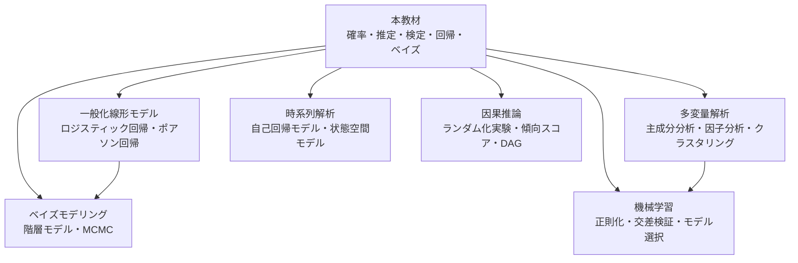

# 付録D 参考文献と次のステップ

## D.1 この教材の次に読む本

### 統計学の入門・基礎（日本語）

- 東京大学教養学部統計学教室 編『統計学入門』（基礎統計学 I）東京大学出版会, 1991.
    - 通称「赤本」。記述統計から推定・検定・回帰まで、日本の大学で長く使われてきた定番の教科書。本教材の第1〜19章の内容を、別の角度から復習できる。
- 東京大学教養学部統計学教室 編『人文・社会科学の統計学』（基礎統計学 II）東京大学出版会, 1994. ／『自然科学の統計学』（基礎統計学 III）東京大学出版会, 1992.
    - 分野ごとの応用例が豊富な続編。

### 数理統計学（本教材の第4部をさらに深く）

- 久保川達也『現代数理統計学の基礎』（共立講座 数学の魅力 11）共立出版, 2017.
    - 確率論の基礎から推定・検定の理論、ベイズ法まで、数理統計学を体系的に学べる。本教材の次の一冊として最適。
- 竹村彰通『新装改訂版 現代数理統計学』学術図書出版社, 2020.
    - 数理統計学の標準的な教科書。決定理論的な視点も含む。1991年に創文社から刊行された版を増補改訂したもの。
- G. Casella and R. L. Berger, *Statistical Inference*, 2nd ed., Duxbury, 2002.
    - 英語圏の大学院の定番教科書。演習問題が豊富。
- L. Wasserman, *All of Statistics: A Concise Course in Statistical Inference*, Springer Texts in Statistics, Springer, 2004.
    - 数理統計から機械学習に近い話題まで、コンパクトに一通り扱う。

### ベイズ統計

- 須山敦志 著、杉山将 監修『ベイズ推論による機械学習入門』（機械学習スタートアップシリーズ）講談社, 2017.
    - 共役事前分布を使ったベイズ推論を、機械学習の文脈でていねいに解説。
- A. Gelman, J. B. Carlin, H. S. Stern, D. B. Dunson, A. Vehtari and D. B. Rubin, *Bayesian Data Analysis*, 3rd ed., CRC Press, 2013.
    - ベイズ統計の実践的なバイブル。

## D.2 資格・検定

**統計検定**（日本統計学会公式認定）：<https://www.toukei-kentei.jp/>

### 統計検定との対応 { #toukei-kentei }

統計検定の各級の出題範囲表と、この教材の各章の対応です。

- ◎：章の中心的な内容が、その級の出題範囲表に含まれる
- ○：一部の節だけが含まれる（どの節かは下の「級ごとの読み方」）
- 空欄：その級の出題範囲表には挙がっていない

上の級は下の級の内容を前提にしています（準1級は2級の範囲を含みます）。
空欄でも、上の級を受けるなら読んでおく必要があります。
また、◎ はその章で試験対策が十分という意味ではありません。

| 章 | 3級 | 2級 | 準1級 | 1級（統計数理） |
|---|:-:|:-:|:-:|:-:|
| [第1章 データの種類と可視化](../part1/01-data-visualization.md) | ◎ | ◎ | | |
| [第2章 代表値と散らばり](../part1/02-summary-statistics.md) | ◎ | ◎ | | |
| [第3章 2つの変数の関係](../part1/03-correlation.md) | ◎ | ◎ | | |
| [第4章 確率の基本](../part2/04-probability.md) | ○ | ◎ | ◎ | ◎ |
| [第5章 確率変数と確率分布](../part2/05-random-variables.md) | ○ | ◎ | ◎ | ◎ |
| [第6章 期待値と分散](../part2/06-expectation.md) | ○ | ◎ | ◎ | ◎ |
| [第7章 代表的な離散分布](../part2/07-discrete-distributions.md) | ○ | ◎ | ◎ | ◎ |
| [第8章 代表的な連続分布](../part2/08-continuous-distributions.md) | ○ | ◎ | ◎ | ◎ |
| [第9章 多次元の確率分布](../part2/09-multivariate.md) | | ◎ | ◎ | ◎ |
| [第10章 確率変数の変換](../part2/10-transformation.md) | | ○ | ◎ | ◎ |
| [第11章 大数の法則](../part3/11-law-of-large-numbers.md) | | ◎ | ◎ | ◎ |
| [第12章 中心極限定理](../part3/12-central-limit-theorem.md) | ○ | ◎ | ◎ | ◎ |
| [第13章 母集団と標本分布](../part4/13-sampling-distributions.md) | ○ | ◎ | ◎ | ◎ |
| [第14章 点推定](../part4/14-point-estimation.md) | | ○ | ◎ | ◎ |
| [第15章 区間推定](../part4/15-interval-estimation.md) | ○ | ◎ | ◎ | ◎ |
| [第16章 仮説検定の考え方](../part4/16-hypothesis-testing.md) | ○ | ◎ | ◎ | ◎ |
| [第17章 いろいろな検定](../part4/17-various-tests.md) | | ◎ | ◎ | ◎ |
| [第18章 回帰分析](../part5/18-regression.md) | ○ | ◎ | ◎ | ◎ |
| [第19章 分散分析](../part5/19-anova.md) | | ◎ | ◎ | ◎ |
| [第20章 ベイズ統計入門](../part5/20-bayes.md) | | | ◎ | ◎ |

### 級ごとの読み方

- **3級**：第1〜3章に加えて、次の節を読みます。
  4.4〜4.5（条件付き確率と独立）、5.1〜5.4（確率変数）、6.1〜6.3（期待値と分散）、7.2（二項分布）、8.2（正規分布）、12.4（二項分布の正規近似）、13.2（標本平均の分布）、15.1・15.5（母平均・母比率の区間推定）、16.1〜16.3（検定の考え方と p 値）、18.1〜18.2（回帰直線）
- **2級**：第1〜19章が中心です。ただし次の節は準1級・1級向けなので、最初は読み飛ばしてかまいません。
  6.5（積率母関数）、8.4〜8.6（ガンマ分布・ベータ分布など）、9.5（条件付き期待値）、10.1〜10.2・10.4（10.3 の再生性は2級でも使います）、11.7（収束のいろいろ）、12.3（中心極限定理の証明）、12.7（デルタ法）、14.3〜14.7（モーメント法・最尤法・フィッシャー情報量など）、15.8、16.8〜16.9（ネイマン・ピアソンの補題・尤度比検定）、17.6（ノンパラメトリック検定）、19.5〜19.6（多重比較・二元配置）
- **準1級**：2級の範囲を含むので、全20章を読みます。2級で読み飛ばした節と第20章が、2級との差になる部分です。
- **1級（統計数理）**：第4〜20章と[付録A](math.md)が中心です。1級は論述式なので、折りたたまれた証明まで読み、自分で導出を書けるようにしてください。

### この教材では扱っていない・手薄な範囲

受ける級に合わせて、公式テキストや過去問で補ってください。

- **3級**：時系列データ（時系列グラフ・指数・移動平均）、標本調査と実験の考え方
- **2級**：3級の項目をより詳しくしたもの（成長率・幾何平均・コレログラムなどの時系列データの処理、層化抽出・クラスター抽出などの標本抽出法、フィッシャーの3原則・ブロック化などの実験計画）に加えて、ローレンツ曲線・ジニ係数、偏相関係数、相関係数の区間推定
- **準1級**：確率母関数・包除原理、ワルド検定・スコア検定、カルバック・ライブラー情報量、ジャックナイフ法・ブートストラップ法、回帰診断の詳細（てこ比・Cook の距離など）と一般化線形モデル（ロジスティック回帰など）、実験計画法、標本調査法、多変量解析、時系列解析、マルコフ連鎖と確率過程、分割表のモデル、欠測データ、モデル選択（AIC など）。符号付き順位検定やクラスカル・ウォリス検定などは名前の紹介にとどまります
- **1級（統計数理）**：確率母関数、ワルド型・スコア型検定、カルバック・ライブラー情報量と AIC、共分散分析、欠測・打ち切りデータ、ブートストラップなど。過去問で論述の練習をすることも欠かせません。分野別の **統計応用** は扱っていません

!!! note "準1級の出題範囲の改定（2027年1月1日から）"

    準1級の出題範囲表は2027年1月1日から改定され、概収束・分布収束、スルツキーの補題、バイアス・バリアンス分解、統計的因果推論などが加わります。
    このうち収束の種類は[第11章](../part3/11-law-of-large-numbers.md)（11.7）、バイアス・バリアンス分解は[第14章](../part4/14-point-estimation.md)（定理14.1 MSE の分解）で扱っています。スルツキーの補題と統計的因果推論は扱っていません。
    章ごとの対応表は、改定の前後で変わりません。

出典：統計検定の公式サイト（[3級](https://www.toukei-kentei.jp/exam/grade3/)・[2級](https://www.toukei-kentei.jp/exam/grade2/)・[準1級](https://www.toukei-kentei.jp/exam/grade1semi/)・[1級](https://www.toukei-kentei.jp/exam/grade1/)）で公開されている出題範囲表（2026年10月時点）。
範囲は改定されることがあるので、受験前に最新の範囲表を確認してください。

## D.3 次に学ぶとよいテーマ

本教材で学んだ内容は、次のような発展的なテーマの土台になります。



- **一般化線形モデル**：第18章の回帰分析を、2値データやカウントデータに拡張する。
- **多変量解析**：多数の変数の関係を要約する（主成分分析など）。第9章の多変量正規分布と行列の知識が役立つ。
- **時系列解析**：時間とともに変化するデータの分析。独立性の仮定を外した世界。
- **因果推論**：「相関と因果」（第3章）の問題に正面から取り組む。
- **ベイズモデリング**：第20章の考え方で、複雑な階層構造をもつモデルを作る。
- **機械学習**：予測を重視した統計的手法。過学習、正則化、交差検証などの考え方は、本教材の「偏りと分散のトレードオフ」（第14章）とつながっている。

## D.4 計算に使えるツール

この教材の図はすべて Python（NumPy・SciPy・Matplotlib）で作成しています。ソースコードは [GitHub リポジトリ](https://github.com/yasut0ra/learn-stats-ja) の `scripts/` にあります。

- **Python**：`scipy.stats` に主要な確率分布と検定がそろっている。`statsmodels` で回帰分析、`PyMC` でベイズ推論。
- **R**：統計解析のための言語。`t.test()`、`chisq.test()`、`lm()` など、本教材の手法がすべて標準で使える。
- **表計算ソフト**：Excel や Google スプレッドシートにも `NORM.DIST`、`T.TEST` などの統計関数がある。

たとえば Python では、第17章の例題が次のように数行で計算できます。

```python
from scipy import stats

# 1標本 t 検定（第17章）
x = [102.3, 99.8, 101.5, 100.9, 98.7, 103.1, 100.2, 101.8, 99.5, 102.2]
print(stats.ttest_1samp(x, popmean=100))   # t = 2.232, p = 0.0525

# カイ二乗独立性検定（第17章）
table = [[30, 40], [35, 35], [40, 20]]
chi2, p, dof, expected = stats.chi2_contingency(table, correction=False)
print(chi2, p, dof)                        # 7.61, 0.022, 2

# 標準正規分布の上側 2.5% 点
print(stats.norm.ppf(0.975))               # 1.959963...
```
