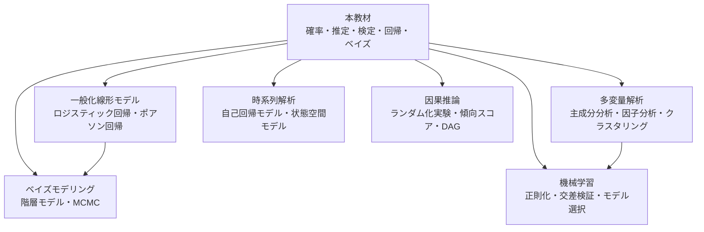

# 付録D 参考文献と次のステップ

## D.1 この教材の次に読む本

### 統計学の入門・基礎（日本語）

- 東京大学教養学部統計学教室 編『統計学入門』東京大学出版会, 1991.
    - 通称「赤本」。記述統計から推定・検定・回帰まで、日本の大学で長く使われてきた定番の教科書。本教材の第1〜19章の内容を、別の角度から復習できる。
- 東京大学教養学部統計学教室 編『人文・社会科学の統計学』東京大学出版会, 1994. ／『自然科学の統計学』東京大学出版会, 1992.
    - 分野ごとの応用例が豊富な続編。

### 数理統計学（本教材の第4部をさらに深く）

- 久保川達也『現代数理統計学の基礎』共立出版, 2017.
    - 確率論の基礎から推定・検定の理論、ベイズ法まで、数理統計学を体系的に学べる。本教材の次の一冊として最適。
- 竹村彰通『現代数理統計学』（新装改訂版）学術図書出版社, 2020.
    - 数理統計学の標準的な教科書。決定理論的な視点も含む。
- G. Casella and R. L. Berger, *Statistical Inference*, 2nd ed., Duxbury, 2002.
    - 英語圏の大学院の定番教科書。演習問題が豊富。
- L. Wasserman, *All of Statistics: A Concise Course in Statistical Inference*, Springer, 2004.
    - 数理統計から機械学習に近い話題まで、コンパクトに一通り扱う。

### ベイズ統計

- 須山敦志『ベイズ推論による機械学習入門』講談社, 2017.
    - 共役事前分布を使ったベイズ推論を、機械学習の文脈でていねいに解説。
- A. Gelman et al., *Bayesian Data Analysis*, 3rd ed., CRC Press, 2013.
    - ベイズ統計の実践的なバイブル。

## D.2 資格・検定

- **統計検定**（日本統計学会公式認定）：<https://www.toukei-kentei.jp/>
    - 本教材の第1〜19章はおおむね「統計検定2級」の範囲を、第4部の理論（最尤法・フィッシャー情報量・ネイマン・ピアソンの補題など）は「準1級」「1級（数理統計）」の範囲の基礎をカバーしています。

## D.3 次に学ぶとよいテーマ

本教材で学んだ内容は、次のような発展的なテーマの土台になります。



- **一般化線形モデル**：第18章の回帰分析を、2値データやカウントデータに拡張する。
- **多変量解析**：多数の変数の関係を要約する（主成分分析など）。第9章の多変量正規分布と行列の知識が役立つ。
- **時系列解析**：時間とともに変化するデータの分析。独立性の仮定を外した世界。
- **因果推論**：「相関と因果」（第3章）の問題に正面から取り組む。
- **ベイズモデリング**：第20章の考え方で、複雑な階層構造をもつモデルを作る。
- **機械学習**：予測を重視した統計的手法。過学習、正則化、交差検証などの考え方は、本教材の「偏りと分散のトレードオフ」（第14章）とつながっている。

## D.4 計算に使えるツール

この教材の図はすべて Python（NumPy・SciPy・Matplotlib）で作成しています。ソースコードは [GitHub リポジトリ](https://github.com/yasut0ra/learn-stats-ja) の `scripts/` にあります。

- **Python**：`scipy.stats` に主要な確率分布と検定がそろっている。`statsmodels` で回帰分析、`PyMC` でベイズ推論。
- **R**：統計解析のための言語。`t.test()`、`chisq.test()`、`lm()` など、本教材の手法がすべて標準で使える。
- **表計算ソフト**：Excel や Google スプレッドシートにも `NORM.DIST`、`T.TEST` などの統計関数がある。

たとえば Python では、第17章の例題が次のように数行で計算できます。

```python
from scipy import stats

# 1標本 t 検定（第17章）
x = [102.3, 99.8, 101.5, 100.9, 98.7, 103.1, 100.2, 101.8, 99.5, 102.2]
print(stats.ttest_1samp(x, popmean=100))   # t = 2.232, p = 0.0525

# カイ二乗独立性検定（第17章）
table = [[30, 40], [35, 35], [40, 20]]
chi2, p, dof, expected = stats.chi2_contingency(table, correction=False)
print(chi2, p, dof)                        # 7.61, 0.022, 2

# 標準正規分布の上側 2.5% 点
print(stats.norm.ppf(0.975))               # 1.959963...
```
