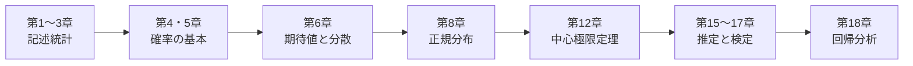

# この教材の使い方

## 誰のための教材か

- 統計学を初めて学ぶ人、または一度挫折した人
- 公式は覚えたけれど「なぜそうなるのか」がわからないままの人
- 統計検定や大学院入試に向けて、数理統計学の基礎を固めたい人

数式は避けずに使いますが、**数式が出てきたら必ず図や具体例で意味を確かめる** ように構成しています。

## 本文の読み方

本文には、次のようなボックスが登場します。

!!! definition "定義"
    用語や記号の正確な意味。ここがあいまいだと先に進めなくなるので、ていねいに読みましょう。

!!! theorem "定理"
    数学的に証明できる重要な性質。まずは主張の意味を理解しましょう。

??? proof "証明（クリックで開く）"
    定理の証明は折りたたんであります。1回目は飛ばして先に進み、全体像がつかめてから戻ってくる読み方もおすすめです。
    ただし、第4部（推測統計）の理論を本当に理解したい人は、ぜひ証明も追ってみてください。

!!! point "ポイント"
    特に大事な考え方や、他の章とのつながり。

!!! warning "注意"
    よくある誤解や、間違えやすいポイント。

!!! demo "シミュレーション"
    ブラウザで動かせるシミュレーション。スライダーやボタンを操作して、理論を体感しましょう。

!!! exercise "練習問題"
    各章末にあります。解答は折りたたんであるので、自分で考えてから開きましょう。

    ??? success "解答"
        ここに解答があります。

## おすすめの進め方

### じっくり全部学ぶ（標準コース）

第1章から順に読み進めます。各章の練習問題を解き、シミュレーションで手を動かしましょう。

### まず使えるようになりたい（速習コース）

証明は読み飛ばし、次の章を中心に読みます。

### 数理統計を固めたい（理論コース）

第2部〜第4部を重点的に読み、すべての証明を追います。特に次の章が中心です。

- 第6章（積率母関数）、第9章（多次元分布）、第10章（変数変換）
- 第11章・第12章（極限定理の証明）
- 第13章（標本分布の定理）、第14章（最尤法・クラメール・ラオの不等式）、第16章（ネイマン・ピアソンの補題・尤度比検定）

## 前提となる数学

高校の数学II・B 程度の微分積分（多項式・指数関数・対数関数の微分と積分）がわかれば読み進められます。
Σ記号、組合せ、テイラー展開、ガウス積分、行列などは [付録A 数学の準備](appendix/math.md) にまとめてあるので、必要に応じて参照してください。

## 図とシミュレーションについて

- 本文中の図は、すべて Python（NumPy・SciPy・Matplotlib）で作成しています。図を作るコードは [GitHub](https://github.com/yasut0ra/learn-stats-ja/tree/main/scripts) で公開しているので、パラメータを変えて自分で描き直すこともできます。
- シミュレーションは外部ライブラリを使わない JavaScript で書かれており、ブラウザだけで動きます。乱数を使うので、実行するたびに結果が変わります。それ自体が「偶然のぶれ」を体験する教材になっています。

## 誤りを見つけたら

誤字・計算ミス・わかりにくい説明などを見つけたら、[GitHub の Issue](https://github.com/yasut0ra/learn-stats-ja/issues) で教えてください。
各ページ右上の編集ボタンから、修正の提案（Pull Request）を送ることもできます。
