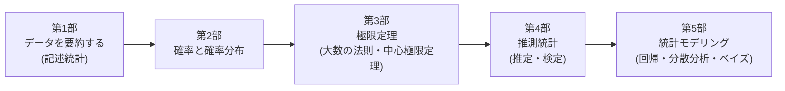

---
hide:
  - navigation
---

# やさしく学ぶ統計学

**記述統計から数理統計まで、図とシミュレーションで直感的に学ぶ無料の統計学教材です。**

「平均と分散」から始めて、確率・確率分布、大数の法則と中心極限定理、推定と検定、回帰分析、ベイズ統計まで、
**「なぜその公式になるのか」がわかる** ところまで、ひとつながりの道筋で学べるように作りました。

-   :material-chart-bell-curve:{ .lg .middle } __図が豊富__

    ---

    120点以上の図で、数式の意味を「見て」理解できます。分布の形、信頼区間の意味、検定の仕組みも一目でわかります。

-   :material-flask-outline:{ .lg .middle } __動かして体感__

    ---

    ブラウザで動く12個のシミュレーションを用意。中心極限定理や信頼区間、検出力を、自分で手を動かして確かめられます。

-   :material-book-open-variant:{ .lg .middle } __数理統計までしっかり__

    ---

    最尤法、フィッシャー情報量、クラメール・ラオの不等式、ネイマン・ピアソンの補題まで、証明つきで扱います（証明は折りたたみ式）。

-   :material-head-question-outline:{ .lg .middle } __練習問題つき__

    ---

    全章に解答つきの練習問題があります。理解度を確かめながら進めましょう。

## 学習の道のり

## 目次

### 第1部 データを要約する

| 章 | 内容 |
|---|---|
| [第1章 データの種類と可視化](part1/01-data-visualization.md) | 母集団と標本、変数の種類、度数分布表とヒストグラム |
| [第2章 代表値と散らばり](part1/02-summary-statistics.md) | 平均・中央値、分散・標準偏差、箱ひげ図、標準化 |
| [第3章 2つの変数の関係](part1/03-correlation.md) | 散布図、共分散、相関係数、相関と因果 |

### 第2部 確率と確率分布

| 章 | 内容 |
|---|---|
| [第4章 確率の基本](part2/04-probability.md) | 確率の公理、条件付き確率、独立、ベイズの定理 |
| [第5章 確率変数と確率分布](part2/05-random-variables.md) | 確率関数、確率密度関数、累積分布関数 |
| [第6章 期待値と分散](part2/06-expectation.md) | 期待値の線形性、チェビシェフの不等式、積率母関数 |
| [第7章 代表的な離散分布](part2/07-discrete-distributions.md) | 二項分布、ポアソン分布、幾何分布、超幾何分布 |
| [第8章 代表的な連続分布](part2/08-continuous-distributions.md) | 正規分布、指数分布、ガンマ分布、ベータ分布 |
| [第9章 多次元の確率分布](part2/09-multivariate.md) | 同時分布、独立、共分散、条件付き期待値、2変量正規分布 |
| [第10章 確率変数の変換](part2/10-transformation.md) | 変数変換、ヤコビアン、畳み込み、再生性 |

### 第3部 極限定理

| 章 | 内容 |
|---|---|
| [第11章 大数の法則](part3/11-law-of-large-numbers.md) | 確率収束、大数の弱法則の証明、モンテカルロ法 |
| [第12章 中心極限定理](part3/12-central-limit-theorem.md) | 分布収束、中心極限定理の証明、正規近似、デルタ法 |

### 第4部 推測統計

| 章 | 内容 |
|---|---|
| [第13章 母集団と標本分布](part4/13-sampling-distributions.md) | 不偏分散、カイ二乗分布、$t$ 分布、$F$ 分布 |
| [第14章 点推定](part4/14-point-estimation.md) | 不偏性・一致性・有効性、最尤法、クラメール・ラオの不等式 |
| [第15章 区間推定](part4/15-interval-estimation.md) | 信頼区間の意味、母平均・母比率・母分散の区間推定 |
| [第16章 仮説検定の考え方](part4/16-hypothesis-testing.md) | $p$ 値、2種類の過誤、検出力、ネイマン・ピアソンの補題 |
| [第17章 いろいろな検定](part4/17-various-tests.md) | $t$ 検定、カイ二乗検定、ノンパラメトリック検定 |

### 第5部 統計モデリング

| 章 | 内容 |
|---|---|
| [第18章 回帰分析](part5/18-regression.md) | 最小二乗法、決定係数、回帰係数の推測、重回帰 |
| [第19章 分散分析](part5/19-anova.md) | 平方和の分解、$F$ 検定、多重比較、交互作用 |
| [第20章 ベイズ統計入門](part5/20-bayes.md) | 事前分布と事後分布、共役事前分布、信用区間 |

### 付録

[付録A 数学の準備](appendix/math.md) ／ [付録B 確率分布一覧と数表](appendix/distributions.md) ／ [付録C 記号と用語](appendix/glossary.md) ／ [付録D 参考文献と次のステップ](appendix/references.md)

## この教材について

- **対象**：統計学を初めて学ぶ大学生・社会人、統計検定（2級〜準1級）を目指す人、数理統計学の基礎を固めたい人
- **前提知識**：高校数学（数学II・B 程度の微分積分）。必要な数学は [付録A](appendix/math.md) にまとめています。
- **進め方**：はじめての人は [この教材の使い方](guide.md) を読んでから始めてください。

本文は [CC BY 4.0](https://creativecommons.org/licenses/by/4.0/deed.ja)、図を生成するコードとシミュレーションは MIT ライセンスで公開しています。
誤りの指摘や改善の提案は [GitHub](https://github.com/yasut0ra/learn-stats-ja/issues) の Issue でお気軽にどうぞ。
