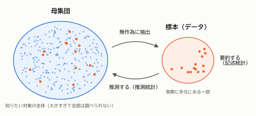
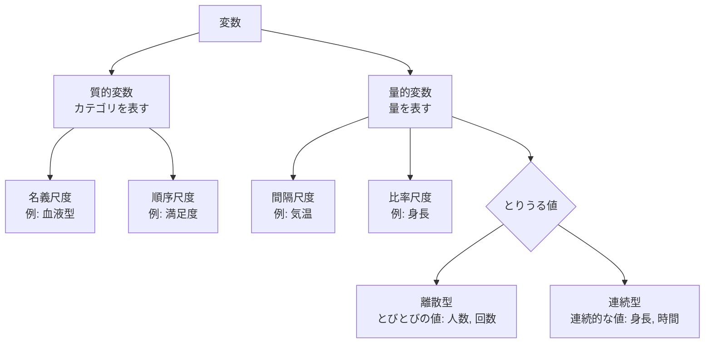
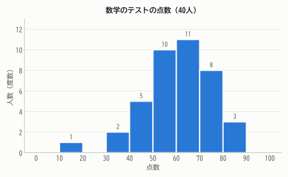
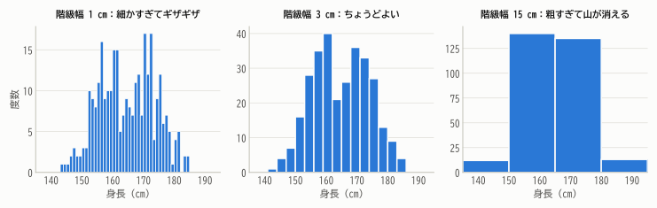
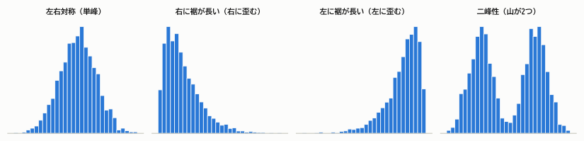
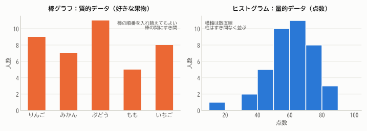
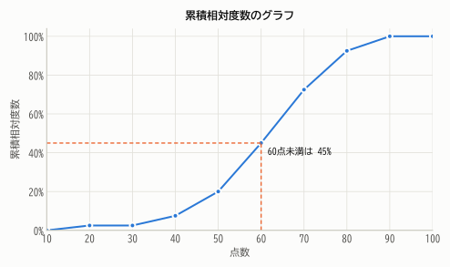
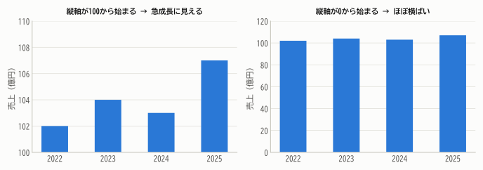

# 第1章 データの種類と可視化

!!! abstract "この章で学ぶこと"
    - 統計学の2本柱「記述統計」と「推測統計」の違い
    - データ（変数）の種類と、それぞれに使える分析
    - 度数分布表とヒストグラムの作り方・読み方
    - グラフにだまされないための注意点

## 1.1 統計学は何をする学問か

「日本の高校生は1日に平均何分スマートフォンを使っているのだろう？」——こんな疑問に答えたいとします。
いちばん確実なのは全国の高校生 **全員** に聞くことですが、約300万人に聞いて回るのは現実的ではありません。
そこで、たとえば1000人を **くじ引きのように偏りなく選んで** 調べ、その結果から全体の様子を推し量ります。

このとき、

- 本当に知りたい対象全体を **母集団**（population）
- 実際に調べた一部を **標本**（sample）

と呼びます。

<figure markdown="span">
  { width="720" }
  <figcaption>図1.1 母集団から標本を抽出し、標本から母集団を推測する。手元の標本を要約するのが記述統計、標本から母集団を推し量るのが推測統計。</figcaption>
</figure>

統計学は大きく次の2つに分かれます。

| | 記述統計（descriptive statistics） | 推測統計（inferential statistics） |
|---|---|---|
| 目的 | 手元のデータの特徴を **要約・可視化** する | 標本から **母集団について推測** する |
| 道具 | 表・グラフ・平均・分散・相関係数 など | 確率論・推定・検定・回帰分析 など |
| 本教材 | 第1部（第1〜3章） | 第4〜5部（第13章以降） |

推測統計では「標本はたまたま選ばれた一部なので、結果には **偶然のぶれ** が含まれる」ことを正面から扱います。
そのぶれを測るための言語が **確率** です。そこで本教材では、第2部・第3部で確率論をじっくり学んでから推測統計に進みます。
遠回りに見えますが、これが「なぜその公式になるのか」を本当に理解するための近道です。

!!! point "統計学の全体像"
    **記述統計**で「データを眺める目」を養い、**確率論**で「偶然を測るものさし」を手に入れ、
    **推測統計**で「一部から全体を語る方法」を学ぶ——これが本教材の道のりです。

## 1.2 データの種類

### 個体・変数・観測値

データは多くの場合、次のような表の形をしています。

| 生徒 | 学年 | 部活 | 身長 (cm) | 数学の点数 | 満足度（5段階） |
|---|---|---|---|---|---|
| A | 1年 | 吹奏楽 | 158.2 | 62 | 4 |
| B | 2年 | サッカー | 171.5 | 48 | 3 |
| C | 1年 | 美術 | 163.0 | 75 | 5 |
| ⋮ | ⋮ | ⋮ | ⋮ | ⋮ | ⋮ |

- 1行1行の調べた対象（ここでは生徒）を **個体**（観測単位）といいます。
- 1列1列の調べた項目（学年、身長、……）を **変数**（variable）といいます。
- 表の中の1つ1つの値を **観測値** といいます。

### 質的変数と量的変数

変数は、値の性質によって大きく2種類に分かれます。

- **質的変数**（カテゴリカル変数）：値が「種類」や「区分」を表すもの。例：部活、血液型、満足度
- **量的変数**（数値変数）：値が「量」を表し、足し引きに意味があるもの。例：身長、点数、年収

さらに細かく、次の4つの **尺度** に分ける考え方があります。

| 尺度 | 種類 | 意味 | 例 | 意味のある操作 |
|---|---|---|---|---|
| 名義尺度 | 質的 | 区別のためのラベル | 血液型、部活、郵便番号 | 同じ／違う、度数を数える |
| 順序尺度 | 質的 | 順序に意味がある | 満足度（5段階）、成績の評定、順位 | ＋ 大小比較、中央値 |
| 間隔尺度 | 量的 | 差に意味がある（0は便宜的） | 気温（℃）、西暦、偏差値 | ＋ 足し算・引き算、平均 |
| 比率尺度 | 量的 | 0が「無」を表し、比にも意味がある | 身長、体重、年収、時間 | ＋ 掛け算・割り算（「2倍」と言える） |

たとえば、気温 20℃ は 10℃ の「2倍暑い」とはいえません（0℃ は「温度がない」状態ではないからです）。
一方、体重 60 kg は 30 kg の「2倍重い」といえます。これが間隔尺度と比率尺度の違いです。

!!! warning "数字で書かれていても量的とは限らない"
    郵便番号や背番号は数字で書かれていますが、足したり平均したりしても意味がありません。名義尺度です。
    また満足度（1〜5）の平均はよく計算されますが、「1と2の差」と「4と5の差」が等しいとは限らないので、本来は注意が必要です。



量的変数はさらに、

- **離散型**：とびとびの値しかとらない（例：家族の人数、サイコロの目、1日のメール件数）
- **連続型**：ある範囲の任意の実数値をとりうる（例：身長、時間、重さ）

に分けられます。この区別は、第5章で確率分布を学ぶときに「確率関数」と「確率密度関数」の違いとして再び登場します。

## 1.3 度数分布表

ここから先は、次のデータを例にします。あるクラス40人の数学のテストの点数（100点満点）を小さい順に並べたものです。

```text
18  33  35  40  43  45  46  49  50  51
51  53  54  55  56  57  58  59  60  60
60  62  63  64  65  66  67  68  69  70
70  72  72  75  75  77  79  81  84  88
```

数字が40個並んでいるだけでは、全体の様子はなかなかつかめません。そこで、点数をいくつかの区間（**階級**）に分け、
各階級に入る人数（**度数**）を数えた表を作ります。これを **度数分布表** といいます。

| 階級（点） | 階級値 | 度数 | 相対度数 | 累積度数 | 累積相対度数 |
|---|---:|---:|---:|---:|---:|
| 10 以上 20 未満 | 15 | 1 | 0.025 | 1 | 0.025 |
| 20 〜 30 | 25 | 0 | 0.000 | 1 | 0.025 |
| 30 〜 40 | 35 | 2 | 0.050 | 3 | 0.075 |
| 40 〜 50 | 45 | 5 | 0.125 | 8 | 0.200 |
| 50 〜 60 | 55 | 10 | 0.250 | 18 | 0.450 |
| 60 〜 70 | 65 | 11 | 0.275 | 29 | 0.725 |
| 70 〜 80 | 75 | 8 | 0.200 | 37 | 0.925 |
| 80 〜 90 | 85 | 3 | 0.075 | 40 | 1.000 |
| **合計** | | **40** | **1.000** | | |

用語を整理しておきましょう。

!!! definition "定義 1.1（度数分布表の用語）"
    - **階級**：データを区切る区間。ふつう「$a$ 以上 $b$ 未満」のように境界の扱いを決めておく。
    - **階級幅**：階級の幅 $b-a$。
    - **階級値**：階級の真ん中の値 $(a+b)/2$。その階級を代表する値として使う。
    - **度数** $f_i$：階級 $i$ に入る観測値の個数。
    - **相対度数**：度数を全体の個数 $n$ で割ったもの $f_i / n$。全体に占める割合。
    - **累積度数**：その階級までの度数の合計。**累積相対度数**はそれを $n$ で割ったもの。

相対度数を使うと、人数の違うクラス同士でも「割合」で比べられます。相対度数の合計は必ず 1 になります。

## 1.4 ヒストグラム

度数分布表を柱の高さで表したグラフが **ヒストグラム** です。

<figure markdown="span">
  { width="640" }
  <figcaption>図1.2 40人の点数のヒストグラム。60点台がいちばん多く、そこから左右に減っていく「山型」の分布であることが一目でわかる。</figcaption>
</figure>

数字の羅列ではわからなかった「60点前後に集中している」「20点未満の人が1人だけ離れている」といった特徴が、図にすると一目でわかります。

### ヒストグラムは「面積」で度数を表す

ヒストグラムで本当に度数を表しているのは、柱の **高さ** ではなく **面積** です。
階級幅がすべて等しいときは面積と高さが比例するので、高さで読んでも問題ありません。
しかし、階級幅が異なる場合には注意が必要です。

たとえば上の表で、人数の少ない「10〜50点」をまとめて1つの階級（幅40、度数8）にしたとします。
このとき柱の高さを度数8にしてしまうと、幅が4倍あるので面積が大きくなりすぎ、10〜50点の人がとても多いかのように見えてしまいます。
正しくは高さを

$$
\text{高さ} = \frac{\text{度数}}{\text{階級幅}}
$$

とします（幅10あたりに換算するなら $8 \div 4 = 2$）。この「単位幅あたりの度数」を **度数密度** といいます。

!!! point "あとで効いてくる考え方"
    「面積が量（度数・割合）を表し、高さは密度を表す」という考え方は、第5章の **確率密度関数** にそのままつながります。
    ヒストグラムの階級幅をどんどん細かくし、全体の面積が 1 になるように縦軸をそろえていくと、なめらかな曲線——確率密度関数——が現れます。

### 階級幅の決め方

同じデータでも、階級幅の決め方によってヒストグラムの見え方は大きく変わります。
次の図は、ある300人の身長データを3通りの階級幅で描いたものです。

<figure markdown="span">
  { width="860" }
  <figcaption>図1.3 階級幅が細かすぎると偶然のでこぼこが目立ち、粗すぎると「山が2つある」という重要な特徴が消えてしまう。</figcaption>
</figure>

中央の図では山が2つあることがはっきりわかります（実はこのデータは、身長の分布が異なる2つのグループが混ざったものです）。
しかし右の図では、その特徴が完全に見えなくなっています。

階級の数の目安として **スタージェスの公式**

$$
k \approx 1 + \log_2 n
$$

がよく知られています（$n$ はデータの個数、$k$ は階級の数）。$n = 40$ なら $1 + \log_2 40 \approx 6.3$ なので、6〜7個程度が目安です。
ただしこれはあくまで目安で、実際にはいくつかの幅を試して、データの特徴がよく見えるものを選ぶのが大切です。

## 1.5 分布の形を読む

ヒストグラムを見たら、次の3点に注目しましょう。

1. **中心**：どのあたりに値が集まっているか
2. **広がり**：値がどのくらい散らばっているか
3. **形**：左右対称か、歪んでいるか、山はいくつあるか、飛び離れた値（**外れ値**）はないか

<figure markdown="span">
  { width="900" }
  <figcaption>図1.4 分布の代表的な形。歪みは「裾が長く伸びている側」で呼ぶ。</figcaption>
</figure>

- **左右対称**：身長（男女別）、測定誤差 など
- **右に裾が長い**（右に歪んだ分布）：所得、住宅価格、待ち時間 など。少数の非常に大きな値が右側に長い裾を作る。
- **左に裾が長い**（左に歪んだ分布）：易しいテストの点数、寿命 など。上限近くに多くが集まる。
- **二峰性**：性質の異なる2つのグループが混ざっているサイン。グループに分けて分析し直すとよい。

!!! warning "歪みの向きの呼び方"
    「右に歪む」は山の頂上が右にあるのではなく、**裾が右に長い** ことを指します。山の頂上はむしろ左に寄ります。
    混乱しやすいので「裾の長い方」と覚えましょう。

## 1.6 質的データのグラフ

質的変数のデータは、各カテゴリの度数を **棒グラフ** で表すのが基本です。全体に占める割合を見せたいときは **帯グラフ** や **円グラフ** も使われます。

<figure markdown="span">
  { width="820" }
  <figcaption>図1.5 棒グラフ（左）とヒストグラム（右）は似ているが別物。棒グラフの横軸はカテゴリ、ヒストグラムの横軸は数直線。</figcaption>
</figure>

| | 棒グラフ | ヒストグラム |
|---|---|---|
| データ | 質的変数（カテゴリ） | 量的変数 |
| 横軸 | カテゴリ（並べ替えてもよい） | 数直線（順序は変えられない） |
| 柱のすき間 | あける | あけない（数直線は連続しているので） |
| 量を表すもの | 棒の高さ | 柱の面積 |

## 1.7 累積相対度数のグラフ

「60点未満の人は全体の何％か？」のような問いには、**累積相対度数** のグラフが便利です。
各階級の右端（上限）の位置に累積相対度数をとって、点を折れ線で結びます。

<figure markdown="span">
  { width="640" }
  <figcaption>図1.6 累積相対度数のグラフ。横軸の値 $x$ に対して「$x$ 未満の人の割合」を読み取れる。グラフは必ず右上がり（減少しない）で、最後は100%に達する。</figcaption>
</figure>

グラフから「60点未満は45%」「80点未満は92.5%」と読み取れます。逆に、縦軸50%に対応する横軸の値を読めば、ちょうど真ん中の人の点数（第2章で学ぶ **中央値**）の見当がつきます。

このグラフは第5章で学ぶ **累積分布関数** の原型です。

## 1.8 グラフにだまされないために

グラフは強力な道具ですが、作り方次第で印象を大きく操作できてしまいます。

<figure markdown="span">
  { width="780" }
  <figcaption>図1.7 まったく同じデータでも、縦軸の始点を変えるだけで印象が大きく変わる。</figcaption>
</figure>

グラフを見るとき・作るときは、次の点をチェックしましょう。

- **縦軸の始点**：棒グラフの縦軸は原則 0 から始める（棒の長さで量を比べるため）。
- **3D・遠近法**：立体的な円グラフは、手前の扇形が大きく見えてしまう。使わない。
- **面積や体積での誇張**：値が2倍になったことを、絵の縦横をそれぞれ2倍にして表すと面積は4倍に見える。
- **二重軸**：左右で異なる目盛りの縦軸を持つグラフは、目盛りの取り方次第で「相関しているように」見せられる。
- **データの出どころと母数**：「満足度90%」でも、回答者が10人なのか1万人なのかで意味が変わる。

## まとめ

- 統計学は、手元のデータを要約する **記述統計** と、標本から母集団を推し量る **推測統計** の2本柱からなる。
- 変数は **質的変数**（名義・順序尺度）と **量的変数**（間隔・比率尺度）に分かれ、使える分析が異なる。量的変数はさらに離散型と連続型に分かれる。
- **度数分布表** と **ヒストグラム** で分布の中心・広がり・形をつかむ。ヒストグラムは **面積** で度数を表す。
- 階級幅を変えると見え方が変わる。いくつか試して特徴がよく見えるものを選ぶ。
- 累積相対度数のグラフは「$x$ 未満の割合」を読むのに便利で、累積分布関数の原型になる。

## 練習問題

!!! exercise "問題 1.1（変数の種類）"
    次の変数は、名義尺度・順序尺度・間隔尺度・比率尺度のどれにあたりますか。

    (1) 血液型　(2) 気温（℃）　(3) 年収　(4) アンケートの満足度（とても不満〜とても満足の5段階）　(5) 電話番号　(6) 100 m 走のタイム　(7) マラソンの順位

    ??? success "解答"
        (1) 名義尺度　(2) 間隔尺度　(3) 比率尺度　(4) 順序尺度　(5) 名義尺度　(6) 比率尺度　(7) 順序尺度

        (6) のタイムは 0 秒が「時間がゼロ」を意味するので比率尺度です（「2倍速い」といえる）。
        (7) の順位は順序には意味がありますが、1位と2位の差と2位と3位の差は等しいとは限らないので順序尺度です。

!!! exercise "問題 1.2（度数分布表を読む）"
    本文の度数分布表について、次の問いに答えてください。

    (1) 70点以上の生徒は全体の何％ですか。
    (2) 点数の低い方から数えて20番目の生徒は、どの階級に入っていますか。

    ??? success "解答"
        (1) 70〜80点が8人、80〜90点が3人なので $(8+3)/40 = 0.275$、つまり 27.5% です。
        累積相対度数を使って $1 - 0.725 = 0.275$ と求めることもできます。

        (2) 累積度数を見ると、50〜60点の階級までで18人、60〜70点の階級までで29人です。
        20番目は19番目〜29番目の範囲に入るので、**60点以上70点未満** の階級です。

!!! exercise "問題 1.3（階級幅が異なるヒストグラム）"
    ある店の客の滞在時間を調べたところ、次の度数分布表が得られました。

    | 滞在時間（分） | 0〜10 | 10〜20 | 20〜30 | 30〜60 |
    |---|---|---|---|---|
    | 度数（人） | 12 | 18 | 9 | 15 |

    ヒストグラムを正しく描くには、各柱の高さをいくつにすればよいですか（「10分あたりの人数」で答えてください）。

    ??? success "解答"
        30〜60分の階級だけ幅が30分で、他の階級（幅10分）の3倍あります。面積が度数に比例するように、高さは

        - 0〜10, 10〜20, 20〜30：それぞれ 12, 18, 9
        - 30〜60：$15 \div 3 = 5$

        とします。高さを15にしてしまうと、長く滞在する客がとても多いという誤った印象を与えてしまいます。

!!! exercise "問題 1.4（分布の形）"
    次のデータのヒストグラムは、どのような形になると予想されますか。理由もあわせて答えてください。

    (1) ある国の世帯ごとの貯蓄額　(2) 小学1年生と6年生をまとめた児童の身長　(3) ほとんどの人が満点近くをとった易しい小テストの点数

    ??? success "解答"
        (1) **右に裾が長い**分布。多くの世帯は少額〜中程度で、ごく一部の世帯が非常に大きな額をもつため、右に長い裾ができます。

        (2) **二峰性**の分布。1年生（120 cm 前後）と6年生（145 cm 前後）で身長の分布の中心が大きく異なるため、山が2つ現れます。

        (3) **左に裾が長い**分布。満点という上限があり、多くの人が上限近くに集まる一方、一部の低い点数が左に裾を作ります。
