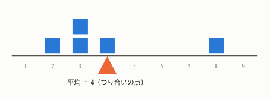
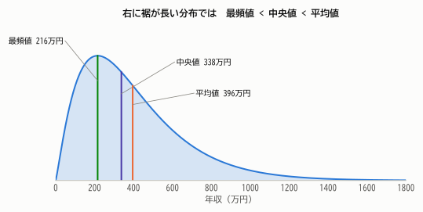
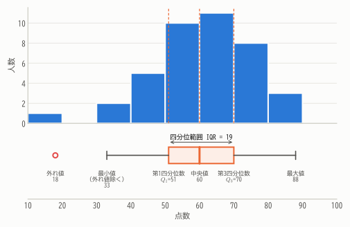
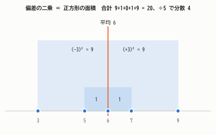
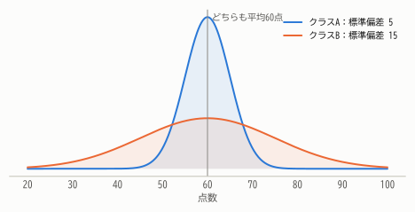
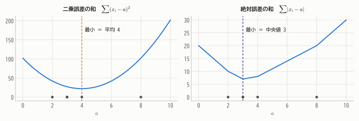
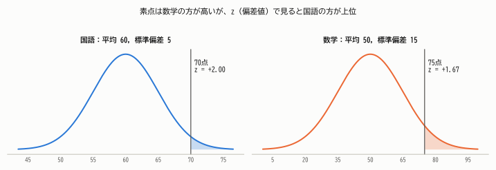

# 第2章 代表値と散らばり

!!! abstract "この章で学ぶこと"
    - データの「中心」を表す代表値：平均値・中央値・最頻値
    - データの「散らばり」を表す指標：範囲・四分位範囲・分散・標準偏差
    - 箱ひげ図の描き方と読み方
    - 平均値が「二乗誤差を最小にする値」であること
    - 標準化（$z$ 得点）と偏差値

第1章ではグラフでデータの様子をつかみました。この章では、分布の特徴を **1つの数値** に要約する方法を学びます。
要約の基本は「中心はどこか」と「どのくらい散らばっているか」の2つです。

## 2.1 データの中心を表す ― 代表値

### 平均値

$n$ 個のデータ $x_1, x_2, \dots, x_n$ の **平均値**（mean）は、すべてを足して個数で割ったものです。

!!! definition "定義 2.1（平均値）"
    $$
    \bar{x} = \frac{x_1 + x_2 + \cdots + x_n}{n} = \frac{1}{n}\sum_{i=1}^{n} x_i
    $$

    $\bar{x}$ は「エックス・バー」と読みます。

$\sum$（シグマ）は「足し合わせる」ことを表す記号で、$\sum_{i=1}^{n} x_i$ は「$i$ を 1 から $n$ まで動かして $x_i$ を全部足す」という意味です。
Σ記号に慣れていない人は [付録A 数学の準備](../appendix/math.md#sigma) を見てください。

第1章の40人のテストの点数では、合計が 2400 点なので平均値は $\bar{x} = 2400/40 = 60$ 点です。

### 平均値は「つり合いの点」

平均値には、物理的なわかりやすいイメージがあります。数直線を1本の板とみなし、データの位置に同じ重さのおもりを置くと、
**平均値の位置で板がちょうどつり合います**。

<figure markdown="span">
  { width="640" }
  <figcaption>図2.1 データ 2, 3, 3, 4, 8 をおもりとして置くと、平均値 4 の位置でつり合う。右端の 8 は1つだけでも支点から遠いので、平均を右に引っ張る力が強い。</figcaption>
</figure>

これを式で表したのが、次の性質です。各データと平均値との差 $x_i - \bar{x}$ を **偏差** といいます。

!!! theorem "定理 2.1（偏差の和は 0）"
    $$
    \sum_{i=1}^{n} (x_i - \bar{x}) = 0
    $$

??? proof "証明"
    $\sum$ は足し算なので、項ごとに分けられます。$\bar{x}$ は $i$ によらない定数なので $n$ 回足すと $n\bar{x}$ です。

    $$
    \sum_{i=1}^{n} (x_i - \bar{x}) = \sum_{i=1}^{n} x_i - n\bar{x} = n\bar{x} - n\bar{x} = 0
    $$

    （平均値の定義から $\sum x_i = n\bar{x}$ を使いました。）

図2.1でいえば、支点より左の「てこの力」（$-2, -1, -1, 0$ の合計 $-4$）と右の「てこの力」（$+4$）が打ち消し合っている、ということです。

### 中央値

データを小さい順に並べたとき、ちょうど真ん中にくる値を **中央値**（median）といいます。

!!! definition "定義 2.2（中央値）"
    データを小さい順に並べたものを $x_{(1)} \le x_{(2)} \le \cdots \le x_{(n)}$ とします。

    - $n$ が奇数のとき：真ん中の $x_{\left(\frac{n+1}{2}\right)}$
    - $n$ が偶数のとき：真ん中の2つの平均 $\dfrac{x_{\left(\frac{n}{2}\right)} + x_{\left(\frac{n}{2}+1\right)}}{2}$

40人の点数では $n = 40$ が偶数なので、20番目と21番目の平均をとって $(60 + 60)/2 = 60$ 点です。

### 最頻値

データの中で最も多く現れる値を **最頻値**（mode）といいます。40人の点数では 60 点が3人で最も多いので、最頻値は 60 点です。
度数分布表から求める場合は、度数が最大の階級の階級値を最頻値とします（この例では 60〜70 点の階級値 65 点）。

最頻値は質的変数（例：最も人気のある果物）にも使える唯一の代表値です。

### 平均値と中央値はどちらがよいか

5人の年収（万円）が次のようだったとします。

$$
300,\quad 350,\quad 400,\quad 450,\quad 3000
$$

平均値は $(300+350+400+450+3000)/5 = 900$ 万円ですが、5人中4人は 450 万円以下です。
一方、中央値は 400 万円で、「典型的な人」の感覚に近い値です。

平均値は1つの極端な値（**外れ値**）に強く引っ張られます（図2.1の「てこ」を思い出してください）。
中央値は順番だけで決まるので、最大値が 3000 万円でも 3 億円でも変わりません。このように外れ値の影響を受けにくい性質を **頑健性**（ロバスト性）といいます。

<figure markdown="span">
  { width="680" }
  <figcaption>図2.2 右に裾が長い分布（年収の分布のイメージ）では、長い裾に引っ張られて 最頻値 &lt; 中央値 &lt; 平均値 の順に並ぶ。左右対称な分布では3つはほぼ一致する。</figcaption>
</figure>

| 代表値 | 長所 | 短所 |
|---|---|---|
| 平均値 | すべてのデータを使う。数学的に扱いやすい | 外れ値に弱い |
| 中央値 | 外れ値に強い | 計算に並べ替えが必要。数学的な扱いがやや難しい |
| 最頻値 | 質的データにも使える | データが少ないと不安定。山が2つあると定まらない |

!!! point "どれを使うべき？"
    分布が左右対称に近ければ平均値、歪んでいたり外れ値があったりすれば中央値も併記する、のが基本です。
    「平均年収」と「年収の中央値」が大きく違うのは、所得の分布が右に歪んでいるからです。

### 度数分布表から平均を求める

元のデータがなく度数分布表しかないときは、各階級のデータがすべて階級値 $m_k$ に等しいとみなして計算します。

$$
\bar{x} \approx \frac{1}{n}\sum_{k} m_k f_k
$$

第1章の度数分布表では

$$
\frac{15 \times 1 + 35 \times 2 + 45 \times 5 + 55 \times 10 + 65 \times 11 + 75 \times 8 + 85 \times 3}{40} = \frac{2430}{40} = 60.75
$$

となり、元データの平均 60 点に近い値が得られます（階級内での値の偏りのぶんだけずれます）。

## 2.2 散らばりを表す（1）― 範囲・四分位数・箱ひげ図

平均値が同じでも、データの散らばり具合はさまざまです。代表値だけでなく、散らばりの指標もあわせて見ることが大切です。

### 範囲

最も簡単な指標は **範囲**（レンジ）= 最大値 − 最小値 です。40人の点数では $88 - 18 = 70$ 点です。
わかりやすい反面、最大値と最小値という2つの値だけで決まるので、外れ値の影響をまともに受けます。

### 四分位数と四分位範囲

データを小さい順に並べて4等分する位置の値を **四分位数** といいます。

!!! definition "定義 2.3（四分位数）"
    データを小さい順に並べ、中央値を境に前半と後半に分けます（$n$ が奇数のときは中央値自身はどちらにも含めない）。

    - **第1四分位数** $Q_1$：前半部分の中央値
    - **第2四分位数** $Q_2$：全体の中央値
    - **第3四分位数** $Q_3$：後半部分の中央値

    $Q_3 - Q_1$ を **四分位範囲**（IQR: interquartile range）といいます。

40人の点数では、前半20人の中央値は10番目と11番目の平均で $Q_1 = (51+51)/2 = 51$、
後半20人の中央値は30番目と31番目の平均で $Q_3 = (70+70)/2 = 70$ です。四分位範囲は $70 - 51 = 19$ 点です。

四分位範囲は「真ん中の50%のデータが収まる幅」を表し、両端の外れ値の影響を受けません。

!!! note "四分位数の定義は1つではない"
    四分位数の求め方にはいくつかの流儀があり、Excel の `QUARTILE.INC` や Python の `numpy.percentile` などは
    上の方法とは少し異なる値を返すことがあります。データが多ければ違いはわずかです。

### 箱ひげ図

**最小値・$Q_1$・中央値・$Q_3$・最大値** の5つの数（**五数要約**）を図にしたものが **箱ひげ図** です。

<figure markdown="span">
  { width="680" }
  <figcaption>図2.3 40人の点数のヒストグラム（上）と箱ひげ図（下）。箱の中に真ん中の半数（20人）が入る。18点は外れ値として別に描かれている。</figcaption>
</figure>

描き方は次の通りです。

1. $Q_1$ から $Q_3$ までを箱で描き、中央値の位置に線を引く。
2. 箱の両端から、最小値と最大値までひげを伸ばす。
3. ただし、外れ値の基準を設けて、それを超える値はひげに含めず点で描くことが多い。よく使われる基準は

    $$
    Q_1 - 1.5 \times \mathrm{IQR} \quad\text{より小さい}\quad\text{または}\quad Q_3 + 1.5 \times \mathrm{IQR}\quad\text{より大きい}
    $$

40人の点数では $51 - 1.5 \times 19 = 22.5$ なので、18 点は外れ値と判定されます。ひげは外れ値を除いた最小値 33 点まで伸ばします。

箱ひげ図はコンパクトなので、**複数のグループを並べて比較する** のに特に便利です（例：クラス別の点数の比較）。
ただし、山が2つあるかどうか（二峰性）は箱ひげ図からはわからないので、ヒストグラムとあわせて見るのが理想です。

## 2.3 散らばりを表す（2）― 分散と標準偏差

四分位範囲はデータの一部（順位）しか使いません。すべてのデータを使った散らばりの指標を作りましょう。

### 偏差の「平均」をとりたいが……

散らばりとは「各データが平均値からどのくらい離れているか」なので、偏差 $x_i - \bar{x}$ の平均をとればよさそうです。
ところが定理2.1より偏差の和は常に 0 なので、平均も 0 になってしまいます。プラスとマイナスが打ち消し合うからです。

符号を消す方法として、絶対値をとる方法と二乗する方法がありますが、統計学では主に **二乗** を使います。

!!! definition "定義 2.4（分散と標準偏差）"
    $$
    s^2 = \frac{1}{n}\sum_{i=1}^{n} (x_i - \bar{x})^2
    $$

    を **分散**（variance）といいます。偏差の二乗の平均です。分散の正の平方根

    $$
    s = \sqrt{s^2} = \sqrt{\frac{1}{n}\sum_{i=1}^{n} (x_i - \bar{x})^2}
    $$

    を **標準偏差**（standard deviation, SD）といいます。

### 具体例で計算してみる

データ $3, 5, 6, 7, 9$ の分散を求めます。平均は $\bar{x} = 30/5 = 6$ です。

| $x_i$ | 3 | 5 | 6 | 7 | 9 | 合計 |
|---|---:|---:|---:|---:|---:|---:|
| 偏差 $x_i - \bar{x}$ | $-3$ | $-1$ | $0$ | $1$ | $3$ | $0$ |
| 偏差の二乗 | 9 | 1 | 0 | 1 | 9 | 20 |

分散は $s^2 = 20/5 = 4$、標準偏差は $s = \sqrt{4} = 2$ です。

<figure markdown="span">
  { width="600" }
  <figcaption>図2.4 偏差の二乗は、平均値からの距離を1辺とする正方形の面積。分散はこの正方形の面積の平均であり、標準偏差は「平均的な正方形」の1辺の長さにあたる。</figcaption>
</figure>

二乗するので、平均から遠いデータほど大きな正方形になり、分散に大きく効きます。

### なぜ標準偏差を使うのか

分散は二乗しているので、単位も二乗になってしまいます（点数なら「点²」）。
平方根をとった標準偏差は **元のデータと同じ単位** になるので、「平均からだいたいこのくらい離れている」という感覚的な意味を持ちます。

40人の点数では分散 $s^2 = 210.6$、標準偏差 $s \approx 14.5$ 点です。「平均 60 点、だいたい ±15 点くらいの範囲に多くの人がいる」と読めます。

<figure markdown="span">
  { width="660" }
  <figcaption>図2.5 平均が同じでも、標準偏差が大きいほど分布は横に広がる。</figcaption>
</figure>

!!! point "標準偏差の目安"
    山型で左右対称に近い分布では、おおよそ

    - 平均 ± 1 標準偏差 の範囲に全体の約 **68%**
    - 平均 ± 2 標準偏差 の範囲に全体の約 **95%**

    のデータが入ります。これは第8章で学ぶ正規分布の性質です。

### 分散の計算公式

分散は次の形でも計算できます。手計算や理論的な計算でよく使う大切な公式です。

!!! theorem "定理 2.2（分散の計算公式）"
    $$
    s^2 = \overline{x^2} - \bar{x}^2 \qquad \left(\text{ただし } \overline{x^2} = \frac{1}{n}\sum_{i=1}^{n} x_i^2\right)
    $$

    つまり、**分散 ＝（2乗の平均）−（平均の2乗）** です。

??? proof "証明"
    $(x_i - \bar{x})^2 = x_i^2 - 2\bar{x}x_i + \bar{x}^2$ を展開して足し合わせます。

    $$
    \begin{aligned}
    s^2 &= \frac{1}{n}\sum_{i=1}^{n} \left(x_i^2 - 2\bar{x}x_i + \bar{x}^2\right) \\
        &= \frac{1}{n}\sum_{i=1}^{n} x_i^2 - 2\bar{x}\cdot\frac{1}{n}\sum_{i=1}^{n} x_i + \frac{1}{n}\cdot n\bar{x}^2 \\
        &= \overline{x^2} - 2\bar{x}\cdot\bar{x} + \bar{x}^2 = \overline{x^2} - \bar{x}^2
    \end{aligned}
    $$

先ほどのデータ $3, 5, 6, 7, 9$ で確かめると、2乗の平均は $(9 + 25 + 36 + 49 + 81)/5 = 40$ なので、$s^2 = 40 - 6^2 = 4$ となり一致します。

この公式は第6章で確率変数の分散 $V[X] = E[X^2] - (E[X])^2$ としてそのまま再登場します。

!!! note "$n$ で割るか、$n-1$ で割るか"
    分散の定義で $n$ ではなく $n-1$ で割ったもの

    $$
    u^2 = \frac{1}{n-1}\sum_{i=1}^{n}(x_i - \bar{x})^2
    $$

    を使うこともあり、**不偏分散** といいます。Excel の `VAR.S` や Python の `pandas` のデフォルトはこちらです。
    手元のデータそのものの散らばりを記述するなら $n$ で割り、標本から母集団の分散を推定するなら $n-1$ で割ります。
    なぜ $n-1$ なのかは第13章・第14章で詳しく説明します。

## 2.4 平均値と中央値の「最適性」

平均値や分散の定義は、天下り的に感じるかもしれません。実は、平均値には次のような自然な意味づけがあります。

「データ全体を1つの値 $a$ で代表させたい。代表させたときの誤差（ずれ）の合計をできるだけ小さくしたい」と考えます。
誤差を二乗で測るなら、$a$ の関数

$$
L(a) = \sum_{i=1}^{n} (x_i - a)^2
$$

を最小にする $a$ を探すことになります。

!!! theorem "定理 2.3（平均値は二乗誤差の和を最小にする）"
    任意の実数 $a$ について

    $$
    \sum_{i=1}^{n} (x_i - a)^2 = \sum_{i=1}^{n} (x_i - \bar{x})^2 + n(\bar{x} - a)^2
    $$

    が成り立ちます。したがって $L(a)$ は $a = \bar{x}$ のとき最小になり、その最小値は $n s^2$ です。

??? proof "証明"
    $x_i - a = (x_i - \bar{x}) + (\bar{x} - a)$ と分解して二乗します。

    $$
    \sum_{i=1}^{n} (x_i - a)^2 = \sum_{i=1}^{n} (x_i - \bar{x})^2 + 2(\bar{x} - a)\sum_{i=1}^{n}(x_i - \bar{x}) + n(\bar{x} - a)^2
    $$

    定理2.1より真ん中の項は 0 です。右辺第2項 $n(\bar{x}-a)^2$ は 0 以上で、$a = \bar{x}$ のときだけ 0 になります。

一方、誤差を絶対値で測った $\sum |x_i - a|$ を最小にするのは **中央値** です。
$a$ を少し右に動かすと、$a$ より左にあるデータとの距離は増え、右にあるデータとの距離は減ります。
左右のデータの個数が等しい点、つまり中央値で増減がつり合って最小になる、というわけです。

<figure markdown="span">
  { width="800" }
  <figcaption>図2.6 データ 2, 3, 3, 4, 8 について、代表値 $a$ を動かしたときの誤差の和。二乗誤差（左）は平均値 4 で、絶対誤差（右）は中央値 3 で最小になる。</figcaption>
</figure>

!!! point "この考え方は何度も登場する"
    「誤差の二乗和を最小にする値を選ぶ」という考え方は **最小二乗法** と呼ばれ、第18章の回帰分析の土台になります。
    定理2.3の分解（全体の平方和 ＝ 平均まわりの平方和 ＋ ずれの平方和）も、分散分析（第19章）などで形を変えて繰り返し現れます。

## 2.5 データの変換と標準化

### 1次変換で平均・標準偏差はどう変わるか

温度を摂氏（℃）から華氏（℉）に変換するには $F = 1.8C + 32$ とします。このような1次式による変換で、平均や標準偏差はどう変わるでしょうか。

!!! theorem "定理 2.4（1次変換と平均・分散）"
    データ $x_1, \dots, x_n$ を $y_i = a x_i + b$（$a, b$ は定数）と変換すると

    $$
    \bar{y} = a\bar{x} + b, \qquad s_y^2 = a^2 s_x^2, \qquad s_y = |a|\, s_x
    $$

??? proof "証明"
    平均：$\bar{y} = \frac{1}{n}\sum (a x_i + b) = a \cdot \frac{1}{n}\sum x_i + b = a\bar{x} + b$。

    分散：$y_i - \bar{y} = (a x_i + b) - (a\bar{x} + b) = a(x_i - \bar{x})$ なので

    $$
    s_y^2 = \frac{1}{n}\sum a^2 (x_i - \bar{x})^2 = a^2 s_x^2
    $$

直感的には、全員に $b$ を足す（平行移動）と中心は動くが散らばりは変わらず、全員を $a$ 倍する（拡大）と散らばりも $|a|$ 倍になる、ということです。

### 標準化と $z$ 得点

各データから平均を引き、標準偏差で割る変換

$$
z_i = \frac{x_i - \bar{x}}{s}
$$

を **標準化** といい、$z_i$ を **$z$ 得点**（標準得点）といいます。
定理2.4で $a = 1/s$、$b = -\bar{x}/s$ とすると、標準化したデータは **平均 0、標準偏差 1** になることがわかります。

$z$ 得点は「平均から標準偏差何個ぶん離れているか」を表すので、平均や散らばりの異なるデータ同士を比較できます。

**例**：A さんは国語で 70 点（クラス平均 60 点、標準偏差 5 点）、数学で 75 点（平均 50 点、標準偏差 15 点）をとりました。どちらが「よくできた」といえるでしょうか。

$$
z_{\text{国語}} = \frac{70 - 60}{5} = 2.0, \qquad z_{\text{数学}} = \frac{75 - 50}{15} \approx 1.67
$$

素点は数学の方が高いですが、クラスの中での位置で見ると国語の方が上位です。

<figure markdown="span">
  { width="820" }
  <figcaption>図2.7 色をつけた部分が「自分より上の人」の割合のイメージ。国語の方がその割合が小さい。</figcaption>
</figure>

日本でおなじみの **偏差値** は、$z$ 得点を平均 50、標準偏差 10 になるように変換したものです。

$$
\text{偏差値} = 50 + 10 z
$$

上の例では国語の偏差値は 70、数学の偏差値は約 66.7 です。

### 変動係数

ゾウの体重の標準偏差が 500 kg、ネズミの体重の標準偏差が 5 g だったとして、「ゾウの方が散らばりが大きい」というのは公平な比較ではありません。
平均の大きさが全く違うからです。そこで、標準偏差を平均で割った

$$
\mathrm{CV} = \frac{s}{\bar{x}}
$$

を **変動係数**（coefficient of variation）といい、平均に対する相対的な散らばりを表します（比率尺度のデータで使います）。

## 2.6 発展：どんなデータでも成り立つ不等式

「平均 ± 2 標準偏差に約 95%」は山型の分布での目安でした。では、分布の形がまったくわからないとき、何かいえるでしょうか。
実は、どんなデータに対しても次のことが成り立ちます。

!!! theorem "定理 2.5（チェビシェフの不等式：データ版）"
    任意の $k > 0$ について、平均値から $k$ 標準偏差以上離れたデータの割合は $1/k^2$ 以下です。

    $$
    \frac{\#\{i : |x_i - \bar{x}| \ge k s\}}{n} \le \frac{1}{k^2}
    $$

    （$\#\{\cdots\}$ は条件を満たすデータの個数を表します。）

??? proof "証明"
    条件 $|x_i - \bar{x}| \ge ks$ を満たすデータの集合を $A$、その個数を $m$ とします。分散の定義から

    $$
    n s^2 = \sum_{i=1}^{n} (x_i - \bar{x})^2 \ge \sum_{i \in A} (x_i - \bar{x})^2 \ge \sum_{i \in A} k^2 s^2 = m k^2 s^2
    $$

    1つめの不等号は「0 以上の項を捨てたので小さくなる」、2つめは「$A$ の中では $(x_i - \bar{x})^2 \ge k^2 s^2$」を使いました。
    両辺を $n k^2 s^2$ で割ると $m/n \le 1/k^2$ が得られます。

たとえば $k = 2$ とすると、**どんなデータでも** 平均 ± 2 標準偏差の外にあるデータは 25% 以下、つまり内側に 75% 以上が入ります。
山型の分布の 95% に比べると控えめな値ですが、分布の形を一切仮定していない点が強力です。
この不等式は確率の言葉に翻訳され、第11章で大数の法則を証明するときの鍵になります。

## まとめ

- 代表値には **平均値・中央値・最頻値** がある。平均値は外れ値に弱く、中央値は強い。右に歪んだ分布では 最頻値 < 中央値 < 平均値。
- 偏差の和は常に 0。平均値は「つり合いの点」であり、二乗誤差の和を最小にする値。
- 散らばりの指標には **範囲・四分位範囲・分散・標準偏差** がある。箱ひげ図は五数要約を図示したもの。
- 分散 ＝ 偏差の二乗の平均 ＝（2乗の平均）−（平均の2乗）。標準偏差は分散の平方根で、データと同じ単位をもつ。
- 1次変換 $y = ax + b$ で、平均は $a\bar{x} + b$、標準偏差は $|a|$ 倍になる。標準化すると平均 0、標準偏差 1。

## 練習問題

!!! exercise "問題 2.1（基本統計量の計算）"
    データ $4, 7, 7, 9, 13$ について、平均値・中央値・最頻値・分散・標準偏差を求めてください。

    ??? success "解答"
        - 平均値：$(4+7+7+9+13)/5 = 40/5 = 8$
        - 中央値：小さい順に並べて3番目なので 7
        - 最頻値：2回現れる 7
        - 分散：偏差は $-4, -1, -1, 1, 5$、その二乗の和は $16+1+1+1+25 = 44$ なので $s^2 = 44/5 = 8.8$
        - 標準偏差：$s = \sqrt{8.8} \approx 2.97$

        計算公式でも確かめましょう。2乗の平均は $(16+49+49+81+169)/5 = 364/5 = 72.8$ なので $s^2 = 72.8 - 64 = 8.8$。一致します。

!!! exercise "問題 2.2（平均の更新）"
    10人のグループの平均身長は 165 cm でした。ここに身長 187 cm の人が1人加わると、11人の平均身長はいくつになりますか。

    ??? success "解答"
        10人の合計は $165 \times 10 = 1650$ cm。11人の合計は $1650 + 187 = 1837$ cm なので、平均は $1837/11 = 167$ cm です。

!!! exercise "問題 2.3（単位の変換）"
    ある都市の1年間の日ごとの最高気温は、平均 20℃、標準偏差 5℃ でした。華氏（$F = 1.8C + 32$）に直すと、平均と標準偏差はいくつになりますか。

    ??? success "解答"
        定理2.4より、平均は $1.8 \times 20 + 32 = 68$ ℉、標準偏差は $1.8 \times 5 = 9$ ℉ です。
        標準偏差には $+32$ の平行移動は影響しないことに注意しましょう。

!!! exercise "問題 2.4（外れ値の判定）"
    あるデータの五数要約が、最小値 12、$Q_1 = 30$、中央値 36、$Q_3 = 42$、最大値 65 でした。
    「$Q_1 - 1.5\,\mathrm{IQR}$ 未満、または $Q_3 + 1.5\,\mathrm{IQR}$ より大」を外れ値の基準とするとき、最小値と最大値は外れ値ですか。

    ??? success "解答"
        $\mathrm{IQR} = 42 - 30 = 12$ なので、基準は下側 $30 - 18 = 12$、上側 $42 + 18 = 60$ です。
        最小値 12 はちょうど下側の基準と等しく「12 未満」ではないので外れ値ではありません。最大値 65 は 60 より大きいので外れ値です。

!!! exercise "問題 2.5（証明問題）"
    定理2.3を、$L(a) = \sum (x_i - a)^2$ を $a$ で微分する方法で示してください。

    ??? success "解答"
        $L(a)$ は $a$ の2次関数で、$a^2$ の係数は $n > 0$ なので下に凸です。微分すると

        $$
        L'(a) = \sum_{i=1}^{n} 2(x_i - a)(-1) = -2\left(\sum_{i=1}^{n} x_i - na\right)
        $$

        $L'(a) = 0$ とおくと $a = \frac{1}{n}\sum x_i = \bar{x}$。下に凸なので、ここで最小になります。

!!! exercise "問題 2.6（チェビシェフの不等式）"
    あるデータの平均が 50、標準偏差が 8 でした。分布の形がわからないとき、26 より大きく 74 より小さいデータの割合は少なくとも何％といえますか。

    ??? success "解答"
        $26 = 50 - 3 \times 8$、$74 = 50 + 3 \times 8$ なので、平均から 3 標準偏差以上離れたデータの割合は $1/3^2 = 1/9$ 以下です。
        よって内側のデータの割合は少なくとも $1 - 1/9 = 8/9 \approx 88.9\%$ です。
