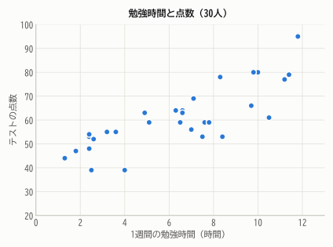
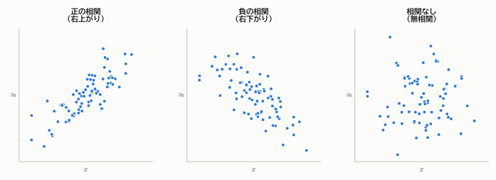
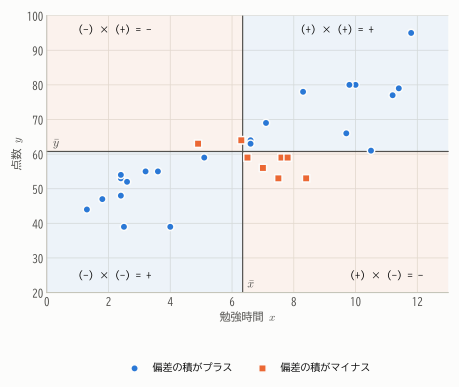
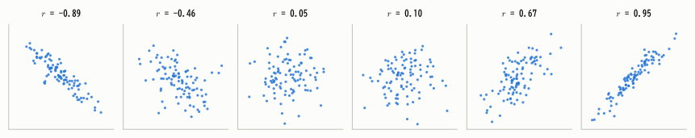
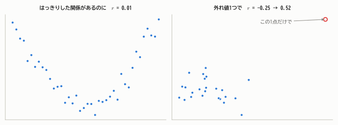
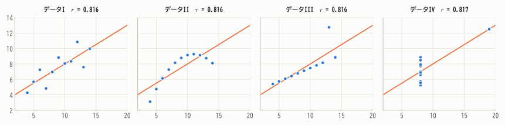
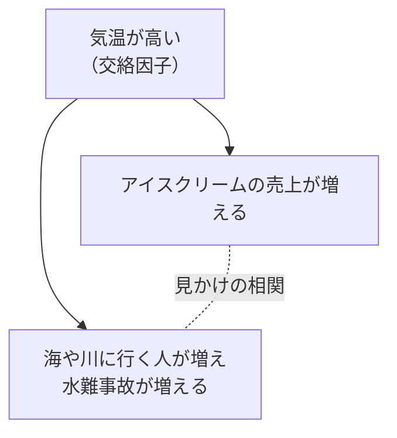
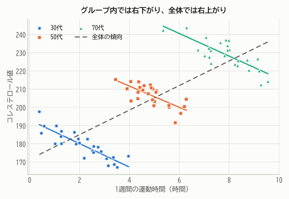
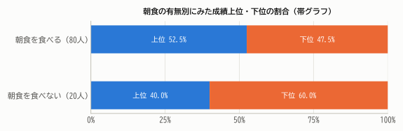

# 第3章 2つの変数の関係

!!! abstract "この章で学ぶこと"
    - 散布図で2つの量的変数の関係を見る
    - 共分散と相関係数の定義・意味・性質（$-1 \le r \le 1$ の証明）
    - 相関係数の落とし穴：非線形な関係、外れ値、相関と因果、シンプソンのパラドックス
    - 質的変数どうしの関係を見るクロス集計表

「勉強時間が長い人ほど点数が高いのか？」「気温が高い日ほどアイスクリームが売れるのか？」——
統計学で最もよく問われるのは、このような **2つの変数の関係** です。この章では、その関係を図と数値で捉える方法を学びます。

## 3.1 散布図

2つの量的変数 $x, y$ の組 $(x_1, y_1), (x_2, y_2), \dots, (x_n, y_n)$ を座標平面上の点として打ったものを **散布図** といいます。

<figure markdown="span">
  { width="560" }
  <figcaption>図3.1 30人の1週間の勉強時間と点数の散布図。全体として右上がりの傾向が見える。</figcaption>
</figure>

散布図では、点の並び方から関係の向きと強さを読み取ります。

<figure markdown="span">
  { width="820" }
  <figcaption>図3.2 $x$ が大きいほど $y$ も大きい傾向を **正の相関**、$x$ が大きいほど $y$ が小さい傾向を **負の相関**、どちらの傾向もないことを **無相関** という。</figcaption>
</figure>

## 3.2 共分散

### 4つの象限で考える

散布図に、$x$ の平均 $\bar{x}$ と $y$ の平均 $\bar{y}$ の位置で縦線と横線を引き、平面を4つの領域に分けてみます。

<figure markdown="span">
  { width="620" }
  <figcaption>図3.3 平均の位置で4つに分けると、右上と左下の点では $x, y$ の偏差の積がプラス、左上と右下ではマイナスになる。正の相関があると、プラスの点が多くなる。</figcaption>
</figure>

- 右上の点：$x$ も $y$ も平均より大きい → 偏差 $(x_i - \bar{x})$ と $(y_i - \bar{y})$ はどちらも正 → **積は正**
- 左下の点：どちらも平均より小さい → どちらの偏差も負 → **積は正**
- 左上・右下の点：偏差の符号が逆 → **積は負**

正の相関があれば右上と左下に点が多く集まるので、偏差の積を平均すると正になります。負の相関なら負に、無相関なら打ち消し合って 0 に近くなります。

!!! definition "定義 3.1（共分散）"
    $$
    s_{xy} = \frac{1}{n}\sum_{i=1}^{n} (x_i - \bar{x})(y_i - \bar{y})
    $$

    を $x$ と $y$ の **共分散**（covariance）といいます。

$y$ の代わりに $x$ 自身を入れると $s_{xx} = \frac{1}{n}\sum (x_i - \bar{x})^2 = s_x^2$ となり、共分散は分散の拡張になっていることがわかります。
分散と同じく、次の計算公式が成り立ちます（証明は分散のときと同様です）。

$$
s_{xy} = \overline{xy} - \bar{x}\,\bar{y} \qquad \left(\overline{xy} = \frac{1}{n}\sum_{i=1}^{n} x_i y_i\right)
$$

### 具体例

5組のデータで計算してみましょう。

| $x_i$ | 1 | 2 | 3 | 4 | 5 | 平均 |
|---|---:|---:|---:|---:|---:|---:|
| $y_i$ | 2 | 4 | 5 | 4 | 5 | $\bar{y} = 4$ |
| $x_i - \bar{x}$ | $-2$ | $-1$ | $0$ | $1$ | $2$ | （$\bar{x} = 3$） |
| $y_i - \bar{y}$ | $-2$ | $0$ | $1$ | $0$ | $1$ | |
| 積 | 4 | 0 | 0 | 0 | 2 | $s_{xy} = 6/5 = 1.2$ |

計算公式で確かめると、$\overline{xy} = (2 + 8 + 15 + 16 + 25)/5 = 13.2$ なので $s_{xy} = 13.2 - 3 \times 4 = 1.2$ です。

### 共分散の弱点：単位に依存する

共分散の値は、$x$ や $y$ の単位によって変わってしまいます。たとえば身長を cm で測るか m で測るかで、共分散は 100 倍違います。
そのため「共分散が 1.2 だから関係が強い／弱い」とは判断できません。正か負かという **向き** はわかりますが、**強さ** の指標としては使いにくいのです。

## 3.3 相関係数

単位の影響を取り除くには、共分散をそれぞれの標準偏差で割ればよいのです。

!!! definition "定義 3.2（相関係数）"
    $$
    r = \frac{s_{xy}}{s_x\, s_y} = \frac{\sum_{i=1}^{n}(x_i - \bar{x})(y_i - \bar{y})}{\sqrt{\sum_{i=1}^{n}(x_i - \bar{x})^2}\sqrt{\sum_{i=1}^{n}(y_i - \bar{y})^2}}
    $$

    を（ピアソンの）**相関係数**（correlation coefficient）といいます。

上の5組のデータでは、$s_x^2 = 10/5 = 2$、$s_y^2 = 6/5 = 1.2$ なので

$$
r = \frac{1.2}{\sqrt{2}\sqrt{1.2}} = \frac{1.2}{\sqrt{2.4}} \approx 0.775
$$

です。

相関係数は、**標準化したデータの積の平均** と見ることもできます。$z$ 得点 $z^x_i = (x_i - \bar{x})/s_x$、$z^y_i = (y_i - \bar{y})/s_y$ を使うと

$$
r = \frac{1}{n}\sum_{i=1}^{n} z^x_i\, z^y_i
$$

と書けます。つまり相関係数は「標準化したデータどうしの共分散」です。標準化によって単位が消えるので、相関係数は単位によりません。

### 相関係数の性質

!!! theorem "定理 3.1（相関係数の性質）"
    1. $-1 \le r \le 1$ が成り立つ。
    2. $r = 1$ となるのは、すべての点が右上がりの直線上にあるときに限る。$r = -1$ となるのは、右下がりの直線上にあるときに限る。
    3. $x$ を $ax + b$、$y$ を $cy + d$ に変換しても（$a, c > 0$）、相関係数は変わらない。$a$ と $c$ の符号が異なれば、符号だけが反転する。

??? proof "証明"
    **1.と2.** 標準化した値 $z^x_i, z^y_i$ は平均 0、分散 1 なので $\frac{1}{n}\sum (z^x_i)^2 = \frac{1}{n}\sum (z^y_i)^2 = 1$ です。
    そこで $z^x_i + z^y_i$ の2乗の平均を考えると、2乗の平均は 0 以上なので

    $$
    0 \le \frac{1}{n}\sum_{i=1}^{n} (z^x_i + z^y_i)^2 = 1 + 2r + 1 = 2(1 + r)
    $$

    よって $r \ge -1$。同様に $z^x_i - z^y_i$ で考えると $0 \le 2(1 - r)$ より $r \le 1$ です。

    $r = 1$ となるのは $\frac{1}{n}\sum (z^x_i - z^y_i)^2 = 0$、つまりすべての $i$ で $z^x_i = z^y_i$ のときです。
    これは $y_i = \bar{y} + \frac{s_y}{s_x}(x_i - \bar{x})$ を意味し、すべての点が傾き正の直線上にあることを表します。$r = -1$ も同様です。

    **3.** 定理2.4より、$x$ を $ax + b$ に変えると偏差は $a$ 倍、標準偏差は $|a|$ 倍になります。$y$ も同様です。したがって

    $$
    r' = \frac{ac\, s_{xy}}{|a| s_x \cdot |c| s_y} = \frac{ac}{|ac|}\, r
    $$

    で、$ac > 0$ なら $r' = r$、$ac < 0$ なら $r' = -r$ です。

<figure markdown="span">
  { width="900" }
  <figcaption>図3.4 相関係数の値と散布図の見た目。$|r|$ が1に近いほど点が直線のまわりに集まる。</figcaption>
</figure>

相関の強さの目安として、次のような表現がよく使われます（分野によって基準は異なり、絶対的なものではありません）。

| $\lvert r \rvert$ の大きさ | 表現の目安 |
|---|---|
| 0.7 〜 1.0 | 強い相関がある |
| 0.4 〜 0.7 | 中程度の相関がある |
| 0.2 〜 0.4 | 弱い相関がある |
| 0 〜 0.2 | ほとんど相関がない |

!!! demo "やってみよう：相関係数と散布図"
    スライダーで相関係数を動かして、散布図の見た目がどう変わるか確かめましょう。$r = 0.3$ くらいだと、見た目ではほとんど関係がわからないことにも注目してください。

    

## 3.4 相関係数を読むときの注意

相関係数は便利ですが、誤解されやすい指標でもあります。

### 注意1：相関係数は「直線的な関係」しか測れない

<figure markdown="span">
  { width="780" }
  <figcaption>図3.5 左：U字型のはっきりした関係があっても、直線的でないため $r \approx 0$。右：無相関のデータに外れ値が1つ加わるだけで、相関係数が大きく変わる。</figcaption>
</figure>

「$r \approx 0$」は「関係がない」ではなく「**直線的な** 関係がない」という意味にすぎません。また、相関係数は平均や分散と同様に外れ値の影響を強く受けます。

### 注意2：必ず散布図を描く ― アンスコムの例

次の4つのデータは、平均・分散・相関係数（約 0.816）・回帰直線（$y = 3 + 0.5x$）がほぼ完全に一致するように作られた有名な例です（統計学者アンスコムが1973年に発表）。

<figure markdown="span">
  { width="900" }
  <figcaption>図3.6 アンスコムの例。数値の要約はまったく同じでも、散布図を描くとまったく違う関係だとわかる。</figcaption>
</figure>

I は素直な直線関係、II は曲線関係、III は1つの外れ値が直線をゆがめている例、IV は1点だけで相関が生まれている例です。
**数値で要約する前に、必ずグラフを描く** ——これは統計解析の鉄則です。

### 注意3：相関関係は因果関係ではない

「アイスクリームの売上が多い日ほど、水難事故が多い」というデータがあったとします。だからといって「アイスクリームを食べると溺れやすくなる」わけではありません。
どちらも **気温** という第3の変数の影響を受けて増えているだけです。

このように、2つの変数の両方に影響を与えて見かけの相関を生み出す変数を **交絡因子**（交絡変数）といい、それによって生じる見かけ上の相関を **疑似相関** といいます。
相関から因果を主張するには、ランダム化比較試験（RCT）のような実験デザインや、交絡を考慮した分析（回帰分析や因果推論の手法）が必要です。

!!! warning "相関と因果を区別するための問い"
    $x$ と $y$ に相関があるとき、次の可能性を考えましょう。

    1. $x$ が $y$ の原因である
    2. 逆に $y$ が $x$ の原因である（逆の因果）
    3. 第3の変数 $z$ が両方の原因である（交絡）
    4. 単なる偶然である（データが少ないときに起こりやすい）

### 注意4：シンプソンのパラドックス

交絡因子の影響が極端に現れると、**グループごとの傾向と全体の傾向が逆転する** ことがあります。

<figure markdown="span">
  { width="620" }
  <figcaption>図3.7 年代ごとに見ると「運動時間が長いほどコレステロール値が低い」（右下がり）のに、全員をまとめると右上がりになる（架空のデータ）。年齢が上がるほど運動時間もコレステロール値も高い傾向があるため。</figcaption>
</figure>

これを **シンプソンのパラドックス** といいます。データをどの単位でまとめるかによって結論が変わりうること、そして交絡因子を見落とすと正反対の結論を導きかねないことを示しています。

## 3.5 回帰直線へのつなぎ

相関係数は関係の「強さ」を表しますが、「$x$ が1増えると $y$ はどのくらい増えるか」は教えてくれません。
それに答えるのが、散布図に最もよく当てはまる直線 ——**回帰直線**—— です。

第2章の「二乗誤差の和を最小にする」という考え方を使うと、回帰直線は

$$
y = \bar{y} + r\,\frac{s_y}{s_x}\,(x - \bar{x})
$$

となることが示せます（導出は第18章で行います）。傾きは $r\,s_y/s_x = s_{xy}/s_x^2$ です。
上の5組のデータでは傾き $1.2/2 = 0.6$、切片 $4 - 0.6 \times 3 = 2.2$ で、回帰直線は $y = 2.2 + 0.6x$ となります。

傾きに相関係数 $r$ が掛かっていることに注目してください。$x$ が平均より標準偏差1つぶん大きいとき、$y$ の予測値は平均より標準偏差 $r$ 個ぶんだけ大きくなります。
$|r| < 1$ なので、予測値は $x$ ほど極端にはならず平均に近づきます。これが「**平均への回帰**」と呼ばれる現象で、「回帰」という名前の由来です。

## 3.6 質的変数どうしの関係：クロス集計表

2つの質的変数の関係は、**クロス集計表**（分割表）にまとめます。100人の生徒について、朝食を食べるかどうかと成績（上位・下位）を調べたとします。

| | 成績上位 | 成績下位 | 合計 |
|---|---:|---:|---:|
| 朝食を食べる | 42 | 38 | 80 |
| 朝食を食べない | 8 | 12 | 20 |
| 合計 | 50 | 50 | 100 |

人数が大きく違うグループを比べるときは、**行ごとの割合** にするとわかりやすくなります。

<figure markdown="span">
  { width="640" }
  <figcaption>図3.8 朝食を食べるグループでは上位が52.5%、食べないグループでは40.0%。</figcaption>
</figure>

割合には差がありますが、この差は「たまたま」生じた程度のものなのでしょうか、それとも意味のある差なのでしょうか。
それを判断するのが第17章で学ぶ **カイ二乗検定** です。また、この差が見つかったとしても、朝食が成績の原因だとはいえない（生活習慣全体という交絡因子があるかもしれない）ことにも注意しましょう。

## まとめ

- 2つの量的変数の関係は **散布図** で見る。数値で要約する前に、必ずグラフを描く。
- **共分散** $s_{xy}$ は偏差の積の平均。符号が関係の向きを表すが、単位に依存する。
- **相関係数** $r = s_{xy}/(s_x s_y)$ は単位によらず、$-1 \le r \le 1$。$|r| = 1$ は完全な直線関係。
- 相関係数は直線的な関係しか測れず、外れ値に弱い。
- **相関関係は因果関係ではない**。交絡因子による疑似相関や、シンプソンのパラドックスに注意する。

## 練習問題

!!! exercise "問題 3.1（相関係数の計算）"
    4組のデータ $(x, y) = (2, 5), (4, 4), (6, 2), (8, 1)$ について、共分散と相関係数を求めてください。

    ??? success "解答"
        $\bar{x} = 5$、$\bar{y} = 3$。偏差は $x$：$-3, -1, 1, 3$、$y$：$2, 1, -1, -2$ です。

        - 共分散：積は $-6, -1, -1, -6$ で合計 $-14$ なので $s_{xy} = -14/4 = -3.5$
        - 分散：$s_x^2 = (9+1+1+9)/4 = 5$、$s_y^2 = (4+1+1+4)/4 = 2.5$
        - 相関係数：$r = -3.5 / \sqrt{5 \times 2.5} = -3.5/\sqrt{12.5} \approx -0.990$

        強い負の相関があります。

!!! exercise "問題 3.2（単位の変換）"
    身長（cm）と体重（kg）の共分散が 45、相関係数が 0.6 でした。身長を m 単位に変えると、共分散と相関係数はそれぞれいくつになりますか。

    ??? success "解答"
        身長の値が $1/100$ 倍になるので、偏差も $1/100$ 倍になり、共分散は $45/100 = 0.45$ になります。
        相関係数は定理3.1の3より変わらず 0.6 です。

!!! exercise "問題 3.3（完全な直線関係）"
    すべてのデータが $y_i = -2x_i + 3$ を満たすとき、相関係数 $r$ はいくつですか。定義に従って確かめてください。

    ??? success "解答"
        $\bar{y} = -2\bar{x} + 3$ なので $y_i - \bar{y} = -2(x_i - \bar{x})$。よって

        $$
        s_{xy} = \frac{1}{n}\sum (x_i - \bar{x})\cdot(-2)(x_i - \bar{x}) = -2 s_x^2, \qquad s_y = 2 s_x
        $$

        したがって $r = -2s_x^2 / (s_x \cdot 2 s_x) = -1$ です。

!!! exercise "問題 3.4（相関と因果）"
    次の主張の問題点を指摘し、考えられる交絡因子を挙げてください。

    (1) 「消防車がたくさん出動した火事ほど被害額が大きい。消防車は被害を大きくしている。」
    (2) 「子どもの靴のサイズが大きいほど、読解力テストの点数が高い。大きい靴を履かせれば読解力が上がる。」

    ??? success "解答"
        (1) **火事の規模** が交絡因子です。大きな火事ほど消防車が多く出動し、被害額も大きくなります。
        (2) **年齢（学年）** が交絡因子です。年齢が上がるほど足は大きくなり、読解力も向上します。同じ学年の中で比べれば、相関はほとんど消えるでしょう。

!!! exercise "問題 3.5（証明問題）"
    相関係数が「標準化したデータの積の平均」$r = \frac{1}{n}\sum z^x_i z^y_i$ に等しいことを示してください。

    ??? success "解答"
        $$
        \frac{1}{n}\sum_{i=1}^{n} z^x_i z^y_i = \frac{1}{n}\sum_{i=1}^{n} \frac{x_i - \bar{x}}{s_x}\cdot\frac{y_i - \bar{y}}{s_y}
        = \frac{1}{s_x s_y}\cdot\frac{1}{n}\sum_{i=1}^{n}(x_i - \bar{x})(y_i - \bar{y}) = \frac{s_{xy}}{s_x s_y} = r
        $$
