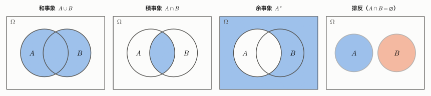
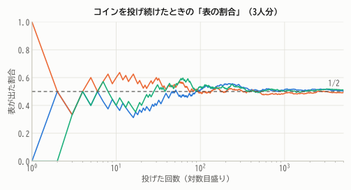
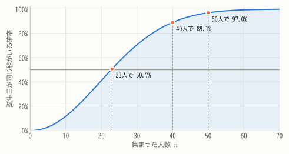
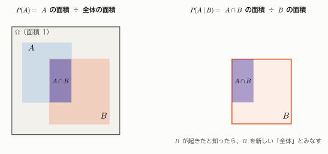
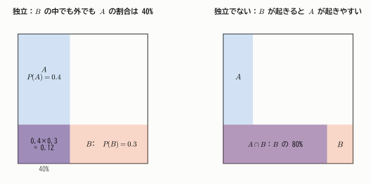
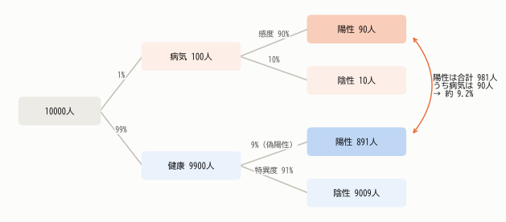

# 第4章 確率の基本

!!! abstract "この章で学ぶこと"
    - 試行・標本空間・事象という確率の「舞台設定」
    - 確率の3つの考え方（古典的・頻度的・公理的）と、確率の公理
    - 条件付き確率と独立
    - 全確率の公式と **ベイズの定理**（検査の陽性的中率の例）

第1部では手元のデータを要約しました。推測統計では「たまたま選ばれた標本」から母集団を推し量りますが、
そのためには **偶然のぶれ** を定量的に扱う言葉が必要です。それが確率です。
この章では、確率を数学的にきちんと定義し、条件付き確率とベイズの定理までを学びます。

## 4.1 試行・標本空間・事象

サイコロを振る、コインを投げる、ある人の血圧を測る——結果が偶然に左右される実験や観測を **試行** といいます。

!!! definition "定義 4.1（標本空間と事象）"
    - 試行で起こりうる結果全体の集合を **標本空間** といい、$\Omega$（オメガ）で表す。
    - $\Omega$ の要素（1つ1つの結果）を **根元事象**（標本点）という。
    - $\Omega$ の部分集合を **事象** という。事象は「起こりうる結果のうち、ある条件を満たすものの集まり」である。

**例**：サイコロを1回振る試行では $\Omega = \{1, 2, 3, 4, 5, 6\}$。「偶数の目が出る」という事象は $A = \{2, 4, 6\}$、「4以上の目が出る」という事象は $B = \{4, 5, 6\}$ です。

事象は集合なので、集合の演算で新しい事象を作れます。

| 記号 | 名前 | 意味 | サイコロの例 |
|---|---|---|---|
| $A \cup B$ | 和事象 | $A$ または $B$ が起こる | $\{2, 4, 5, 6\}$ |
| $A \cap B$ | 積事象 | $A$ と $B$ がともに起こる | $\{4, 6\}$ |
| $A^c$ | 余事象 | $A$ が起こらない | $\{1, 3, 5\}$ |
| $\varnothing$ | 空事象 | 決して起こらない事象 | |
| $\Omega$ | 全事象 | 必ず起こる事象 | $\{1, \dots, 6\}$ |

$A \cap B = \varnothing$ のとき、$A$ と $B$ は **排反**（互いに排反）であるといいます。同時には起こりえない、という意味です。

<figure markdown="span">
  { width="900" }
  <figcaption>図4.1 ベン図で表した事象の演算。四角形全体が標本空間 $\Omega$、色のついた部分がそれぞれの事象。</figcaption>
</figure>

!!! point "ド・モルガンの法則"
    $(A \cup B)^c = A^c \cap B^c$、$(A \cap B)^c = A^c \cup B^c$。
    「$A$ または $B$」の否定は「$A$ でも $B$ でもない」、「$A$ かつ $B$」の否定は「$A$ でないか $B$ でない」。ベン図で確かめてみましょう。

## 4.2 確率とは何か ― 3つの考え方

### 古典的確率

サイコロの各目のように、根元事象がどれも **同様に確からしい** とき、事象 $A$ の確率を

$$
P(A) = \frac{A \text{ に含まれる根元事象の数}}{\Omega \text{ に含まれる根元事象の数}} = \frac{|A|}{|\Omega|}
$$

と定めます。サイコロで偶数の目が出る確率は $3/6 = 1/2$ です。

わかりやすい定義ですが、「同様に確からしい」が成り立たない場面（いびつなサイコロ、明日雨が降るか、など）には使えません。

### 頻度的確率

同じ試行を何度もくり返したとき、事象 $A$ が起こった割合（相対頻度）がある値に近づいていくなら、その値を $A$ の確率とみなす考え方です。

<figure markdown="span">
  { width="660" }
  <figcaption>図4.2 コインを投げ続けると、表が出た割合は最初こそ大きくぶれるが、回数が増えるにつれて 1/2 に近づいていく。</figcaption>
</figure>

この「近づいていく」という現象は、第11章で **大数の法則** として数学的に証明されます。

### 公理的確率

現代の確率論は、確率が満たすべき最小限のルール（**公理**）だけを決め、そこからすべてを導くという立場をとります。
ソ連の数学者コルモゴロフが1933年に確立しました。

!!! definition "定義 4.2（確率の公理）"
    標本空間 $\Omega$ の事象 $A$ に実数 $P(A)$ を対応させる関数 $P$ が次の3つを満たすとき、$P$ を **確率**（確率測度）という。

    1. **非負性**：任意の事象 $A$ について $P(A) \ge 0$
    2. **全確率は1**：$P(\Omega) = 1$
    3. **（可算）加法性**：$A_1, A_2, \dots$ が互いに排反（どの2つも同時に起こらない）ならば

        $$
        P(A_1 \cup A_2 \cup \cdots) = P(A_1) + P(A_2) + \cdots
        $$

公理はたったこれだけです。古典的確率はこの3つを満たしていますし、相対頻度も（有限回の試行では）同じ性質をもっています。
「確率とは結局何なのか」という哲学的な問題には立ち入らず、「この3つのルールを満たすものなら何でも確率として扱ってよい」とするのが公理的な立場です。

!!! note "発展：どんな部分集合でも事象にできるわけではない"
    $\Omega$ が実数全体のように無限集合の場合、すべての部分集合に矛盾なく確率を割り当てることはできないことが知られています。
    そのため厳密には、確率を割り当てる部分集合の集まり（**σ-加法族**）をあらかじめ決めておきます。
    本教材の範囲では、この点を気にする必要はありません。

### 公理から導かれる性質

公理だけから、おなじみの性質が次々と導けます。

!!! theorem "定理 4.1（確率の基本性質）"
    1. $P(A^c) = 1 - P(A)$
    2. $P(\varnothing) = 0$
    3. $A \subset B$ ならば $P(A) \le P(B)$。特に $0 \le P(A) \le 1$
    4. **加法定理**：$P(A \cup B) = P(A) + P(B) - P(A \cap B)$

??? proof "証明"
    **1.** $A$ と $A^c$ は排反で、$A \cup A^c = \Omega$。公理3と公理2より $P(A) + P(A^c) = P(\Omega) = 1$。

    **2.** 1で $A = \Omega$ とすると $\Omega^c = \varnothing$ なので $P(\varnothing) = 1 - 1 = 0$。

    **3.** $B = A \cup (B \cap A^c)$ で、右辺の2つは排反。公理3より $P(B) = P(A) + P(B \cap A^c) \ge P(A)$（公理1を使った）。
    $A \subset \Omega$ なので $P(A) \le P(\Omega) = 1$。

    **4.** $A \cup B$ を排反な3つの部分 $A \cap B^c$、$A \cap B$、$A^c \cap B$ に分けると

    $$
    P(A \cup B) = P(A \cap B^c) + P(A \cap B) + P(A^c \cap B)
    $$

    一方、$P(A) = P(A \cap B^c) + P(A \cap B)$、$P(B) = P(A^c \cap B) + P(A \cap B)$ なので、
    $P(A) + P(B)$ では $P(A \cap B)$ を2回数えている。1回ぶん引けば $P(A \cup B)$ に等しい。

加法定理はベン図で見ると明らかです。$A$ と $B$ の面積を足すと、重なり部分を2回数えてしまうので1回ぶん引く、というだけです。

**例**：サイコロで $A$ = 偶数、$B$ = 4以上 のとき、$P(A \cup B) = 3/6 + 3/6 - 2/6 = 4/6 = 2/3$。直接数えた $|\{2, 4, 5, 6\}|/6$ と一致します。

## 4.3 数え上げと確率

同様に確からしい場合の確率計算では、場合の数を数えることが基本になります。

- **順列**：$n$ 個から $r$ 個を選んで並べる方法は $_{n}\mathrm{P}_{r} = n(n-1)\cdots(n-r+1) = \dfrac{n!}{(n-r)!}$ 通り
- **組合せ**：$n$ 個から $r$ 個を選ぶ方法（順番は区別しない）は $\dbinom{n}{r} = {}_{n}\mathrm{C}_{r} = \dfrac{n!}{r!\,(n-r)!}$ 通り

組合せ $\binom{n}{r}$ は第7章の二項分布で中心的な役割を果たします（詳しくは [付録A](../appendix/math.md#counting)）。

### 誕生日のパラドックス

**問題**：$n$ 人が集まったとき、誕生日が同じ人の組が少なくとも1組いる確率はいくらでしょうか（1年を365日とし、どの日に生まれる確率も等しいとします）。

「少なくとも1組」は数えにくいので、余事象「全員の誕生日が異なる」を考えます。
1人目は365日のどれでもよく、2人目は残り364日、3人目は残り363日、……なので

$$
P(\text{全員異なる}) = \frac{365}{365}\cdot\frac{364}{365}\cdot\frac{363}{365}\cdots\frac{365 - n + 1}{365}
$$

求める確率は $1 - P(\text{全員異なる})$ です。

<figure markdown="span">
  { width="620" }
  <figcaption>図4.3 わずか23人で確率は50%を超え、50人なら97%に達する。直感よりはるかに大きい。</figcaption>
</figure>

直感に反するのは、「自分と同じ誕生日の人がいる確率」と取り違えやすいからです。
23人いれば「2人の組」は $\binom{23}{2} = 253$ 組もあり、そのどれか1組でも一致すればよいのです。

!!! point "「少なくとも1つ」は余事象で"
    「少なくとも1回〜が起こる確率」は、余事象「1回も起こらない確率」を1から引いて求めるのが定石です。

## 4.4 条件付き確率

### 情報が入ると確率が変わる

サイコロを振って、出た目は見えないけれど「4以上だった」と教えてもらったとします。このとき偶数である確率はいくらでしょうか。
4以上の目 $\{4, 5, 6\}$ のうち偶数は $\{4, 6\}$ の2つなので $2/3$ です。何も知らないときの $1/2$ から変わりました。

このように「$B$ が起こったことがわかっている」という条件のもとでの $A$ の確率を、**条件付き確率** といいます。

!!! definition "定義 4.3（条件付き確率）"
    $P(B) > 0$ のとき、事象 $B$ が起こったという条件のもとで事象 $A$ が起こる条件付き確率を

    $$
    P(A \mid B) = \frac{P(A \cap B)}{P(B)}
    $$

    と定める。

<figure markdown="span">
  { width="780" }
  <figcaption>図4.4 条件付き確率は「全体を $B$ に縮めた世界での $A$ の割合」。$B$ が起きたとわかれば $B$ の外側は考えなくてよい。</figcaption>
</figure>

サイコロの例では $P(A \cap B) = 2/6$、$P(B) = 3/6$ なので $P(A \mid B) = (2/6)/(3/6) = 2/3$ となり、先ほどの計算と一致します。

!!! warning "$P(A \mid B)$ と $P(B \mid A)$ は違う"
    「雨が降っている日に傘を持っている確率」と「傘を持っている日に雨が降っている確率」は別物です。
    この2つを取り違える誤りは非常に多く、**検察官の誤謬** とも呼ばれます（4.6節の検査の例で、その影響の大きさがわかります）。

### 乗法定理

条件付き確率の定義の両辺に $P(B)$ を掛けると、**乗法定理** が得られます。

$$
P(A \cap B) = P(B)\,P(A \mid B) = P(A)\,P(B \mid A)
$$

「$A$ と $B$ がともに起こる確率」を「まず $B$ が起こり、そのうえで $A$ が起こる確率」に分解する公式です。

**例**：10本中3本が当たりのくじを、A さん、B さんの順に引きます（引いたくじは戻さない）。2人とも当たる確率は

$$
P(\text{A当たり} \cap \text{B当たり}) = P(\text{A当たり})\,P(\text{B当たり} \mid \text{A当たり}) = \frac{3}{10}\cdot\frac{2}{9} = \frac{1}{15}
$$

## 4.5 独立

「$B$ が起こったと知っても、$A$ の起こりやすさが変わらない」とき、つまり $P(A \mid B) = P(A)$ のとき、$A$ と $B$ は無関係といえます。
これを乗法定理に代入すると $P(A \cap B) = P(A)P(B)$ となります。この形を独立の定義とします。

!!! definition "定義 4.4（事象の独立）"
    $$
    P(A \cap B) = P(A)\,P(B)
    $$

    が成り立つとき、事象 $A$ と $B$ は **独立** であるという。

    3つ以上の事象 $A_1, \dots, A_n$ が（互いに）独立であるとは、その中から選んだ **どの組み合わせ** についても
    「積事象の確率 ＝ 確率の積」が成り立つことをいう。

<figure markdown="span">
  { width="760" }
  <figcaption>図4.5 独立なとき（左）、$B$ の中での $A$ の割合と全体での $A$ の割合が等しく、$A \cap B$ の面積は縦と横の積になる。独立でないとき（右）は $B$ の中での $A$ の割合が大きく変わる。</figcaption>
</figure>

**例**：サイコロを2回振るとき、「1回目が偶数」と「2回目が6」は独立です。$P = \frac{1}{2}\cdot\frac{1}{6} = \frac{1}{12}$。

!!! warning "「独立」と「排反」は全く違う"
    排反は「同時に起こらない」、独立は「互いに影響しない」です。
    $P(A) > 0$、$P(B) > 0$ のとき、$A$ と $B$ が排反なら $P(A \cap B) = 0 \ne P(A)P(B)$ なので **独立ではありません**。
    むしろ「$A$ が起これば $B$ は絶対に起こらない」という強い関係があります。

!!! note "2つずつ独立でも、3つが独立とは限らない"
    コインを2回投げ、$A$ = 1回目が表、$B$ = 2回目が表、$C$ = 2回の結果が一致、とします。
    $P(A) = P(B) = P(C) = 1/2$ で、$P(A \cap B) = P(A \cap C) = P(B \cap C) = 1/4$ なので、どの2つも独立です。
    しかし $P(A \cap B \cap C) = P(\text{表表}) = 1/4 \ne 1/8$ なので、3つは独立ではありません。
    （$A$ と $B$ がわかれば $C$ は完全に決まってしまいます。）

## 4.6 全確率の公式とベイズの定理

### 全確率の公式

標本空間を、互いに排反でもれのない事象 $B_1, B_2, \dots, B_k$ に分けることを考えます（このような事象の組を $\Omega$ の **分割** といいます）。

!!! theorem "定理 4.2（全確率の公式）"
    $B_1, \dots, B_k$ が $\Omega$ の分割で、$P(B_i) > 0$ のとき、任意の事象 $A$ について

    $$
    P(A) = \sum_{i=1}^{k} P(B_i)\,P(A \mid B_i)
    $$

??? proof "証明"
    $A = (A \cap B_1) \cup \cdots \cup (A \cap B_k)$ で、右辺の各事象は互いに排反です。公理3と乗法定理より

    $$
    P(A) = \sum_{i=1}^{k} P(A \cap B_i) = \sum_{i=1}^{k} P(B_i)\,P(A \mid B_i)
    $$

「場合分けして、それぞれの場合の確率を重みとして平均する」公式です。

### ベイズの定理

全確率の公式と条件付き確率の定義を組み合わせると、条件の向きを逆転させる公式が得られます。

!!! theorem "定理 4.3（ベイズの定理）"
    $B_1, \dots, B_k$ が $\Omega$ の分割で、$P(A) > 0$ のとき

    $$
    P(B_j \mid A) = \frac{P(B_j)\,P(A \mid B_j)}{\sum_{i=1}^{k} P(B_i)\,P(A \mid B_i)}
    $$

    特に $k = 2$（$B$ と $B^c$ で分割）のときは

    $$
    P(B \mid A) = \frac{P(B)\,P(A \mid B)}{P(B)\,P(A \mid B) + P(B^c)\,P(A \mid B^c)}
    $$

??? proof "証明"
    条件付き確率の定義と乗法定理から $P(B_j \mid A) = \dfrac{P(A \cap B_j)}{P(A)} = \dfrac{P(B_j)\,P(A \mid B_j)}{P(A)}$。
    分母の $P(A)$ に全確率の公式を代入すればよい。

ベイズの定理は「原因 $B_j$ から結果 $A$ が起こる確率 $P(A \mid B_j)$」がわかっているときに、
「結果 $A$ を見たうえで、原因が $B_j$ である確率 $P(B_j \mid A)$」を求める公式と読めます。

- $P(B_j)$：データを見る前の、原因 $B_j$ の確率 → **事前確率**
- $P(B_j \mid A)$：データ $A$ を見た後の、原因 $B_j$ の確率 → **事後確率**

### 例：検査で陽性が出たら、本当に病気なのか

ある病気について、次のことがわかっているとします。

- この病気にかかっている人の割合（**有病率**）は 1%
- 病気の人が検査を受けると 90% の確率で陽性になる（**感度** $P(\text{陽性} \mid \text{病気}) = 0.9$）
- 健康な人が検査を受けると 91% の確率で陰性になる（**特異度** $P(\text{陰性} \mid \text{健康}) = 0.91$）。つまり 9% は誤って陽性になる（偽陽性）

ある人が検査で陽性になりました。この人が本当に病気である確率はいくらでしょうか。「90%くらい」と答えたくなりますが……。

ベイズの定理で計算すると

$$
P(\text{病気} \mid \text{陽性}) = \frac{0.01 \times 0.9}{0.01 \times 0.9 + 0.99 \times 0.09} = \frac{0.009}{0.009 + 0.0891} = \frac{0.009}{0.0981} \approx 0.092
$$

なんと **約9%** しかありません。

なぜこうなるのか、10000人が検査を受けた場合の人数で考えるとよくわかります（**自然頻度** による表現）。

<figure markdown="span">
  { width="820" }
  <figcaption>図4.6 病気の人は100人しかいないので、その90%が陽性でも90人。一方、健康な人は9900人もいるので、その9%でも891人が偽陽性になる。陽性者981人のうち本当に病気なのは90人だけ。</figcaption>
</figure>

病気がまれ（有病率が低い）だと、健康な人の数が圧倒的に多いので、わずかな偽陽性率でも偽陽性の人数が真の陽性を上回ってしまうのです。
「90%」は $P(\text{陽性} \mid \text{病気})$ であり、知りたい $P(\text{病気} \mid \text{陽性})$ とは別物です。

!!! demo "やってみよう：有病率・感度・特異度を動かす"
    1000人を1マスずつ表しています。有病率を上げたり、特異度を99%以上にしたりすると、$P(\text{病気} \mid \text{陽性})$ がどう変わるか確かめましょう。

    

!!! point "ベイズ更新：情報を得るたびに確率を更新する"
    陽性だった人がもう一度（独立に）検査を受け、再び陽性だったとします。今度は事前確率として、1回目の検査後の事後確率 0.092 を使います。

    $$
    \frac{0.092 \times 0.9}{0.092 \times 0.9 + 0.908 \times 0.09} \approx 0.50
    $$

    2回続けて陽性なら約50%まで上がります。このように、新しいデータを得るたびに「事後確率を次の事前確率として」更新していく考え方が、第20章で学ぶ **ベイズ統計** の出発点です。

## まとめ

- 試行の結果全体が **標本空間** $\Omega$、その部分集合が **事象**。事象は集合の演算（和・積・余）で組み合わせられる。
- 確率は **公理**（非負性・全確率1・排反な事象の加法性）を満たす関数として定義される。加法定理などはすべて公理から導ける。
- **条件付き確率** $P(A \mid B) = P(A \cap B)/P(B)$ は「$B$ を新しい全体とみなしたときの $A$ の割合」。
- $P(A \cap B) = P(A)P(B)$ のとき **独立**。独立と排反は別の概念。
- **ベイズの定理** は条件の向きを逆転させる。有病率の低い病気では、陽性でも本当に病気である確率は意外に低い。

## 練習問題

!!! exercise "問題 4.1（加法定理）"
    1〜100の整数から1つを無作為に選びます。選んだ数が3の倍数または5の倍数である確率を求めてください。

    ??? success "解答"
        3の倍数は33個、5の倍数は20個、15の倍数（両方の倍数）は6個です。加法定理より

        $$
        P = \frac{33}{100} + \frac{20}{100} - \frac{6}{100} = \frac{47}{100}
        $$

!!! exercise "問題 4.2（余事象）"
    サイコロを4回振るとき、少なくとも1回6の目が出る確率を求めてください。

    ??? success "解答"
        余事象「4回とも6以外」の確率は $(5/6)^4 = 625/1296$。よって

        $$
        P = 1 - \frac{625}{1296} = \frac{671}{1296} \approx 0.518
        $$

        わずかに1/2を上回ります。17世紀の賭博師シュヴァリエ・ド・メレがこの賭けで儲けていたという逸話が知られています。

!!! exercise "問題 4.3（条件付き確率）"
    2人の子どもがいる家庭について、少なくとも1人が男の子だとわかっているとき、2人とも男の子である確率を求めてください。
    （男女は等確率 1/2 で、2人の性別は独立とします。）

    ??? success "解答"
        標本空間は $\{\text{男男}, \text{男女}, \text{女男}, \text{女女}\}$ で、どれも確率 1/4。
        $B$ = 少なくとも1人が男 = $\{\text{男男}, \text{男女}, \text{女男}\}$、$A$ = 2人とも男 = $\{\text{男男}\}$ なので

        $$
        P(A \mid B) = \frac{P(A \cap B)}{P(B)} = \frac{1/4}{3/4} = \frac{1}{3}
        $$

        「もう1人も男の子である確率なので1/2」と考えがちですが、条件の情報は「どちらか1人」についてのものなので1/3になります。

!!! exercise "問題 4.4（独立の判定）"
    トランプ52枚から1枚引きます。$A$ = ハートである、$B$ = 絵札（J, Q, K）である、とするとき、$A$ と $B$ は独立ですか。

    ??? success "解答"
        $P(A) = 13/52 = 1/4$、$P(B) = 12/52 = 3/13$、$P(A \cap B) = 3/52$。
        $P(A)P(B) = \frac{1}{4}\cdot\frac{3}{13} = \frac{3}{52} = P(A \cap B)$ なので **独立** です。
        絵札であることがわかっても、ハートである確率は 3/12 = 1/4 のまま変わりません。

!!! exercise "問題 4.5（ベイズの定理：工場の不良品）"
    ある製品は工場 X（全体の 60%）と工場 Y（全体の 40%）で作られています。不良品の割合は X で 2%、Y で 5% です。
    無作為に選んだ製品が不良品だったとき、それが工場 Y で作られたものである確率を求めてください。

    ??? success "解答"
        全確率の公式より $P(\text{不良}) = 0.6 \times 0.02 + 0.4 \times 0.05 = 0.012 + 0.020 = 0.032$。ベイズの定理より

        $$
        P(Y \mid \text{不良}) = \frac{0.4 \times 0.05}{0.032} = \frac{0.020}{0.032} = 0.625
        $$

        生産量は X の方が多いのに、不良品の 62.5% は Y 製です。

!!! exercise "問題 4.6（モンティ・ホール問題）"
    3つの扉の1つの後ろに賞品があります。あなたが扉を1つ選ぶと、答えを知っている司会者は、残り2つのうち **はずれの扉** を1つ開けて見せ、
    「選んだ扉を変えてもいいですよ」と言います（司会者は必ずはずれを開け、選び方が2通りあるときは等確率で選ぶとします）。扉を変えるべきでしょうか。

    ??? success "解答"
        あなたが扉1を選び、司会者が扉3を開けたとします。$C_i$ = 賞品が扉 $i$ にある（事前確率は各 1/3）、$O_3$ = 司会者が扉3を開ける、とします。

        - $P(O_3 \mid C_1) = 1/2$（扉2と3のどちらも開けられる）
        - $P(O_3 \mid C_2) = 1$（扉3しか開けられない）
        - $P(O_3 \mid C_3) = 0$（賞品の扉は開けない）

        ベイズの定理より

        $$
        P(C_2 \mid O_3) = \frac{\frac{1}{3}\cdot 1}{\frac{1}{3}\cdot\frac{1}{2} + \frac{1}{3}\cdot 1 + \frac{1}{3}\cdot 0} = \frac{1/3}{1/2} = \frac{2}{3}
        $$

        扉を変えると当たる確率は **2/3**、変えなければ 1/3 です。**変えるべき** です。
        直感的には、最初に選んだ扉が当たりである確率 1/3 は司会者の行動で変わらず、残りの 2/3 が「開けられなかった扉」に集まる、と理解できます。
