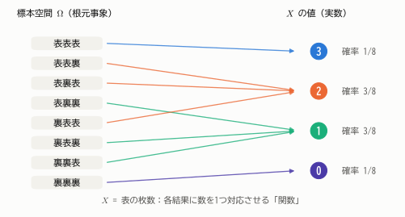
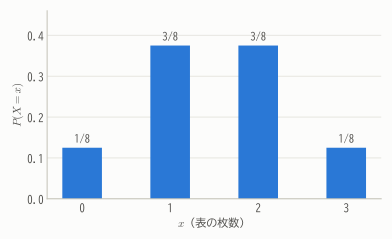
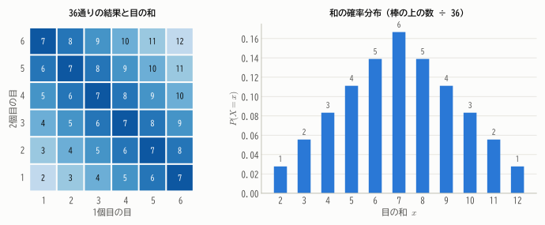
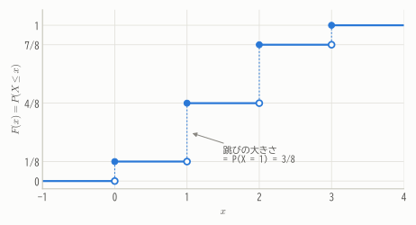
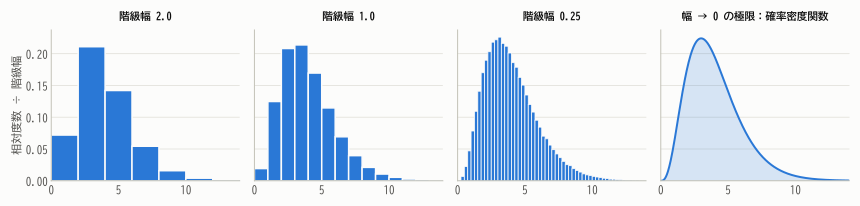
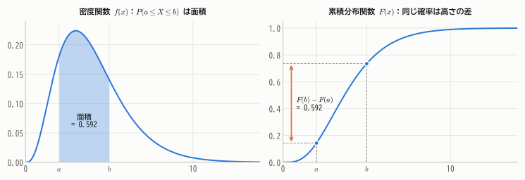
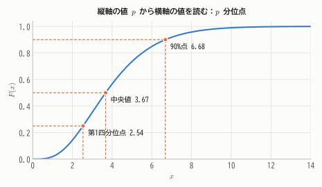

# 第5章 確率変数と確率分布

!!! abstract "この章で学ぶこと"
    - 確率変数とは「偶然によって値が決まる変数」であり、数学的には標本空間上の関数であること
    - 離散型確率変数と **確率関数**
    - 連続型確率変数と **確率密度関数**（ヒストグラムの極限としての理解）
    - **累積分布関数** と **分位点**

第4章では「事象」の確率を考えました。しかし統計学で扱うのは、ほとんどの場合「表が何枚出たか」「身長は何 cm か」といった **数値** です。
この章では、偶然の結果を数値で表す **確率変数** と、その値がどのように散らばるかを表す **確率分布** を学びます。
これは推測統計の最も基本的な道具です。

## 5.1 確率変数とは

コインを3回投げる試行を考えます。標本空間は

$$
\Omega = \{\text{表表表}, \text{表表裏}, \text{表裏表}, \text{表裏裏}, \text{裏表表}, \text{裏表裏}, \text{裏裏表}, \text{裏裏裏}\}
$$

の8通りで、どれも確率 $1/8$ です。ここで「表が出た枚数」を $X$ とすると、$X$ は結果ごとに 0, 1, 2, 3 のいずれかの値をとります。

<figure markdown="span">
  { width="700" }
  <figcaption>図5.1 確率変数 $X$（表の枚数）は、8通りの結果それぞれに数を1つ対応させる関数。同じ値に対応する結果の確率を合計すると、$X$ がその値をとる確率になる。</figcaption>
</figure>

!!! definition "定義 5.1（確率変数）"
    標本空間 $\Omega$ の各要素 $\omega$ に実数 $X(\omega)$ を1つ対応させる関数 $X$ を **確率変数**（random variable）という。

    確率変数は大文字 $X, Y, Z$ で表し、それが実際にとった値（**実現値**）は小文字 $x, y, z$ で表す。

「変数」という名前ですが、正体は **関数** です。ただし普段は $\omega$ を意識せず、「偶然によって値が決まる変数」と考えて差し支えありません。

$X = 2$ という書き方は、「$X(\omega) = 2$ となる結果 $\omega$ の集まり」という **事象** を表します。図5.1では $\{X = 2\} = \{\text{表表裏}, \text{表裏表}, \text{裏表表}\}$ なので

$$
P(X = 2) = \frac{3}{8}
$$

です。このように、確率変数の各値にどれだけの確率が割り当てられているかを **確率分布**（probability distribution）といいます。

確率変数は、とりうる値の種類によって2つに分かれます。

- **離散型確率変数**：とりうる値が 0, 1, 2, … のようにとびとびで、数え上げられるもの（コインの表の枚数、1日の事故件数など）
- **連続型確率変数**：とりうる値がある区間全体にわたる実数であるもの（身長、待ち時間、測定誤差など）

## 5.2 離散型確率変数と確率関数

!!! definition "定義 5.2（確率関数）"
    離散型確率変数 $X$ のとりうる値を $x_1, x_2, \dots$ とするとき

    $$
    p(x_i) = P(X = x_i)
    $$

    を $X$ の **確率関数**（probability mass function, pmf）という。確率関数は次の2つを満たす。

    $$
    p(x_i) \ge 0, \qquad \sum_{i} p(x_i) = 1
    $$

コイン3回の例では、確率関数は次の表のようになります。

| $x$ | 0 | 1 | 2 | 3 | 合計 |
|---|---|---|---|---|---|
| $P(X = x)$ | $1/8$ | $3/8$ | $3/8$ | $1/8$ | $1$ |

<figure markdown="span">
  { width="480" }
  <figcaption>図5.2 コインを3回投げたときの表の枚数 $X$ の確率分布。棒の高さが確率を表し、高さの合計は1。</figcaption>
</figure>

確率関数のグラフは、第1章の相対度数のヒストグラムによく似ています。実際、コイン3回の試行を何万回もくり返して表の枚数の相対度数を求めれば、このグラフに近づいていきます。
**確率分布は「無限回くり返したときの相対度数分布」の理想像** と考えるとわかりやすいでしょう。

### 例：2つのサイコロの目の和

2つのサイコロを振り、目の和を $X$ とします。36通りの結果はどれも同様に確からしいので、和ごとに数えれば確率関数が求まります。

<figure markdown="span">
  { width="820" }
  <figcaption>図5.3 左：36通りの結果と目の和。同じ和は右下がりの斜めの列に並ぶ（例：和7は (1, 6), (2, 5), …, (6, 1)）。右：和の確率分布。7が最も出やすい（確率 6/36）。</figcaption>
</figure>

1つのサイコロの目は1〜6が等確率（平らな分布）なのに、2つの和は真ん中が高い山型になりました。
「独立な確率変数を足し合わせると山型に近づく」というこの現象は、第12章の **中心極限定理** で一般的に説明されます。

## 5.3 累積分布関数

!!! definition "定義 5.3（累積分布関数）"
    確率変数 $X$ に対して

    $$
    F(x) = P(X \le x) \qquad (-\infty < x < \infty)
    $$

    を $X$ の **累積分布関数**（cumulative distribution function, cdf）または単に **分布関数** という。

累積分布関数は、第1章の累積相対度数を確率に置き換えたものです。離散型でも連続型でも同じ形で定義できるのが利点です。

コイン3回の例では、$F(x)$ は次の図のような **階段状** の関数になります。

<figure markdown="span">
  { width="600" }
  <figcaption>図5.4 コイン3回の表の枚数の累積分布関数。$X$ がとりうる値で跳び上がり、跳びの大きさがその値の確率。各段は左端（塗りつぶした丸）を含み、右端（白抜きの丸）を含まない。これが「右連続」の意味。</figcaption>
</figure>

たとえば $F(1.5) = P(X \le 1.5) = P(X = 0) + P(X = 1) = 4/8$ です。

!!! theorem "定理 5.1（累積分布関数の性質）"
    1. $F(x)$ は単調非減少：$x < y$ ならば $F(x) \le F(y)$
    2. $\displaystyle\lim_{x \to -\infty} F(x) = 0$、$\displaystyle\lim_{x \to \infty} F(x) = 1$
    3. 右連続：$\displaystyle\lim_{h \downarrow 0} F(x + h) = F(x)$
    4. $a < b$ のとき $P(a < X \le b) = F(b) - F(a)$

??? proof "証明（1と4）"
    $a < b$ のとき、事象 $\{X \le b\}$ は排反な2つの事象 $\{X \le a\}$ と $\{a < X \le b\}$ に分けられます。確率の公理（加法性）より

    $$
    F(b) = P(X \le b) = P(X \le a) + P(a < X \le b) = F(a) + P(a < X \le b)
    $$

    これを移項すると4が得られます。また $P(a < X \le b) \ge 0$ なので $F(a) \le F(b)$、つまり1も示されました。
    （2と3の証明には「確率の連続性」という性質が必要なので、ここでは省略します。）

## 5.4 連続型確率変数と確率密度関数

### 「ちょうど170 cm」の確率は 0

身長のような連続的な量では、「ちょうど 170 cm である確率」を考えても意味がありません。
本当に「ちょうど」なら 170.000000… cm で、小数点以下がどこまでも 0 でなければならず、そのような人がいる確率は 0 だからです。
連続型確率変数では、どんな値 $x$ についても $P(X = x) = 0$ になります。

意味があるのは「169.5 cm 以上 170.5 cm 未満である確率」のように、**区間** に入る確率です。

### ヒストグラムから密度関数へ

第1章で、ヒストグラムは **面積** で度数を表すこと、そして縦軸を「相対度数 ÷ 階級幅」（密度）にすると柱の面積の合計が1になることを学びました。
この形のヒストグラムで、データの数を限りなく増やし、階級幅を限りなく細かくしていくと、柱の上端はなめらかな曲線に近づきます。

<figure markdown="span">
  { width="900" }
  <figcaption>図5.5 縦軸を「相対度数 ÷ 階級幅」にしたヒストグラムは、どの階級幅でも面積の合計が1。階級幅を細かくしていくと、なめらかな曲線＝確率密度関数に近づく。</figcaption>
</figure>

この極限の曲線が **確率密度関数** です。ヒストグラムで「面積 ＝ 相対度数」だったのと同様に、密度関数では「**面積 ＝ 確率**」となります。

!!! definition "定義 5.4（確率密度関数）"
    関数 $f(x)$ が、任意の $a \le b$ について

    $$
    P(a \le X \le b) = \int_{a}^{b} f(x)\, dx
    $$

    を満たすとき、$f(x)$ を $X$ の **確率密度関数**（probability density function, pdf）という。確率密度関数は次の2つを満たす。

    $$
    f(x) \ge 0, \qquad \int_{-\infty}^{\infty} f(x)\, dx = 1
    $$

    このような $f$ をもつ確率変数を **連続型確率変数** という。

<figure markdown="span">
  { width="860" }
  <figcaption>図5.6 同じ確率 $P(a \le X \le b)$ が、密度関数では面積として、累積分布関数では高さの差として表れる。</figcaption>
</figure>

### 密度関数と累積分布関数の関係

累積分布関数は、密度関数を左端から $x$ まで積分したもの（$x$ より左の面積）です。逆に、累積分布関数を微分すると密度関数に戻ります。

$$
F(x) = \int_{-\infty}^{x} f(t)\, dt, \qquad f(x) = F'(x)
$$

（微分積分学の基本定理。[付録A](../appendix/math.md#calculus) を参照。）

### 密度の値は確率ではない

密度関数の値 $f(x)$ そのものは確率ではありません。小さな幅 $\Delta x$ について

$$
P(x \le X \le x + \Delta x) \approx f(x)\,\Delta x
$$

となる、つまり **「幅をかけてはじめて確率になる」量** です。物理でいえば「密度 × 体積 ＝ 質量」の密度にあたります。

そのため、**密度の値は1を超えてもかまいません**。たとえば区間 $[0, 0.5]$ 上で一定の値をとる密度関数は、面積が1になるように高さ2でなければなりません。

### 例題

$X$ の密度関数が

$$
f(x) = \begin{cases} 2x & (0 \le x \le 1) \\ 0 & (\text{それ以外}) \end{cases}
$$

であるとします。

- **密度関数であることの確認**：$f(x) \ge 0$ で、$\int_0^1 2x\, dx = \left[x^2\right]_0^1 = 1$。
- **累積分布関数**：$0 \le x \le 1$ のとき $F(x) = \int_0^x 2t\, dt = x^2$。$x < 0$ なら $F(x) = 0$、$x > 1$ なら $F(x) = 1$。
- **確率**：$P(X \le 1/2) = F(1/2) = 1/4$。区間の幅は半分なのに、確率は 1/4 しかありません。密度が右ほど高いからです。

## 5.5 分位点

累積分布関数は「値 $x$ → その値以下である確率」を与えます。逆に「確率 $p$ → その確率に対応する値」を考えたものが分位点です。

!!! definition "定義 5.5（分位点）"
    $0 < p < 1$ に対して $F(x) = p$ となる $x$ を、$X$ の **$p$ 分位点**（$100p$ パーセント点）という。
    特に $p = 0.5$ のときを **中央値**、$p = 0.25, 0.75$ のときを **四分位点** という。

    （離散型のように $F(x) = p$ となる $x$ がちょうど存在しない場合は、$F(x) \ge p$ となる最小の $x$ と定める。）

<figure markdown="span">
  { width="600" }
  <figcaption>図5.7 累積分布関数のグラフで、縦軸の値 $p$ から水平に進んでグラフに当たった点の横軸の値が $p$ 分位点。</figcaption>
</figure>

上の例題 $f(x) = 2x$ の中央値は、$F(m) = m^2 = 1/2$ を解いて $m = 1/\sqrt{2} \approx 0.707$ です。

分位点は推測統計の至るところで使います。たとえば「標準正規分布の上側 2.5% 点（0.975 分位点）は 1.96」という事実は、第15章の信頼区間や第16章の検定で何度も登場します。

## 5.6 離散型と連続型のまとめ

| | 離散型 | 連続型 |
|---|---|---|
| 分布を表す関数 | 確率関数 $p(x) = P(X = x)$ | 確率密度関数 $f(x)$ |
| 1点の確率 | $P(X = x) = p(x)$ | $P(X = x) = 0$ |
| 区間の確率 | $\sum_{a \le x_i \le b} p(x_i)$ | $\int_a^b f(x)\,dx$ |
| 全体 | $\sum p(x_i) = 1$ | $\int_{-\infty}^{\infty} f(x)\,dx = 1$ |
| 値の上限 | $p(x) \le 1$ | $f(x)$ は1を超えてもよい |
| 累積分布関数 | 階段状 | 連続、$F'(x) = f(x)$ |

離散型の「和 $\sum$」が、連続型では「積分 $\int$」に置き換わる、と覚えておきましょう。この対応は次章以降でもずっと続きます。

## まとめ

- **確率変数** は偶然によって値が決まる変数で、数学的には標本空間から実数への関数。その値の確率の割り当て方が **確率分布**。
- 離散型は **確率関数** $p(x) = P(X = x)$ で、連続型は **確率密度関数** $f(x)$ で分布を表す。
- 連続型では1点の確率は0で、区間の確率は密度関数の **面積**（積分）。密度は「幅をかけて確率になる量」。
- **累積分布関数** $F(x) = P(X \le x)$ は離散・連続に共通の表し方で、$P(a < X \le b) = F(b) - F(a)$。
- **分位点** は累積分布関数の逆。中央値は 0.5 分位点。

## 練習問題

!!! exercise "問題 5.1（大きい方の目）"
    2つのサイコロを振り、大きい方の目（同じなら その目）を $X$ とします。$X$ の確率関数を求めてください。

    ??? success "解答"
        $P(X \le k) = P(\text{2つとも } k \text{ 以下}) = (k/6)^2 = k^2/36$ です。累積分布関数の差をとって

        $$
        P(X = k) = \frac{k^2}{36} - \frac{(k-1)^2}{36} = \frac{2k - 1}{36} \qquad (k = 1, 2, \dots, 6)
        $$

        つまり $1/36, 3/36, 5/36, 7/36, 9/36, 11/36$ です。合計は $36/36 = 1$ で確かに確率関数になっています。

!!! exercise "問題 5.2（確率関数の定数）"
    確率変数 $X$ の確率関数が $p(x) = cx$（$x = 1, 2, 3, 4$）で与えられています。定数 $c$ と $P(X \ge 3)$ を求めてください。

    ??? success "解答"
        $c(1 + 2 + 3 + 4) = 10c = 1$ より $c = 1/10$。$P(X \ge 3) = 3/10 + 4/10 = 7/10$。

!!! exercise "問題 5.3（密度関数の計算）"
    $X$ の密度関数が $f(x) = cx^2$（$0 \le x \le 3$）、それ以外では 0 とします。

    (1) 定数 $c$ を求めてください。　(2) 累積分布関数 $F(x)$ を求めてください。　(3) $P(1 \le X \le 2)$ を求めてください。　(4) 中央値を求めてください。

    ??? success "解答"
        (1) $\int_0^3 cx^2\,dx = c\left[\frac{x^3}{3}\right]_0^3 = 9c = 1$ より $c = 1/9$。

        (2) $0 \le x \le 3$ で $F(x) = \int_0^x \frac{t^2}{9}\,dt = \frac{x^3}{27}$。$x < 0$ で 0、$x > 3$ で 1。

        (3) $F(2) - F(1) = \frac{8}{27} - \frac{1}{27} = \frac{7}{27} \approx 0.259$。

        (4) $\frac{m^3}{27} = \frac{1}{2}$ より $m = \frac{3}{\sqrt[3]{2}} \approx 2.38$。

!!! exercise "問題 5.4（分布関数から密度関数へ）"
    $X$ の累積分布関数が $F(x) = 1 - e^{-2x}$（$x \ge 0$）、$F(x) = 0$（$x < 0$）で与えられています。密度関数と $P(X > 1)$ を求めてください。

    ??? success "解答"
        $x > 0$ で $f(x) = F'(x) = 2e^{-2x}$（$x < 0$ では 0）。$P(X > 1) = 1 - F(1) = e^{-2} \approx 0.135$。
        これは第8章で学ぶ **指数分布** です。

!!! exercise "問題 5.5（考察）"
    確率関数の値 $p(x)$ は必ず1以下なのに、密度関数の値 $f(x)$ は1を超えることがあります。その理由を説明してください。

    ??? success "解答"
        $p(x) = P(X = x)$ は確率そのものなので、確率の性質から1以下です。
        一方 $f(x)$ は確率ではなく「単位幅あたりの確率」です。確率になるのは $f(x)\Delta x$ や $\int_a^b f(x)\,dx$ のように **幅をかけたもの** なので、
        値が狭い範囲に集中していれば、面積を1に保つために高さ $f(x)$ は1より大きくなります（例：$[0, 0.1]$ 上の一様分布の密度は10）。
