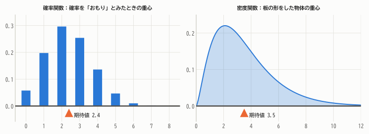
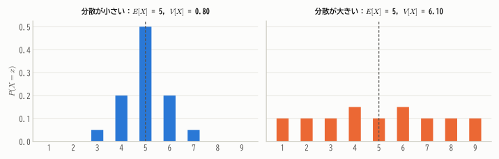
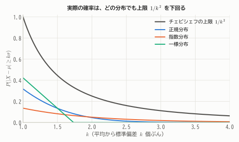
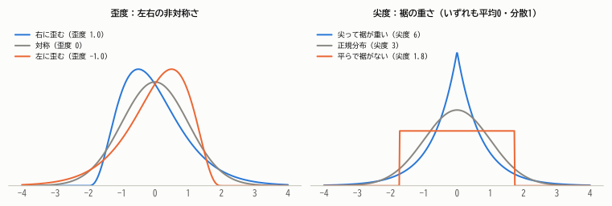
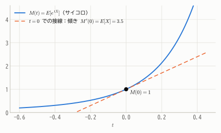

# 第6章 期待値と分散

!!! abstract "この章で学ぶこと"
    - 確率変数の **期待値**（平均）の定義と「重心」としての意味
    - 期待値の **線形性** とその威力
    - 確率変数の **分散・標準偏差** と、その計算公式
    - どんな分布でも成り立つ **マルコフの不等式・チェビシェフの不等式**
    - モーメント、歪度・尖度、そして **積率母関数**

第2章ではデータの平均と分散を学びました。この章では、それを **確率分布** に対して定義します。
データの平均が「実際に得られた値の平均」だったのに対し、期待値は「確率分布の中心」であり、「無限回くり返したときの平均」の理想像です。

## 6.1 期待値

### 宝くじの「平均的な」賞金

1000枚のくじがあり、1等（1万円）が1枚、2等（1000円）が10枚、3等（100円）が100枚、残りははずれだとします。くじを1枚引いたときの賞金を $X$ 円とすると

| $x$（円） | 10000 | 1000 | 100 | 0 |
|---|---:|---:|---:|---:|
| $P(X = x)$ | $1/1000$ | $10/1000$ | $100/1000$ | $889/1000$ |

です。1000枚すべてを買えば賞金の合計は $10000 + 10000 + 10000 = 30000$ 円なので、1枚あたり平均 30 円になります。これは

$$
10000 \times \frac{1}{1000} + 1000 \times \frac{10}{1000} + 100 \times \frac{100}{1000} + 0 \times \frac{889}{1000} = 30
$$

と、**値 × 確率** を足し合わせたものに等しくなっています。くじが1枚 100 円なら、1枚あたり平均 70 円損をする計算です。

!!! definition "定義 6.1（期待値）"
    確率変数 $X$ の **期待値**（expectation）または **平均**（mean）を次で定める。

    - 離散型：$\displaystyle E[X] = \sum_{i} x_i\, p(x_i)$
    - 連続型：$\displaystyle E[X] = \int_{-\infty}^{\infty} x\, f(x)\, dx$

    期待値はしばしば $\mu$（ミュー）で表す。

連続型では、確率 $p(x_i)$ の代わりに「微小な確率」$f(x)\,dx$ を使い、和を積分に置き換えています（第5章の対応表を思い出してください）。

**例1**：サイコロの目 $X$ の期待値は $E[X] = (1 + 2 + 3 + 4 + 5 + 6) \times \frac{1}{6} = 3.5$。

**例2**：密度関数 $f(x) = 2x$（$0 \le x \le 1$）をもつ $X$ の期待値は $E[X] = \int_0^1 x \cdot 2x\, dx = \left[\frac{2x^3}{3}\right]_0^1 = \frac{2}{3}$。

### 期待値は分布の「重心」

第2章で、データの平均値は「つり合いの点」だと学びました。期待値も同じです。

<figure markdown="span">
  { width="840" }
  <figcaption>図6.1 確率をおもりの重さとみなすと、期待値の位置でつり合う。連続型では、密度関数の形をした板の重心が期待値。</figcaption>
</figure>

例1のサイコロのように、期待値は実際にはとりえない値（3.5）になることもあります。期待値は「最もよく出る値」ではなく、「平均的な値」です。

!!! note "期待値が存在しない場合"
    和や積分が収束しない（無限大に発散する）場合、期待値は存在しません。
    有名な例が **サンクトペテルブルクのパラドックス** です。コインを投げて初めて表が出るまでの回数を $N$ とし、賞金を $2^N$ 円とすると

    $$
    E[2^N] = \sum_{n=1}^{\infty} 2^n \cdot \frac{1}{2^n} = 1 + 1 + 1 + \cdots = \infty
    $$

    となります。本教材では、特に断らない限り期待値が存在する（有限である）場合を考えます。

### 関数の期待値

$X$ の関数 $g(X)$（たとえば $X^2$ や $e^X$）も確率変数です。その期待値は、$g(X)$ の分布を求め直さなくても次のように計算できます。

$$
E[g(X)] = \sum_i g(x_i)\, p(x_i) \qquad \text{（連続型なら } \int g(x) f(x)\, dx\text{）}
$$

**例**：サイコロの目 $X$ について $E[X^2] = (1 + 4 + 9 + 16 + 25 + 36) \times \frac{1}{6} = \frac{91}{6}$。

!!! warning "$E[g(X)]$ と $g(E[X])$ は一般に違う"
    サイコロの例では $E[X^2] = 91/6 \approx 15.17$ ですが、$(E[X])^2 = 3.5^2 = 12.25$ です。「2乗の期待値」と「期待値の2乗」を混同しないようにしましょう。
    （実はこの差が次節の分散です。）

## 6.2 期待値の線形性

期待値の最も重要な性質は **線形性** です。

!!! theorem "定理 6.1（期待値の線形性）"
    $a, b$ を定数、$X, Y$ を確率変数とすると

    1. $E[aX + b] = aE[X] + b$
    2. $E[X + Y] = E[X] + E[Y]$

    2は $X$ と $Y$ が **独立でなくても** 常に成り立つ。

??? proof "証明"
    簡単のため、標本空間 $\Omega$ が有限集合の場合を示します。このとき期待値は、根元事象 $\omega$ ごとの「値 × 確率」の和

    $$
    E[X] = \sum_{\omega \in \Omega} X(\omega)\, P(\{\omega\})
    $$

    とも書けます（同じ値 $x_i$ をとる $\omega$ をまとめれば定義6.1の形になります）。すると

    $$
    E[X + Y] = \sum_{\omega} \big(X(\omega) + Y(\omega)\big) P(\{\omega\}) = \sum_{\omega} X(\omega) P(\{\omega\}) + \sum_{\omega} Y(\omega) P(\{\omega\}) = E[X] + E[Y]
    $$

    1も同様に、$\sum_\omega (aX(\omega) + b) P(\{\omega\}) = a E[X] + b \sum_\omega P(\{\omega\}) = aE[X] + b$ です。
    一般の場合（連続型など）でも、和を積分に置き換えれば同じ議論が成り立ちます（第9章で同時分布を使って示します）。

**例**：2つのサイコロの目の和の期待値は、和の分布（第5章の図5.3）を使わなくても $3.5 + 3.5 = 7$ とすぐにわかります。

### 線形性の威力：帽子の問題

$n$ 人がパーティーに帽子を預け、帰りに帽子がでたらめに（全員の並べ方が等確率になるように）返されたとします。自分の帽子が戻ってくる人数 $X$ の期待値はいくらでしょうか。

$X$ の分布を求めるのはかなり大変ですが、期待値なら簡単です。$i$ 番目の人が自分の帽子を受け取れば 1、そうでなければ 0 となる確率変数 $X_i$ を考えると、$X = X_1 + X_2 + \cdots + X_n$ です。
$X_i$ は互いに独立ではありませんが、線形性は独立性を必要としません。$E[X_i] = 1 \cdot P(X_i = 1) = 1/n$ なので

$$
E[X] = E[X_1] + \cdots + E[X_n] = n \cdot \frac{1}{n} = 1
$$

人数 $n$ によらず、平均してちょうど1人が自分の帽子を受け取ります。

!!! point "指示変数のテクニック"
    「ある事象が起これば 1、起こらなければ 0」という確率変数を **指示変数**（indicator）といいます。指示変数の期待値はその事象の確率に等しい（$E[1_A] = P(A)$）ので、
    「〜となるものの個数の期待値」は、指示変数の和に分解して線形性を使うと簡単に求まることがよくあります。

## 6.3 分散と標準偏差

期待値は分布の中心を表しますが、散らばり具合はわかりません。データの場合と同じく、平均からのずれの2乗の平均で散らばりを測ります。

!!! definition "定義 6.2（分散と標準偏差）"
    $\mu = E[X]$ とするとき

    $$
    V[X] = E\big[(X - \mu)^2\big]
    $$

    を $X$ の **分散**（variance）といい、$\sigma^2$ で表すことも多い。$\sigma = \sqrt{V[X]}$ を **標準偏差** という。

    離散型なら $V[X] = \sum_i (x_i - \mu)^2 p(x_i)$、連続型なら $V[X] = \int (x - \mu)^2 f(x)\,dx$。

<figure markdown="span">
  { width="820" }
  <figcaption>図6.2 期待値はどちらも5だが、右の分布の方が値が広く散らばっており、分散が大きい。</figcaption>
</figure>

データの分散と同様に、次の計算公式が成り立ちます。実際の計算ではこちらを使うことがほとんどです。

!!! theorem "定理 6.2（分散の性質）"
    1. **計算公式**：$V[X] = E[X^2] - (E[X])^2$
    2. $V[aX + b] = a^2\, V[X]$（$a, b$ は定数）
    3. $V[X] \ge 0$。$V[X] = 0$ となるのは $X$ が確率1で定数のときに限る。

??? proof "証明"
    **1.** $(X - \mu)^2 = X^2 - 2\mu X + \mu^2$ の期待値を、線形性を使ってとります。

    $$
    V[X] = E[X^2] - 2\mu E[X] + \mu^2 = E[X^2] - 2\mu^2 + \mu^2 = E[X^2] - \mu^2
    $$

    **2.** $E[aX + b] = a\mu + b$ なので、$(aX + b) - (a\mu + b) = a(X - \mu)$。よって

    $$
    V[aX + b] = E\big[a^2 (X - \mu)^2\big] = a^2 V[X]
    $$

    **3.** $(X - \mu)^2 \ge 0$ の期待値なので 0 以上です。0 になるのは $(X - \mu)^2 = 0$、つまり $X = \mu$ が確率1で成り立つときです。

**例**：サイコロの目では $V[X] = \frac{91}{6} - \left(\frac{7}{2}\right)^2 = \frac{182 - 147}{12} = \frac{35}{12} \approx 2.92$、標準偏差は約 1.71 です。

**例**：$f(x) = 2x$（$0 \le x \le 1$）では $E[X^2] = \int_0^1 x^2 \cdot 2x\,dx = \frac{1}{2}$ なので $V[X] = \frac{1}{2} - \frac{4}{9} = \frac{1}{18}$。

性質2は、データの1次変換（第2章 定理2.4）と同じ形です。平行移動 $b$ は散らばりに影響せず、$a$ 倍すると分散は $a^2$ 倍になります。

### 確率変数の標準化

定理6.1と6.2を使うと、期待値 $\mu$、標準偏差 $\sigma$ の確率変数 $X$ を

$$
Z = \frac{X - \mu}{\sigma}
$$

と変換すれば、$E[Z] = 0$、$V[Z] = 1$ となることがわかります。これを **標準化** といいます。
異なる分布を共通の尺度で比べたり、第8章の正規分布の確率を「標準正規分布表」1つで求めたりするのに使います。

## 6.4 マルコフの不等式とチェビシェフの不等式

分散は「散らばり」の指標ですが、具体的に「平均から大きく外れる確率」とどう関係するのでしょうか。
分布の形がまったくわからなくても、期待値と分散だけから確率を評価できる、強力な不等式があります。

!!! theorem "定理 6.3（マルコフの不等式）"
    $X \ge 0$ である確率変数と、任意の $a > 0$ について

    $$
    P(X \ge a) \le \frac{E[X]}{a}
    $$

??? proof "証明（連続型）"
    $X \ge 0$ なので、積分範囲を $[a, \infty)$ に狭めると値は小さくなります。さらにその範囲では $x \ge a$ です。

    $$
    E[X] = \int_0^{\infty} x f(x)\,dx \ge \int_a^{\infty} x f(x)\,dx \ge \int_a^{\infty} a f(x)\,dx = a\,P(X \ge a)
    $$

    両辺を $a$ で割れば得られます。離散型でも積分を和に変えれば同じです。

たとえば「年収の平均が 400 万円なら、年収 2000 万円以上の人は全体の $400/2000 = 20\%$ 以下」と、分布を知らなくてもいえます。

!!! theorem "定理 6.4（チェビシェフの不等式）"
    期待値 $\mu$、分散 $\sigma^2$ の確率変数 $X$ と、任意の $k > 0$ について

    $$
    P\big(|X - \mu| \ge k\sigma\big) \le \frac{1}{k^2}
    $$

??? proof "証明"
    $Y = (X - \mu)^2 \ge 0$ にマルコフの不等式を $a = k^2\sigma^2$ として適用します。$|X - \mu| \ge k\sigma$ と $Y \ge k^2\sigma^2$ は同じ事象なので

    $$
    P\big(|X - \mu| \ge k\sigma\big) = P\big(Y \ge k^2\sigma^2\big) \le \frac{E[Y]}{k^2\sigma^2} = \frac{\sigma^2}{k^2\sigma^2} = \frac{1}{k^2}
    $$

第2章の定理2.5（データ版）を確率の言葉で述べ直したものです。どんな分布でも「平均から標準偏差の2倍以上離れる確率は 1/4 以下、3倍以上なら 1/9 以下」がいえます。

<figure markdown="span">
  { width="620" }
  <figcaption>図6.3 チェビシェフの不等式の上限 $1/k^2$ と、代表的な分布での実際の確率。上限はかなり控えめ（ゆるい）だが、どんな分布にも使える。</figcaption>
</figure>

チェビシェフの不等式は第11章で **大数の法則** を証明するときに主役を務めます。

## 6.5 モーメントと分布の形

### モーメント

期待値と分散は、次のように一般化できます。

!!! definition "定義 6.3（モーメント）"
    - $E[X^k]$ を $X$ の（原点まわりの）**$k$ 次モーメント**（積率）という。
    - $E[(X - \mu)^k]$ を **$k$ 次の中心モーメント** という。

期待値は1次モーメント、分散は2次の中心モーメントです。3次・4次の中心モーメントは、分布の形を表す指標になります。

- **歪度**（わいど、skewness）：$\dfrac{E[(X - \mu)^3]}{\sigma^3}$。分布の左右の非対称さ。右に裾が長いと正、左に裾が長いと負、左右対称なら 0。
- **尖度**（せんど、kurtosis）：$\dfrac{E[(X - \mu)^4]}{\sigma^4}$。裾の重さ（外れ値の出やすさ）。正規分布では 3 になる。正規分布と比べるために 3 を引いた値（超過尖度）を尖度と呼ぶこともある。

<figure markdown="span">
  { width="860" }
  <figcaption>図6.4 左：歪度の違い。右：尖度の違い。どの分布も平均 0、分散 1 にそろえてあるが、形はかなり異なる。</figcaption>
</figure>

$\sigma^3$、$\sigma^4$ で割っているのは、標準化して単位をなくすためです。

### 積率母関数

すべてのモーメントを1つの関数に「まとめて詰め込む」便利な道具があります。

!!! definition "定義 6.4（積率母関数）"
    $$
    M_X(t) = E\big[e^{tX}\big]
    $$

    が $t = 0$ を含むある区間で存在するとき、$M_X(t)$ を $X$ の **積率母関数**（moment generating function, mgf）という。

「母関数」と呼ばれるのは、微分するとモーメントが次々に生み出されるからです。

!!! theorem "定理 6.5（積率母関数とモーメント）"
    $$
    M_X^{(k)}(0) = E[X^k] \qquad (k = 1, 2, \dots)
    $$

    つまり、積率母関数を $k$ 回微分して $t = 0$ を代入すると $k$ 次モーメントが得られる。

??? proof "証明（概略）"
    指数関数のテイラー展開 $e^{u} = 1 + u + \frac{u^2}{2!} + \frac{u^3}{3!} + \cdots$ に $u = tX$ を代入して期待値をとると（和と期待値の交換が許されるとして）

    $$
    M_X(t) = 1 + E[X]\,t + \frac{E[X^2]}{2!}t^2 + \frac{E[X^3]}{3!}t^3 + \cdots
    $$

    これを $k$ 回微分して $t = 0$ とおくと、$t^k$ の項から $E[X^k]$ だけが残ります。

<figure markdown="span">
  { width="600" }
  <figcaption>図6.5 サイコロの目の積率母関数。$t = 0$ で値は 1、接線の傾きが期待値 3.5 になっている。</figcaption>
</figure>

**例（ベルヌーイ分布）**：$P(X = 1) = p$、$P(X = 0) = 1 - p$ のとき

$$
M_X(t) = e^{t \cdot 0}(1 - p) + e^{t \cdot 1}p = 1 - p + pe^t
$$

$M'_X(t) = M''_X(t) = pe^t$ なので $E[X] = p$、$E[X^2] = p$、$V[X] = p - p^2 = p(1 - p)$ です。

積率母関数の本当の威力は、次の性質にあります。

!!! theorem "定理 6.6（積率母関数の一意性）"
    2つの確率変数の積率母関数が、$t = 0$ を含むある区間で一致するならば、2つの確率分布は等しい。

つまり積率母関数は分布の「指紋」のようなもので、積率母関数がわかれば分布が決まります（証明は本教材の範囲を超えるので省略します）。
この性質を使うと、第10章で「独立な確率変数の和の分布」を、第12章で「中心極限定理」を、エレガントに導くことができます。

!!! note "特性関数"
    積率母関数は分布によっては存在しません（例：第13章の $t$ 分布）。そこで、虚数単位 $i$ を使った $\varphi_X(t) = E[e^{itX}]$（**特性関数**）を使うと、どんな分布でも必ず存在し、同じ議論ができます。
    より進んだ確率論では特性関数が標準的に使われます。

## まとめ

- **期待値** $E[X]$ は「値 × 確率」の和（連続型では積分）で、分布の重心。
- 期待値は **線形**：$E[aX + b] = aE[X] + b$、$E[X + Y] = E[X] + E[Y]$（独立でなくてよい）。指示変数と組み合わせると強力。
- **分散** $V[X] = E[(X - \mu)^2] = E[X^2] - (E[X])^2$。$V[aX + b] = a^2 V[X]$。
- **チェビシェフの不等式** $P(|X - \mu| \ge k\sigma) \le 1/k^2$ は、分布の形によらず成り立つ。
- **積率母関数** $M_X(t) = E[e^{tX}]$ を微分するとモーメントが得られ、積率母関数は分布を一意に決める。

## 練習問題

!!! exercise "問題 6.1（離散一様分布）"
    $X$ が $1, 2, \dots, n$ の値を等確率 $1/n$ でとるとき、$E[X] = \dfrac{n + 1}{2}$、$V[X] = \dfrac{n^2 - 1}{12}$ を示してください。
    （公式 $\sum_{k=1}^n k = \frac{n(n+1)}{2}$、$\sum_{k=1}^n k^2 = \frac{n(n+1)(2n+1)}{6}$ を使ってかまいません。）

    ??? success "解答"
        $$
        E[X] = \frac{1}{n}\sum_{k=1}^{n} k = \frac{n + 1}{2}, \qquad E[X^2] = \frac{1}{n}\sum_{k=1}^{n} k^2 = \frac{(n + 1)(2n + 1)}{6}
        $$

        $$
        V[X] = \frac{(n + 1)(2n + 1)}{6} - \frac{(n + 1)^2}{4} = \frac{(n + 1)\{2(2n + 1) - 3(n + 1)\}}{12} = \frac{(n + 1)(n - 1)}{12} = \frac{n^2 - 1}{12}
        $$

        $n = 6$ とすると $E[X] = 3.5$、$V[X] = 35/12$ で、サイコロの結果と一致します。

!!! exercise "問題 6.2（連続型の期待値と分散）"
    $X$ の密度関数が $f(x) = 3x^2$（$0 \le x \le 1$）のとき、$E[X]$ と $V[X]$ を求めてください。

    ??? success "解答"
        $E[X] = \int_0^1 3x^3\,dx = \frac{3}{4}$、$E[X^2] = \int_0^1 3x^4\,dx = \frac{3}{5}$。
        $V[X] = \frac{3}{5} - \frac{9}{16} = \frac{48 - 45}{80} = \frac{3}{80}$。

!!! exercise "問題 6.3（1次変換）"
    $E[X] = 5$、$V[X] = 4$ のとき、$Y = 2X - 3$ と $W = -X/2$ の期待値・分散を求めてください。

    ??? success "解答"
        $E[Y] = 2 \times 5 - 3 = 7$、$V[Y] = 2^2 \times 4 = 16$。
        $E[W] = -5/2$、$V[W] = (-1/2)^2 \times 4 = 1$。符号が反転しても分散は負になりません。

!!! exercise "問題 6.4（チェビシェフの不等式）"
    ある工場で作るネジの長さの平均は 20.0 mm、標準偏差は 0.1 mm です。分布の形がわからないとき、長さが 19.7 mm 以上 20.3 mm 以下に収まる確率は少なくともいくらといえますか。

    ??? success "解答"
        $0.3 = 3 \times 0.1$ なので $k = 3$。チェビシェフの不等式より、外れる確率は $1/9$ 以下（厳密には $|X - 20| \ge 0.3$ の確率が $1/9$ 以下）。
        よって収まる確率は少なくとも $1 - 1/9 = 8/9 \approx 88.9\%$ です。

!!! exercise "問題 6.5（積率母関数）"
    $P(X = 1) = P(X = -1) = 1/2$ である確率変数 $X$ の積率母関数を求め、それを使って $E[X]$ と $V[X]$ を求めてください。

    ??? success "解答"
        $M_X(t) = \frac{1}{2}e^{t} + \frac{1}{2}e^{-t}$。
        $M'_X(t) = \frac{1}{2}e^t - \frac{1}{2}e^{-t}$ より $E[X] = M'_X(0) = 0$。
        $M''_X(t) = \frac{1}{2}e^t + \frac{1}{2}e^{-t}$ より $E[X^2] = M''_X(0) = 1$。よって $V[X] = 1 - 0 = 1$。

!!! exercise "問題 6.6（指示変数の応用）"
    サイコロを10回振るとき、1回も出ない目の種類の数の期待値を求めてください。

    ??? success "解答"
        目 $j$（$j = 1, \dots, 6$）が10回のうち一度も出なければ 1、出れば 0 となる指示変数を $X_j$ とします。$P(X_j = 1) = (5/6)^{10}$ なので

        $$
        E[X_1 + \cdots + X_6] = 6 \times \left(\frac{5}{6}\right)^{10} \approx 6 \times 0.1615 \approx 0.969
        $$

        10回振っても、平均して約1種類の目は出ないままです。
