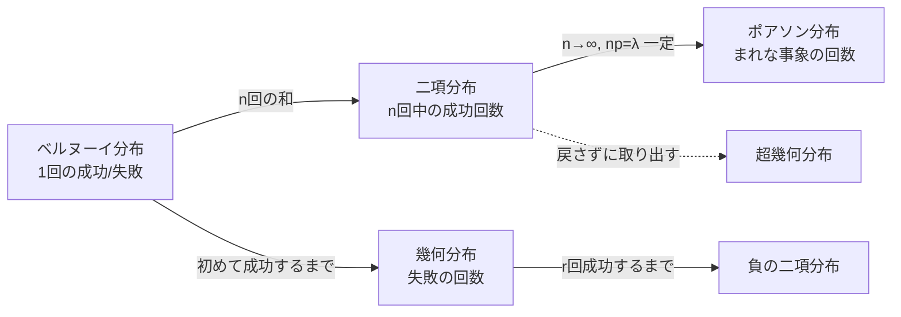
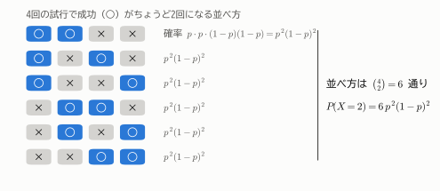
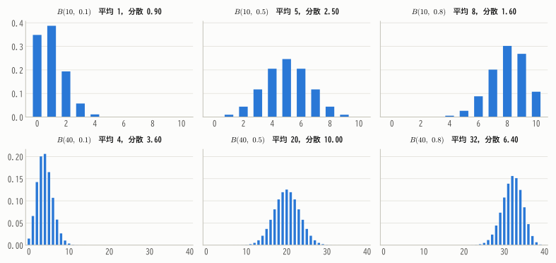
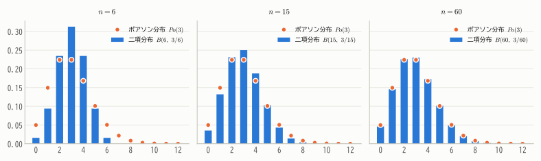
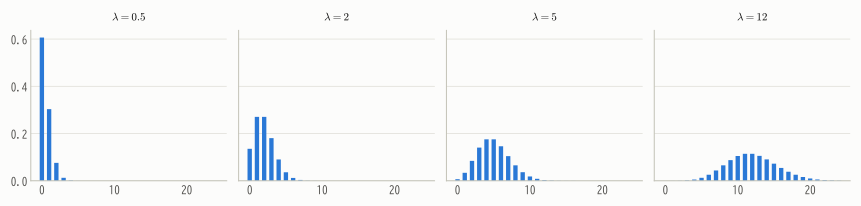
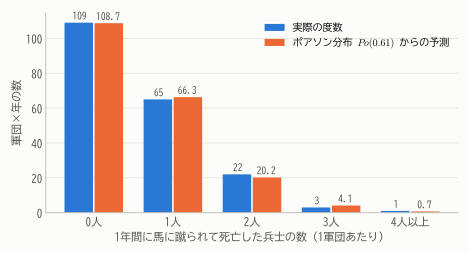
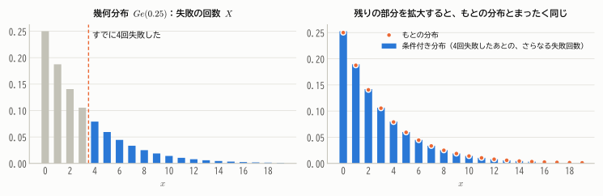
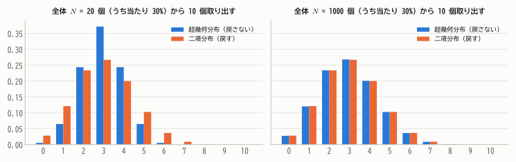

# 第7章 代表的な離散分布

!!! abstract "この章で学ぶこと"
    - ベルヌーイ分布と **二項分布**：「成功の回数」の分布
    - **ポアソン分布**：「まれな出来事の回数」の分布（二項分布の極限として）
    - **幾何分布**・負の二項分布：「初めて成功するまで」の分布と無記憶性
    - **超幾何分布**：「戻さずに取り出す」ときの分布
    - それぞれの期待値・分散の導出

現実の偶然現象の多くは、いくつかの「定番の確率分布」でうまく表せます。この章では離散型の定番分布を、
**どんな状況から生まれるのか** という成り立ちとともに学びます。成り立ちを理解すれば、公式を丸暗記する必要はありません。

## 7.1 ベルヌーイ分布

コイン投げの表/裏、合格/不合格、購入する/しない——結果が2通りしかない試行を **ベルヌーイ試行** といいます。
一方を「成功」として1、他方を「失敗」として0で表した確率変数 $X$ の分布が、最も単純な分布です。

!!! definition "定義 7.1（ベルヌーイ分布）"
    $$
    P(X = 1) = p, \qquad P(X = 0) = 1 - p \qquad (0 \le p \le 1)
    $$

    に従う確率変数の分布を、成功確率 $p$ の **ベルヌーイ分布** といい、$\mathrm{Bern}(p)$ と書く。まとめて $P(X = x) = p^x (1 - p)^{1-x}$（$x = 0, 1$）とも書ける。

    $$
    E[X] = p, \qquad V[X] = p(1 - p)
    $$

期待値と分散は第6章ですでに計算しました（$X^2 = X$ なので $E[X^2] = p$、$V[X] = p - p^2$）。
分散 $p(1-p)$ は $p = 1/2$ のとき最大の $1/4$ になります。結果が最も予想しにくいとき、散らばりが最大になるわけです。

## 7.2 二項分布

### 成り立ち

成功確率 $p$ のベルヌーイ試行を **独立に $n$ 回** くり返したときの成功回数を $X$ とします。$X = k$ となる確率を求めましょう。

<figure markdown="span">
  { width="700" }
  <figcaption>図7.1 $n = 4$ 回中ちょうど $k = 2$ 回成功する並べ方は6通り。どの並べ方も確率は $p^2(1-p)^2$ なので、合計すると $6p^2(1-p)^2$。</figcaption>
</figure>

- 「どの回に成功するか」の選び方は $\binom{n}{k}$ 通り
- 特定の並べ方（例：○○××）になる確率は、独立性より $p^k(1 - p)^{n-k}$

したがって、次の分布が得られます。

!!! definition "定義 7.2（二項分布）"
    $$
    P(X = k) = \binom{n}{k} p^k (1 - p)^{n-k} \qquad (k = 0, 1, \dots, n)
    $$

    を **二項分布** といい、$B(n, p)$ と書く。$X$ が二項分布に従うことを $X \sim B(n, p)$ と表す。

    $$
    E[X] = np, \qquad V[X] = np(1 - p)
    $$

「二項」の名前は、確率の合計が **二項定理** で計算できることに由来します。

$$
\sum_{k=0}^{n} \binom{n}{k} p^k (1 - p)^{n-k} = \big(p + (1 - p)\big)^n = 1
$$

??? proof "期待値と分散の導出"
    **期待値**：$k\binom{n}{k} = n\binom{n-1}{k-1}$ という関係（$k \cdot \frac{n!}{k!(n-k)!} = n \cdot \frac{(n-1)!}{(k-1)!(n-k)!}$）を使います。$q = 1 - p$ とすると

    $$
    E[X] = \sum_{k=1}^{n} k\binom{n}{k}p^k q^{n-k} = np\sum_{k=1}^{n}\binom{n-1}{k-1}p^{k-1}q^{n-k} = np\,(p + q)^{n-1} = np
    $$

    **分散**：同様に $k(k-1)\binom{n}{k} = n(n-1)\binom{n-2}{k-2}$ を使うと

    $$
    E[X(X-1)] = n(n-1)p^2 \sum_{k=2}^{n}\binom{n-2}{k-2}p^{k-2}q^{n-k} = n(n-1)p^2
    $$

    $E[X^2] = E[X(X-1)] + E[X]$ なので

    $$
    V[X] = n(n-1)p^2 + np - (np)^2 = np - np^2 = np(1 - p)
    $$

    **別の見方**：$X = X_1 + \cdots + X_n$（$X_i$ は $i$ 回目が成功なら1の独立なベルヌーイ変数）と分解すると、
    期待値の線形性から $E[X] = np$ はすぐにわかります。分散も、第9章で学ぶ「独立な確率変数の和の分散は分散の和」を使えば $V[X] = np(1-p)$ と一瞬です。

<figure markdown="span">
  { width="880" }
  <figcaption>図7.2 二項分布の形。$p = 0.5$ では左右対称、$p$ が 0 や 1 に近いと歪む。$n$ が大きくなると、どの $p$ でも山型（正規分布に近い形）に近づく（第12章）。</figcaption>
</figure>

**例**：4択問題10問にでたらめに答えたときの正解数 $X$ は $B(10, 0.25)$ に従います。平均正解数は $10 \times 0.25 = 2.5$ 問、6問以上正解する確率は

$$
P(X \ge 6) = \sum_{k=6}^{10}\binom{10}{k}(0.25)^k(0.75)^{10-k} \approx 0.020
$$

で、約2%しかありません。

!!! warning "二項分布が使える条件"
    (1) 各試行の結果が2通り、(2) 成功確率 $p$ が毎回同じ、(3) 試行が互いに独立、(4) 試行回数 $n$ があらかじめ決まっている。
    たとえば「くじを戻さずに引く」場合は (2)(3) が成り立たないので、二項分布ではなく 7.5節の超幾何分布になります。

## 7.3 ポアソン分布

### まれな出来事の回数

「1時間に窓口に来る客の数」「1ページあたりの誤植の数」「1日の交通事故の件数」——
このような **一定の時間・範囲の中で、まれな出来事が起こる回数** の分布を考えます。

1時間を $n$ 個の短い区間に分け、各区間で客が来る確率を $p$ とすると、客の数は $B(n, p)$ に従うと考えられます。
1時間あたりの平均人数 $\lambda = np$ を一定に保ちながら区間をどんどん細かくする（$n \to \infty$、$p = \lambda/n \to 0$）と、二項分布はある分布に近づきます。

!!! theorem "定理 7.1（二項分布のポアソン近似）"
    $\lambda > 0$ を固定し、$p = \lambda/n$ とすると、各 $k = 0, 1, 2, \dots$ について

    $$
    \lim_{n \to \infty}\binom{n}{k}\left(\frac{\lambda}{n}\right)^k\left(1 - \frac{\lambda}{n}\right)^{n-k} = e^{-\lambda}\frac{\lambda^k}{k!}
    $$

??? proof "証明"
    次のように4つの因子に分けます。

    $$
    \binom{n}{k}\left(\frac{\lambda}{n}\right)^k\left(1 - \frac{\lambda}{n}\right)^{n-k}
    = \underbrace{\frac{n(n-1)\cdots(n-k+1)}{n^k}}_{(\mathrm{a})}\cdot\frac{\lambda^k}{k!}\cdot\underbrace{\left(1 - \frac{\lambda}{n}\right)^{n}}_{(\mathrm{b})}\cdot\underbrace{\left(1 - \frac{\lambda}{n}\right)^{-k}}_{(\mathrm{c})}
    $$

    - (a) $= 1 \cdot \left(1 - \frac{1}{n}\right)\cdots\left(1 - \frac{k-1}{n}\right) \to 1$（$k$ は固定）
    - (b) $\to e^{-\lambda}$（ネイピア数の定義 $\lim_{n\to\infty}(1 + x/n)^n = e^x$ より）
    - (c) $\to 1$

    よって全体は $\frac{\lambda^k}{k!}e^{-\lambda}$ に収束します。

!!! definition "定義 7.3（ポアソン分布）"
    $$
    P(X = k) = e^{-\lambda}\frac{\lambda^k}{k!} \qquad (k = 0, 1, 2, \dots)
    $$

    を平均 $\lambda$ の **ポアソン分布** といい、$Po(\lambda)$ と書く。

    $$
    E[X] = \lambda, \qquad V[X] = \lambda
    $$

確率の合計が1になることは、指数関数のテイラー展開 $e^\lambda = \sum_{k=0}^\infty \frac{\lambda^k}{k!}$ からわかります。

??? proof "期待値と分散の導出"
    $$
    E[X] = \sum_{k=1}^{\infty} k\,e^{-\lambda}\frac{\lambda^k}{k!} = \lambda e^{-\lambda}\sum_{k=1}^{\infty}\frac{\lambda^{k-1}}{(k-1)!} = \lambda e^{-\lambda}e^{\lambda} = \lambda
    $$

    同様に $E[X(X-1)] = \lambda^2 e^{-\lambda}\sum_{k=2}^\infty \frac{\lambda^{k-2}}{(k-2)!} = \lambda^2$ なので

    $$
    V[X] = E[X(X-1)] + E[X] - (E[X])^2 = \lambda^2 + \lambda - \lambda^2 = \lambda
    $$

    二項分布の期待値 $np = \lambda$、分散 $np(1-p) = \lambda(1 - \lambda/n) \to \lambda$ の極限とも一致しています。

<figure markdown="span">
  { width="880" }
  <figcaption>図7.3 平均 $np = 3$ を保ちながら $n$ を大きくすると、二項分布はポアソン分布 $Po(3)$ にどんどん近づく。</figcaption>
</figure>

<figure markdown="span">
  { width="880" }
  <figcaption>図7.4 ポアソン分布の形。$\lambda$ が小さいと右に歪み、$\lambda$ が大きくなると山型に近づく。</figcaption>
</figure>

**期待値と分散が等しい** のがポアソン分布の大きな特徴です。実際のデータで分散が平均よりずっと大きい場合（**過分散**）は、ポアソン分布の前提（出来事が独立に、一定の割合で起こる）が崩れているサインです。

### 実例：プロイセン陸軍の馬蹴り事故

ポアソン分布の古典的な実例として、統計学者ボルトキーヴィッチが1898年に分析したデータがあります。
プロイセン陸軍の10の軍団について20年間（合計200「軍団×年」）、馬に蹴られて死亡した兵士の数を数えたものです。

<figure markdown="span">
  { width="620" }
  <figcaption>図7.5 1年間の死亡者数の度数（青）と、平均 $\lambda = 122/200 = 0.61$ のポアソン分布による予測（橙）。驚くほどよく一致している。</figcaption>
</figure>

1件1件の事故はまれで、互いに独立に起こると考えられるので、ポアソン分布がよく当てはまるのです。
「観測された度数が理論分布に当てはまっているか」を厳密に判断する方法は、第17章の **適合度検定** で学びます。

!!! demo "やってみよう：離散分布エクスプローラ"
    分布を選び、パラメータを動かして形の変化を観察しましょう。二項分布で $n$ を大きく、$p$ を小さくすると、ポアソン分布とそっくりになることも確かめてみてください。

    

## 7.4 幾何分布と負の二項分布

### 幾何分布：初めて成功するまで

成功確率 $p$ のベルヌーイ試行を、**初めて成功するまで** くり返します。それまでに失敗した回数を $X$ とすると、
$X = k$ となるのは「最初の $k$ 回が失敗で、$k+1$ 回目に成功」のときなので

!!! definition "定義 7.4（幾何分布）"
    $$
    P(X = k) = p(1 - p)^k \qquad (k = 0, 1, 2, \dots)
    $$

    を **幾何分布** といい、$Ge(p)$ と書く。$q = 1 - p$ として

    $$
    E[X] = \frac{q}{p}, \qquad V[X] = \frac{q}{p^2}
    $$

!!! note "定義の流儀に注意"
    「初めて成功するまでの **試行回数**」（成功した回も含める）$Y = X + 1$ を幾何分布と呼ぶ教科書もあります。その場合 $E[Y] = 1/p$ です。
    たとえばサイコロで6が出るまでに平均 $1/(1/6) = 6$ 回振る（失敗は平均5回）、というのはこちらの数え方です。

??? proof "期待値と分散の導出"
    等比級数 $\sum_{k=0}^\infty q^k = \frac{1}{1-q}$（$|q| < 1$）を $q$ で微分すると

    $$
    \sum_{k=1}^{\infty} k q^{k-1} = \frac{1}{(1-q)^2}, \qquad \sum_{k=2}^{\infty} k(k-1) q^{k-2} = \frac{2}{(1-q)^3}
    $$

    これを使うと、$1 - q = p$ に注意して

    $$
    E[X] = \sum_{k=0}^{\infty} k\,p q^k = pq \sum_{k=1}^{\infty} k q^{k-1} = \frac{pq}{p^2} = \frac{q}{p}
    $$

    $$
    E[X(X-1)] = pq^2\sum_{k=2}^{\infty} k(k-1)q^{k-2} = \frac{2pq^2}{p^3} = \frac{2q^2}{p^2}
    $$

    $$
    V[X] = \frac{2q^2}{p^2} + \frac{q}{p} - \frac{q^2}{p^2} = \frac{q^2 + pq}{p^2} = \frac{q(q + p)}{p^2} = \frac{q}{p^2}
    $$

### 無記憶性

幾何分布には、**無記憶性** という不思議な性質があります。

!!! theorem "定理 7.2（幾何分布の無記憶性）"
    $X \sim Ge(p)$ のとき、任意の $s, t = 0, 1, 2, \dots$ について

    $$
    P(X \ge s + t \mid X \ge s) = P(X \ge t)
    $$

??? proof "証明"
    $X \ge m$ は「最初の $m$ 回がすべて失敗」という事象なので $P(X \ge m) = q^m$ です。$\{X \ge s + t\} \subset \{X \ge s\}$ に注意すると

    $$
    P(X \ge s + t \mid X \ge s) = \frac{P(X \ge s + t)}{P(X \ge s)} = \frac{q^{s+t}}{q^s} = q^t = P(X \ge t)
    $$

「すでに $s$ 回失敗した」という情報は、この先あと何回失敗するかの予想に何の影響も与えません。
試行が独立なので、過去の失敗を「覚えていない」のです。

<figure markdown="span">
  { width="860" }
  <figcaption>図7.6 左：すでに4回失敗したという条件は、4以上の部分（青）だけを考えることを意味する。右：その部分を全体が1になるよう拡大すると、もとの分布とまったく同じ形になる。</figcaption>
</figure>

!!! warning "ギャンブラーの誤謬"
    ルーレットで赤が10回続いたからといって、「そろそろ黒が出やすい」ということはありません。各回が独立なら、過去の結果は次の結果に影響しません。
    無記憶性はこの事実を数学的に表したものです。

### 負の二項分布

幾何分布を一般化して、**$r$ 回目の成功** までの失敗回数 $X$ を考えます。$X = k$ となるのは「最初の $k + r - 1$ 回のうち $r - 1$ 回が成功し、$k + r$ 回目に成功」のときなので

$$
P(X = k) = \binom{k + r - 1}{k} p^r (1 - p)^k \qquad (k = 0, 1, 2, \dots)
$$

これを **負の二項分布** $NB(r, p)$ といいます。$X$ は独立な $r$ 個の幾何分布の和と考えられるので、$E[X] = rq/p$、$V[X] = rq/p^2$ です。
負の二項分布は、分散が平均より大きいカウントデータ（過分散データ）のモデルとしても広く使われます。

## 7.5 超幾何分布

### 戻さずに取り出す

20個の製品の中に不良品が4個混ざっています。ここから5個を **戻さずに** 取り出したとき、不良品の個数 $X$ の分布を考えます。

- 20個から5個を選ぶ方法は $\binom{20}{5}$ 通りで、どれも同様に確からしい
- 不良品4個から $k$ 個、良品16個から $5 - k$ 個を選ぶ方法は $\binom{4}{k}\binom{16}{5-k}$ 通り

したがって $P(X = k) = \binom{4}{k}\binom{16}{5-k} \Big/ \binom{20}{5}$ です。一般化すると次のようになります。

!!! definition "定義 7.5（超幾何分布）"
    $N$ 個のうち $M$ 個が「当たり」である集団から、$n$ 個を戻さずに取り出したときの当たりの個数 $X$ は

    $$
    P(X = k) = \frac{\binom{M}{k}\binom{N - M}{n - k}}{\binom{N}{n}}
    $$

    に従う。これを **超幾何分布** という。$p = M/N$ とすると

    $$
    E[X] = np, \qquad V[X] = np(1 - p)\cdot\frac{N - n}{N - 1}
    $$

期待値は二項分布と同じですが、分散には **有限母集団修正** と呼ばれる因子 $\frac{N - n}{N - 1}$ がかかり、二項分布より小さくなります。
戻さずに取り出すと、取り出すたびに残りの中身についての不確実さが減っていくからです。$n = N$（全部取り出す）なら分散は0になります。

<figure markdown="span">
  { width="860" }
  <figcaption>図7.7 全体の個数 $N$ が小さいと超幾何分布は二項分布より散らばりが小さい（左）。$N$ が十分大きければ、戻しても戻さなくてもほとんど変わらず、二項分布で近似できる（右）。</figcaption>
</figure>

世論調査は数千人を「戻さずに」選びますが、母集団（有権者）は何千万人もいるので、二項分布で考えて問題ありません。

**例（ロト6）**：1〜43から6個の数字を選び、抽選の6個の数字と何個一致するかを考えます。当選数字を「当たり」とみなせば、一致する個数は $N = 43$、$M = 6$、$n = 6$ の超幾何分布に従います。
6個すべて一致する確率は $1/\binom{43}{6} = 1/6{,}096{,}454$、ちょうど3個一致する確率は $\binom{6}{3}\binom{37}{3}/\binom{43}{6} \approx 0.0255$ です。

## まとめ

| 分布 | 記号 | 確率関数 | 期待値 | 分散 | 典型的な状況 |
|---|---|---|---|---|---|
| ベルヌーイ | $\mathrm{Bern}(p)$ | $p^x(1-p)^{1-x}$ | $p$ | $p(1-p)$ | 1回の成功/失敗 |
| 二項 | $B(n, p)$ | $\binom{n}{k}p^k(1-p)^{n-k}$ | $np$ | $np(1-p)$ | $n$ 回中の成功回数 |
| ポアソン | $Po(\lambda)$ | $e^{-\lambda}\lambda^k/k!$ | $\lambda$ | $\lambda$ | まれな事象の発生回数 |
| 幾何 | $Ge(p)$ | $p(1-p)^k$ | $(1-p)/p$ | $(1-p)/p^2$ | 初成功までの失敗回数 |
| 負の二項 | $NB(r, p)$ | $\binom{k+r-1}{k}p^r(1-p)^k$ | $r(1-p)/p$ | $r(1-p)/p^2$ | $r$ 回成功までの失敗回数 |
| 超幾何 | $HG(N, M, n)$ | $\binom{M}{k}\binom{N-M}{n-k}/\binom{N}{n}$ | $nM/N$ | 二項 × $\frac{N-n}{N-1}$ | 戻さない抽出 |

- 分布は「どんな状況で生まれるか」とセットで理解する。
- ポアソン分布は二項分布の「$n$ 大、$p$ 小」の極限で、期待値＝分散が特徴。
- 幾何分布は **無記憶性** をもつ。

## 練習問題

!!! exercise "問題 7.1（二項分布）"
    ある薬の有効率は 70% です。この薬を5人に投与したとき、4人以上に効く確率を求めてください（効くかどうかは人ごとに独立とします）。

    ??? success "解答"
        効いた人数 $X \sim B(5, 0.7)$ なので

        $$
        P(X \ge 4) = \binom{5}{4}(0.7)^4(0.3) + (0.7)^5 = 5 \times 0.2401 \times 0.3 + 0.16807 = 0.36015 + 0.16807 \approx 0.528
        $$

!!! exercise "問題 7.2（ポアソン分布）"
    ある交差点での事故は、1か月あたり平均2件のポアソン分布に従うとします。

    (1) 1か月に事故が1件も起こらない確率を求めてください。
    (2) 1か月に3件以上起こる確率を求めてください。

    ??? success "解答"
        (1) $P(X = 0) = e^{-2} \approx 0.135$

        (2) $P(X \ge 3) = 1 - P(X \le 2) = 1 - e^{-2}\left(1 + 2 + \frac{2^2}{2}\right) = 1 - 5e^{-2} \approx 0.323$

!!! exercise "問題 7.3（ポアソン近似）"
    ある副反応は 1000 人に 1 人の割合で起こります。2000 人がワクチンを接種したとき、副反応が2人以上に起こる確率を、ポアソン近似を使って求めてください。

    ??? success "解答"
        $X \sim B(2000, 0.001)$ を $\lambda = 2000 \times 0.001 = 2$ のポアソン分布で近似すると

        $$
        P(X \ge 2) = 1 - P(X = 0) - P(X = 1) \approx 1 - e^{-2} - 2e^{-2} = 1 - 3e^{-2} \approx 0.594
        $$

        二項分布で正確に計算した値も 0.594 で、近似は非常に良好です。

!!! exercise "問題 7.4（超幾何分布）"
    20個の製品の中に不良品が4個あります。5個を無作為に（戻さずに）抜き取るとき、不良品が1個以上含まれる確率を求めてください。

    ??? success "解答"
        余事象「不良品が0個」の確率は $\binom{16}{5}/\binom{20}{5} = 4368/15504 \approx 0.282$。よって求める確率は $1 - 0.282 = 0.718$。

!!! exercise "問題 7.5（積率母関数）"
    (1) 二項分布 $B(n, p)$ の積率母関数が $M(t) = (1 - p + pe^t)^n$ であることを示してください。
    (2) ポアソン分布 $Po(\lambda)$ の積率母関数が $M(t) = \exp\{\lambda(e^t - 1)\}$ であることを示し、そこから期待値を求めてください。

    ??? success "解答"
        (1) 二項定理より

        $$
        M(t) = \sum_{k=0}^{n} e^{tk}\binom{n}{k}p^k(1-p)^{n-k} = \sum_{k=0}^{n}\binom{n}{k}(pe^t)^k(1-p)^{n-k} = (pe^t + 1 - p)^n
        $$

        (2) 指数関数のテイラー展開より

        $$
        M(t) = \sum_{k=0}^{\infty} e^{tk}e^{-\lambda}\frac{\lambda^k}{k!} = e^{-\lambda}\sum_{k=0}^{\infty}\frac{(\lambda e^t)^k}{k!} = e^{-\lambda}e^{\lambda e^t} = \exp\{\lambda(e^t - 1)\}
        $$

        $M'(t) = \lambda e^t \exp\{\lambda(e^t - 1)\}$ より $E[X] = M'(0) = \lambda$。

!!! exercise "問題 7.6（幾何分布）"
    1回あたり当たる確率が 1% のガチャを、当たるまで引き続けます。

    (1) 当たるまでに引く回数（当たりの回を含む）の期待値を求めてください。
    (2) 100回引いても当たらない確率を求めてください。
    (3) すでに100回はずれたとき、そこからさらに100回以上はずれ続ける確率を求めてください。

    ??? success "解答"
        (1) はずれの回数 $X \sim Ge(0.01)$ の期待値は $0.99/0.01 = 99$ なので、引く回数の期待値は $99 + 1 = 100$ 回です。

        (2) $P(X \ge 100) = 0.99^{100} \approx 0.366$。100回引いても約37%の人は当たりません。

        (3) 無記憶性より $P(X \ge 200 \mid X \ge 100) = P(X \ge 100) \approx 0.366$。「もう100回も引いたのだからそろそろ当たるはず」ということはありません。
