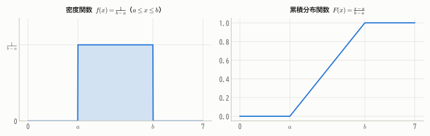
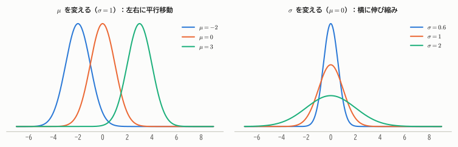
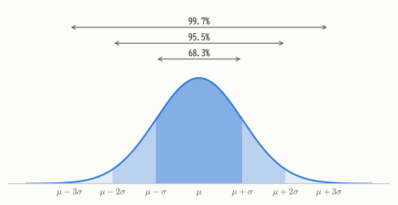
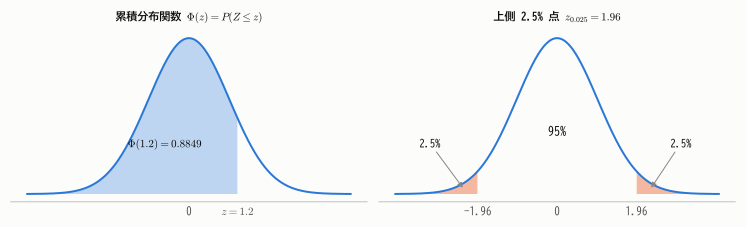
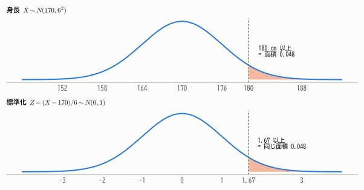
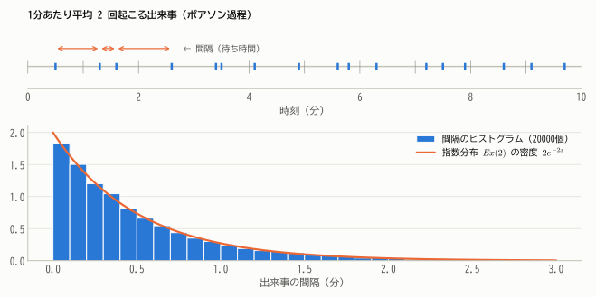
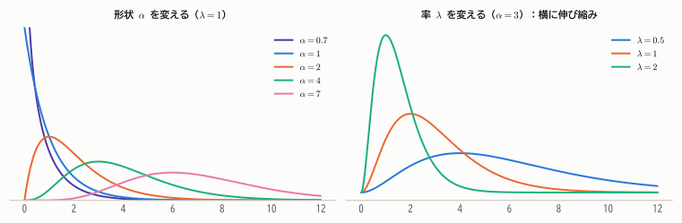
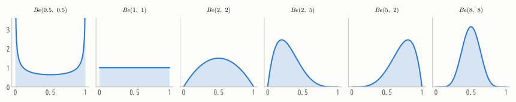
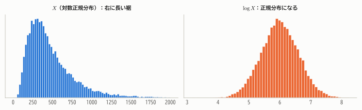

# 第8章 代表的な連続分布

!!! abstract "この章で学ぶこと"
    - **一様分布**：どの値も同じくらい出やすい分布
    - **正規分布**：統計学で最も重要な分布。標準化と正規分布表の使い方
    - **指数分布**：待ち時間の分布。ポアソン分布との関係と無記憶性
    - **ガンマ分布**・**ベータ分布**：指数分布や比率のモデルを一般化した分布
    - 対数正規分布などその他の分布

第7章の離散分布に続いて、この章では連続型の定番分布を学びます。特に **正規分布** は、統計学のあらゆる場面に登場する最重要の分布です。

## 8.1 一様分布

区間 $[a, b]$ のどの値も「同じくらい出やすい」分布です。

!!! definition "定義 8.1（一様分布）"
    $$
    f(x) = \begin{cases} \dfrac{1}{b - a} & (a \le x \le b) \\ 0 & (\text{それ以外}) \end{cases}
    $$

    を密度関数にもつ分布を区間 $[a, b]$ 上の **一様分布** といい、$U(a, b)$ と書く。

    $$
    E[X] = \frac{a + b}{2}, \qquad V[X] = \frac{(b - a)^2}{12}
    $$

<figure markdown="span">
  { width="800" }
  <figcaption>図8.1 一様分布 $U(a, b)$。密度は区間内で一定（面積が1になるよう高さは $1/(b-a)$）、累積分布関数は直線的に増える。</figcaption>
</figure>

??? proof "期待値と分散の導出"
    $$
    E[X] = \int_a^b \frac{x}{b - a}\,dx = \frac{1}{b - a}\cdot\frac{b^2 - a^2}{2} = \frac{a + b}{2}
    $$

    $$
    E[X^2] = \int_a^b \frac{x^2}{b - a}\,dx = \frac{b^3 - a^3}{3(b - a)} = \frac{a^2 + ab + b^2}{3}
    $$

    $$
    V[X] = \frac{a^2 + ab + b^2}{3} - \frac{(a + b)^2}{4} = \frac{4a^2 + 4ab + 4b^2 - 3a^2 - 6ab - 3b^2}{12} = \frac{(b - a)^2}{12}
    $$

コンピュータの乱数（`Math.random()` や `numpy.random.random()`）は $U(0, 1)$ に従うように作られています。
第10章で学ぶように、$U(0, 1)$ の乱数を変換すれば、どんな分布の乱数でも作ることができます。

## 8.2 正規分布

### 定義と形

!!! definition "定義 8.2（正規分布）"
    $$
    f(x) = \frac{1}{\sqrt{2\pi}\,\sigma}\exp\left\{-\frac{(x - \mu)^2}{2\sigma^2}\right\} \qquad (-\infty < x < \infty)
    $$

    を密度関数にもつ分布を、平均 $\mu$、分散 $\sigma^2$ の **正規分布** といい、$N(\mu, \sigma^2)$ と書く。

    $$
    E[X] = \mu, \qquad V[X] = \sigma^2
    $$

    特に $N(0, 1)$ を **標準正規分布** という。その密度関数を $\phi(z)$、累積分布関数を $\Phi(z)$ で表す。

正規分布は **ガウス分布** とも呼ばれます。天文観測の誤差を研究したガウスにちなむ名前です。
密度関数は左右対称な釣り鐘型で、パラメータは期待値 $\mu$ と分散 $\sigma^2$ の2つだけです。

<figure markdown="span">
  { width="860" }
  <figcaption>図8.2 $\mu$ は山の位置を、$\sigma$ は山の幅を決める。$\sigma$ が小さいほど幅が狭く、山が高くなる（面積は常に1）。</figcaption>
</figure>

密度関数の式は複雑に見えますが、本質は $e^{-(\text{距離})^2/2}$ の部分です。平均から離れるにつれて、**距離の2乗** に比例して急速に（指数関数的に）小さくなります。
前の係数 $\frac{1}{\sqrt{2\pi}\sigma}$ は、全体の面積を1にするための調整です。面積が1になることは **ガウス積分**

$$
\int_{-\infty}^{\infty} e^{-z^2/2}\,dz = \sqrt{2\pi}
$$

から確かめられます（[付録A](../appendix/math.md#gauss) で証明します）。

??? proof "期待値と分散の導出"
    $z = (x - \mu)/\sigma$ と置換すると、$X = \mu + \sigma Z$ で $Z \sim N(0, 1)$ と考えられるので、$E[Z] = 0$、$V[Z] = 1$ を示せば十分です（定理6.1, 6.2より $E[X] = \mu$、$V[X] = \sigma^2$）。

    - $E[Z] = \int z\,\phi(z)\,dz = 0$：$z\phi(z)$ は奇関数（$z \to -z$ で符号が反転）なので、積分は打ち消し合って0になります。
    - $E[Z^2] = \int z^2 \phi(z)\,dz$：$\phi'(z) = -z\phi(z)$ に注意して部分積分すると

    $$
    \int_{-\infty}^{\infty} z \cdot z\phi(z)\,dz = \Big[-z\phi(z)\Big]_{-\infty}^{\infty} + \int_{-\infty}^{\infty}\phi(z)\,dz = 0 + 1 = 1
    $$

    よって $V[Z] = E[Z^2] - 0^2 = 1$ です。

### 68-95-99.7 ルール

正規分布では、平均から標準偏差の何倍の範囲に何％が入るかが決まっています。

<figure markdown="span">
  { width="660" }
  <figcaption>図8.3 正規分布では、$\mu \pm \sigma$ に約68%、$\mu \pm 2\sigma$ に約95%、$\mu \pm 3\sigma$ に約99.7%が入る。</figcaption>
</figure>

第2章で「山型の分布では平均 ± 2 標準偏差に約95%」と述べたのは、この性質のことです。
$\pm 3\sigma$ の外側は 0.3% しかないので、「$3\sigma$ を超えるのは異常」とみなす品質管理の考え方（3シグマ法）もここから来ています。

### 1次変換と標準化

!!! theorem "定理 8.1（正規分布の1次変換）"
    $X \sim N(\mu, \sigma^2)$ ならば、定数 $a \ne 0$、$b$ について

    $$
    aX + b \sim N(a\mu + b,\ a^2\sigma^2)
    $$

    特に、**標準化** $Z = \dfrac{X - \mu}{\sigma}$ は標準正規分布 $N(0, 1)$ に従う。

期待値と分散が $a\mu + b$、$a^2\sigma^2$ になるのは第6章の一般的な性質です。この定理の大事なポイントは「1次変換しても **正規分布のまま** である」ことです（証明は第10章の変数変換で行います）。

### 正規分布の確率の求め方

正規分布の累積分布関数は、初等関数では表せません。そこで、どんな正規分布も標準化して $N(0, 1)$ に直し、
**標準正規分布表**（またはソフトウェア）で $\Phi(z)$ の値を読み取ります。

<figure markdown="span">
  { width="840" }
  <figcaption>図8.4 左：$\Phi(z)$ は $z$ より左の面積。右：上側確率が $\alpha$ となる点を上側 $100\alpha$% 点 $z_\alpha$ という。$z_{0.025} = 1.96$ は推測統計で最もよく使う値。</figcaption>
</figure>

**例**：成人男性の身長が $N(170, 6^2)$ に従うとき、身長 180 cm 以上の人の割合は？

$$
P(X \ge 180) = P\left(Z \ge \frac{180 - 170}{6}\right) = P(Z \ge 1.67) = 1 - \Phi(1.67) \approx 0.048
$$

約4.8%です。

<figure markdown="span">
  { width="680" }
  <figcaption>図8.5 標準化は目盛りの付け替えにすぎない。身長の分布で 180 cm 以上の面積と、標準正規分布で 1.67 以上の面積は等しい。</figcaption>
</figure>

計算に便利な性質と、よく使う値をまとめておきます（より詳しい表は [付録B](../appendix/distributions.md#normal-table) にあります）。

- 対称性：$\Phi(-z) = 1 - \Phi(z)$
- $P(a \le Z \le b) = \Phi(b) - \Phi(a)$

| 上側確率 $\alpha$ | 0.10 | 0.05 | 0.025 | 0.01 | 0.005 |
|---|---|---|---|---|---|
| 上側 $100\alpha$% 点 $z_\alpha$ | 1.282 | 1.645 | 1.960 | 2.326 | 2.576 |

!!! point "なぜ正規分布がそんなに重要なのか"
    1. **中心極限定理**（第12章）：独立な確率変数をたくさん足し合わせると、元の分布が何であっても和の分布は正規分布に近づく。
       測定誤差や身長など、多くの小さな要因が積み重なって決まる量が正規分布に近いのはこのためです。
    2. **数学的な扱いやすさ**：正規分布に従う変数の1次変換や和は再び正規分布になる（第10章）。標本分布の理論（第13章）もきれいに組み立てられる。
    3. **最大エントロピー**：平均と分散だけがわかっているとき、最も「偏りのない」（情報量の少ない）分布が正規分布であることが知られています。

### 積率母関数

正規分布 $N(\mu, \sigma^2)$ の積率母関数は

$$
M_X(t) = \exp\left(\mu t + \frac{\sigma^2 t^2}{2}\right)
$$

です。これは第10章・第12章で大活躍します。

??? proof "導出"
    まず $Z \sim N(0, 1)$ の場合を計算します。指数部分で平方完成すると

    $$
    M_Z(t) = \int_{-\infty}^{\infty} e^{tz}\frac{1}{\sqrt{2\pi}}e^{-z^2/2}\,dz = e^{t^2/2}\int_{-\infty}^{\infty}\frac{1}{\sqrt{2\pi}}e^{-(z - t)^2/2}\,dz = e^{t^2/2}
    $$

    （最後の積分は $N(t, 1)$ の密度の積分なので1です。）
    $X = \mu + \sigma Z$ なので $M_X(t) = E[e^{t(\mu + \sigma Z)}] = e^{\mu t}M_Z(\sigma t) = e^{\mu t + \sigma^2 t^2/2}$。

## 8.3 指数分布

### 待ち時間の分布

第7章で、一定の割合でランダムに起こる出来事の回数はポアソン分布に従うことを学びました。
では、**次の出来事が起こるまでの待ち時間** はどんな分布に従うでしょうか。

単位時間あたり平均 $\lambda$ 回の割合で起こるとき、時間 $t$ の間に起こる回数は $Po(\lambda t)$ に従います。
待ち時間を $T$ とすると、「$T > t$」は「時間 $t$ の間に1回も起こらない」ことと同じなので

$$
P(T > t) = P(\text{時間 } t \text{ の間の回数} = 0) = e^{-\lambda t}
$$

よって累積分布関数は $F(t) = 1 - e^{-\lambda t}$、微分して密度関数 $f(t) = \lambda e^{-\lambda t}$ が得られます。

!!! definition "定義 8.3（指数分布）"
    $$
    f(x) = \lambda e^{-\lambda x} \qquad (x \ge 0)
    $$

    を密度関数にもつ分布を、率 $\lambda$（$> 0$）の **指数分布** といい、$Ex(\lambda)$ と書く。

    $$
    E[X] = \frac{1}{\lambda}, \qquad V[X] = \frac{1}{\lambda^2}
    $$

1分に平均2回起こる出来事なら、待ち時間の平均は $1/2$ 分です。「率」の逆数が平均待ち時間になる、というのは自然な結果です。

<figure markdown="span">
  { width="760" }
  <figcaption>図8.6 上：ランダムに起こる出来事（縦線）とその間隔。下：多数の間隔のヒストグラムは指数分布の密度にぴったり重なる。</figcaption>
</figure>

??? proof "期待値と分散の導出"
    部分積分を使います。

    $$
    E[X] = \int_0^{\infty} x\lambda e^{-\lambda x}\,dx = \Big[-xe^{-\lambda x}\Big]_0^{\infty} + \int_0^{\infty} e^{-\lambda x}\,dx = 0 + \frac{1}{\lambda}
    $$

    $$
    E[X^2] = \int_0^{\infty} x^2\lambda e^{-\lambda x}\,dx = \Big[-x^2 e^{-\lambda x}\Big]_0^{\infty} + \int_0^{\infty} 2x e^{-\lambda x}\,dx = \frac{2}{\lambda}E[X] = \frac{2}{\lambda^2}
    $$

    $V[X] = \frac{2}{\lambda^2} - \frac{1}{\lambda^2} = \frac{1}{\lambda^2}$。
    なお積率母関数は $M_X(t) = \int_0^\infty e^{tx}\lambda e^{-\lambda x}dx = \frac{\lambda}{\lambda - t}$（$t < \lambda$）です。

### 指数分布の無記憶性

指数分布は、幾何分布（第7章）の連続版です。そのため、同じく **無記憶性** をもちます。

$$
P(X > s + t \mid X > s) = \frac{e^{-\lambda(s + t)}}{e^{-\lambda s}} = e^{-\lambda t} = P(X > t)
$$

「すでに $s$ 分待った」という情報は、この先の待ち時間に影響しません。
逆に、無記憶性をもつ連続分布は指数分布に限られることが知られています。

!!! warning "無記憶性が成り立たない例"
    電球や機械部品の寿命は、使い込むほど壊れやすくなる（摩耗する）ので、無記憶性は成り立たず指数分布は当てはまりません。
    寿命の分析では、壊れやすさが時間とともに変化する **ワイブル分布** などが使われます。

## 8.4 ガンマ分布

### ガンマ関数

ガンマ分布を定義するために、階乗を実数に拡張した **ガンマ関数** を導入します。

!!! definition "定義 8.4（ガンマ関数）"
    $\alpha > 0$ に対して

    $$
    \Gamma(\alpha) = \int_0^{\infty} x^{\alpha - 1}e^{-x}\,dx
    $$

ガンマ関数は次の性質をもちます（1は部分積分で示せます）。

1. $\Gamma(\alpha + 1) = \alpha\,\Gamma(\alpha)$
2. $\Gamma(1) = 1$、したがって正の整数 $n$ について $\Gamma(n) = (n - 1)!$
3. $\Gamma(1/2) = \sqrt{\pi}$（ガウス積分から）

### ガンマ分布

!!! definition "定義 8.5（ガンマ分布）"
    $$
    f(x) = \frac{\lambda^\alpha}{\Gamma(\alpha)}x^{\alpha - 1}e^{-\lambda x} \qquad (x > 0)
    $$

    を密度関数にもつ分布を、形状 $\alpha$（$> 0$）、率 $\lambda$（$> 0$）の **ガンマ分布** といい、$Ga(\alpha, \lambda)$ と書く。

    $$
    E[X] = \frac{\alpha}{\lambda}, \qquad V[X] = \frac{\alpha}{\lambda^2}
    $$

!!! note "パラメータの流儀"
    率 $\lambda$ の代わりに尺度 $\theta = 1/\lambda$ を使って $Ga(\alpha, \theta)$ と書く流儀もあります（Python の `scipy.stats.gamma` は尺度を使います）。
    文献を読むときは、どちらの流儀かを必ず確認しましょう。

<figure markdown="span">
  { width="860" }
  <figcaption>図8.7 ガンマ分布。$\alpha = 1$ は指数分布そのもの。$\alpha$ が大きくなるほど山型に近づく。</figcaption>
</figure>

$\alpha = 1$ のとき $Ga(1, \lambda) = Ex(\lambda)$ です。さらに、整数 $\alpha = n$ のガンマ分布は「**$n$ 回目の出来事が起こるまでの待ち時間**」の分布になります。
これは「独立な $n$ 個の $Ex(\lambda)$ の和は $Ga(n, \lambda)$ に従う」ということで、第10章で証明します。
第13章で学ぶ **カイ二乗分布** も、ガンマ分布の特別な場合 $\chi^2(k) = Ga(k/2, 1/2)$ です。

??? proof "期待値と分散の導出"
    密度関数の積分が1であることから、$\int_0^\infty x^{\beta - 1}e^{-\lambda x}dx = \Gamma(\beta)/\lambda^\beta$ が任意の $\beta > 0$ で成り立ちます。これを使うと

    $$
    E[X] = \frac{\lambda^\alpha}{\Gamma(\alpha)}\int_0^{\infty} x^{\alpha}e^{-\lambda x}\,dx = \frac{\lambda^\alpha}{\Gamma(\alpha)}\cdot\frac{\Gamma(\alpha + 1)}{\lambda^{\alpha + 1}} = \frac{\alpha}{\lambda}
    $$

    $$
    E[X^2] = \frac{\lambda^\alpha}{\Gamma(\alpha)}\cdot\frac{\Gamma(\alpha + 2)}{\lambda^{\alpha + 2}} = \frac{\alpha(\alpha + 1)}{\lambda^2}, \qquad V[X] = \frac{\alpha(\alpha + 1) - \alpha^2}{\lambda^2} = \frac{\alpha}{\lambda^2}
    $$

    積率母関数は同様に $M_X(t) = \left(\frac{\lambda}{\lambda - t}\right)^\alpha$（$t < \lambda$）です。

## 8.5 ベータ分布

区間 $(0, 1)$ に値をとる量——割合、比率、確率そのもの——のモデルとしてよく使われるのが **ベータ分布** です。

!!! definition "定義 8.6（ベータ分布）"
    $$
    f(x) = \frac{1}{B(a, b)}x^{a - 1}(1 - x)^{b - 1} \qquad (0 < x < 1)
    $$

    を密度関数にもつ分布を **ベータ分布** といい、$Be(a, b)$ と書く（$a, b > 0$）。ここで $B(a, b)$ は **ベータ関数**

    $$
    B(a, b) = \int_0^1 x^{a - 1}(1 - x)^{b - 1}\,dx = \frac{\Gamma(a)\Gamma(b)}{\Gamma(a + b)}
    $$

    で、面積を1にするための定数である。

    $$
    E[X] = \frac{a}{a + b}, \qquad V[X] = \frac{ab}{(a + b)^2(a + b + 1)}
    $$

<figure markdown="span">
  { width="900" }
  <figcaption>図8.8 ベータ分布は2つのパラメータで、U字型・一様・山型・左右に偏った形など、多彩な形をとる。$Be(1, 1)$ は一様分布 $U(0, 1)$。</figcaption>
</figure>

$a$ を「成功の数 + 1」、$b$ を「失敗の数 + 1」と考えると直感的です。$a$ が大きいほど1寄りに、$b$ が大きいほど0寄りになり、$a + b$ が大きいほど山が鋭くなります。
この解釈は、第20章の **ベイズ統計** で「確率 $p$ についての信念」をベータ分布で表すときに、そのまま意味をもちます。

!!! demo "やってみよう：連続分布エクスプローラ"
    分布を選んでパラメータを動かしてみましょう。グラフの上にマウスを置くと密度の値が表示されます。

    

## 8.6 その他の分布

### 対数正規分布

$\log X$ が正規分布 $N(\mu, \sigma^2)$ に従うとき、$X$ は **対数正規分布** に従うといいます。
正の値だけをとり、右に長い裾をもつので、所得、株価、粒子の大きさ、病気の潜伏期間などのモデルに使われます。
「多くの要因が **掛け算で** 効いてくる量」は、対数をとると足し算になるので、中心極限定理により対数正規分布に近づきます。

<figure markdown="span">
  { width="800" }
  <figcaption>図8.9 対数正規分布に従うデータ（左）は、対数をとると正規分布になる（右）。右に歪んだデータは、対数変換すると扱いやすくなることが多い。</figcaption>
</figure>

### コーシー分布

密度関数 $f(x) = \dfrac{1}{\pi(1 + x^2)}$ の分布を **コーシー分布** といいます。正規分布に似た釣り鐘型ですが、裾が非常に重く、**期待値が存在しません**
（$\int |x| f(x)\,dx = \infty$）。第11章の大数の法則が成り立たない例として登場します。

## まとめ

| 分布 | 記号 | 密度関数 | 期待値 | 分散 | 典型的な状況 |
|---|---|---|---|---|---|
| 一様 | $U(a, b)$ | $\frac{1}{b-a}$ | $\frac{a+b}{2}$ | $\frac{(b-a)^2}{12}$ | 乱数、どの値も同等 |
| 正規 | $N(\mu, \sigma^2)$ | $\frac{1}{\sqrt{2\pi}\sigma}e^{-\frac{(x-\mu)^2}{2\sigma^2}}$ | $\mu$ | $\sigma^2$ | 誤差、多数の要因の和 |
| 指数 | $Ex(\lambda)$ | $\lambda e^{-\lambda x}$ | $\frac{1}{\lambda}$ | $\frac{1}{\lambda^2}$ | 待ち時間（無記憶） |
| ガンマ | $Ga(\alpha, \lambda)$ | $\frac{\lambda^\alpha}{\Gamma(\alpha)}x^{\alpha-1}e^{-\lambda x}$ | $\frac{\alpha}{\lambda}$ | $\frac{\alpha}{\lambda^2}$ | $\alpha$ 回目までの待ち時間 |
| ベータ | $Be(a, b)$ | $\frac{x^{a-1}(1-x)^{b-1}}{B(a,b)}$ | $\frac{a}{a+b}$ | $\frac{ab}{(a+b)^2(a+b+1)}$ | 割合・確率のモデル |

- 正規分布の確率は、**標準化** して標準正規分布表で求める。$z_{0.025} = 1.96$ は必須の値。
- 指数分布はポアソン過程の待ち時間で、**無記憶性** をもつ。
- 指数分布 ⊂ ガンマ分布、カイ二乗分布 ⊂ ガンマ分布、一様分布 ⊂ ベータ分布、という包含関係がある。

## 練習問題

!!! exercise "問題 8.1（正規分布の確率）"
    あるテストの点数が $N(60, 10^2)$ に従うとき、次の確率を求めてください。$\Phi(1.5) = 0.9332$、$\Phi(2) = 0.9772$、$\Phi(1) = 0.8413$ を使ってかまいません。

    (1) 75点以上の割合　(2) 50点以上80点以下の割合　(3) 上位2.5%に入るには何点以上必要か

    ??? success "解答"
        (1) $P(X \ge 75) = P(Z \ge 1.5) = 1 - 0.9332 = 0.0668$（約6.7%）

        (2) $P(50 \le X \le 80) = P(-1 \le Z \le 2) = \Phi(2) - \Phi(-1) = 0.9772 - (1 - 0.8413) = 0.8185$（約81.9%）

        (3) 上側2.5%点は $z = 1.96$ なので、$60 + 1.96 \times 10 = 79.6$ 点以上。

!!! exercise "問題 8.2（指数分布）"
    あるコールセンターには、平均して3分に1回電話がかかってきます（ポアソン過程とします）。

    (1) 次の電話までの待ち時間 $T$ の分布を答えてください。
    (2) 5分以上電話がかかってこない確率を求めてください。
    (3) すでに5分間電話がなかったとき、さらに5分以上かかってこない確率を求めてください。

    ??? success "解答"
        (1) 1分あたりの率は $\lambda = 1/3$ なので $T \sim Ex(1/3)$（平均3分）。

        (2) $P(T > 5) = e^{-5/3} \approx 0.189$

        (3) 無記憶性より $P(T > 10 \mid T > 5) = P(T > 5) \approx 0.189$

!!! exercise "問題 8.3（一様分布）"
    $X \sim U(0, 1)$ のとき、$Y = 3X + 2$ はどんな分布に従いますか。また $E[Y]$、$V[Y]$ を求めてください。

    ??? success "解答"
        $Y$ は $[2, 5]$ の値を「同じくらいの出やすさで」とるので $Y \sim U(2, 5)$ です（第10章の変数変換で厳密に示せます）。
        $E[Y] = (2 + 5)/2 = 3.5$、$V[Y] = (5 - 2)^2/12 = 0.75$。
        $E[Y] = 3 \times 0.5 + 2$、$V[Y] = 9 \times \frac{1}{12}$ としても同じです。

!!! exercise "問題 8.4（ガンマ関数）"
    (1) 部分積分を用いて $\Gamma(\alpha + 1) = \alpha\Gamma(\alpha)$ を示してください。
    (2) $\Gamma(1/2) = \sqrt{\pi}$ を用いて $\Gamma(5/2)$ を求めてください。

    ??? success "解答"
        (1) $\Gamma(\alpha + 1) = \int_0^\infty x^\alpha e^{-x}dx = \Big[-x^\alpha e^{-x}\Big]_0^\infty + \int_0^\infty \alpha x^{\alpha - 1}e^{-x}dx = 0 + \alpha\Gamma(\alpha)$

        (2) $\Gamma(5/2) = \frac{3}{2}\Gamma(3/2) = \frac{3}{2}\cdot\frac{1}{2}\Gamma(1/2) = \frac{3}{4}\sqrt{\pi} \approx 1.329$

!!! exercise "問題 8.5（ベータ分布）"
    $X \sim Be(2, 3)$ の密度関数を具体的に書き、$E[X]$ を定義に従って計算してください。

    ??? success "解答"
        $B(2, 3) = \frac{\Gamma(2)\Gamma(3)}{\Gamma(5)} = \frac{1! \cdot 2!}{4!} = \frac{2}{24} = \frac{1}{12}$ なので、$f(x) = 12x(1 - x)^2$（$0 < x < 1$）。

        $$
        E[X] = \int_0^1 12x^2(1 - x)^2\,dx = 12\int_0^1 (x^2 - 2x^3 + x^4)\,dx = 12\left(\frac{1}{3} - \frac{1}{2} + \frac{1}{5}\right) = 12 \cdot \frac{1}{30} = \frac{2}{5}
        $$

        公式 $a/(a + b) = 2/5$ と一致します。
