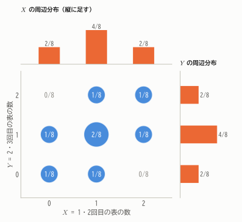
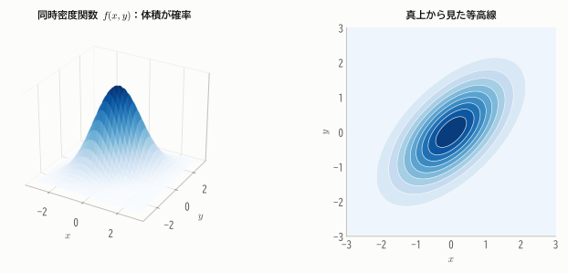
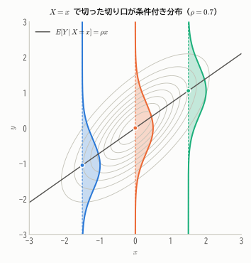
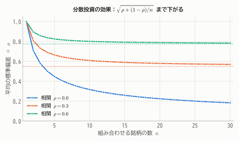
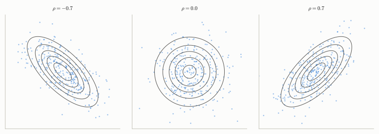

# 第9章 多次元の確率分布

!!! abstract "この章で学ぶこと"
    - 2つ以上の確率変数を同時に扱う **同時分布**、そこから得られる **周辺分布**・**条件付き分布**
    - 確率変数の **独立性** と、統計学の前提となる「独立同分布」
    - **共分散**・**相関係数** と、和の分散の公式 $V[X + Y] = V[X] + V[Y] + 2\mathrm{Cov}(X, Y)$
    - 標本平均の分散 $V[\bar{X}] = \sigma^2/n$ ——推測統計の出発点
    - **条件付き期待値** と繰り返し期待値の法則
    - **2変量正規分布**

これまでは確率変数を1つずつ扱ってきました。しかし現実には「身長と体重」「気温と売上」のように、複数の量の **関係** を知りたいことがほとんどです。
また、統計学では $n$ 個のデータを $n$ 個の確率変数 $X_1, \dots, X_n$ とみなすので、多変数の確率論は推測統計の土台そのものです。

## 9.1 同時分布と周辺分布

### 離散型の同時分布

コインを3回投げ、$X$ = 1・2回目の表の数、$Y$ = 2・3回目の表の数 とします。2回目のコインが両方に関わっているので、$X$ と $Y$ には関係がありそうです。
8通りの結果それぞれで $(X, Y)$ の値を調べて集計すると、次の表が得られます。

| | $Y = 0$ | $Y = 1$ | $Y = 2$ | **$X$ の周辺分布** |
|---|---|---|---|---|
| $X = 0$ | $1/8$ | $1/8$ | $0$ | $2/8$ |
| $X = 1$ | $1/8$ | $2/8$ | $1/8$ | $4/8$ |
| $X = 2$ | $0$ | $1/8$ | $1/8$ | $2/8$ |
| **$Y$ の周辺分布** | $2/8$ | $4/8$ | $2/8$ | $1$ |

!!! definition "定義 9.1（同時確率関数と周辺確率関数）"
    - $p(x, y) = P(X = x,\ Y = y)$ を $(X, Y)$ の **同時確率関数** という。$\sum_x\sum_y p(x, y) = 1$ を満たす。
    - $p_X(x) = \sum_y p(x, y)$、$p_Y(y) = \sum_x p(x, y)$ を、それぞれ $X$、$Y$ の **周辺確率関数** という。

「周辺」という名前は、表の **周辺（端）** に合計を書くことに由来します。同時分布から一方の変数について足し合わせる（消去する）と、もう一方だけの分布が得られます。

<figure markdown="span">
  { width="520" }
  <figcaption>図9.1 同時分布（円の面積が確率）と、それを縦・横に足し合わせて得られる周辺分布。</figcaption>
</figure>

### 連続型の同時分布

連続型では、2変数の関数 $f(x, y)$ を **同時密度関数** として使います。1変数では「面積が確率」でしたが、2変数では **体積が確率** になります。

$$
P\big((X, Y) \in A\big) = \iint_A f(x, y)\,dx\,dy, \qquad \iint_{\mathbb{R}^2} f(x, y)\,dx\,dy = 1
$$

周辺密度関数は、離散型の和を積分に置き換えて $f_X(x) = \int_{-\infty}^{\infty} f(x, y)\,dy$ です。

<figure markdown="span">
  { width="820" }
  <figcaption>図9.2 2変数の同時密度関数は「山」の形をした曲面で、ある領域の上の体積がその領域に入る確率になる。右は真上から見た等高線。</figcaption>
</figure>

## 9.2 条件付き分布

「$X = x$ とわかったとき、$Y$ はどう分布するか」を表すのが条件付き分布です。第4章の条件付き確率をそのまま確率変数に当てはめます。

!!! definition "定義 9.2（条件付き分布）"
    $p_X(x) > 0$ のとき、$X = x$ を与えたときの $Y$ の **条件付き確率関数** を

    $$
    p(y \mid x) = P(Y = y \mid X = x) = \frac{p(x, y)}{p_X(x)}
    $$

    と定める。連続型では $f(y \mid x) = \dfrac{f(x, y)}{f_X(x)}$ を **条件付き密度関数** という。

上の表で $X = 1$ を与えると、$Y$ の条件付き分布は「$X = 1$ の行」を行の合計 $4/8$ で割って

$$
P(Y = 0 \mid X = 1) = \frac{1}{4}, \quad P(Y = 1 \mid X = 1) = \frac{1}{2}, \quad P(Y = 2 \mid X = 1) = \frac{1}{4}
$$

となります。表のある行（または列）だけを取り出し、合計が1になるように拡大したものが条件付き分布です。
連続型では、同時密度関数の山を $X = x$ の位置で切った **切り口** の形が条件付き分布になります。

<figure markdown="span">
  { width="560" }
  <figcaption>図9.3 楕円は同時密度関数の等高線。$X = x$ で切った切り口（色つきの曲線）が条件付き分布で、その中心（条件付き期待値）は $x$ とともに移動する。</figcaption>
</figure>

## 9.3 確率変数の独立性

!!! definition "定義 9.3（確率変数の独立）"
    すべての $x, y$ について

    $$
    p(x, y) = p_X(x)\,p_Y(y) \qquad (\text{連続型では } f(x, y) = f_X(x) f_Y(y))
    $$

    が成り立つとき、$X$ と $Y$ は **独立** であるという。$n$ 個の確率変数 $X_1, \dots, X_n$ についても、同時分布が周辺分布の積になるとき独立という。

独立なら $p(y \mid x) = p(x, y)/p_X(x) = p_Y(y)$、つまり **$X$ の値を知っても $Y$ の分布は変わらない** ことになります。

上の例では $P(X = 0, Y = 2) = 0$ ですが $P(X = 0)P(Y = 2) = \frac{2}{8}\cdot\frac{2}{8} \ne 0$ なので、$X$ と $Y$ は独立ではありません。

!!! point "独立同分布（i.i.d.）"
    $X_1, X_2, \dots, X_n$ が互いに独立で、すべて同じ分布に従うとき、**独立同分布**（independent and identically distributed, **i.i.d.**）であるといいます。

    母集団から無作為に（くじ引きのように）$n$ 個のデータを取り出すことは、「母集団分布に従う i.i.d. な確率変数 $X_1, \dots, X_n$ の実現値を得ること」とモデル化されます。
    これが第4部以降の推測統計の基本的な枠組みです。

## 9.4 共分散と相関係数

### 2変数の関数の期待値

$g(X, Y)$ の期待値は、1変数のときと同様に $E[g(X, Y)] = \sum_x\sum_y g(x, y)\,p(x, y)$（連続型なら二重積分）で計算できます。
これを使うと、第6章で予告した期待値の線形性 $E[X + Y] = E[X] + E[Y]$ が一般に示せます。

$$
E[X + Y] = \sum_x\sum_y (x + y)p(x, y) = \sum_x x\sum_y p(x, y) + \sum_y y\sum_x p(x, y) = \sum_x x\,p_X(x) + \sum_y y\,p_Y(y)
$$

!!! theorem "定理 9.1（独立な確率変数の積の期待値）"
    $X$ と $Y$ が独立ならば

    $$
    E[XY] = E[X]\,E[Y]
    $$

    より一般に、独立ならば任意の関数 $g, h$ について $E[g(X)h(Y)] = E[g(X)]\,E[h(Y)]$。

??? proof "証明（離散型）"
    独立性より $p(x, y) = p_X(x)p_Y(y)$ なので、二重和が積に分解できます。

    $$
    E[XY] = \sum_x\sum_y xy\,p_X(x)p_Y(y) = \left(\sum_x x\,p_X(x)\right)\left(\sum_y y\,p_Y(y)\right) = E[X]\,E[Y]
    $$

### 共分散と相関係数

第3章ではデータの共分散・相関係数を学びました。確率変数についても同じように定義します。

!!! definition "定義 9.4（共分散と相関係数）"
    $\mu_X = E[X]$、$\mu_Y = E[Y]$ とするとき

    $$
    \mathrm{Cov}(X, Y) = E\big[(X - \mu_X)(Y - \mu_Y)\big] = E[XY] - E[X]\,E[Y]
    $$

    を **共分散**、

    $$
    \rho(X, Y) = \frac{\mathrm{Cov}(X, Y)}{\sqrt{V[X]}\sqrt{V[Y]}}
    $$

    を **相関係数** という。

上の例では $E[XY] = \frac{1}{8}(1\cdot 1\cdot 2 + 1\cdot 2\cdot 1 + 2\cdot 1\cdot 1 + 2\cdot 2\cdot 1) = \frac{10}{8}$、$E[X] = E[Y] = 1$ なので
$\mathrm{Cov}(X, Y) = \frac{10}{8} - 1 = \frac{1}{4}$。$V[X] = V[Y] = \frac{1}{2}$（$B(2, 1/2)$ の分散）なので、$\rho = \frac{1/4}{1/2} = \frac{1}{2}$ です。
2回目のコインを共有しているぶん、正の相関があります。

!!! theorem "定理 9.2（共分散と相関係数の性質）"
    1. $\mathrm{Cov}(X, X) = V[X]$、$\mathrm{Cov}(X, Y) = \mathrm{Cov}(Y, X)$
    2. $\mathrm{Cov}(aX + b,\ cY + d) = ac\,\mathrm{Cov}(X, Y)$
    3. $\mathrm{Cov}(X + Y,\ Z) = \mathrm{Cov}(X, Z) + \mathrm{Cov}(Y, Z)$
    4. $-1 \le \rho(X, Y) \le 1$。$|\rho| = 1$ となるのは、$Y = a + bX$（$b \ne 0$）が確率1で成り立つときに限る。
    5. $X$ と $Y$ が独立ならば $\mathrm{Cov}(X, Y) = 0$（したがって $\rho = 0$）。

??? proof "証明（4と5）"
    **4.** 任意の実数 $t$ について $V[tX + Y] \ge 0$ です。展開すると（次の定理9.3を使う）

    $$
    V[tX + Y] = t^2 V[X] + 2t\,\mathrm{Cov}(X, Y) + V[Y] \ge 0
    $$

    これが $t$ の2次式としてつねに0以上なので、判別式は0以下です。

    $$
    \mathrm{Cov}(X, Y)^2 - V[X]\,V[Y] \le 0 \quad\Longleftrightarrow\quad \rho^2 \le 1
    $$

    等号は、ある $t$ で $V[tX + Y] = 0$、つまり $tX + Y$ が確率1で定数になるときに成り立ちます。

    **5.** 定理9.1より $E[XY] = E[X]E[Y]$ なので $\mathrm{Cov}(X, Y) = 0$。

!!! warning "無相関でも独立とは限らない"
    定理9.2の5の逆は成り立ちません。たとえば $X$ が $-1, 0, 1$ を確率 $1/3$ ずつとり、$Y = X^2$ とすると、$Y$ は $X$ で完全に決まる（独立ではない）のに

    $$
    \mathrm{Cov}(X, Y) = E[X^3] - E[X]E[X^2] = 0 - 0 = 0
    $$

    です。共分散・相関係数は **直線的な** 関係しか捉えません（第3章で見たU字型の散布図と同じ現象です）。

### 和の分散

!!! theorem "定理 9.3（和の分散）"
    $$
    V[X + Y] = V[X] + V[Y] + 2\,\mathrm{Cov}(X, Y)
    $$

    特に $X$ と $Y$ が独立（または無相関）ならば

    $$
    V[X + Y] = V[X] + V[Y]
    $$

    より一般に、定数 $a_1, \dots, a_n$ について

    $$
    V\left[\sum_{i=1}^{n} a_i X_i\right] = \sum_{i=1}^{n} a_i^2 V[X_i] + 2\sum_{i<j} a_i a_j \mathrm{Cov}(X_i, X_j)
    $$

??? proof "証明"
    $X - \mu_X = \tilde{X}$、$Y - \mu_Y = \tilde{Y}$ とおくと、$(X + Y) - (\mu_X + \mu_Y) = \tilde{X} + \tilde{Y}$ なので

    $$
    V[X + Y] = E\big[(\tilde{X} + \tilde{Y})^2\big] = E[\tilde{X}^2] + 2E[\tilde{X}\tilde{Y}] + E[\tilde{Y}^2] = V[X] + 2\mathrm{Cov}(X, Y) + V[Y]
    $$

    一般の場合も、$(\sum a_i \tilde{X}_i)^2$ を展開して期待値をとれば同様です。

**注意**：独立なら分散は足し算になりますが、**標準偏差は足し算にならない** ことに注意しましょう（$\sigma_{X+Y} = \sqrt{\sigma_X^2 + \sigma_Y^2}$。ピタゴラスの定理と同じ形です）。
また $V[X - Y] = V[X] + V[Y] - 2\mathrm{Cov}(X, Y)$ で、独立なら **差の分散も和になります**。

**例（二項分布の分散）**：$X \sim B(n, p)$ は独立な $n$ 個のベルヌーイ変数の和なので、$V[X] = n \cdot p(1 - p)$。第7章の面倒な計算が一瞬で済みます。

### 標本平均の期待値と分散 ― 推測統計の出発点

定理9.3から、統計学で最も重要な結果の1つが導かれます。

!!! theorem "定理 9.4（標本平均の期待値と分散）"
    $X_1, \dots, X_n$ が i.i.d. で $E[X_i] = \mu$、$V[X_i] = \sigma^2$ のとき、**標本平均** $\bar{X} = \frac{1}{n}\sum_{i=1}^n X_i$ について

    $$
    E[\bar{X}] = \mu, \qquad V[\bar{X}] = \frac{\sigma^2}{n}, \qquad \text{標準偏差} = \frac{\sigma}{\sqrt{n}}
    $$

??? proof "証明"
    線形性より $E[\bar{X}] = \frac{1}{n}\sum E[X_i] = \frac{1}{n}\cdot n\mu = \mu$。
    独立性と定理9.3（$a_i = 1/n$、共分散はすべて0）より

    $$
    V[\bar{X}] = \sum_{i=1}^{n}\frac{1}{n^2}V[X_i] = \frac{1}{n^2}\cdot n\sigma^2 = \frac{\sigma^2}{n}
    $$

データを $n$ 個集めて平均をとると、平均値のぶれ（標準偏差）は $1/\sqrt{n}$ に小さくなります。
4倍のデータで精度は2倍、100倍のデータで精度は10倍——この **$\sqrt{n}$ の法則** は、第11章の大数の法則、第12章の中心極限定理、そして推定・検定のすべての出発点になります。

### 応用：分散投資

値動き（収益率）の標準偏差がどれも $\sigma$ で、どの2つの相関係数も $\rho$ である $n$ 個の銘柄に、資金を等分して投資するとします。
ポートフォリオの収益率は $\bar{X}$ なので、定理9.3より

$$
V[\bar{X}] = \frac{1}{n^2}\left(n\sigma^2 + n(n-1)\rho\sigma^2\right) = \sigma^2\left(\rho + \frac{1 - \rho}{n}\right)
$$

<figure markdown="span">
  { width="620" }
  <figcaption>図9.4 銘柄数を増やすとリスク（標準偏差）は下がるが、銘柄間に相関があると $\sqrt{\rho}\,\sigma$ より下には下がらない（点線）。</figcaption>
</figure>

銘柄が独立（$\rho = 0$）ならリスクはいくらでも小さくできますが、相関があると、市場全体の動きのような「分散しきれないリスク」が残ります。

## 9.5 条件付き期待値

条件付き分布の期待値を **条件付き期待値** といいます。

$$
E[Y \mid X = x] = \sum_y y\,p(y \mid x) \qquad \left(\text{連続型なら} \int y\,f(y \mid x)\,dy\right)
$$

これは $x$ の関数です。$x$ に確率変数 $X$ を代入した $E[Y \mid X]$ は、**$X$ によって値が決まる確率変数** になります。

図9.3の点（切り口の中心）を結んだ直線が $E[Y \mid X = x]$ でした。「$X$ を知ったときの $Y$ の最良の予測」を表していて、
実際、$E[(Y - g(X))^2]$ を最小にする関数 $g$ は $g(X) = E[Y \mid X]$ であることが示せます（第2章で「平均値は二乗誤差を最小にする」と学んだことの一般化です）。これが第18章の回帰分析の理論的な背景です。

!!! theorem "定理 9.5（繰り返し期待値の法則と全分散の公式）"
    $$
    E\big[E[Y \mid X]\big] = E[Y]
    $$

    $$
    V[Y] = E\big[V[Y \mid X]\big] + V\big[E[Y \mid X]\big]
    $$

??? proof "証明"
    **繰り返し期待値の法則**（離散型）：

    $$
    E\big[E[Y \mid X]\big] = \sum_x E[Y \mid X = x]\,p_X(x) = \sum_x\sum_y y\,\frac{p(x, y)}{p_X(x)}\,p_X(x) = \sum_x\sum_y y\,p(x, y) = E[Y]
    $$

    **全分散の公式**：$V[Y \mid X] = E[Y^2 \mid X] - (E[Y \mid X])^2$ の期待値をとり、繰り返し期待値の法則を使うと

    $$
    E\big[V[Y \mid X]\big] = E[Y^2] - E\big[(E[Y \mid X])^2\big]
    $$

    一方 $V\big[E[Y \mid X]\big] = E\big[(E[Y \mid X])^2\big] - \big(E[E[Y \mid X]]\big)^2 = E\big[(E[Y \mid X])^2\big] - (E[Y])^2$。
    2式を足すと $E[Y^2] - (E[Y])^2 = V[Y]$ になります。

繰り返し期待値の法則は「**場合分けして平均し、その平均をさらに平均する**」ことを表しています（全確率の公式の期待値版です）。
全分散の公式は「全体のばらつき ＝ グループ内のばらつきの平均 ＋ グループ間のばらつき」という分解で、第19章の分散分析の考え方そのものです。

**例**：ある鶏が1か月に産む卵の数 $N$ は $Po(\lambda)$ に従い、各卵は独立に確率 $p$ でかえるとします。かえるひなの数 $Y$ について、$N$ を与えると $Y \sim B(N, p)$ なので

$$
E[Y] = E\big[E[Y \mid N]\big] = E[Np] = \lambda p
$$

$$
V[Y] = E\big[Np(1 - p)\big] + V[Np] = \lambda p(1 - p) + p^2\lambda = \lambda p
$$

期待値と分散が等しいのはポアソン分布の特徴でした。実際、$Y \sim Po(\lambda p)$ であることが示せます。

## 9.6 2変量正規分布

2つの変数の同時分布として最も重要なのが **2変量正規分布** です。

!!! definition "定義 9.5（2変量正規分布）"
    5つのパラメータ $\mu_X, \mu_Y$（平均）、$\sigma_X, \sigma_Y$（標準偏差）、$\rho$（相関係数、$|\rho| < 1$）をもつ **2変量正規分布** の同時密度関数は

    $$
    f(x, y) = \frac{1}{2\pi\sigma_X\sigma_Y\sqrt{1 - \rho^2}}\exp\left[-\frac{1}{2(1 - \rho^2)}\left\{\frac{(x - \mu_X)^2}{\sigma_X^2} - \frac{2\rho(x - \mu_X)(y - \mu_Y)}{\sigma_X\sigma_Y} + \frac{(y - \mu_Y)^2}{\sigma_Y^2}\right\}\right]
    $$

<figure markdown="span">
  { width="860" }
  <figcaption>図9.5 2変量正規分布の等高線は楕円で、$\rho$ の符号で傾きの向きが、$|\rho|$ の大きさで細長さが決まる。点はこの分布から発生させた300組のデータ。</figcaption>
</figure>

式は複雑ですが、次の性質が重要です。

!!! theorem "定理 9.6（2変量正規分布の性質）"
    $(X, Y)$ が2変量正規分布に従うとき

    1. **周辺分布は正規分布**：$X \sim N(\mu_X, \sigma_X^2)$、$Y \sim N(\mu_Y, \sigma_Y^2)$
    2. **条件付き分布も正規分布**：

        $$
        Y \mid X = x \ \sim\ N\left(\mu_Y + \rho\frac{\sigma_Y}{\sigma_X}(x - \mu_X),\ \ \sigma_Y^2(1 - \rho^2)\right)
        $$

    3. **無相関なら独立**：$\rho = 0$ ならば $X$ と $Y$ は独立
    4. $aX + bY$ は正規分布に従う

2 は特に重要です。条件付き期待値 $E[Y \mid X = x]$ は $x$ の **1次関数（直線）** になり、その傾き $\rho\sigma_Y/\sigma_X$ は第3章で見た回帰直線の傾き $r\,s_y/s_x$ とまったく同じ形です。
また条件付き分散 $\sigma_Y^2(1 - \rho^2)$ は $x$ によらず一定で、$X$ を知ることで $Y$ の分散が $(1 - \rho^2)$ 倍に減ることを表しています。

3 は一般には成り立たない「無相関 ⇒ 独立」が、正規分布では成り立つという特別な性質です。$\rho = 0$ を密度関数に代入すると、指数部分が $x$ の項と $y$ の項に分かれ、$f(x, y) = f_X(x)f_Y(y)$ となることから確かめられます。

!!! note "多変量正規分布"
    $k$ 個の変数の場合は、平均ベクトル $\boldsymbol{\mu}$ と **分散共分散行列** $\Sigma$（$(i, j)$ 成分が $\mathrm{Cov}(X_i, X_j)$）を使って

    $$
    f(\boldsymbol{x}) = \frac{1}{(2\pi)^{k/2}|\Sigma|^{1/2}}\exp\left\{-\frac{1}{2}(\boldsymbol{x} - \boldsymbol{\mu})^\top\Sigma^{-1}(\boldsymbol{x} - \boldsymbol{\mu})\right\}
    $$

    と書けます。1変数の $\frac{(x - \mu)^2}{\sigma^2}$ が、行列を使った2次形式に置き換わった形です。重回帰分析（第18章）や多変量解析の基礎になります。

## まとめ

- 同時分布を一方の変数について足す（積分する）と **周辺分布**、ある値で切り取って正規化すると **条件付き分布**。
- **独立** ⟺ 同時分布 ＝ 周辺分布の積。独立なら $E[XY] = E[X]E[Y]$、共分散は0（逆は成り立たない）。
- $V[X + Y] = V[X] + V[Y] + 2\mathrm{Cov}(X, Y)$。独立なら分散は足し算。
- i.i.d. な標本の平均は $E[\bar{X}] = \mu$、$V[\bar{X}] = \sigma^2/n$。精度は $\sqrt{n}$ に比例して上がる。
- $E[E[Y \mid X]] = E[Y]$、$V[Y] = E[V[Y \mid X]] + V[E[Y \mid X]]$。
- 2変量正規分布では、周辺分布も条件付き分布も正規分布で、条件付き期待値は直線、無相関なら独立。

## 練習問題

!!! exercise "問題 9.1（周辺分布と独立性）"
    $(X, Y)$ の同時確率関数が次の表で与えられています。

    | | $Y = 0$ | $Y = 1$ |
    |---|---|---|
    | $X = 0$ | 0.12 | 0.28 |
    | $X = 1$ | 0.18 | 0.42 |

    (1) $X$ と $Y$ の周辺分布を求めてください。　(2) $X$ と $Y$ は独立ですか。

    ??? success "解答"
        (1) $P(X = 0) = 0.40$、$P(X = 1) = 0.60$、$P(Y = 0) = 0.30$、$P(Y = 1) = 0.70$。

        (2) $0.40 \times 0.30 = 0.12$、$0.40 \times 0.70 = 0.28$、$0.60 \times 0.30 = 0.18$、$0.60 \times 0.70 = 0.42$ で、
        すべてのセルで同時確率 ＝ 周辺確率の積なので **独立** です。

!!! exercise "問題 9.2（和と差の分散）"
    $V[X] = 4$、$V[Y] = 9$、$\mathrm{Cov}(X, Y) = -2$ のとき、$V[X + Y]$、$V[X - Y]$、$V[2X - 3Y + 5]$ を求めてください。

    ??? success "解答"
        - $V[X + Y] = 4 + 9 + 2(-2) = 9$
        - $V[X - Y] = 4 + 9 - 2(-2) = 17$
        - $V[2X - 3Y + 5] = 4 \cdot 4 + 9 \cdot 9 + 2 \cdot 2 \cdot (-3) \cdot (-2) = 16 + 81 + 24 = 121$

!!! exercise "問題 9.3（標本平均）"
    ある母集団の標準偏差は 12 です。標本平均の標準偏差を 2 以下にするには、何個以上のデータが必要ですか。

    ??? success "解答"
        $12/\sqrt{n} \le 2$ より $\sqrt{n} \ge 6$、$n \ge 36$。36個以上必要です。

!!! exercise "問題 9.4（2変量正規分布の条件付き分布）"
    父親の身長 $X$ と息子の身長 $Y$ が、$\mu_X = \mu_Y = 170$、$\sigma_X = \sigma_Y = 6$、$\rho = 0.5$ の2変量正規分布に従うとします。
    父親の身長が 182 cm のとき、息子の身長の条件付き分布を求めてください。

    ??? success "解答"
        $$
        E[Y \mid X = 182] = 170 + 0.5 \cdot \frac{6}{6}(182 - 170) = 176, \qquad V[Y \mid X = 182] = 36(1 - 0.25) = 27
        $$

        つまり $N(176, 27)$（標準偏差約 5.2 cm）です。父親は平均より 12 cm 高いのに、息子の予測値は平均より 6 cm 高いだけです。
        これが第3章で触れた「**平均への回帰**」で、ゴルトンが19世紀に親子の身長のデータで発見した現象です。

!!! exercise "問題 9.5（繰り返し期待値の法則）"
    サイコロを1回振って出た目 $N$ の回数だけコインを投げ、表の回数を $Y$ とします。$E[Y]$ と $V[Y]$ を求めてください。

    ??? success "解答"
        $N$ を与えると $Y \sim B(N, 1/2)$ なので $E[Y \mid N] = N/2$、$V[Y \mid N] = N/4$。$E[N] = 7/2$、$V[N] = 35/12$ より

        $$
        E[Y] = E[N/2] = \frac{7}{4}, \qquad V[Y] = E[N/4] + V[N/2] = \frac{7}{8} + \frac{35}{48} = \frac{42 + 35}{48} = \frac{77}{48} \approx 1.60
        $$
