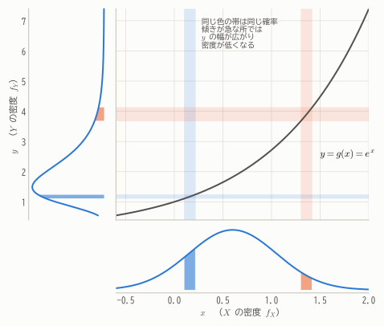
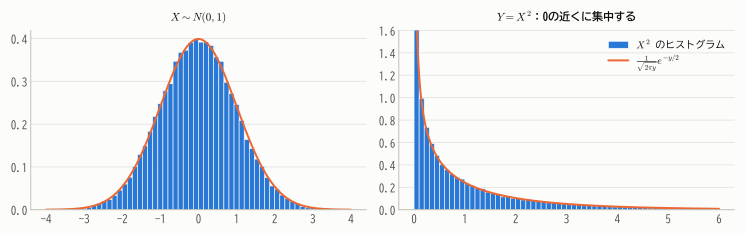
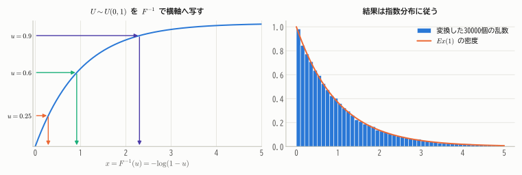
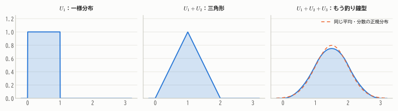
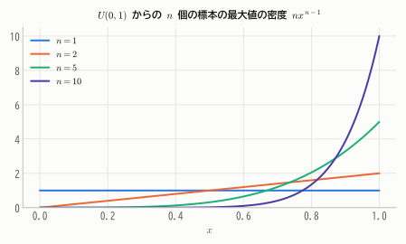

# 第10章 確率変数の変換

!!! abstract "この章で学ぶこと"
    - 確率変数の関数 $Y = g(X)$ の分布の求め方（変数変換の公式）
    - 一様乱数からあらゆる分布の乱数を作る **逆関数法**
    - 2変数の変数変換と **ヤコビアン**
    - 独立な確率変数の和の分布：**畳み込み** と **積率母関数** による方法
    - 正規分布・ポアソン分布などの **再生性**
    - 最大値・最小値の分布（順序統計量）

統計学では、データ $X_1, \dots, X_n$ から計算した量——標本平均 $\bar{X}$、標本分散 $S^2$、検定統計量など——の分布を知る必要があります。
これらはすべて「確率変数の関数」です。この章では、確率変数を変換したときに分布がどう変わるかを求める技術を学びます。
第13章で $t$ 分布や $F$ 分布を導くときの基礎になります。

## 10.1 1変数の変換

### 離散型の場合

離散型なら簡単です。$Y = g(X)$ が値 $y$ をとる確率は、$g(x) = y$ となる $x$ の確率を全部足せばよいのです。

$$
P(Y = y) = \sum_{x:\ g(x) = y} P(X = x)
$$

**例**：$X$ が $-1, 0, 1, 2$ を確率 $0.1, 0.2, 0.3, 0.4$ でとるとき、$Y = X^2$ は $0, 1, 4$ をとり、
$P(Y = 0) = 0.2$、$P(Y = 1) = 0.1 + 0.3 = 0.4$、$P(Y = 4) = 0.4$ です。

### 連続型の場合：累積分布関数を経由する

連続型では、密度関数を直接変換しようとすると間違えやすいので、**累積分布関数を経由する** のが確実です。

1. $F_Y(y) = P(Y \le y) = P(g(X) \le y)$ を、$X$ の確率として書き直す
2. それを $y$ で微分して $f_Y(y)$ を得る

**例**：$X \sim U(0, 1)$、$Y = X^2$ のとき、$0 < y < 1$ について

$$
F_Y(y) = P(X^2 \le y) = P(X \le \sqrt{y}) = \sqrt{y}, \qquad f_Y(y) = \frac{1}{2\sqrt{y}}
$$

### 単調な変換の公式

$g$ が単調な場合は、この手順を一般的な公式にまとめられます。

!!! theorem "定理 10.1（1変数の変数変換）"
    $X$ の密度関数を $f_X(x)$ とし、$g$ が狭義単調（増加または減少）で微分可能な関数とする。$Y = g(X)$ の密度関数は

    $$
    f_Y(y) = f_X\big(g^{-1}(y)\big)\left|\frac{d}{dy}g^{-1}(y)\right|
    $$

??? proof "証明"
    $g$ が増加関数のとき、$g(X) \le y \iff X \le g^{-1}(y)$ なので

    $$
    F_Y(y) = P\big(X \le g^{-1}(y)\big) = F_X\big(g^{-1}(y)\big)
    $$

    合成関数の微分により $f_Y(y) = f_X(g^{-1}(y))\cdot\frac{d}{dy}g^{-1}(y)$ で、この微分は正です。

    $g$ が減少関数のとき、$g(X) \le y \iff X \ge g^{-1}(y)$ なので $F_Y(y) = 1 - F_X(g^{-1}(y))$。
    微分すると $f_Y(y) = -f_X(g^{-1}(y))\cdot\frac{d}{dy}g^{-1}(y)$ で、今度は微分が負なので、全体は絶対値の形にまとめられます。

公式に現れる $\left|\frac{dx}{dy}\right|$ の意味を、図で理解しましょう。

<figure markdown="span">
  { width="600" }
  <figcaption>図10.1 $Y = e^X$ による変換。$x$ 軸上の幅 $dx$ の区間に入る確率は、$y$ 軸上の対応する幅 $dy$ の区間に入る確率と等しい。曲線の傾きが急なところでは幅が引き伸ばされるので、そのぶん密度は低くなる。</figcaption>
</figure>

「確率（面積）は保存される」ので $f_Y(y)\,|dy| = f_X(x)\,|dx|$、つまり $f_Y(y) = f_X(x)\left|\frac{dx}{dy}\right|$ です。
**変換で軸が引き伸ばされれば密度は薄まり、縮められれば濃くなる**——変数変換の公式はこれを式にしたものにすぎません。

**例（正規分布の1次変換）**：$X \sim N(\mu, \sigma^2)$、$Y = aX + b$（$a \ne 0$）とします。$x = (y - b)/a$、$dx/dy = 1/a$ なので

$$
f_Y(y) = \frac{1}{|a|}\cdot\frac{1}{\sqrt{2\pi}\sigma}\exp\left\{-\frac{\left(\frac{y - b}{a} - \mu\right)^2}{2\sigma^2}\right\}
= \frac{1}{\sqrt{2\pi}\,|a|\sigma}\exp\left\{-\frac{(y - a\mu - b)^2}{2a^2\sigma^2}\right\}
$$

これは $N(a\mu + b,\ a^2\sigma^2)$ の密度関数です。第8章の定理8.1が証明できました。

### 単調でない変換：$Y = X^2$ とカイ二乗分布

$X \sim N(0, 1)$ のとき $Y = X^2$ の分布を求めます。$g(x) = x^2$ は単調ではないので、累積分布関数を経由します。$y > 0$ について

$$
F_Y(y) = P(-\sqrt{y} \le X \le \sqrt{y}) = \Phi(\sqrt{y}) - \Phi(-\sqrt{y}) = 2\Phi(\sqrt{y}) - 1
$$

微分すると（$\Phi' = \phi$）

$$
f_Y(y) = 2\phi(\sqrt{y})\cdot\frac{1}{2\sqrt{y}} = \frac{1}{\sqrt{2\pi y}}e^{-y/2} \qquad (y > 0)
$$

<figure markdown="span">
  { width="820" }
  <figcaption>図10.2 標準正規分布に従う乱数を2乗すると、0の近くに強く集中した分布になる。これは自由度1のカイ二乗分布で、ガンマ分布 $Ga(1/2, 1/2)$ と同じもの。</figcaption>
</figure>

これは **自由度1のカイ二乗分布** $\chi^2(1)$ と呼ばれ、第13章で中心的な役割を果たします。
（ガンマ分布の密度 $\frac{\lambda^\alpha}{\Gamma(\alpha)}y^{\alpha - 1}e^{-\lambda y}$ に $\alpha = \lambda = 1/2$、$\Gamma(1/2) = \sqrt{\pi}$ を代入すると一致することを確かめてみましょう。）

### 逆関数法：一様乱数からどんな分布でも作る

変数変換の重要な応用が、乱数の生成です。

!!! theorem "定理 10.2（逆関数法と確率積分変換）"
    $F$ を連続で狭義単調増加な累積分布関数とする。

    1. $U \sim U(0, 1)$ ならば、$X = F^{-1}(U)$ の累積分布関数は $F$ である。
    2. 逆に、$X$ の累積分布関数が $F$ ならば、$F(X) \sim U(0, 1)$ である（**確率積分変換**）。

??? proof "証明"
    1. $P(X \le x) = P(F^{-1}(U) \le x) = P(U \le F(x)) = F(x)$。最後の等号は $U \sim U(0, 1)$ の累積分布関数が $P(U \le u) = u$ であることによります。

    2. $0 < u < 1$ について $P(F(X) \le u) = P(X \le F^{-1}(u)) = F(F^{-1}(u)) = u$。これは $U(0, 1)$ の累積分布関数です。

**例**：指数分布 $Ex(\lambda)$ の累積分布関数 $F(x) = 1 - e^{-\lambda x}$ の逆関数は $F^{-1}(u) = -\frac{1}{\lambda}\log(1 - u)$ です。
一様乱数 $U$ を $-\frac{1}{\lambda}\log(1 - U)$ と変換すれば、指数分布に従う乱数が得られます。

<figure markdown="span">
  { width="860" }
  <figcaption>図10.3 縦軸に一様乱数 $u$ をとり、累積分布関数のグラフに当てて横軸に下ろす。累積分布関数の傾きが急な所（密度の高い所）ほど多くの $u$ が集まるので、結果は目的の分布に従う。</figcaption>
</figure>

性質2は、第16章で「帰無仮説が正しいとき、$p$ 値は一様分布に従う」ことを示すときにも使います。

## 10.2 2変数の変換とヤコビアン

2つの確率変数 $(X, Y)$ を $(U, V)$ に変換する場合も、考え方は同じです。1変数では「幅の伸び縮み」が $|dx/dy|$ でしたが、2変数では「**面積の伸び縮み**」を表す **ヤコビアン** が登場します。

!!! theorem "定理 10.3（2変数の変数変換）"
    $(X, Y)$ の同時密度関数を $f_{X,Y}(x, y)$ とし、$(U, V) = (g_1(X, Y),\ g_2(X, Y))$ が1対1の変換で、その逆変換を $x = h_1(u, v)$、$y = h_2(u, v)$ とする。このとき

    $$
    f_{U,V}(u, v) = f_{X,Y}\big(h_1(u, v),\ h_2(u, v)\big)\,|J|
    $$

    ここで $J$ は **ヤコビアン**（ヤコビ行列式）

    $$
    J = \det\begin{pmatrix} \dfrac{\partial x}{\partial u} & \dfrac{\partial x}{\partial v} \\[2mm] \dfrac{\partial y}{\partial u} & \dfrac{\partial y}{\partial v} \end{pmatrix} = \frac{\partial x}{\partial u}\frac{\partial y}{\partial v} - \frac{\partial x}{\partial v}\frac{\partial y}{\partial u}
    $$

$(u, v)$ 平面の小さな長方形 $du\,dv$ は、$(x, y)$ 平面では面積 $|J|\,du\,dv$ の平行四辺形に対応します。確率（体積）が保存されるので、密度は $|J|$ 倍になる、というわけです。

**例**：$X, Y$ が独立に $Ex(\lambda)$ に従うとき、$U = X + Y$、$V = X/(X + Y)$ の同時分布を求めます。
逆変換は $x = uv$、$y = u(1 - v)$ なので

$$
J = \det\begin{pmatrix} v & u \\ 1 - v & -u \end{pmatrix} = -uv - u(1 - v) = -u, \qquad |J| = u
$$

$f_{X,Y}(x, y) = \lambda^2 e^{-\lambda(x + y)} = \lambda^2 e^{-\lambda u}$ より

$$
f_{U,V}(u, v) = \lambda^2 u\,e^{-\lambda u} \cdot 1 \qquad (u > 0,\ 0 < v < 1)
$$

これは「$u$ だけの関数 $\lambda^2 u e^{-\lambda u}$」と「$v$ だけの関数 $1$」の積なので、$U$ と $V$ は独立で、
$U \sim Ga(2, \lambda)$、$V \sim U(0, 1)$ です。2つの待ち時間の合計はガンマ分布に従い、そのうち最初の待ち時間が占める割合は一様分布に従います。

## 10.3 和の分布

統計学では「独立な確率変数の和」の分布が特に重要です。標本平均は和を $n$ で割ったものだからです。

### 畳み込み

!!! theorem "定理 10.4（畳み込み）"
    $X$ と $Y$ が独立のとき、$Z = X + Y$ の分布は

    - 離散型：$\displaystyle P(Z = z) = \sum_{x} P(X = x)\,P(Y = z - x)$
    - 連続型：$\displaystyle f_Z(z) = \int_{-\infty}^{\infty} f_X(x)\,f_Y(z - x)\,dx$

    で与えられる。これを $f_X$ と $f_Y$ の **畳み込み**（convolution）という。

??? proof "証明（連続型）"
    $(Z, W) = (X + Y, X)$ と変換すると、逆変換は $x = w$、$y = z - w$ で、ヤコビアンは
    $J = \det\begin{pmatrix} 0 & 1 \\ 1 & -1 \end{pmatrix} = -1$ です。独立性より

    $$
    f_{Z,W}(z, w) = f_X(w)\,f_Y(z - w)
    $$

    これを $w$ について積分すれば $Z$ の周辺密度が得られます。

離散型の式は「$X = x$ かつ $Y = z - x$ となる場合をすべて足す」というだけです。第5章の2つのサイコロの和の分布（図5.3）は、まさにこの計算でした。

**例**：$U_1, U_2$ が独立に $U(0, 1)$ に従うとき、$Z = U_1 + U_2$ の密度は

$$
f_Z(z) = \int_0^1 \mathbf{1}\{0 \le z - x \le 1\}\,dx = \begin{cases} z & (0 \le z \le 1) \\ 2 - z & (1 \le z \le 2) \end{cases}
$$

という三角形になります。

<figure markdown="span">
  { width="880" }
  <figcaption>図10.4 一様分布を足していくと、平らな分布 → 三角形 → 釣り鐘型 と変化し、わずか3個の和でも正規分布にかなり近くなる。中心極限定理（第12章）の予告編。</figcaption>
</figure>

### 積率母関数による方法

畳み込みの積分は計算が大変なことが多いのですが、積率母関数を使うと驚くほど簡単になります。

!!! theorem "定理 10.5（独立な和の積率母関数）"
    $X$ と $Y$ が独立ならば

    $$
    M_{X+Y}(t) = M_X(t)\,M_Y(t)
    $$

    つまり、**独立な和の積率母関数は、積率母関数の積**。

??? proof "証明"
    独立なら $e^{tX}$ と $e^{tY}$ も独立なので、定理9.1より

    $$
    M_{X+Y}(t) = E\big[e^{t(X+Y)}\big] = E\big[e^{tX}e^{tY}\big] = E\big[e^{tX}\big]E\big[e^{tY}\big] = M_X(t)\,M_Y(t)
    $$

「和」が「積」に変わるので計算が簡単になります。そして第6章の **一意性定理**（積率母関数が一致すれば分布も一致する）により、積率母関数の形から和の分布がわかります。

### 再生性

同じ種類の分布に従う独立な確率変数の和が、また同じ種類の分布に従う性質を **再生性** といいます。

!!! theorem "定理 10.6（再生性）"
    以下で $X$ と $Y$ は独立とする。

    | $X$ の分布 | $Y$ の分布 | $X + Y$ の分布 |
    |---|---|---|
    | $B(m, p)$ | $B(n, p)$ | $B(m + n, p)$ |
    | $Po(\lambda_1)$ | $Po(\lambda_2)$ | $Po(\lambda_1 + \lambda_2)$ |
    | $N(\mu_1, \sigma_1^2)$ | $N(\mu_2, \sigma_2^2)$ | $N(\mu_1 + \mu_2,\ \sigma_1^2 + \sigma_2^2)$ |
    | $Ga(\alpha_1, \lambda)$ | $Ga(\alpha_2, \lambda)$ | $Ga(\alpha_1 + \alpha_2, \lambda)$ |

??? proof "証明"
    積率母関数の積を計算し、一意性定理を使います。

    - 二項分布：$(1 - p + pe^t)^m(1 - p + pe^t)^n = (1 - p + pe^t)^{m+n}$
    - ポアソン分布：$e^{\lambda_1(e^t - 1)}e^{\lambda_2(e^t - 1)} = e^{(\lambda_1 + \lambda_2)(e^t - 1)}$
    - 正規分布：$e^{\mu_1 t + \sigma_1^2 t^2/2}e^{\mu_2 t + \sigma_2^2 t^2/2} = e^{(\mu_1 + \mu_2)t + (\sigma_1^2 + \sigma_2^2)t^2/2}$
    - ガンマ分布：$\left(\frac{\lambda}{\lambda - t}\right)^{\alpha_1}\left(\frac{\lambda}{\lambda - t}\right)^{\alpha_2} = \left(\frac{\lambda}{\lambda - t}\right)^{\alpha_1 + \alpha_2}$

    いずれも右辺は、それぞれの分布の積率母関数の形をしています。

直感的にも自然です。二項分布なら「$m$ 回の試行と $n$ 回の試行を合わせれば $m + n$ 回の試行」、ポアソン分布なら「午前の来客数と午後の来客数を合わせれば1日の来客数」です。

ガンマ分布の再生性から、**独立な $n$ 個の $Ex(\lambda) = Ga(1, \lambda)$ の和は $Ga(n, \lambda)$** に従うことがわかります（第8章で予告した事実）。

正規分布の再生性と1次変換の性質を組み合わせると、推測統計で最も重要な結果の1つが得られます。

!!! theorem "定理 10.7（正規母集団からの標本平均の分布）"
    $X_1, \dots, X_n$ が i.i.d. で $N(\mu, \sigma^2)$ に従うならば

    $$
    \bar{X} = \frac{1}{n}\sum_{i=1}^{n} X_i \sim N\left(\mu,\ \frac{\sigma^2}{n}\right)
    $$

??? proof "証明"
    再生性をくり返し使うと $\sum X_i \sim N(n\mu, n\sigma^2)$。これを $1/n$ 倍すると、定理8.1より $N(\mu, \sigma^2/n)$。

第9章では「$\bar{X}$ の期待値は $\mu$、分散は $\sigma^2/n$」までしかわかりませんでしたが、母集団が正規分布なら **分布の形まで正規分布** と確定します。
母集団が正規分布でない場合でも、$n$ が大きければ近似的に成り立つ——それが第12章の中心極限定理です。

## 10.4 最大値と最小値の分布

$X_1, \dots, X_n$ が i.i.d. で累積分布関数 $F$ をもつとき、最大値 $X_{(n)} = \max_i X_i$ と最小値 $X_{(1)} = \min_i X_i$ の分布を求めます。
このように、データを小さい順に並べたときの $k$ 番目の値を **順序統計量** といいます。

!!! theorem "定理 10.8（最大値・最小値の分布）"
    $$
    P\big(X_{(n)} \le x\big) = F(x)^n, \qquad P\big(X_{(1)} > x\big) = \big(1 - F(x)\big)^n
    $$

??? proof "証明"
    「最大値が $x$ 以下」⟺「すべての $X_i$ が $x$ 以下」です。独立性より

    $$
    P\big(X_{(n)} \le x\big) = P(X_1 \le x, \dots, X_n \le x) = \prod_{i=1}^{n}P(X_i \le x) = F(x)^n
    $$

    同様に「最小値が $x$ より大きい」⟺「すべての $X_i$ が $x$ より大きい」です。

**例1**：$U(0, 1)$ からの $n$ 個の最大値の累積分布関数は $x^n$、密度関数は $nx^{n-1}$ です。$n$ が大きいほど1の近くに集中します。

<figure markdown="span">
  { width="600" }
  <figcaption>図10.5 $U(0, 1)$ から $n$ 個とったときの最大値の密度。$n$ が大きくなるほど、最大値は上限1に近づく。この性質は第14章で一様分布の上限を推定するときに使う。</figcaption>
</figure>

**例2**：$n$ 個の電子部品の寿命が独立に $Ex(\lambda)$ に従うとき、最初の1個が故障するまでの時間は

$$
P\big(X_{(1)} > x\big) = \left(e^{-\lambda x}\right)^n = e^{-n\lambda x}
$$

より $Ex(n\lambda)$ に従います。平均すると $1/(n\lambda)$、つまり1個のときの $1/n$ の時間で最初の故障が起こります。

## まとめ

- $Y = g(X)$ の分布は、累積分布関数 $P(g(X) \le y)$ を経由して求めるのが確実。$g$ が単調なら $f_Y(y) = f_X(x)\left|\frac{dx}{dy}\right|$。
- 変数変換の公式の本質は「確率（面積・体積）の保存」。2変数ではヤコビアン $|J|$ が面積の伸縮率を表す。
- **逆関数法**：$U \sim U(0, 1)$ なら $F^{-1}(U)$ は分布 $F$ に従う。逆に $F(X) \sim U(0, 1)$。
- 独立な和の分布は **畳み込み** で求められるが、**積率母関数の積** を使う方が簡単なことが多い。
- 二項・ポアソン・正規・ガンマ分布は **再生性** をもつ。正規母集団の標本平均は $\bar{X} \sim N(\mu, \sigma^2/n)$。

## 練習問題

!!! exercise "問題 10.1（一様分布の対数変換）"
    $X \sim U(0, 1)$ のとき、$Y = -2\log X$ の分布を求めてください。

    ??? success "解答"
        $y > 0$ について

        $$
        F_Y(y) = P(-2\log X \le y) = P(X \ge e^{-y/2}) = 1 - e^{-y/2}
        $$

        これは $Ex(1/2)$ の累積分布関数です（密度 $\frac{1}{2}e^{-y/2}$）。これは自由度2のカイ二乗分布 $\chi^2(2) = Ga(1, 1/2)$ でもあります。

!!! exercise "問題 10.2（変数変換の公式）"
    $X \sim Ex(\lambda)$ のとき、$Y = \sqrt{X}$ の密度関数を求めてください。

    ??? success "解答"
        $g(x) = \sqrt{x}$ は $x > 0$ で単調増加で、$x = y^2$、$dx/dy = 2y$。定理10.1より

        $$
        f_Y(y) = \lambda e^{-\lambda y^2}\cdot 2y = 2\lambda y\,e^{-\lambda y^2} \qquad (y > 0)
        $$

        これはレイリー分布（ワイブル分布の一種）と呼ばれる分布です。

!!! exercise "問題 10.3（ポアソン分布の再生性）"
    ある店の午前の来客数は $Po(3)$、午後の来客数は $Po(5)$ に従い、互いに独立です。1日の来客数がちょうど8人である確率を求めてください。

    ??? success "解答"
        再生性より1日の来客数は $Po(8)$ に従うので $P = e^{-8}\frac{8^8}{8!} \approx 0.140$。

!!! exercise "問題 10.4（正規分布の再生性）"
    A さんの通勤時間は $N(50, 3^2)$、B さんの通勤時間は $N(55, 4^2)$（単位：分）に従い、互いに独立です。
    ある日、A さんの通勤時間が B さんより長くなる確率を求めてください。

    ??? success "解答"
        $D = X_A - X_B$ とすると、$-X_B \sim N(-55, 16)$ なので再生性より $D \sim N(50 - 55,\ 9 + 16) = N(-5, 5^2)$。

        $$
        P(D > 0) = P\left(Z > \frac{0 - (-5)}{5}\right) = P(Z > 1) \approx 0.159
        $$

        差をとるときも分散は **足し算** になることに注意しましょう。

!!! exercise "問題 10.5（最小値の分布）"
    3台のサーバーの故障までの時間が独立に平均 1000 時間の指数分布に従うとき、いずれか1台が最初に故障するまでの時間の期待値を求めてください。

    ??? success "解答"
        各サーバーは $Ex(1/1000)$ なので、最小値は $Ex(3/1000)$ に従い、期待値は $1000/3 \approx 333$ 時間です。

!!! exercise "問題 10.6（2変数の変換）"
    $X, Y$ が独立に $N(0, 1)$ に従うとき、$U = X + Y$、$V = X - Y$ は独立であることを示してください。

    ??? success "解答"
        逆変換は $x = (u + v)/2$、$y = (u - v)/2$ で、$J = \det\begin{pmatrix} 1/2 & 1/2 \\ 1/2 & -1/2 \end{pmatrix} = -\frac{1}{2}$。
        $x^2 + y^2 = \frac{(u + v)^2 + (u - v)^2}{4} = \frac{u^2 + v^2}{2}$ なので

        $$
        f_{U,V}(u, v) = \frac{1}{2\pi}e^{-(u^2 + v^2)/4}\cdot\frac{1}{2} = \frac{1}{\sqrt{4\pi}}e^{-u^2/4}\cdot\frac{1}{\sqrt{4\pi}}e^{-v^2/4}
        $$

        $u$ だけの関数と $v$ だけの関数の積に分解できるので $U$ と $V$ は独立で、どちらも $N(0, 2)$ に従います。
        （正規分布では「和と差が独立」になる——これは第13章で $\bar{X}$ と $S^2$ が独立であることを示す鍵になる性質です。）
