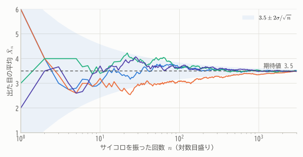
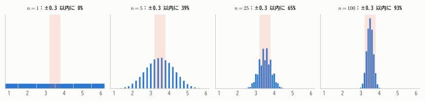
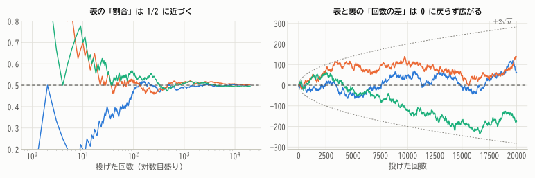
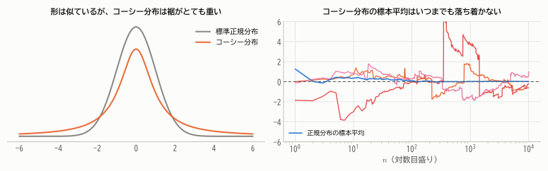
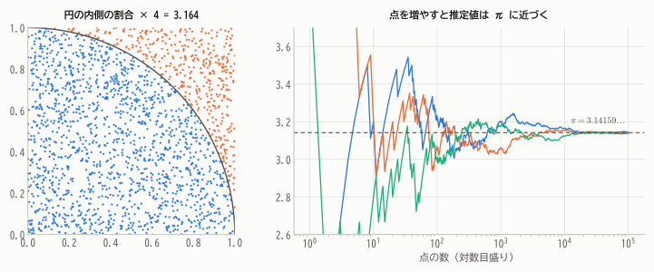

# 第11章 大数の法則

!!! abstract "この章で学ぶこと"
    - 標本平均が母集団の平均に近づくという **大数の法則** の主張と意味
    - 確率収束の定義と、チェビシェフの不等式による **大数の弱法則の証明**
    - 大数の法則が「言っていないこと」（ギャンブラーの誤謬）
    - 大数の法則が成り立たない例（コーシー分布）
    - 応用：モンテカルロ法、保険

第2部で、確率分布の性質を調べる道具がそろいました。第3部では、データの数 $n$ を大きくしたときに何が起こるかを調べる **極限定理** を学びます。
極限定理は「なぜ統計学が機能するのか」を保証する理論的な柱です。最初の柱が **大数の法則** です。

## 11.1 平均は安定する

サイコロを何度も振って、出た目の平均を記録していきます。

<figure markdown="span">
  { width="680" }
  <figcaption>図11.1 4人がそれぞれサイコロを振り続けたときの、出た目の平均の推移。最初は大きくばらつくが、回数が増えるにつれてどの人の平均も期待値 3.5 に近づいていく。色のついた帯は $3.5 \pm 2\sigma/\sqrt{n}$。</figcaption>
</figure>

最初の数回は 2 や 5 といった値になりますが、何千回も振れば平均はほぼ 3.5 に落ち着きます。
第4章で見た「表の割合が 1/2 に近づく」現象（図4.2）と同じです。この経験的な事実を数学的に表したのが大数の法則です。

!!! demo "やってみよう：コイン投げで大数の法則を体験する"
    3人が同時にコインを投げ続けます。ボタンを押して回数を増やし、表の割合がどう変化するか観察しましょう。
    色のついた帯は「ほとんどの場合にこの中に入る範囲」で、回数とともに狭まっていきます。

    

## 11.2 確率収束

「$\bar{X}_n$ が $\mu$ に近づく」と言っても、$\bar{X}_n$ は確率変数なので、数列の収束のように「必ず近づく」とは言えません。
運が悪ければ、1万回振っても平均が 5 になる可能性はゼロではないからです。そこで、確率を使って「近づく」ことを定義します。

!!! definition "定義 11.1（確率収束）"
    確率変数の列 $Y_1, Y_2, \dots$ と定数 $c$ について、任意の $\varepsilon > 0$ に対して

    $$
    \lim_{n \to \infty} P\big(|Y_n - c| \ge \varepsilon\big) = 0
    $$

    が成り立つとき、$Y_n$ は $c$ に **確率収束** するといい、$Y_n \xrightarrow{P} c$ と書く。

言葉にすると「どんなに小さな誤差 $\varepsilon$ を許容範囲として決めても、$n$ を十分大きくすれば、許容範囲を超える確率をいくらでも小さくできる」ということです。

<figure markdown="span">
  { width="900" }
  <figcaption>図11.2 サイコロ $n$ 個の目の平均の分布。$n$ が大きくなるにつれて分布は 3.5 のまわりに集中し、$\pm 0.3$ の範囲（橙）に入る確率は 1 に近づく。</figcaption>
</figure>

## 11.3 大数の弱法則

!!! theorem "定理 11.1（大数の弱法則）"
    $X_1, X_2, \dots$ が i.i.d. で、期待値 $\mu$、分散 $\sigma^2 < \infty$ をもつとする。標本平均 $\bar{X}_n = \frac{1}{n}\sum_{i=1}^n X_i$ について、任意の $\varepsilon > 0$ に対して

    $$
    \lim_{n \to \infty} P\big(|\bar{X}_n - \mu| \ge \varepsilon\big) = 0
    $$

    すなわち $\bar{X}_n \xrightarrow{P} \mu$ である。

??? proof "証明"
    第9章の定理9.4より $E[\bar{X}_n] = \mu$、$V[\bar{X}_n] = \sigma^2/n$ です。
    $\bar{X}_n$ にチェビシェフの不等式（第6章 定理6.4）を適用します。標準偏差は $\sigma/\sqrt{n}$ なので、$k = \varepsilon\sqrt{n}/\sigma$ とおくと $k \cdot \sigma/\sqrt{n} = \varepsilon$ であり

    $$
    P\big(|\bar{X}_n - \mu| \ge \varepsilon\big) \le \frac{1}{k^2} = \frac{\sigma^2}{n\varepsilon^2}
    $$

    右辺は $n \to \infty$ で 0 に収束します。確率は 0 以上なので、左辺も 0 に収束します。

証明はわずか数行です。鍵は2つありました。

1. 標本平均の分散が $\sigma^2/n$ と、$n$ に反比例して小さくなること（第9章）
2. 分散が小さければ、平均から大きく外れる確率も小さいこと（チェビシェフの不等式）

!!! point "大数の法則が保証すること"
    大数の法則は、**「データを十分たくさん集めれば、標本平均で母集団の平均を好きなだけ正確に知ることができる」** ことを保証します。
    世論調査で全員に聞かなくてもよいのも、くじを何度も引いて確率を推し量れるのも、この法則のおかげです。

### 相対頻度は確率に近づく

特に、$X_i$ を「$i$ 回目に事象 $A$ が起これば 1、起こらなければ 0」という指示変数とすると、$\mu = E[X_i] = P(A)$ で、$\bar{X}_n$ は $n$ 回中 $A$ が起こった **相対頻度** です。

!!! theorem "系 11.2（ベルヌーイの大数の法則）"
    独立な試行をくり返すとき、事象 $A$ の相対頻度は $P(A)$ に確率収束する。

第4章では「くり返したときの相対頻度の行き着く先」を確率とみなす頻度的な考え方を紹介しました。
公理から出発した確率論の中で、その考え方が正しかったことが **定理として証明された** わけです。

### 大数の強法則

定理11.1が「弱」法則と呼ばれるのは、もっと強い形の主張も成り立つからです。

!!! note "大数の強法則"
    同じ条件（実は期待値が存在すれば十分）のもとで

    $$
    P\left(\lim_{n \to \infty}\bar{X}_n = \mu\right) = 1
    $$

    が成り立ちます。これを **概収束**（ほとんど確実な収束）といいます。
    弱法則が「各時点 $n$ で外れる確率が小さい」ことを述べるのに対し、強法則は「1本1本の試行の列（図11.1の1本の線）が、確率1で最終的に $\mu$ に収束する」ことを述べています。
    証明はより高度なので、本教材では扱いません。

## 11.4 どのくらいの $n$ が必要か

証明の中の不等式 $P(|\bar{X}_n - \mu| \ge \varepsilon) \le \sigma^2/(n\varepsilon^2)$ は、必要なデータの数の目安も与えてくれます。

**例**：ある政策の支持率 $p$ を、誤差 $\pm 0.05$ 以内に収まる確率が 95% 以上となるように推定したい。何人に調査すればよいでしょうか。

支持なら1、不支持なら0とすると $\sigma^2 = p(1 - p) \le 1/4$ です。

$$
P\big(|\bar{X}_n - p| \ge 0.05\big) \le \frac{p(1 - p)}{n \times 0.05^2} \le \frac{1}{4n \times 0.0025} = \frac{100}{n}
$$

これが 0.05 以下になるには $n \ge 2000$ あれば十分です。

ただし、チェビシェフの不等式は「どんな分布でも成り立つ」代わりにかなり控えめな評価です。
次章の中心極限定理を使うと、実は $n \approx 385$ で十分であることがわかります（第15章で詳しく計算します）。

## 11.5 大数の法則の誤解

### ギャンブラーの誤謬

「コインで表が10回続いた。大数の法則によれば、表の割合は 1/2 に近づくはずだから、これからは裏が出やすいはずだ」——これは誤りです。
コインには記憶がなく、各回は独立なので、次に表が出る確率は相変わらず 1/2 です（第7章の無記憶性）。

では、最初の偏りはどうやって「解消」されるのでしょうか。答えは **打ち消されるのではなく、薄められる** のです。

<figure markdown="span">
  { width="860" }
  <figcaption>図11.3 左：表の「割合」はどの系列も 1/2 に近づく。右：同じ系列で「表の回数 − 裏の回数」を見ると、0 に戻るどころか $\sqrt{n}$ 程度の大きさで広がっていく。</figcaption>
</figure>

最初に表が10回多く出たとしても、その後の1万回でちょうど半々なら、割合は $(5000 + 10)/10010 \approx 0.5005$ となって 1/2 に近づきます。
差の「10回」が埋め合わされたわけではなく、大量の新しいデータによって **相対的に無視できるほど小さくなった** だけです。
実際、回数の差 $|\text{表} - \text{裏}|$ は、むしろ $\sqrt{n}$ に比例して大きくなっていく傾向があります。

!!! warning "大数の法則は「平均」についての法則"
    大数の法則が述べているのは、あくまで **平均（割合）** が近づくことです。「合計」や「回数の差」が期待値に近づくことは述べていません。

### 大数の法則が成り立たない例

大数の法則には「期待値が存在する」という前提が必要です。第8章で紹介した **コーシー分布** は期待値をもたないので、大数の法則が成り立ちません。

<figure markdown="span">
  { width="860" }
  <figcaption>図11.4 コーシー分布は正規分布に似た形だが裾が非常に重く、ときどき極端に大きな値が出る。そのため標本平均は、何万個のデータを集めてもまったく落ち着かない。</figcaption>
</figure>

実は、コーシー分布に従う i.i.d. の標本平均 $\bar{X}_n$ は、$n$ によらず元と同じコーシー分布に従うことが知られています。
1万個のデータの平均が、1個のデータと同じだけばらつくのです。「データを増やせば平均が安定する」は、どんな場合にも成り立つ自明な事実ではありません。

## 11.6 応用

### モンテカルロ法

大数の法則は「確率や期待値を、シミュレーションの平均で近似できる」ことを保証します。これを利用した計算手法を **モンテカルロ法** といいます。

**例（円周率の推定）**：1辺1の正方形の中に一様乱数で点を打つと、点が四分円 $x^2 + y^2 \le 1$ の内側に入る確率は面積比 $\pi/4$ です。
したがって「内側に入った点の割合 × 4」は、大数の法則により $\pi$ に確率収束します。

<figure markdown="span">
  { width="840" }
  <figcaption>図11.5 ランダムに打った点のうち、円の内側（青）に入った割合から π を推定する。点を増やすと推定値は π に近づく。</figcaption>
</figure>

モンテカルロ法は、複雑な積分の計算、物理シミュレーション、金融商品の価格評価、ベイズ統計の計算（第20章）など、科学技術のあらゆる分野で使われています。
本教材のシミュレーションも、すべてこの考え方に基づいています。

### 保険の原理

1人1人の事故は予測できなくても、多数の加入者を集めれば、1人あたりの支払額の平均は期待値にほぼ一致します。
保険会社は大数の法則に頼って、期待値に基づいた保険料を設定できるのです。

## 11.7 収束のいろいろ

確率変数の列の「収束」には、いくつかの異なる意味があります。次章の中心極限定理では、新たに **分布収束** が登場します。

| 収束の種類 | 定義 | 代表的な定理 |
|---|---|---|
| 概収束 | $P(\lim_{n\to\infty} Y_n = Y) = 1$ | 大数の強法則 |
| 確率収束 | 任意の $\varepsilon > 0$ で $P(\lvert Y_n - Y \rvert \ge \varepsilon) \to 0$ | 大数の弱法則 |
| 分布収束 | $Y$ の分布関数が連続な各点で $P(Y_n \le y) \to P(Y \le y)$ | 中心極限定理 |

概収束 ⇒ 確率収束 ⇒ 分布収束 の順に弱い（成り立ちやすい）概念になっています。

## まとめ

- **確率収束**：許容誤差を超える確率が 0 に近づくこと。
- **大数の弱法則**：i.i.d. の標本平均は母平均に確率収束する。証明は「$V[\bar{X}_n] = \sigma^2/n$」と「チェビシェフの不等式」の組み合わせ。
- 相対頻度は確率に収束する。頻度的な確率の解釈が定理として正当化される。
- 大数の法則は偏りを「打ち消す」のではなく「薄める」。ギャンブラーの誤謬に注意。
- 期待値が存在しない分布（コーシー分布）では成り立たない。
- **モンテカルロ法**は大数の法則の応用。

## 練習問題

!!! exercise "問題 11.1（チェビシェフの不等式による評価）"
    サイコロを $n$ 回振ったときの目の平均 $\bar{X}_n$ について、$P(|\bar{X}_n - 3.5| \ge 0.1) \le 0.05$ を保証するには、チェビシェフの不等式によれば $n$ をいくつ以上にすればよいですか。

    ??? success "解答"
        $\sigma^2 = 35/12$ なので $P(|\bar{X}_n - 3.5| \ge 0.1) \le \frac{35/12}{n \times 0.01} \le 0.05$ より

        $$
        n \ge \frac{35/12}{0.01 \times 0.05} = \frac{35}{12} \times 2000 \approx 5834
        $$

        5834回以上振れば十分です。

!!! exercise "問題 11.2（大数の法則の適用）"
    $X_1, X_2, \dots$ が i.i.d. で $U(0, 1)$ に従うとき、$\frac{1}{n}\sum_{i=1}^n X_i^2$ は何に確率収束しますか。

    ??? success "解答"
        $Y_i = X_i^2$ も i.i.d. で、$E[Y_i] = \int_0^1 x^2\,dx = 1/3$、分散も有限です。大数の法則より $\frac{1}{n}\sum Y_i \xrightarrow{P} \frac{1}{3}$。

        このように、大数の法則は「関数の平均」にも使えます。これがモンテカルロ積分 $\int_0^1 g(x)\,dx \approx \frac{1}{n}\sum g(U_i)$ の原理です。

!!! exercise "問題 11.3（誤解を正す）"
    「宝くじの当選確率は 100 万分の 1 なので、大数の法則によれば 100 万枚買えば必ず1枚は当たる」という主張の誤りを説明してください。

    ??? success "解答"
        大数の法則は「当たりの割合が、枚数を増やすと 100 万分の 1 に **近づく傾向がある**」ことを述べているだけで、特定の枚数でちょうど期待どおりになることは保証しません。
        各くじが独立に確率 $p = 10^{-6}$ で当たるとすると、100 万枚買っても1枚も当たらない確率は

        $$
        (1 - 10^{-6})^{10^6} \approx e^{-1} \approx 0.37
        $$

        で、約37%もあります（ポアソン近似 $Po(1)$ で $P(0) = e^{-1}$）。

!!! exercise "問題 11.4（モンテカルロ法）"
    一様乱数を使って積分 $I = \int_0^1 e^{-x^2}\,dx$ を推定する方法を説明し、乱数の個数 $n$ を4倍にすると推定誤差の大きさ（標準偏差）がどう変わるか答えてください。

    ??? success "解答"
        $U_1, \dots, U_n$ を $U(0, 1)$ の乱数として $\hat{I}_n = \frac{1}{n}\sum e^{-U_i^2}$ とすれば、$E[e^{-U^2}] = I$ なので大数の法則により $\hat{I}_n \xrightarrow{P} I$ です。
        $\hat{I}_n$ の標準偏差は $\sigma/\sqrt{n}$（$\sigma$ は $e^{-U^2}$ の標準偏差）なので、$n$ を4倍にすると誤差は $1/2$ になります。精度を1桁上げるには100倍の乱数が必要です。
