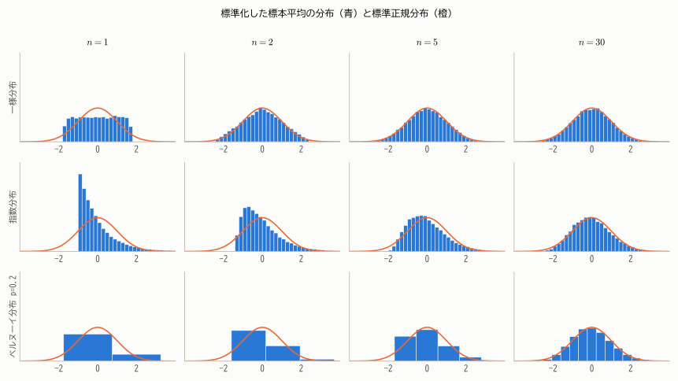
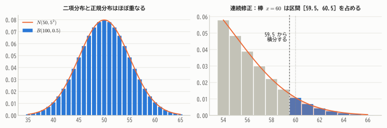
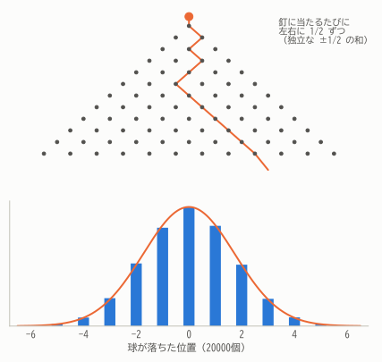
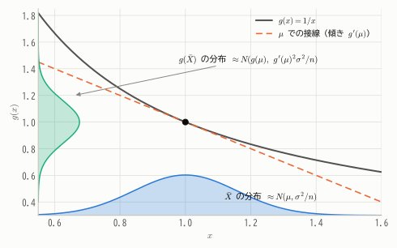

# 第12章 中心極限定理

!!! abstract "この章で学ぶこと"
    - どんな分布から出発しても、標本平均の分布は **正規分布に近づく** という中心極限定理
    - 分布収束の定義と、積率母関数による **中心極限定理の証明**
    - 二項分布の正規近似と **連続修正**
    - 正規近似がうまくいくための $n$ の大きさの目安
    - 関数の分布を近似する **デルタ法**

大数の法則は「標本平均 $\bar{X}_n$ が母平均 $\mu$ に近づく」ことを教えてくれました。しかし、「どのくらいの誤差で近づくのか」「誤差はどんな分布をしているのか」はわかりません。
それに答えるのが **中心極限定理**（Central Limit Theorem, CLT）です。統計学で最も重要な定理といっても過言ではありません。

## 12.1 どんな分布も、足せば正規分布になる

第10章で、一様分布に従う確率変数を3つ足すだけで釣り鐘型に近づくことを見ました（図10.4）。これは一様分布に限った話ではありません。

<figure markdown="span">
  { width="900" }
  <figcaption>図12.1 一様分布（上）、右に大きく歪んだ指数分布（中）、0か1しかとらないベルヌーイ分布（下）から、それぞれ大きさ $n$ の標本をとり、標本平均を標準化した値の分布。どの分布から出発しても、$n$ が大きくなると標準正規分布（橙）に近づく。</figcaption>
</figure>

元の分布が平らでも、歪んでいても、とびとびの値しかとらなくても、平均をとると正規分布に近づいていきます。驚くべき普遍性です。

!!! demo "やってみよう：中心極限定理シミュレーター"
    元の分布と標本の大きさ $n$ を選び、「標本平均を1000回つくる」を押してください。
    $n = 1$ では元の分布そのものですが、$n$ を大きくするとヒストグラムが正規分布の曲線に重なり、幅も狭くなっていく様子がわかります。

    

## 12.2 中心極限定理の主張

$\bar{X}_n$ の期待値は $\mu$、標準偏差は $\sigma/\sqrt{n}$ でした（第9章）。そこで $\bar{X}_n$ を標準化した

$$
Z_n = \frac{\bar{X}_n - \mu}{\sigma/\sqrt{n}} = \frac{\sum_{i=1}^n X_i - n\mu}{\sqrt{n}\,\sigma}
$$

を考えると、$E[Z_n] = 0$、$V[Z_n] = 1$ です。中心極限定理は、この $Z_n$ の **分布の形** が標準正規分布に近づくことを述べます。

!!! definition "定義 12.1（分布収束）"
    確率変数の列 $Y_1, Y_2, \dots$ の累積分布関数を $F_n$、確率変数 $Y$ の累積分布関数を $F$ とする。$F$ が連続なすべての点 $y$ で

    $$
    \lim_{n \to \infty} F_n(y) = F(y)
    $$

    が成り立つとき、$Y_n$ は $Y$ に **分布収束**（法則収束）するといい、$Y_n \xrightarrow{d} Y$ と書く。

!!! theorem "定理 12.1（中心極限定理）"
    $X_1, X_2, \dots$ が i.i.d. で、期待値 $\mu$、分散 $\sigma^2$（$0 < \sigma^2 < \infty$）をもつとする。このとき

    $$
    Z_n = \frac{\bar{X}_n - \mu}{\sigma/\sqrt{n}} \xrightarrow{d} N(0, 1)
    $$

    すなわち、すべての $z$ について $\displaystyle\lim_{n \to \infty} P(Z_n \le z) = \Phi(z)$ が成り立つ。

実用上は、次のように「近似的に正規分布に従う」と読み替えて使います。$n$ が十分大きいとき

$$
\bar{X}_n \ \approx\ N\left(\mu,\ \frac{\sigma^2}{n}\right), \qquad \sum_{i=1}^n X_i \ \approx\ N\left(n\mu,\ n\sigma^2\right)
$$

!!! point "大数の法則と中心極限定理の関係"
    - **大数の法則**：$\bar{X}_n - \mu \to 0$（誤差は0に近づく）
    - **中心極限定理**：$\sqrt{n}(\bar{X}_n - \mu)/\sigma \approx N(0, 1)$（誤差を $\sqrt{n}$ 倍に拡大して見ると、正規分布の形をしている）

    大数の法則が「どこに行き着くか」を、中心極限定理が「どのように近づくか（誤差の大きさと形）」を教えてくれます。
    推測統計で「誤差 ± 何％」と言えるのは中心極限定理のおかげです。

## 12.3 中心極限定理の証明

積率母関数が存在する場合について証明します。鍵となるのは次の事実です（証明は省略します）。

!!! theorem "定理 12.2（連続性定理）"
    $Y_n$ の積率母関数 $M_{Y_n}(t)$ が、$t = 0$ を含むある区間のすべての $t$ で、$Y$ の積率母関数 $M_Y(t)$ に収束するならば、$Y_n \xrightarrow{d} Y$ である。

つまり、**積率母関数が収束すれば分布も収束する** ので、$Z_n$ の積率母関数が $N(0, 1)$ の積率母関数 $e^{t^2/2}$ に近づくことを示せばよいのです。

??? proof "中心極限定理の証明（積率母関数が存在する場合）"
    $Y_i = (X_i - \mu)/\sigma$ とおくと、$Y_i$ は i.i.d. で $E[Y_i] = 0$、$V[Y_i] = E[Y_i^2] = 1$、そして

    $$
    Z_n = \frac{1}{\sqrt{n}}\sum_{i=1}^{n} Y_i
    $$

    です。$Y_i$ の共通の積率母関数を $M(s)$ とすると、独立な和の積率母関数は積なので（定理10.5）

    $$
    M_{Z_n}(t) = E\left[\exp\left(\frac{t}{\sqrt{n}}\sum_{i=1}^n Y_i\right)\right] = \left[M\left(\frac{t}{\sqrt{n}}\right)\right]^n
    $$

    $M(s)$ を $s = 0$ のまわりでテイラー展開すると、$M(0) = 1$、$M'(0) = E[Y] = 0$、$M''(0) = E[Y^2] = 1$ より

    $$
    M(s) = 1 + 0 \cdot s + \frac{1}{2}s^2 + o(s^2)
    $$

    （$o(s^2)$ は $s^2$ より速く 0 に近づく項。）$s = t/\sqrt{n}$ を代入すると

    $$
    M_{Z_n}(t) = \left[1 + \frac{t^2}{2n} + o\left(\frac{1}{n}\right)\right]^n
    $$

    ここで $\lim_{n\to\infty}\left(1 + \frac{a}{n}\right)^n = e^a$ を使うと（$o(1/n)$ の項は極限に影響しない）

    $$
    \lim_{n \to \infty} M_{Z_n}(t) = e^{t^2/2}
    $$

    これは $N(0, 1)$ の積率母関数です。連続性定理より $Z_n \xrightarrow{d} N(0, 1)$。

!!! note "証明の核心"
    証明で使ったのは、$Y_i$ の **平均が0、分散が1** ということだけです。3次以上のモーメント（分布の歪みや尖り）は $o(1/n)$ の項に押し込まれ、極限では消えてしまいます。
    だからこそ、元の分布の形に関係なく正規分布が現れるのです。

    積率母関数が存在しない場合も、特性関数（第6章）を使えば、分散が有限であるという条件だけで同じ証明が成り立ちます。

## 12.4 二項分布の正規近似

$X \sim B(n, p)$ は、独立なベルヌーイ変数 $n$ 個の和でした。中心極限定理を当てはめると、$n$ が大きいとき

$$
X \approx N\big(np,\ np(1 - p)\big)
$$

となります（**ド・モアブル＝ラプラスの定理**）。歴史的には、これが最初に発見された中心極限定理でした（1733年、ド・モアブル）。

<figure markdown="span">
  { width="860" }
  <figcaption>図12.2 左：$B(100, 0.5)$ と $N(50, 5^2)$ はほぼ重なる。右：二項分布の棒 $x = 60$ は、正規分布では区間 $[59.5, 60.5]$ に対応するので、「60以上」の確率は 59.5 から積分すると精度がよい（連続修正）。</figcaption>
</figure>

### 連続修正

**例**：コインを100回投げて、表が60回以上出る確率は？

$X \sim B(100, 0.5)$ を $N(50, 25)$ で近似します。

- そのまま近似：$P(X \ge 60) \approx P\left(Z \ge \frac{60 - 50}{5}\right) = P(Z \ge 2.0) = 0.0228$
- 連続修正あり：$P(X \ge 60) = P(X \ge 59.5) \approx P\left(Z \ge \frac{59.5 - 50}{5}\right) = P(Z \ge 1.9) = 0.0287$
- 正確な値（二項分布）：$0.0284$

離散型の分布を連続型で近似するときは、整数 $x$ を区間 $[x - 0.5, x + 0.5]$ とみなすと近似がよくなります。これを **連続修正**（半整数補正）といいます。

!!! point "正規近似の目安"
    二項分布の正規近似は、$np \ge 5$ かつ $n(1 - p) \ge 5$ 程度あれば実用的とされます（より厳しく10とする流儀もあります）。
    $p$ が 0 や 1 に近いと分布が歪むので、より大きな $n$ が必要です。逆に $n$ が大きく $p$ が非常に小さいときは、ポアソン近似（第7章）の方が適しています。

同様に、ポアソン分布 $Po(\lambda)$ も、再生性により独立な $Po(1)$ の和とみなせるので、$\lambda$ が大きいとき $N(\lambda, \lambda)$ で近似できます。

## 12.5 正規近似はどのくらいの $n$ で使えるか

「$n \ge 30$ なら正規近似してよい」という目安をよく見かけますが、これは絶対的なルールではありません。必要な $n$ は **元の分布の形** によります。

- 元の分布が左右対称（一様分布など）なら、$n = 5$ 程度でもかなりよく近似できる。
- 元の分布が大きく歪んでいる（指数分布、まれな事象のベルヌーイ分布など）と、$n = 30$ でもまだ歪みが残る（図12.1の中段・下段）。
- 裾が非常に重い分布では、さらに大きな $n$ が必要。分散が無限大の分布（コーシー分布など）では、そもそも中心極限定理は成り立たない。

近似の誤差は、おおよそ「元の分布の歪度 ÷ $\sqrt{n}$」に比例することが知られています（**ベリー＝エッシーンの定理**）。

## 12.6 なぜ世の中には正規分布が多いのか

<figure markdown="span">
  { width="520" }
  <figcaption>図12.3 ゴルトンボード。上から落とした球は、釘に当たるたびに左右にランダムに振り分けられる。最終的な位置は多数の独立な小さなずれの和なので、正規分布に近い形に積み上がる。</figcaption>
</figure>

測定誤差、身長、製品の寸法のばらつき……。現実の多くの量が正規分布に近いのは、それらが **多数の独立な小さな要因の和** として決まるからだ、と中心極限定理によって説明できます。
19世紀の統計学者ゴルトンは、この現象を目で見せるために上のような装置を作りました。

逆に、要因が **掛け算** で効く量（所得、資産など）は、対数をとると和になるので対数正規分布に近くなります（第8章）。
また、少数の大きな要因が支配する量や、要因どうしが強く依存し合う量は、正規分布から大きく外れることがあります。

## 12.7 デルタ法

中心極限定理で $\bar{X}_n$ の分布がわかったとき、その関数 $g(\bar{X}_n)$ の分布はどうなるでしょうか。
たとえば指数分布 $Ex(\lambda)$ の平均は $1/\lambda$ なので、率 $\lambda$ を推定するには $1/\bar{X}_n$ を使いたくなります。その誤差はどのくらいでしょうか。

!!! theorem "定理 12.3（デルタ法）"
    $\sqrt{n}(\bar{X}_n - \mu) \xrightarrow{d} N(0, \sigma^2)$ で、$g$ が $\mu$ で微分可能かつ $g'(\mu) \ne 0$ ならば

    $$
    \sqrt{n}\big(g(\bar{X}_n) - g(\mu)\big) \xrightarrow{d} N\big(0,\ g'(\mu)^2\sigma^2\big)
    $$

    すなわち $g(\bar{X}_n) \approx N\left(g(\mu),\ \dfrac{g'(\mu)^2\sigma^2}{n}\right)$。

??? proof "証明の考え方"
    $\bar{X}_n$ は $\mu$ の近くに集中しているので（大数の法則）、$g$ を $\mu$ のまわりで1次近似できます。

    $$
    g(\bar{X}_n) \approx g(\mu) + g'(\mu)(\bar{X}_n - \mu)
    $$

    右辺は $\bar{X}_n$ の1次式なので、近似的に正規分布に従い、その分散は $g'(\mu)^2 \cdot \sigma^2/n$ です。
    （厳密には、1次近似の誤差が $\sqrt{n}$ 倍しても0に収束することを示す必要があります。）

<figure markdown="span">
  { width="620" }
  <figcaption>図12.4 $\bar{X}$ が $\mu$ の近くの狭い範囲に集中していれば、その範囲で曲線 $g$ はほぼ直線（接線）とみなせる。直線による変換なので正規分布は正規分布のまま、幅は傾き $|g'(\mu)|$ 倍になる。</figcaption>
</figure>

**例**：$X_i \sim Ex(\lambda)$ のとき $\mu = 1/\lambda$、$\sigma^2 = 1/\lambda^2$。$g(x) = 1/x$ とすると $g'(\mu) = -1/\mu^2 = -\lambda^2$ なので

$$
\frac{1}{\bar{X}_n} \approx N\left(\lambda,\ \frac{\lambda^4 \cdot (1/\lambda^2)}{n}\right) = N\left(\lambda,\ \frac{\lambda^2}{n}\right)
$$

$\lambda$ の推定値 $1/\bar{X}_n$ の標準誤差はおよそ $\lambda/\sqrt{n}$ です。デルタ法は第14章の最尤推定量の性質や、第15章の信頼区間でも活躍します。

## まとめ

- **中心極限定理**：i.i.d. で分散が有限なら、元の分布によらず $\frac{\bar{X}_n - \mu}{\sigma/\sqrt{n}} \xrightarrow{d} N(0, 1)$。
- 証明の鍵は積率母関数（特性関数）。平均と分散以外の情報は極限で消える。
- 二項分布は $N(np, np(1-p))$ で近似できる。離散分布を近似するときは **連続修正** を使う。
- 必要な $n$ は元の分布の歪み具合による。「$n \ge 30$」は目安にすぎない。
- **デルタ法**：$g(\bar{X}_n) \approx N(g(\mu),\ g'(\mu)^2\sigma^2/n)$。

## 練習問題

!!! exercise "問題 12.1（サイコロの和）"
    サイコロを100回振ったときの目の合計 $S$ が 380 以上になる確率を、連続修正を用いた正規近似で求めてください。

    ??? success "解答"
        $E[S] = 100 \times 3.5 = 350$、$V[S] = 100 \times \frac{35}{12} \approx 291.7$、標準偏差は約 17.08 です。

        $$
        P(S \ge 380) = P(S \ge 379.5) \approx P\left(Z \ge \frac{379.5 - 350}{17.08}\right) = P(Z \ge 1.73) \approx 0.042
        $$

!!! exercise "問題 12.2（平均寿命）"
    ある電球の寿命は平均 100 時間の指数分布に従います。独立な50個の電球の平均寿命が 120 時間を超える確率を、中心極限定理を用いて近似してください。

    ??? success "解答"
        指数分布の標準偏差は平均と等しく 100 時間なので、$\bar{X} \approx N(100,\ 100^2/50)$、標準偏差は $100/\sqrt{50} \approx 14.14$。

        $$
        P(\bar{X} > 120) \approx P\left(Z > \frac{20}{14.14}\right) = P(Z > 1.41) \approx 0.079
        $$

        （指数分布は歪んでいるので、$n = 50$ でも近似誤差がやや残ります。正確な値はガンマ分布 $Ga(50, 1/100)$ から計算できます。）

!!! exercise "問題 12.3（丸め誤差の蓄積）"
    100個の数をそれぞれ整数に四捨五入してから合計します。各数の丸め誤差は独立に $U(-0.5, 0.5)$ に従うとき、合計の誤差の絶対値が 5 を超える確率を近似的に求めてください。

    ??? success "解答"
        各誤差の平均は 0、分散は $1/12$ なので、合計の誤差は近似的に $N(0,\ 100/12)$、標準偏差は約 2.89 です。

        $$
        P(|\text{誤差}| > 5) \approx 2P\left(Z > \frac{5}{2.89}\right) = 2P(Z > 1.73) \approx 0.083
        $$

        個々の誤差は最大でも 0.5 ですが、100個分の合計では誤差が 5 を超えることも約8%の確率で起こります。

!!! exercise "問題 12.4（ポアソン分布の正規近似）"
    1日の問い合わせ件数が $Po(100)$ に従うとき、問い合わせが 120 件以上になる確率を連続修正つきの正規近似で求めてください。

    ??? success "解答"
        $Po(100) \approx N(100, 100)$、標準偏差 10。

        $$
        P(X \ge 120) = P(X \ge 119.5) \approx P\left(Z \ge \frac{119.5 - 100}{10}\right) = P(Z \ge 1.95) \approx 0.026
        $$

!!! exercise "問題 12.5（デルタ法）"
    $X_1, \dots, X_n$ が i.i.d. で $\mathrm{Bern}(p)$ に従い、$\hat{p} = \bar{X}_n$ とします。$\hat{p}^2$ の近似的な分布をデルタ法で求めてください（$0 < p < 1$）。

    ??? success "解答"
        $\mu = p$、$\sigma^2 = p(1 - p)$、$g(x) = x^2$、$g'(p) = 2p$ なので

        $$
        \hat{p}^2 \approx N\left(p^2,\ \frac{4p^2 \cdot p(1 - p)}{n}\right) = N\left(p^2,\ \frac{4p^3(1 - p)}{n}\right)
        $$
