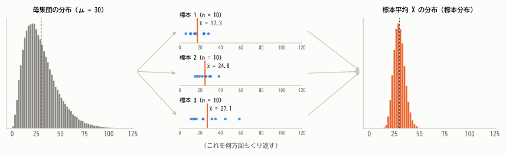
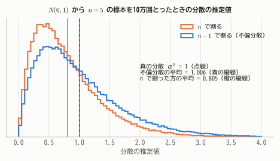
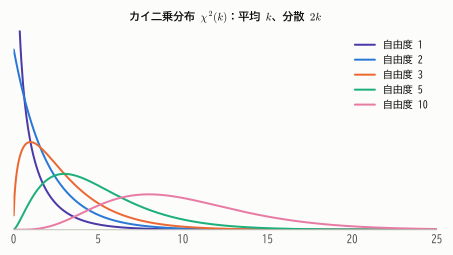
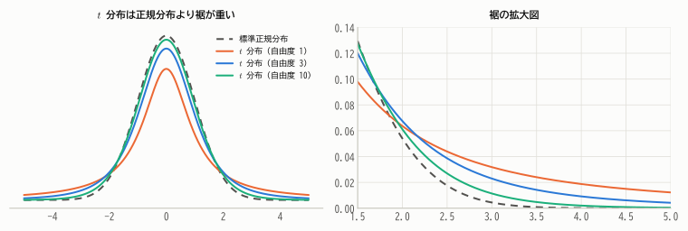
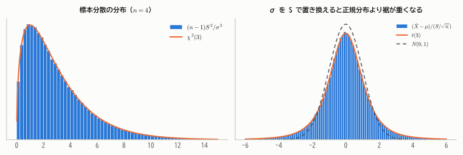
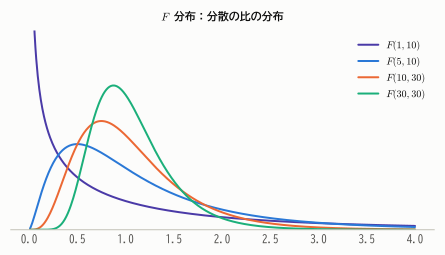

# 第13章 母集団と標本分布

!!! abstract "この章で学ぶこと"
    - 母集団・標本・母数・統計量という推測統計の基本用語
    - **標本分布**（統計量の分布）という考え方
    - 不偏分散で $n - 1$ で割る理由
    - 推測統計の3大分布：**カイ二乗分布**・**$t$ 分布**・**$F$ 分布**
    - 正規母集団の標本分布に関する基本定理（$\bar{X}$ と $S^2$ の独立性）

いよいよ推測統計に入ります。第3部までで、確率変数・確率分布・極限定理という道具がそろいました。
この章では、それらを使って「標本から計算した量が、標本の選ばれ方によってどのくらいばらつくのか」——**標本分布**——を調べます。
これが第14章以降の推定・検定のすべての土台になります。

## 13.1 母集団と標本

第1章で、知りたい対象全体を **母集団**、実際に調べた一部を **標本** と呼びました。ここで、それを確率の言葉で定式化します。

- 母集団の中での値の分布を **母集団分布** という。たとえば「日本の成人男性の身長の分布」。
- 母集団分布を特徴づける定数を **母数**（パラメータ）という。母平均 $\mu$、母分散 $\sigma^2$、母比率 $p$ など。母数は未知であり、それを知ることが推測統計の目的である。
- 母集団から **無作為に** 選んだ $n$ 個のデータ $X_1, \dots, X_n$ を、大きさ $n$ の **無作為標本** という。

!!! definition "定義 13.1（無作為標本と統計量）"
    - 母集団分布に従う **i.i.d.** な確率変数 $X_1, \dots, X_n$ を、大きさ $n$ の **無作為標本**（ランダムサンプル）という。
    - 標本 $X_1, \dots, X_n$ の関数で、未知の母数を含まないものを **統計量** という。標本平均 $\bar{X}$ や標本分散は統計量である。
    - 統計量の確率分布を **標本分布** という。

ポイントは、**標本を確率変数とみなす** ことです。実際に得られたデータ $x_1, \dots, x_n$ は、確率変数 $X_1, \dots, X_n$ の1つの実現値にすぎません。
もう一度標本をとり直せば、別のデータが得られ、標本平均も別の値になります。

<figure markdown="span">
  { width="900" }
  <figcaption>図13.1 標本分布の考え方。母集団（左）から大きさ10の標本をとるたびに標本平均の値は変わる。標本のとり方をくり返したときの標本平均の分布（右）が、標本平均の「標本分布」である。母集団は歪んでいても、標本平均の分布は母平均のまわりに集中し、正規分布に近い。</figcaption>
</figure>

現実には標本は1回しかとれません。しかし理論の上では、「もし何度もくり返したら標本平均はどう分布するか」を計算できます。
そして、その分布を知っていれば、「手元の1回の標本平均が、母平均からどのくらいずれている可能性があるか」を評価できるのです。これが推測統計の基本的な発想です。

!!! note "有限母集団と無限母集団"
    母集団が有限（例：あるクラス40人）で、戻さずに抽出する場合、厳密には $X_i$ は独立になりません（第7章の超幾何分布）。
    しかし母集団が標本に比べて十分大きければ、i.i.d. とみなして差し支えありません。厳密な補正が必要な場合は、分散に **有限母集団修正** $\frac{N - n}{N - 1}$ を掛けます。

## 13.2 標本平均の標本分布

第9章・第10章・第12章の結果をまとめると、標本平均の標本分布は次のようになります。

!!! theorem "定理 13.1（標本平均の標本分布）"
    母平均 $\mu$、母分散 $\sigma^2$ の母集団からの無作為標本について

    1. $E[\bar{X}] = \mu$、$V[\bar{X}] = \dfrac{\sigma^2}{n}$（どんな母集団でも成り立つ）
    2. 母集団が正規分布ならば、$\bar{X} \sim N\left(\mu, \dfrac{\sigma^2}{n}\right)$（正確に）
    3. 母集団が正規分布でなくても、$n$ が大きければ $\bar{X} \approx N\left(\mu, \dfrac{\sigma^2}{n}\right)$（中心極限定理）

標本平均の標準偏差 $\sigma/\sqrt{n}$ を、平均の **標準誤差**（standard error, SE）といいます。
「標準偏差」がデータ1個1個のばらつきを表すのに対し、「標準誤差」は推定値（ここでは $\bar{X}$）のばらつきを表します。

## 13.3 標本分散と不偏分散

### なぜ $n - 1$ で割るのか

母分散 $\sigma^2$ を推定するには、標本の分散を使うのが自然です。ところが、第2章と同じく $n$ で割った

$$
\tilde{S}^2 = \frac{1}{n}\sum_{i=1}^{n}(X_i - \bar{X})^2
$$

は、平均的に $\sigma^2$ より **小さく** なってしまいます。

!!! theorem "定理 13.2（標本分散の期待値）"
    母分散 $\sigma^2$ の母集団からの無作為標本について

    $$
    E\left[\sum_{i=1}^{n}(X_i - \bar{X})^2\right] = (n - 1)\sigma^2
    $$

    したがって、$\tilde{S}^2 = \frac{1}{n}\sum(X_i - \bar{X})^2$ の期待値は $\frac{n-1}{n}\sigma^2$ で $\sigma^2$ より小さいが、

    $$
    S^2 = \frac{1}{n - 1}\sum_{i=1}^{n}(X_i - \bar{X})^2
    $$

    の期待値は $E[S^2] = \sigma^2$ となる。$S^2$ を **不偏分散** という。

??? proof "証明"
    第2章の定理2.3（平方和の分解）で $a = \mu$ とすると

    $$
    \sum_{i=1}^{n}(X_i - \mu)^2 = \sum_{i=1}^{n}(X_i - \bar{X})^2 + n(\bar{X} - \mu)^2
    $$

    両辺の期待値をとります。左辺は $\sum E[(X_i - \mu)^2] = n\sigma^2$。右辺第2項は $nE[(\bar{X} - \mu)^2] = nV[\bar{X}] = n \cdot \frac{\sigma^2}{n} = \sigma^2$。したがって

    $$
    E\left[\sum_{i=1}^{n}(X_i - \bar{X})^2\right] = n\sigma^2 - \sigma^2 = (n - 1)\sigma^2
    $$

直感的な理由は2つあります。

1. **$\bar{X}$ はデータに「寄り添いすぎて」いる**：第2章で、$\sum(x_i - a)^2$ を最小にする $a$ は $\bar{x}$ でした。したがって $\sum(X_i - \bar{X})^2 \le \sum(X_i - \mu)^2$ で、真の平均 $\mu$ からの偏差の代わりに $\bar{X}$ からの偏差を使うと、散らばりを過小評価してしまいます。その過小評価のぶん（平均すると $\sigma^2$ 1個ぶん）を補正するのが $n - 1$ です。
2. **自由度**：$n$ 個の偏差 $X_i - \bar{X}$ は、合計が必ず 0 になる（第2章 定理2.1）という制約があるので、自由に動けるのは $n - 1$ 個だけです。この「自由に動ける個数」を **自由度** といいます。平均を1つ推定するごとに、自由度が1つ失われます。

<figure markdown="span">
  { width="660" }
  <figcaption>図13.2 $N(0, 1)$ から大きさ5の標本を10万回とり、分散を推定した結果。$n$ で割った推定値の平均は約 0.8（$= 4/5$）で、真の値1を系統的に下回る。$n - 1$ で割ると平均はほぼ1になる。</figcaption>
</figure>

!!! note "記号について"
    本教材では以降、$S^2$ は $n - 1$ で割った **不偏分散** を表し、$S = \sqrt{S^2}$ と書きます（第2章の $u^2$ にあたります）。
    なお、$E[S^2] = \sigma^2$ でも $E[S] = \sigma$ とはならない（$S$ は $\sigma$ をわずかに過小評価する）ことに注意しましょう。

## 13.4 カイ二乗分布

ここからは、母集団が **正規分布** の場合に、統計量の正確な標本分布を求めていきます。まず、分散の推定に関係するカイ二乗分布です。

!!! definition "定義 13.2（カイ二乗分布）"
    $Z_1, \dots, Z_k$ が i.i.d. で $N(0, 1)$ に従うとき

    $$
    W = Z_1^2 + Z_2^2 + \cdots + Z_k^2
    $$

    の分布を、自由度 $k$ の **カイ二乗分布** といい、$\chi^2(k)$ と書く。

第10章で、$Z^2$（$Z \sim N(0, 1)$）はガンマ分布 $Ga(1/2, 1/2)$ に従うことを示しました。ガンマ分布の再生性から、ただちに次がわかります。

!!! theorem "定理 13.3（カイ二乗分布の性質）"
    1. $\chi^2(k) = Ga(k/2,\ 1/2)$。密度関数は

        $$
        f(x) = \frac{1}{2^{k/2}\Gamma(k/2)}x^{k/2 - 1}e^{-x/2} \qquad (x > 0)
        $$

    2. $E[W] = k$、$V[W] = 2k$
    3. 積率母関数は $M(t) = (1 - 2t)^{-k/2}$（$t < 1/2$）
    4. **再生性**：$W_1 \sim \chi^2(k_1)$、$W_2 \sim \chi^2(k_2)$ が独立ならば $W_1 + W_2 \sim \chi^2(k_1 + k_2)$

<figure markdown="span">
  { width="620" }
  <figcaption>図13.3 カイ二乗分布は 0 以上の値をとり、右に歪んでいる。自由度が大きくなると平均 $k$ のまわりの山型に近づく（中心極限定理）。</figcaption>
</figure>

$E[W] = k$ は、$E[Z_i^2] = V[Z_i] = 1$ を $k$ 個足したものと考えればすぐにわかります。

## 13.5 正規母集団の標本分布定理

次の定理は、正規母集団からの推定・検定の理論の要です。

!!! theorem "定理 13.4（正規母集団の標本分布）"
    $X_1, \dots, X_n$ が i.i.d. で $N(\mu, \sigma^2)$ に従うとき

    1. $\bar{X} \sim N\left(\mu,\ \dfrac{\sigma^2}{n}\right)$
    2. $\bar{X}$ と $S^2$ は **独立**
    3. $\dfrac{(n - 1)S^2}{\sigma^2} = \dfrac{\sum_{i=1}^n (X_i - \bar{X})^2}{\sigma^2} \sim \chi^2(n - 1)$

??? proof "証明の概略"
    1は第10章の定理10.7です。

    **2（独立性）**：各偏差 $X_i - \bar{X}$ と $\bar{X}$ の共分散を計算すると

    $$
    \mathrm{Cov}(X_i - \bar{X},\ \bar{X}) = \mathrm{Cov}(X_i, \bar{X}) - V[\bar{X}] = \frac{\sigma^2}{n} - \frac{\sigma^2}{n} = 0
    $$

    （$\mathrm{Cov}(X_i, \bar{X}) = \frac{1}{n}\sum_j \mathrm{Cov}(X_i, X_j) = \frac{\sigma^2}{n}$ を使った。）
    $(\bar{X},\ X_1 - \bar{X},\ \dots,\ X_n - \bar{X})$ は独立な正規確率変数の1次式なので、全体として多変量正規分布に従います。
    多変量正規分布では「無相関 ⇒ 独立」が成り立つ（第9章 定理9.6の多変数版）ので、$\bar{X}$ は偏差ベクトル全体と独立であり、偏差の関数である $S^2$ とも独立です。

    **3（カイ二乗分布）**：平方和の分解

    $$
    \underbrace{\sum_{i=1}^{n}\left(\frac{X_i - \mu}{\sigma}\right)^2}_{A} = \underbrace{\frac{(n - 1)S^2}{\sigma^2}}_{B} + \underbrace{\left(\frac{\bar{X} - \mu}{\sigma/\sqrt{n}}\right)^2}_{C}
    $$

    を考えます。$A$ は $n$ 個の独立な標準正規変数の2乗和なので $\chi^2(n)$、$C$ は1個の標準正規変数の2乗なので $\chi^2(1)$ です。
    2より $B$ と $C$ は独立なので、積率母関数について $M_A(t) = M_B(t)M_C(t)$、すなわち

    $$
    (1 - 2t)^{-n/2} = M_B(t)\cdot(1 - 2t)^{-1/2} \quad\Longrightarrow\quad M_B(t) = (1 - 2t)^{-(n-1)/2}
    $$

    これは $\chi^2(n - 1)$ の積率母関数なので、一意性定理より $B \sim \chi^2(n - 1)$ です。

3で自由度が $n$ ではなく $n - 1$ になっているのは、$\mu$ の代わりに $\bar{X}$ を使ったことで自由度が1つ失われたからです。$E[\chi^2(n-1)] = n - 1$ なので、ここからも $E[S^2] = \sigma^2$ が確かめられます。

!!! warning "独立性は正規分布の特別な性質"
    $\bar{X}$ と $S^2$ が独立になるのは、母集団が正規分布の場合だけです（実は、これが成り立つのは正規分布に限ることが知られています）。
    たとえば右に歪んだ母集団では、$\bar{X}$ が大きい標本ほど大きな外れ値を含んでいて $S^2$ も大きくなりやすい、という依存関係が生じます。

## 13.6 $t$ 分布

### $\sigma$ がわからないとき

定理13.4の1より、標準化した

$$
Z = \frac{\bar{X} - \mu}{\sigma/\sqrt{n}} \sim N(0, 1)
$$

を使えば、母平均 $\mu$ についての推論ができそうです。しかし現実には、母標準偏差 $\sigma$ も未知であることがほとんどです。
そこで $\sigma$ を標本から計算した $S$ で置き換えた

$$
T = \frac{\bar{X} - \mu}{S/\sqrt{n}}
$$

を考えます。$S$ も確率変数なので、$T$ は $Z$ よりばらつきが大きくなり、もはや正規分布には従いません。この分布を正確に求めたのが、ギネス社の醸造技師ゴセットでした（1908年、「スチューデント」というペンネームで発表）。

!!! definition "定義 13.3（$t$ 分布）"
    $Z \sim N(0, 1)$ と $W \sim \chi^2(k)$ が独立のとき

    $$
    T = \frac{Z}{\sqrt{W/k}}
    $$

    の分布を、自由度 $k$ の **$t$ 分布**（スチューデントの $t$ 分布）といい、$t(k)$ と書く。密度関数は

    $$
    f(t) = \frac{\Gamma\left(\frac{k+1}{2}\right)}{\sqrt{k\pi}\,\Gamma\left(\frac{k}{2}\right)}\left(1 + \frac{t^2}{k}\right)^{-\frac{k+1}{2}} \qquad (-\infty < t < \infty)
    $$

??? proof "密度関数の導出"
    $Z$ と $W$ の同時密度は $\frac{1}{\sqrt{2\pi}}e^{-z^2/2}\cdot\frac{w^{k/2-1}e^{-w/2}}{2^{k/2}\Gamma(k/2)}$ です。
    $t = z/\sqrt{w/k}$、$v = w$ と変換すると、逆変換は $z = t\sqrt{v/k}$、$w = v$ で、ヤコビアンは $\sqrt{v/k}$ です。$(T, V)$ の同時密度は

    $$
    \frac{1}{\sqrt{2\pi k}\,2^{k/2}\Gamma(k/2)}\,v^{\frac{k+1}{2} - 1}\exp\left\{-\frac{v}{2}\left(1 + \frac{t^2}{k}\right)\right\}
    $$

    これを $v$ について積分します。ガンマ関数の積分公式 $\int_0^\infty v^{a-1}e^{-bv}dv = \Gamma(a)/b^a$ を $a = \frac{k+1}{2}$、$b = \frac{1}{2}(1 + t^2/k)$ で使うと

    $$
    f(t) = \frac{\Gamma\left(\frac{k+1}{2}\right)2^{\frac{k+1}{2}}}{\sqrt{2\pi k}\,2^{k/2}\Gamma(k/2)}\left(1 + \frac{t^2}{k}\right)^{-\frac{k+1}{2}} = \frac{\Gamma\left(\frac{k+1}{2}\right)}{\sqrt{k\pi}\,\Gamma\left(\frac{k}{2}\right)}\left(1 + \frac{t^2}{k}\right)^{-\frac{k+1}{2}}
    $$

!!! theorem "定理 13.5（$t$ 統計量の分布）"
    $X_1, \dots, X_n$ が i.i.d. で $N(\mu, \sigma^2)$ に従うとき

    $$
    T = \frac{\bar{X} - \mu}{S/\sqrt{n}} \sim t(n - 1)
    $$

??? proof "証明"
    分子と分母を $\sigma/\sqrt{n}$ で割って書き直します。

    $$
    T = \frac{\dfrac{\bar{X} - \mu}{\sigma/\sqrt{n}}}{\sqrt{\dfrac{(n - 1)S^2/\sigma^2}{n - 1}}}
    $$

    定理13.4より、分子は $N(0, 1)$、分母の根号の中の $(n - 1)S^2/\sigma^2$ は $\chi^2(n - 1)$ で、両者は独立です。$t$ 分布の定義そのものです。

未知の $\sigma$ がきれいに消えて、$T$ の分布は $\mu$ と $n$ だけで決まることに注目してください。これにより、$\sigma$ を知らなくても $\mu$ について推論できます（第15章・第17章）。

<figure markdown="span">
  { width="860" }
  <figcaption>図13.4 $t$ 分布は標準正規分布と同じく左右対称な釣り鐘型だが、裾が重い（極端な値が出やすい）。自由度が大きくなると標準正規分布に近づく。</figcaption>
</figure>

<figure markdown="span">
  { width="860" }
  <figcaption>図13.5 $N(50, 10^2)$ から大きさ4の標本を20万回とったシミュレーション。左：$(n-1)S^2/\sigma^2$ は $\chi^2(3)$ に従う。右：$\sigma$ を $S$ で置き換えた $T$ は、標準正規分布ではなく $t(3)$ に従う。</figcaption>
</figure>

$t$ 分布の主な性質は次のとおりです。

- 左右対称で、$k > 1$ なら $E[T] = 0$、$k > 2$ なら $V[T] = \frac{k}{k - 2}$（1より大きい）
- $k \to \infty$ で標準正規分布に近づく（大数の法則により $W/k \to 1$ となるため）
- $t(1)$ はコーシー分布（第8章）に等しい

$t$ 分布の上側 2.5% 点 $t_{0.025}(k)$ は、自由度が小さいと標準正規分布の 1.96 よりかなり大きくなります。

| 自由度 $k$ | 1 | 2 | 3 | 5 | 9 | 15 | 29 | 60 | ∞ |
|---|---|---|---|---|---|---|---|---|---|
| $t_{0.025}(k)$ | 12.706 | 4.303 | 3.182 | 2.571 | 2.262 | 2.131 | 2.045 | 2.000 | 1.960 |

## 13.7 $F$ 分布

2つの母集団の **分散を比べる** ときに使うのが $F$ 分布です。

!!! definition "定義 13.4（$F$ 分布）"
    $W_1 \sim \chi^2(m)$ と $W_2 \sim \chi^2(n)$ が独立のとき

    $$
    F = \frac{W_1/m}{W_2/n}
    $$

    の分布を、自由度 $(m, n)$ の **$F$ 分布** といい、$F(m, n)$ と書く。

<figure markdown="span">
  { width="620" }
  <figcaption>図13.6 $F$ 分布は 0 以上の値をとる右に歪んだ分布。分子・分母の自由度がともに大きいと 1 のまわりに集中する。</figcaption>
</figure>

!!! theorem "定理 13.6（$F$ 分布の性質と分散比の分布）"
    1. $F \sim F(m, n)$ ならば $1/F \sim F(n, m)$
    2. $T \sim t(k)$ ならば $T^2 \sim F(1, k)$
    3. 2つの正規母集団 $N(\mu_1, \sigma_1^2)$、$N(\mu_2, \sigma_2^2)$ から独立に大きさ $m$、$n$ の標本をとり、不偏分散を $S_1^2$、$S_2^2$ とすると

        $$
        \frac{S_1^2/\sigma_1^2}{S_2^2/\sigma_2^2} \sim F(m - 1,\ n - 1)
        $$

??? proof "証明"
    1は定義から明らか（分子と分母が入れ替わるだけ）。
    2は $T = Z/\sqrt{W/k}$ より $T^2 = \frac{Z^2/1}{W/k}$ で、$Z^2 \sim \chi^2(1)$ だから。
    3は定理13.4より $(m - 1)S_1^2/\sigma_1^2 \sim \chi^2(m - 1)$、$(n - 1)S_2^2/\sigma_2^2 \sim \chi^2(n - 1)$ で、2つの標本は独立なので

    $$
    \frac{S_1^2/\sigma_1^2}{S_2^2/\sigma_2^2} = \frac{\frac{(m-1)S_1^2/\sigma_1^2}{m - 1}}{\frac{(n-1)S_2^2/\sigma_2^2}{n - 1}} \sim F(m - 1, n - 1)
    $$

$F$ 分布は、第17章の等分散の検定、第18章の回帰分析、第19章の分散分析で使います。

!!! demo "やってみよう：標本分布エクスプローラ"
    カイ二乗分布・$t$ 分布・$F$ 分布の自由度を動かして、形の変化を確かめましょう。$t$ 分布では、自由度を大きくすると点線の標準正規分布に重なっていくことがわかります。

    

## 13.8 パーセント点の記号

推定や検定では、これらの分布の **上側パーセント点** を頻繁に使います。本教材では次の記号を使います。

- $z_\alpha$：標準正規分布の上側 $100\alpha$% 点（$P(Z > z_\alpha) = \alpha$）
- $\chi^2_\alpha(k)$：$\chi^2(k)$ の上側 $100\alpha$% 点
- $t_\alpha(k)$：$t(k)$ の上側 $100\alpha$% 点
- $F_\alpha(m, n)$：$F(m, n)$ の上側 $100\alpha$% 点

たとえば $\chi^2_{0.025}(9) = 19.02$、$\chi^2_{0.975}(9) = 2.70$、$t_{0.025}(9) = 2.262$、$F_{0.025}(9, 9) = 4.03$ です。
カイ二乗分布と $F$ 分布は左右対称ではないので、下側のパーセント点も別に必要になることに注意しましょう（主な値は [付録B](../appendix/distributions.md#tables) の数表にまとめてあります）。

## まとめ

- 標本 $X_1, \dots, X_n$ を i.i.d. な確率変数とみなし、統計量の分布（**標本分布**）を考えるのが推測統計の基本。
- 標本平均の標準誤差は $\sigma/\sqrt{n}$。母集団が正規なら $\bar{X}$ は正確に正規分布、そうでなくても近似的に正規分布。
- **不偏分散** $S^2 = \frac{1}{n-1}\sum(X_i - \bar{X})^2$ は $E[S^2] = \sigma^2$。$n - 1$ は自由度。
- 正規母集団では、$\bar{X}$ と $S^2$ は独立で、$(n-1)S^2/\sigma^2 \sim \chi^2(n-1)$。
- $T = (\bar{X} - \mu)/(S/\sqrt{n}) \sim t(n-1)$。分散の比は $F$ 分布に従う。

## 練習問題

!!! exercise "問題 13.1（標本平均の分布）"
    平均 50、標準偏差 10 の正規母集団から大きさ 25 の標本をとるとき、標本平均が 53 を超える確率を求めてください。

    ??? success "解答"
        $\bar{X} \sim N(50, 10^2/25) = N(50, 2^2)$ なので $P(\bar{X} > 53) = P(Z > 1.5) \approx 0.067$。

!!! exercise "問題 13.2（標本分散の分布）"
    $N(\mu, 4)$ から大きさ 10 の標本をとるとき、不偏分散 $S^2$ が 6 を超える確率を、カイ二乗分布で表してください（数値も求められれば求めてください）。

    ??? success "解答"
        $9S^2/4 \sim \chi^2(9)$ なので

        $$
        P(S^2 > 6) = P\left(\frac{9S^2}{4} > 13.5\right) = P\big(\chi^2(9) > 13.5\big) \approx 0.141
        $$

!!! exercise "問題 13.3（$t$ 分布）"
    正規母集団から大きさ 16 の標本をとり、$T = (\bar{X} - \mu)/(S/4)$ を計算します。$P(|T| > c) = 0.05$ となる $c$ を答えてください。

    ??? success "解答"
        $T \sim t(15)$ で、両側 5% なので $c = t_{0.025}(15) = 2.131$。
        $\sigma$ が既知で $Z$ を使えるなら $c = 1.96$ でしたが、$\sigma$ を推定したぶん $c$ が大きくなっています。

!!! exercise "問題 13.4（自由度の直感）"
    3個のデータの偏差 $x_1 - \bar{x}$、$x_2 - \bar{x}$、$x_3 - \bar{x}$ のうち2つが $-2$、$5$ とわかっているとき、残りの1つはいくつですか。これと「自由度」の関係を説明してください。

    ??? success "解答"
        偏差の合計は必ず0なので、残りは $-3$ です。3個の偏差のうち、自由に値をとれるのは2個だけで、最後の1個は自動的に決まります。
        平方和 $\sum(x_i - \bar{x})^2$ は実質的に $n - 1 = 2$ 個の独立な情報からできているので、自由度は $n - 1$ になります。

!!! exercise "問題 13.5（$F$ 分布のパーセント点）"
    $F \sim F(m, n)$ のとき、下側のパーセント点について $F_{1-\alpha}(m, n) = \dfrac{1}{F_\alpha(n, m)}$ が成り立つことを示してください。

    ??? success "解答"
        $1/F \sim F(n, m)$ なので

        $$
        1 - \alpha = P\big(F > F_{1-\alpha}(m, n)\big) = P\left(\frac{1}{F} < \frac{1}{F_{1-\alpha}(m, n)}\right)
        $$

        よって $P\left(\frac{1}{F} > \frac{1}{F_{1-\alpha}(m, n)}\right) = \alpha$ となり、$\frac{1}{F_{1-\alpha}(m, n)}$ は $F(n, m)$ の上側 $100\alpha$% 点 $F_\alpha(n, m)$ に等しくなります。
        数表には上側の値しか載っていないことが多いので、下側の値はこの関係から求めます。
