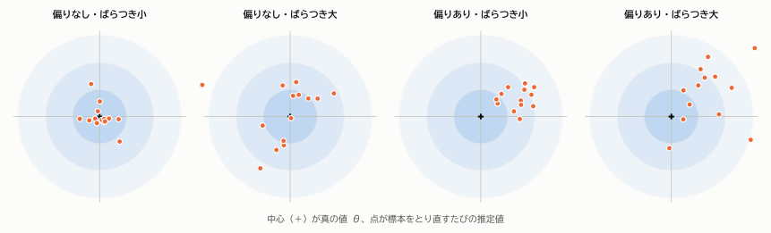
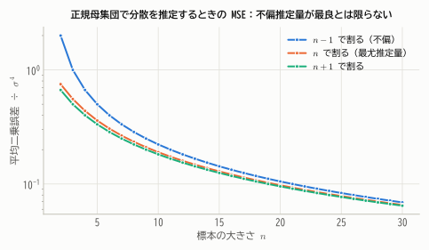
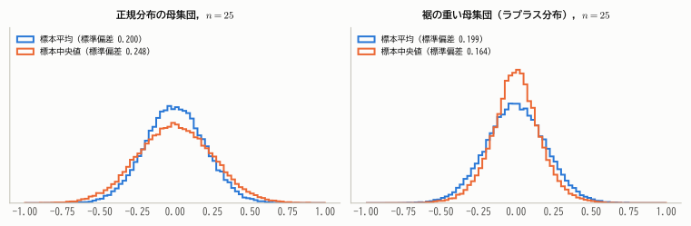
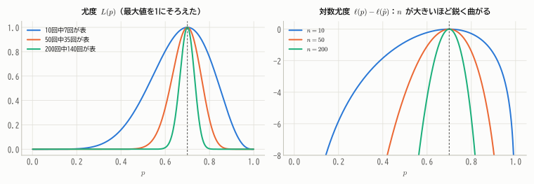
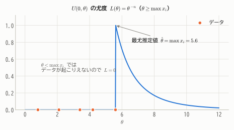
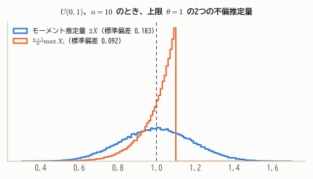
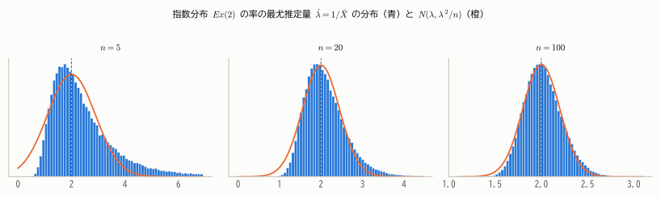

# 第14章 点推定

!!! abstract "この章で学ぶこと"
    - 推定量の「良さ」を測る基準：**不偏性・平均二乗誤差・一致性・有効性**
    - 推定量の作り方1：**モーメント法**
    - 推定量の作り方2：**最尤法**（最尤推定量）
    - **フィッシャー情報量** と **クラメール・ラオの不等式**：不偏推定量の分散の下限
    - 最尤推定量の **漸近正規性** と漸近有効性
    - 十分統計量

母集団の未知の母数 $\theta$（母平均、母分散、母比率など）を、標本から1つの値で言い当てることを **点推定** といいます。
この章では「どうやって推定量を作るか」と「どの推定量が良いのか」を、数学的に考えます。数理統計学の中心的なテーマです。

## 14.1 推定量と推定値

!!! definition "定義 14.1（推定量と推定値）"
    母数 $\theta$ を推定するための統計量 $\hat{\theta} = T(X_1, \dots, X_n)$ を、$\theta$ の **推定量**（estimator）という。
    実際に得られたデータ $x_1, \dots, x_n$ を代入した値 $T(x_1, \dots, x_n)$ を **推定値**（estimate）という。

推定量は確率変数（標本のとり方によって値が変わる）、推定値はその実現値（ただの数）です。
「$\hat{\theta}$」（シータ・ハット）のように、推定量には帽子をかぶせて表すのが慣習です。

同じ母数に対して、推定量はいくらでも考えられます。母平均 $\mu$ を推定するのに、標本平均 $\bar{X}$ を使ってもよいし、中央値でも、最初の1個 $X_1$ でも、最大値と最小値の平均でもかまいません。
では、どれが「良い」推定量なのでしょうか。

## 14.2 良い推定量の基準

### 不偏性

!!! definition "定義 14.2（不偏推定量）"
    $$
    E[\hat{\theta}] = \theta
    $$

    がすべての $\theta$ で成り立つとき、$\hat{\theta}$ を $\theta$ の **不偏推定量** という。$E[\hat{\theta}] - \theta$ を **偏り**（バイアス）という。

不偏性は「平均的には的の中心に当たっている」ことを意味します。$\bar{X}$ は $\mu$ の、$S^2$（$n - 1$ で割る）は $\sigma^2$ の不偏推定量でした（第13章）。

<figure markdown="span">
  { width="900" }
  <figcaption>図14.1 推定量の良さを的当てにたとえる。標本をとり直すたびに推定値（点）が変わる。理想は左端の「偏りなし・ばらつき小」。偏りがなくても、ばらつきが大きければ1回の推定は大きく外れうる。</figcaption>
</figure>

### 平均二乗誤差

図14.1が示すように、偏りがないだけでは不十分で、ばらつきの小ささも重要です。両方をまとめて評価するのが平均二乗誤差です。

!!! definition "定義 14.3（平均二乗誤差）"
    $$
    \mathrm{MSE}(\hat{\theta}) = E\big[(\hat{\theta} - \theta)^2\big]
    $$

    を $\hat{\theta}$ の **平均二乗誤差**（mean squared error）という。

!!! theorem "定理 14.1（MSE の分解）"
    $$
    \mathrm{MSE}(\hat{\theta}) = V[\hat{\theta}] + \big(E[\hat{\theta}] - \theta\big)^2 = \text{分散} + \text{偏り}^2
    $$

??? proof "証明"
    $\hat{\theta} - \theta = (\hat{\theta} - E[\hat{\theta}]) + (E[\hat{\theta}] - \theta)$ と分解して2乗の期待値をとります。第2項は定数なので

    $$
    E\big[(\hat{\theta} - \theta)^2\big] = E\big[(\hat{\theta} - E[\hat{\theta}])^2\big] + 2(E[\hat{\theta}] - \theta)\underbrace{E\big[\hat{\theta} - E[\hat{\theta}]\big]}_{= 0} + (E[\hat{\theta}] - \theta)^2
    $$

第2章の定理2.3と同じ「平方和の分解」です。不偏推定量なら MSE ＝ 分散 です。

MSE の観点では、**不偏推定量が最良とは限りません**。少し偏りを許すことで分散が大きく減るなら、MSE は小さくなりえます（**偏りと分散のトレードオフ**）。

**例**：正規母集団の分散 $\sigma^2$ を、平方和 $\sum(X_i - \bar{X})^2$ を $d$ で割って推定します。$\sum(X_i - \bar{X})^2/\sigma^2 \sim \chi^2(n - 1)$（平均 $n - 1$、分散 $2(n - 1)$）を使うと

$$
\frac{\mathrm{MSE}}{\sigma^4} = \left(\frac{n - 1}{d} - 1\right)^2 + \frac{2(n - 1)}{d^2}
$$

で、$d = n - 1$（不偏）のとき $\frac{2}{n - 1}$、$d = n$ のとき $\frac{2n - 1}{n^2}$、$d = n + 1$ のとき $\frac{2}{n + 1}$ となり、**MSE は $n + 1$ で割るときが最小** です。

<figure markdown="span">
  { width="620" }
  <figcaption>図14.2 正規母集団の分散の推定量の MSE。不偏推定量（$n - 1$ で割る）は、わずかに偏った推定量より MSE が大きい。</figcaption>
</figure>

### 一致性

標本を増やせば正しい値に近づく、というのは推定量に求められる最低限の性質です。

!!! definition "定義 14.4（一致推定量）"
    $n \to \infty$ のとき $\hat{\theta}_n \xrightarrow{P} \theta$（確率収束）となるならば、$\hat{\theta}_n$ を $\theta$ の **一致推定量** という。

!!! theorem "定理 14.2（一致性の十分条件）"
    $\mathrm{MSE}(\hat{\theta}_n) \to 0$ ならば、$\hat{\theta}_n$ は一致推定量である。特に、不偏推定量で $V[\hat{\theta}_n] \to 0$ ならば一致推定量である。

??? proof "証明"
    マルコフの不等式（第6章 定理6.3）を $(\hat{\theta}_n - \theta)^2$ に適用すると

    $$
    P\big(|\hat{\theta}_n - \theta| \ge \varepsilon\big) = P\big((\hat{\theta}_n - \theta)^2 \ge \varepsilon^2\big) \le \frac{E[(\hat{\theta}_n - \theta)^2]}{\varepsilon^2} = \frac{\mathrm{MSE}(\hat{\theta}_n)}{\varepsilon^2} \to 0
    $$

$\bar{X}$ が $\mu$ の一致推定量であることは、まさに大数の法則です。一方、$\hat{\mu} = X_1$（最初の1個だけ使う）は不偏ですが、$n$ を増やしても分散が $\sigma^2$ のままなので一致推定量ではありません。

### 有効性

不偏推定量どうしなら、分散が小さい方が良い推定量です。2つの不偏推定量 $\hat{\theta}_1, \hat{\theta}_2$ について、分散の比 $V[\hat{\theta}_2]/V[\hat{\theta}_1]$ を $\hat{\theta}_1$ の $\hat{\theta}_2$ に対する **相対効率** といいます。

**例（平均と中央値）**：正規母集団 $N(\mu, \sigma^2)$ では、標本平均も標本中央値も $\mu$ の不偏推定量です。$V[\bar{X}] = \sigma^2/n$ に対し、標本中央値の分散は $n$ が大きいとき約 $\frac{\pi\sigma^2}{2n}$ なので、
平均の中央値に対する相対効率は $\pi/2 \approx 1.57$。中央値で同じ精度を得るには約1.57倍のデータが必要です。

<figure markdown="span">
  { width="860" }
  <figcaption>図14.3 正規母集団（左）では標本平均の方がばらつきが小さく効率的。しかし裾の重い母集団（右）では、外れ値の影響を受けにくい中央値の方が効率的になる。どの推定量が良いかは母集団分布による。</figcaption>
</figure>

では、不偏推定量の分散はどこまで小さくできるのでしょうか。その限界を示すのが、14.5節のクラメール・ラオの不等式です。

## 14.3 モーメント法

推定量の作り方として最も素朴なのが **モーメント法** です。

!!! definition "定義 14.5（モーメント法）"
    母集団の $k$ 次モーメント $E[X^k]$ は母数 $\theta$ の関数です。それを標本の $k$ 次モーメント $\frac{1}{n}\sum X_i^k$ と等しいとおいた方程式を、母数の個数だけ連立して解いて得られる推定量を **モーメント推定量** という。

大数の法則により、標本モーメントは母集団のモーメントに確率収束するので、モーメント推定量は（多くの場合）一致推定量になります。

**例1（ガンマ分布）**：$Ga(\alpha, \lambda)$ では $E[X] = \alpha/\lambda$、$V[X] = \alpha/\lambda^2$ です。標本平均 $\bar{X}$ と（$n$ で割った）標本分散 $\tilde{S}^2$ を等しいとおくと

$$
\frac{\alpha}{\lambda} = \bar{X}, \quad \frac{\alpha}{\lambda^2} = \tilde{S}^2 \quad\Longrightarrow\quad \hat{\lambda} = \frac{\bar{X}}{\tilde{S}^2}, \quad \hat{\alpha} = \frac{\bar{X}^2}{\tilde{S}^2}
$$

**例2（一様分布）**：$U(0, \theta)$ では $E[X] = \theta/2$ なので、$\hat{\theta} = 2\bar{X}$。

モーメント法は簡単ですが、例2のように「データの最大値より小さい推定値」が出てしまうなど、不自然な結果になることもあります。

## 14.4 最尤法

### 尤度とは

コインを10回投げたら、表が7回出ました。表の出る確率 $p$ はいくらと推定するのが自然でしょうか。

$p$ の値を仮に決めると、「10回中7回表」というデータが得られる確率が計算できます。

$$
L(p) = \binom{10}{7}p^7(1 - p)^3
$$

- $p = 0.3$ なら $L = 0.009$
- $p = 0.5$ なら $L = 0.117$
- $p = 0.7$ なら $L = 0.267$

$p = 0.7$ のとき、実際に観測されたデータが最も起こりやすくなります。そこで「**観測されたデータを最も起こりやすくする母数の値**」を推定値に採用しよう、というのが **最尤法**（さいゆうほう）の考え方です。統計学者フィッシャーが1920年代に確立しました。

!!! definition "定義 14.6（尤度と最尤推定量）"
    母集団の確率関数（または密度関数）を $f(x; \theta)$ とする。データ $x_1, \dots, x_n$ を固定して $\theta$ の関数とみた

    $$
    L(\theta) = \prod_{i=1}^{n} f(x_i; \theta)
    $$

    を **尤度関数**（likelihood function）といい、その対数 $\ell(\theta) = \log L(\theta) = \sum_{i=1}^{n}\log f(x_i; \theta)$ を **対数尤度** という。
    $L(\theta)$ を最大にする $\theta$ を **最尤推定量**（maximum likelihood estimator, MLE）という。

!!! warning "尤度は確率ではない"
    $L(\theta)$ は「データの確率（密度）」を $\theta$ の関数として見たものです。$\theta$ について積分しても1にはならず、「$\theta$ の確率分布」ではありません。
    「尤度」の「尤」は「もっともらしい」という意味で、「どの $\theta$ がデータをもっともらしく説明するか」の度合いを表します。

積の最大化は面倒なので、ふつうは対数をとって和にした対数尤度 $\ell(\theta)$ を最大化します（$\log$ は増加関数なので最大点は変わりません）。
多くの場合、**尤度方程式** $\ell'(\theta) = 0$ を解けば最尤推定量が得られます。

<figure markdown="span">
  { width="860" }
  <figcaption>図14.4 表の割合がどれも 0.7 のデータについての尤度（左）と対数尤度（右）。最大点はどれも $p = 0.7$ だが、データが多いほど山が鋭くなり、$p$ の値が狭い範囲に絞り込まれる。</figcaption>
</figure>

!!! demo "やってみよう：尤度関数を動かす"
    投げた回数と表の回数を変えると、尤度関数がどう変わるか観察しましょう。回数を増やすと山が鋭くなることに注目してください。

    

### 最尤推定量の例

**例1（ベルヌーイ分布）**：$f(x; p) = p^x(1 - p)^{1-x}$ なので

$$
\ell(p) = \sum_{i=1}^n\{x_i\log p + (1 - x_i)\log(1 - p)\}, \qquad \ell'(p) = \frac{\sum x_i}{p} - \frac{n - \sum x_i}{1 - p} = 0
$$

を解いて $\hat{p} = \frac{1}{n}\sum x_i = \bar{x}$。標本の成功割合です。

**例2（ポアソン分布）**：$\ell(\lambda) = \sum\{x_i\log\lambda - \lambda - \log x_i!\}$、$\ell'(\lambda) = \frac{\sum x_i}{\lambda} - n = 0$ より $\hat{\lambda} = \bar{x}$。

**例3（正規分布）**：母数は $\mu$ と $\sigma^2$ の2つです。

$$
\ell(\mu, \sigma^2) = -\frac{n}{2}\log(2\pi\sigma^2) - \frac{1}{2\sigma^2}\sum_{i=1}^n(x_i - \mu)^2
$$

それぞれで偏微分して0とおくと

$$
\frac{\partial\ell}{\partial\mu} = \frac{1}{\sigma^2}\sum(x_i - \mu) = 0, \qquad \frac{\partial\ell}{\partial\sigma^2} = -\frac{n}{2\sigma^2} + \frac{1}{2\sigma^4}\sum(x_i - \mu)^2 = 0
$$

より $\hat{\mu} = \bar{x}$、$\hat{\sigma}^2 = \frac{1}{n}\sum(x_i - \bar{x})^2$。分散の最尤推定量は $n$ で割ったもので、**不偏ではありません**（最尤推定量が不偏とは限らない例です）。

**例4（指数分布）**：$\ell(\lambda) = n\log\lambda - \lambda\sum x_i$、$\ell'(\lambda) = \frac{n}{\lambda} - \sum x_i = 0$ より $\hat{\lambda} = 1/\bar{x}$。

**例5（一様分布 $U(0, \theta)$）**：微分では求まらない例です。各データの密度は $1/\theta$（ただし $0 \le x_i \le \theta$ のとき）なので

$$
L(\theta) = \begin{cases} \theta^{-n} & (\theta \ge \max_i x_i) \\ 0 & (\theta < \max_i x_i) \end{cases}
$$

$\theta^{-n}$ は $\theta$ の減少関数なので、$L$ を最大にするのは、許される範囲で最小の $\theta$、つまり $\hat{\theta} = \max_i x_i$ です。

<figure markdown="span">
  { width="620" }
  <figcaption>図14.5 $U(0, \theta)$ の尤度。$\theta$ がデータの最大値より小さいと、そのデータは起こりえないので尤度は0。最大値のところで尤度は最大になる。</figcaption>
</figure>

$\max X_i$ は必ず $\theta$ より小さいので偏りがあり、$E[\max X_i] = \frac{n}{n + 1}\theta$ です（第10章の順序統計量の分布から計算できます）。
偏りを補正した $\frac{n + 1}{n}\max X_i$ は不偏推定量で、その分散 $\frac{\theta^2}{n(n + 2)}$ は、モーメント推定量 $2\bar{X}$ の分散 $\frac{\theta^2}{3n}$ よりはるかに小さくなります。

<figure markdown="span">
  { width="620" }
  <figcaption>図14.6 どちらも不偏推定量だが、最大値にもとづく推定量の方がずっと精度が高い。モーメント推定量 $2\bar{X}$ はデータの「端」の情報をうまく使えていない。</figcaption>
</figure>

### 最尤推定量の不変性

最尤推定量には、次の便利な性質があります。

!!! theorem "定理 14.3（最尤推定量の不変性）"
    $\hat{\theta}$ が $\theta$ の最尤推定量ならば、関数 $g(\theta)$ の最尤推定量は $g(\hat{\theta})$ である。

たとえば正規分布の標準偏差 $\sigma$ の最尤推定量は $\sqrt{\hat{\sigma}^2}$、指数分布で「待ち時間が1を超える確率」$e^{-\lambda}$ の最尤推定量は $e^{-1/\bar{x}}$ です。
（不偏性にはこの性質がありません。$S^2$ は $\sigma^2$ の不偏推定量でも、$S$ は $\sigma$ の不偏推定量ではありませんでした。）

## 14.5 フィッシャー情報量とクラメール・ラオの不等式

### スコアとフィッシャー情報量

図14.4で、データが多いほど対数尤度の山が鋭くなり、母数がよく絞り込まれることを見ました。山の「鋭さ」＝ **対数尤度の曲率** が、データに含まれる母数の情報の量を表していると考えられます。これを定式化したのがフィッシャー情報量です。

!!! definition "定義 14.7（スコア関数とフィッシャー情報量）"
    1個の観測 $X$ について、対数尤度の微分

    $$
    U(\theta) = \frac{\partial}{\partial\theta}\log f(X; \theta)
    $$

    を **スコア関数** という。スコア関数の分散

    $$
    I(\theta) = E\big[U(\theta)^2\big]
    $$

    を **フィッシャー情報量** という。

!!! theorem "定理 14.4（スコアとフィッシャー情報量の性質）"
    適当な正則条件（$X$ のとりうる値の範囲が $\theta$ によらない、微分と積分が交換できる、など）のもとで

    1. $E[U(\theta)] = 0$
    2. $I(\theta) = -E\left[\dfrac{\partial^2}{\partial\theta^2}\log f(X; \theta)\right]$
    3. $n$ 個の i.i.d. 観測に含まれるフィッシャー情報量は $I_n(\theta) = nI(\theta)$

??? proof "証明"
    **1.** $\frac{\partial}{\partial\theta}\log f = \frac{\partial f/\partial\theta}{f}$ なので

    $$
    E[U] = \int\frac{\partial f/\partial\theta}{f}\,f\,dx = \int\frac{\partial f}{\partial\theta}\,dx = \frac{d}{d\theta}\int f\,dx = \frac{d}{d\theta}1 = 0
    $$

    **2.** 1の式 $\int\left(\frac{\partial}{\partial\theta}\log f\right)f\,dx = 0$ をもう一度 $\theta$ で微分すると、積の微分により

    $$
    \int\left(\frac{\partial^2}{\partial\theta^2}\log f\right)f\,dx + \int\left(\frac{\partial}{\partial\theta}\log f\right)\frac{\partial f}{\partial\theta}\,dx = 0
    $$

    第2項は $\int\left(\frac{\partial}{\partial\theta}\log f\right)^2 f\,dx = E[U^2]$ に等しいので、$E[U^2] = -E\left[\frac{\partial^2}{\partial\theta^2}\log f\right]$。

    **3.** $n$ 個の観測の対数尤度は $\sum\log f(X_i; \theta)$ なので、スコアは $\sum U_i$ です。$U_i$ は独立で平均0なので、分散は足し算になり $nI(\theta)$。

2の形は「対数尤度の2階微分（曲率）の期待値にマイナスをつけたもの」で、図14.4の「山の鋭さ」を表しています。3は「独立な観測を $n$ 個集めれば情報量は $n$ 倍」という自然な性質です。

**例**：

| 分布 | $\log f(x; \theta)$ | $-\frac{\partial^2}{\partial\theta^2}\log f$ | $I(\theta)$ |
|---|---|---|---|
| ベルヌーイ $\mathrm{Bern}(p)$ | $x\log p + (1-x)\log(1-p)$ | $\frac{x}{p^2} + \frac{1-x}{(1-p)^2}$ | $\frac{1}{p(1-p)}$ |
| ポアソン $Po(\lambda)$ | $x\log\lambda - \lambda - \log x!$ | $\frac{x}{\lambda^2}$ | $\frac{1}{\lambda}$ |
| 正規 $N(\mu, \sigma^2)$（$\sigma$ 既知） | $-\frac{(x-\mu)^2}{2\sigma^2} + \text{定数}$ | $\frac{1}{\sigma^2}$ | $\frac{1}{\sigma^2}$ |
| 指数 $Ex(\lambda)$ | $\log\lambda - \lambda x$ | $\frac{1}{\lambda^2}$ | $\frac{1}{\lambda^2}$ |

### クラメール・ラオの不等式

!!! theorem "定理 14.5（クラメール・ラオの不等式）"
    正則条件のもとで、$\theta$ の任意の不偏推定量 $\hat{\theta}$ について

    $$
    V[\hat{\theta}] \ge \frac{1}{nI(\theta)}
    $$

    右辺を **クラメール・ラオの下限** という。

??? proof "証明"
    $\boldsymbol{x} = (x_1, \dots, x_n)$ の同時密度を $f_n(\boldsymbol{x}; \theta) = \prod f(x_i; \theta)$、全体のスコアを $U_n = \frac{\partial}{\partial\theta}\log f_n = \sum U_i$ とします。

    $\hat{\theta} = T(\boldsymbol{X})$ は不偏なので、すべての $\theta$ で $\int T(\boldsymbol{x})f_n(\boldsymbol{x}; \theta)\,d\boldsymbol{x} = \theta$。両辺を $\theta$ で微分すると

    $$
    \int T(\boldsymbol{x})\frac{\partial f_n}{\partial\theta}\,d\boldsymbol{x} = 1 \quad\Longleftrightarrow\quad E[T \cdot U_n] = 1
    $$

    $E[U_n] = 0$ なので $\mathrm{Cov}(T, U_n) = E[TU_n] - E[T]E[U_n] = 1$ です。相関係数が1以下であること（第9章 定理9.2の4、コーシー・シュワルツの不等式）より

    $$
    1 = \mathrm{Cov}(T, U_n)^2 \le V[T]\,V[U_n] = V[T]\cdot nI(\theta)
    $$

    両辺を $nI(\theta)$ で割れば得られます。

クラメール・ラオの不等式は「**どんなに工夫しても、不偏推定量の分散は $1/(nI(\theta))$ より小さくできない**」という、推定精度の根本的な限界を表しています。
情報量 $nI(\theta)$ が大きいほど、限界は小さく（精度は高く）なります。

!!! definition "定義 14.8（有効推定量）"
    分散がクラメール・ラオの下限に一致する不偏推定量を **有効推定量** という。

**例**：

- ベルヌーイ分布：下限は $\frac{p(1-p)}{n}$。$V[\bar{X}] = \frac{p(1-p)}{n}$ なので、$\bar{X}$ は $p$ の有効推定量です。
- 正規分布（$\sigma$ 既知）：下限は $\frac{\sigma^2}{n} = V[\bar{X}]$。$\bar{X}$ は $\mu$ の有効推定量で、中央値などどんな不偏推定量も $\bar{X}$ より精度は高くなりえません。
- ポアソン分布：下限は $\frac{\lambda}{n} = V[\bar{X}]$。$\bar{X}$ は $\lambda$ の有効推定量です。

!!! note "正則条件が成り立たない場合"
    $U(0, \theta)$ は、$X$ のとりうる範囲 $[0, \theta]$ が $\theta$ に依存するので正則条件を満たしません。
    そのため不偏推定量 $\frac{n+1}{n}\max X_i$ の分散 $\frac{\theta^2}{n(n+2)}$ は $1/n^2$ の速さで小さくなり、通常の $1/n$ の限界を破ります。

## 14.6 最尤推定量の漸近的性質

最尤推定量は不偏とは限らず、有限の $n$ で最適とも限りません。しかし $n$ が大きいときには、次のような非常に優れた性質をもちます。これが最尤法が広く使われる最大の理由です。

!!! theorem "定理 14.6（最尤推定量の漸近的性質）"
    正則条件のもとで、最尤推定量 $\hat{\theta}_n$ は

    1. **一致性**：$\hat{\theta}_n \xrightarrow{P} \theta$
    2. **漸近正規性**：$\sqrt{n}(\hat{\theta}_n - \theta) \xrightarrow{d} N\left(0,\ \dfrac{1}{I(\theta)}\right)$

    すなわち、$n$ が大きいとき $\hat{\theta}_n \approx N\left(\theta,\ \dfrac{1}{nI(\theta)}\right)$。漸近分散がクラメール・ラオの下限に一致するので、最尤推定量は **漸近有効** である。

??? proof "漸近正規性の証明の考え方"
    最尤推定量は $\ell_n'(\hat{\theta}_n) = 0$ を満たします。$\hat{\theta}_n$ は $\theta$ に近いので（一致性）、$\ell_n'$ を $\theta$ のまわりで1次近似すると

    $$
    0 = \ell_n'(\hat{\theta}_n) \approx \ell_n'(\theta) + (\hat{\theta}_n - \theta)\,\ell_n''(\theta)
    $$

    よって

    $$
    \sqrt{n}(\hat{\theta}_n - \theta) \approx \frac{\frac{1}{\sqrt{n}}\ell_n'(\theta)}{-\frac{1}{n}\ell_n''(\theta)}
    $$

    - 分子：$\ell_n'(\theta) = \sum U_i$ は平均0、分散 $I(\theta)$ の i.i.d. の和なので、中心極限定理より $\frac{1}{\sqrt{n}}\sum U_i \xrightarrow{d} N(0, I(\theta))$。
    - 分母：$-\frac{1}{n}\ell_n''(\theta) = \frac{1}{n}\sum\left(-\frac{\partial^2}{\partial\theta^2}\log f(X_i; \theta)\right)$ は、大数の法則より $I(\theta)$ に確率収束。

    したがって $\sqrt{n}(\hat{\theta}_n - \theta) \approx N(0, I(\theta))/I(\theta) = N(0, 1/I(\theta))$ です。

<figure markdown="span">
  { width="900" }
  <figcaption>図14.7 指数分布の率の最尤推定量 $1/\bar{X}$。$n$ が小さいと右に歪み、やや偏りもあるが、$n$ が大きくなると理論どおりの正規分布 $N(\lambda, 1/(nI(\lambda))) = N(\lambda, \lambda^2/n)$ に近づく。</figcaption>
</figure>

漸近正規性から、最尤推定量の **標準誤差** は $\frac{1}{\sqrt{nI(\hat{\theta})}}$ で見積もることができます。
これを使うと、ほとんどどんなモデルでも「推定値 ± 1.96 × 標準誤差」という近似的な信頼区間が作れます（第15章）。第12章のデルタ法で求めた指数分布の結果（$\lambda^2/n$）とも一致していることを確認しましょう。

## 14.7 十分統計量

コインを $n$ 回投げたデータ $(x_1, \dots, x_n)$ から $p$ を推定するとき、「何回目に表が出たか」という順番の情報は役に立ちそうにありません。表の回数 $\sum x_i$ さえわかれば十分に思えます。この直感を定式化したのが十分統計量です。

!!! definition "定義 14.9（十分統計量）"
    統計量 $T(\boldsymbol{X})$ を与えたときの標本 $\boldsymbol{X}$ の条件付き分布が $\theta$ に依存しないとき、$T$ を $\theta$ の **十分統計量** という。

$T$ の値がわかれば、標本の残りの情報（$T$ が同じ値になる中での並び方など）は $\theta$ について何も教えてくれない、という意味です。判定には次の定理が便利です。

!!! theorem "定理 14.7（因子分解定理）"
    $T$ が $\theta$ の十分統計量であるための必要十分条件は、同時確率関数（密度関数）が

    $$
    f_n(\boldsymbol{x}; \theta) = g\big(T(\boldsymbol{x});\ \theta\big)\,h(\boldsymbol{x})
    $$

    の形に分解できることである（$h$ は $\theta$ を含まない）。

**例**：

- ベルヌーイ分布：$f_n = p^{\sum x_i}(1 - p)^{n - \sum x_i}$ なので $T = \sum X_i$ が十分統計量。
- ポアソン分布：$f_n = \lambda^{\sum x_i}e^{-n\lambda}\cdot\frac{1}{\prod x_i!}$ なので $T = \sum X_i$。
- 正規分布：指数部分 $\sum(x_i - \mu)^2 = \sum x_i^2 - 2\mu\sum x_i + n\mu^2$ より、$(\sum X_i, \sum X_i^2)$（あるいは同じことだが $(\bar{X}, S^2)$）が $(\mu, \sigma^2)$ の十分統計量。

最尤推定量は尤度を通じてしかデータを使わないので、必ず十分統計量の関数になります。
また、任意の不偏推定量を十分統計量で条件付けて「平均し直す」と、分散を増やさずに改良できる（**ラオ・ブラックウェルの定理**）ことも知られています。

## まとめ

- 推定量の良さは **MSE ＝ 分散 ＋ 偏り²** で評価する。不偏推定量が MSE 最小とは限らない。
- **一致性** は最低限の要請。MSE → 0 なら一致推定量。
- **モーメント法**：標本モーメント ＝ 母集団モーメント とおいて解く。簡単だが効率が悪いこともある。
- **最尤法**：データを最も起こりやすくする母数を選ぶ。尤度方程式 $\ell'(\theta) = 0$ を解く。不変性をもつ。
- **フィッシャー情報量** $I(\theta) = -E[\partial^2\log f/\partial\theta^2]$ は対数尤度の曲率。
- **クラメール・ラオの不等式**：不偏推定量の分散 $\ge 1/(nI(\theta))$。
- 最尤推定量は一致性・**漸近正規性** $N(\theta, 1/(nI(\theta)))$・漸近有効性をもつ。

## 練習問題

!!! exercise "問題 14.1（推定量の比較）"
    $X_1, \dots, X_{10}$ を母平均 $\mu$、母分散 $\sigma^2$ の母集団からの無作為標本とします。
    $\hat{\mu}_1 = \frac{X_1 + X_2}{2}$ と $\hat{\mu}_2 = \bar{X}$ はどちらも $\mu$ の不偏推定量であることを示し、どちらが良いか答えてください。

    ??? success "解答"
        $E[\hat{\mu}_1] = \frac{\mu + \mu}{2} = \mu$、$E[\hat{\mu}_2] = \mu$ でどちらも不偏です。
        分散は $V[\hat{\mu}_1] = \frac{\sigma^2 + \sigma^2}{4} = \frac{\sigma^2}{2}$、$V[\hat{\mu}_2] = \frac{\sigma^2}{10}$ なので、$\hat{\mu}_2$ の方が分散が小さく良い推定量です（相対効率は5）。

!!! exercise "問題 14.2（ポアソン分布の最尤推定とクラメール・ラオの下限）"
    $X_1, \dots, X_n$ が i.i.d. で $Po(\lambda)$ に従うとき、

    (1) $\lambda$ の最尤推定量を求めてください。
    (2) フィッシャー情報量 $I(\lambda)$ を求めてください。
    (3) (1) の推定量が有効推定量であることを示してください。

    ??? success "解答"
        (1) 本文の例2より $\hat{\lambda} = \bar{X}$。

        (2) $\frac{\partial^2}{\partial\lambda^2}\log f(x; \lambda) = -\frac{x}{\lambda^2}$ なので $I(\lambda) = E\left[\frac{X}{\lambda^2}\right] = \frac{\lambda}{\lambda^2} = \frac{1}{\lambda}$。

        (3) $E[\bar{X}] = \lambda$（不偏）、$V[\bar{X}] = \frac{\lambda}{n} = \frac{1}{nI(\lambda)}$ で、クラメール・ラオの下限に一致するので有効推定量です。

!!! exercise "問題 14.3（幾何分布の最尤推定）"
    初めて成功するまでの失敗回数 $X_1, \dots, X_n$ が i.i.d. で幾何分布 $Ge(p)$（$P(X = x) = p(1 - p)^x$）に従うとき、$p$ の最尤推定量を求めてください。

    ??? success "解答"
        $\ell(p) = n\log p + \left(\sum x_i\right)\log(1 - p)$。

        $$
        \ell'(p) = \frac{n}{p} - \frac{\sum x_i}{1 - p} = 0 \quad\Longrightarrow\quad \hat{p} = \frac{n}{n + \sum x_i} = \frac{1}{1 + \bar{x}}
        $$

        「1回の成功あたりの試行回数の平均」$1 + \bar{x}$ の逆数で、自然な結果です。

!!! exercise "問題 14.4（モーメント法）"
    ガンマ分布 $Ga(\alpha, \lambda)$ からの標本で、$\bar{x} = 6$、$n$ で割った標本分散 $\tilde{s}^2 = 12$ でした。$\alpha$ と $\lambda$ のモーメント推定値を求めてください。

    ??? success "解答"
        $\hat{\lambda} = \bar{x}/\tilde{s}^2 = 6/12 = 0.5$、$\hat{\alpha} = \bar{x}^2/\tilde{s}^2 = 36/12 = 3$。

!!! exercise "問題 14.5（一様分布の最大値の期待値）"
    $X_1, \dots, X_n$ が i.i.d. で $U(0, \theta)$ に従うとき、$M = \max X_i$ について $E[M] = \frac{n}{n + 1}\theta$ を示してください。

    ??? success "解答"
        第10章の定理10.8より $P(M \le x) = (x/\theta)^n$（$0 \le x \le \theta$）なので、密度は $f_M(x) = \frac{n x^{n-1}}{\theta^n}$。

        $$
        E[M] = \int_0^\theta x\cdot\frac{nx^{n-1}}{\theta^n}\,dx = \frac{n}{\theta^n}\cdot\frac{\theta^{n+1}}{n + 1} = \frac{n}{n + 1}\theta
        $$

        したがって $\frac{n + 1}{n}M$ は $\theta$ の不偏推定量です。

!!! exercise "問題 14.6（最尤推定量の漸近分布）"
    ベルヌーイ分布の最尤推定量 $\hat{p} = \bar{X}$ の漸近分布を、定理14.6を使って書いてください。また、$n = 400$、$\hat{p} = 0.3$ のとき、$\hat{p}$ の標準誤差を見積もってください。

    ??? success "解答"
        $I(p) = \frac{1}{p(1-p)}$ なので $\hat{p} \approx N\left(p,\ \frac{p(1-p)}{n}\right)$（これは中心極限定理から直接得られる結果とも一致します）。
        標準誤差は $\sqrt{\frac{0.3 \times 0.7}{400}} = \sqrt{0.000525} \approx 0.023$ です。
