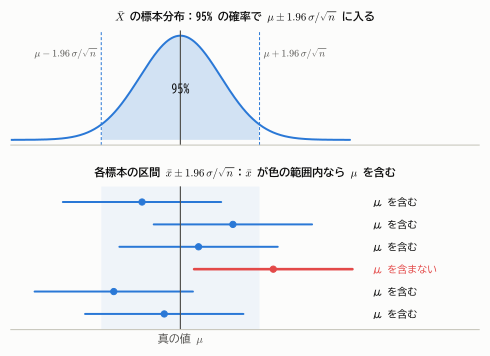
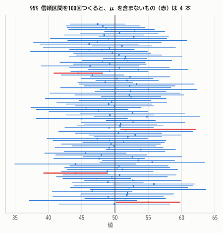
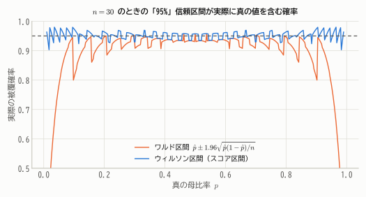
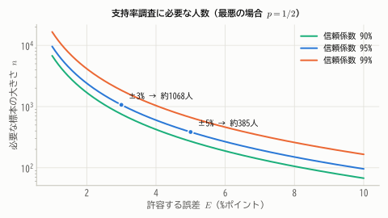

# 第15章 区間推定

!!! abstract "この章で学ぶこと"
    - **信頼区間** の作り方と、その **正しい解釈**
    - 枢軸量を使った信頼区間の一般的な構成法
    - 母平均（$\sigma$ 既知・未知）、母分散、母比率の信頼区間
    - 必要な標本の大きさの設計
    - 2つの母集団の差の信頼区間
    - 最尤推定量にもとづく近似的な信頼区間

点推定は「母平均はおそらく 101.0 g」のように1つの値で答えます。しかし、その推定値がどのくらい信頼できるのかはわかりません。
**区間推定** は「母平均はおそらく 100.0 g から 102.0 g の間にある」のように、**推定の不確かさを幅で表す** 方法です。

## 15.1 信頼区間の考え方

### 母平均の信頼区間（$\sigma$ が既知の場合）

正規母集団 $N(\mu, \sigma^2)$ から大きさ $n$ の標本をとると、$\bar{X} \sim N(\mu, \sigma^2/n)$ なので、標準化した量は標準正規分布に従います。

$$
Z = \frac{\bar{X} - \mu}{\sigma/\sqrt{n}} \sim N(0, 1)
$$

標準正規分布では $P(-1.96 \le Z \le 1.96) = 0.95$ なので

$$
P\left(-1.96 \le \frac{\bar{X} - \mu}{\sigma/\sqrt{n}} \le 1.96\right) = 0.95
$$

かっこの中の不等式を $\mu$ について解くと、次のように書き換えられます。

$$
P\left(\bar{X} - 1.96\frac{\sigma}{\sqrt{n}} \le \mu \le \bar{X} + 1.96\frac{\sigma}{\sqrt{n}}\right) = 0.95
$$

この区間 $\left[\bar{X} - 1.96\frac{\sigma}{\sqrt{n}},\ \bar{X} + 1.96\frac{\sigma}{\sqrt{n}}\right]$ を、$\mu$ の **95% 信頼区間** といいます。

<figure markdown="span">
  { width="680" }
  <figcaption>図15.1 信頼区間の仕組み。$\bar{X}$ は95%の確率で $\mu \pm 1.96\sigma/\sqrt{n}$ の範囲（上の色の部分）に入る。$\bar{x}$ がこの範囲に入っていれば、$\bar{x}$ を中心とする同じ幅の区間は必ず $\mu$ を含む。したがって、区間が $\mu$ を含む確率は95%。</figcaption>
</figure>

!!! definition "定義 15.1（信頼区間）"
    $0 < \alpha < 1$ とする。統計量 $L(\boldsymbol{X})$、$U(\boldsymbol{X})$ が、母数 $\theta$ のどんな値に対しても

    $$
    P\big(L(\boldsymbol{X}) \le \theta \le U(\boldsymbol{X})\big) = 1 - \alpha
    $$

    を満たすとき、区間 $[L, U]$ を $\theta$ の **$100(1 - \alpha)$% 信頼区間** といい、$1 - \alpha$ を **信頼係数**（信頼水準）という。

### 信頼区間の正しい解釈

信頼区間は誤解されやすい概念なので、注意深く理解しましょう。

**例**：ある工場の袋詰めの重さの標準偏差は $\sigma = 1.5$ g とわかっています。10袋を調べたら平均は $\bar{x} = 101.0$ g でした。95% 信頼区間は

$$
101.0 \pm 1.96 \times \frac{1.5}{\sqrt{10}} = 101.0 \pm 0.93 \quad\Longrightarrow\quad [100.07,\ 101.93]
$$

です。この結果を「**母平均 $\mu$ が 100.07 から 101.93 の間にある確率は 95% である**」と言いたくなりますが、これは（頻度論の立場では）**誤り** です。

- 母平均 $\mu$ は未知ですが、**確率変数ではなく定数** です。$\mu$ は 100.07 と 101.93 の間に「ある」か「ない」かのどちらかで、確率を考える対象ではありません。
- 確率的にばらつくのは **区間の方** です。標本をとり直すたびに $\bar{X}$ が変わり、区間が動きます。

正しい解釈は次のとおりです。

!!! point "信頼区間の正しい解釈"
    「同じ方法で標本をとって信頼区間を作ることを何度もくり返すと、そのうち約95%の区間が真の母平均 $\mu$ を含む」

    95% は、区間を作る **方法（手続き）の信頼性** を表しています。手元の1つの区間について言えるのは、「95%の確率で正しい結果を出す方法で作った区間である」ということです。

<figure markdown="span">
  { width="600" }
  <figcaption>図15.2 母平均50の正規母集団から大きさ10の標本を100回とり、それぞれ95%信頼区間を作った結果。真の値（縦線）を含まない区間（赤）が約5本ある。区間ごとに中心も幅も異なる。</figcaption>
</figure>

!!! demo "やってみよう：信頼区間を100回つくる"
    ボタンを押すたびに、新しい標本から100本の信頼区間を作ります。くり返すと、真の値を含む割合が信頼係数に近づくことを確かめましょう。
    標本の大きさ $n$ を変えると区間の幅が、信頼係数を変えると区間の幅と含む割合が変わります。

    <div class="sim" data-sim="ci"></div>

!!! note "ベイズ統計の信用区間"
    「$\mu$ がこの区間に入る確率が95%」と言いたい場合は、$\mu$ そのものを確率変数とみなす **ベイズ統計** の立場をとる必要があります。
    その場合の区間は **信用区間**（確信区間）と呼ばれます（第20章）。

### 信頼係数と区間の幅

信頼係数を上げると区間は広くなります。99% 信頼区間は $\bar{X} \pm 2.576\,\sigma/\sqrt{n}$ で、95% のときより約1.3倍広くなります。
「確実に当てたい」なら広い区間にせざるをえず、「狭い区間で言い切りたい」なら外れるリスクが増えます。
区間を狭く、かつ信頼係数を高く保つには、**標本の大きさ $n$ を大きくする** しかありません（幅は $1/\sqrt{n}$ に比例）。

## 15.2 枢軸量による一般的な構成法

上の議論の鍵は、$Z = \frac{\bar{X} - \mu}{\sigma/\sqrt{n}}$ が

1. 未知の母数 $\mu$ とデータの両方を含み、
2. その分布が $\mu$ によらず完全にわかっている（$N(0, 1)$）

という性質をもつことでした。このような量を **枢軸量**（ピボット）といいます。枢軸量 $Q(\boldsymbol{X}, \theta)$ が見つかれば、その分布のパーセント点 $a, b$ を使って $P(a \le Q \le b) = 1 - \alpha$ とし、不等式を $\theta$ について解けば信頼区間が得られます。

| 推定したいもの | 枢軸量 | 分布 |
|---|---|---|
| 母平均（$\sigma$ 既知） | $\dfrac{\bar{X} - \mu}{\sigma/\sqrt{n}}$ | $N(0, 1)$ |
| 母平均（$\sigma$ 未知） | $\dfrac{\bar{X} - \mu}{S/\sqrt{n}}$ | $t(n - 1)$ |
| 母分散 | $\dfrac{(n-1)S^2}{\sigma^2}$ | $\chi^2(n - 1)$ |
| 母比率（近似） | $\dfrac{\hat{p} - p}{\sqrt{p(1-p)/n}}$ | 近似的に $N(0, 1)$ |

第13章で学んだ標本分布の定理が、そのまま信頼区間の材料になっていることがわかります。

## 15.3 母平均の信頼区間

### $\sigma$ が既知の場合

!!! theorem "公式 15.1（母平均の信頼区間：$\sigma$ 既知）"
    $$
    \bar{X} \pm z_{\alpha/2}\frac{\sigma}{\sqrt{n}}
    $$

    （95% なら $z_{0.025} = 1.96$、99% なら $z_{0.005} = 2.576$。）

### $\sigma$ が未知の場合

現実には $\sigma$ もわからないことがほとんどです。その場合は $\sigma$ を不偏分散の平方根 $S$ で置き換え、$t$ 分布を使います（第13章 定理13.5）。

!!! theorem "公式 15.2（母平均の信頼区間：$\sigma$ 未知）"
    $$
    \bar{X} \pm t_{\alpha/2}(n - 1)\frac{S}{\sqrt{n}}
    $$

**例**：袋詰めの重さ（g）を10袋測ったところ、次のデータが得られました。

```text
102.3  99.8  101.5  100.9  98.7  103.1  100.2  101.8  99.5  102.2
```

$\bar{x} = 101.0$、$s^2 = 2.007$、$s = 1.417$ です。自由度9の $t$ 分布の上側2.5%点は $t_{0.025}(9) = 2.262$ なので

$$
101.0 \pm 2.262 \times \frac{1.417}{\sqrt{10}} = 101.0 \pm 1.01 \quad\Longrightarrow\quad [99.99,\ 102.01]
$$

$\sigma$ を推定したぶん、$z$ の代わりに大きめの $t$ の値を使うので、区間は少し広くなります。

!!! warning "$t$ 区間を使うための前提"
    公式15.2は母集団が正規分布であることを前提にしています。ただし、中心極限定理のおかげで、$n$ がある程度大きければ（目安として30以上）、母集団が正規分布でなくても近似的に使えます。
    $n$ が小さく、データが強く歪んでいたり外れ値があったりする場合は注意が必要です。

## 15.4 母分散の信頼区間

$(n - 1)S^2/\sigma^2 \sim \chi^2(n - 1)$ を使います。カイ二乗分布は左右対称ではないので、下側と上側のパーセント点を別々に使います。

$$
P\left(\chi^2_{1-\alpha/2}(n - 1) \le \frac{(n - 1)S^2}{\sigma^2} \le \chi^2_{\alpha/2}(n - 1)\right) = 1 - \alpha
$$

を $\sigma^2$ について解くと（逆数をとるので不等号の向きが変わることに注意）

!!! theorem "公式 15.3（母分散の信頼区間）"
    $$
    \left[\frac{(n - 1)S^2}{\chi^2_{\alpha/2}(n - 1)},\ \ \frac{(n - 1)S^2}{\chi^2_{1-\alpha/2}(n - 1)}\right]
    $$

**例**：上の袋詰めのデータでは $(n - 1)s^2 = 9 \times 2.007 = 18.06$、$\chi^2_{0.025}(9) = 19.02$、$\chi^2_{0.975}(9) = 2.70$ なので、母分散の95%信頼区間は

$$
\left[\frac{18.06}{19.02},\ \frac{18.06}{2.70}\right] = [0.95,\ 6.69]
$$

点推定値 2.007 に対して、区間はかなり広く、しかも左右非対称です。分散の推定には、平均の推定よりずっと多くのデータが必要です。

## 15.5 母比率の信頼区間

### ワルド区間

ある政策について400人に調査したところ、120人が賛成でした。賛成率 $p$ の信頼区間を求めます。

$\hat{p} = X/n$（$X$ は賛成者数）は、中心極限定理により近似的に $N\left(p, \frac{p(1-p)}{n}\right)$ に従います。分散の中の未知の $p$ を $\hat{p}$ で置き換えると、次の近似的な信頼区間が得られます。

!!! theorem "公式 15.4（母比率の信頼区間：ワルド区間）"
    $$
    \hat{p} \pm z_{\alpha/2}\sqrt{\frac{\hat{p}(1 - \hat{p})}{n}}
    $$

**例**：$\hat{p} = 120/400 = 0.3$、標準誤差は $\sqrt{0.3 \times 0.7/400} = 0.0229$ なので、95% 信頼区間は

$$
0.3 \pm 1.96 \times 0.0229 = 0.3 \pm 0.045 \quad\Longrightarrow\quad [0.255,\ 0.345]
$$

ニュースで「誤差 ±4.5 ポイント」などと報じられるのは、この幅のことです。

### ワルド区間の弱点

ワルド区間は簡単ですが、$n$ が小さいときや $p$ が 0 や 1 に近いときは、実際に真の値を含む確率（**被覆確率**）が名目の95%を大きく下回ることが知られています。

<figure markdown="span">
  { width="660" }
  <figcaption>図15.3 $n = 30$ のとき、「95%」信頼区間が実際に真の母比率を含む確率（二項分布から正確に計算）。ワルド区間（橙）は特に $p$ が 0 や 1 に近いと大きく下回る。ウィルソン区間（青）はおおむね95%前後を保つ。ギザギザなのは二項分布が離散的なため。</figcaption>
</figure>

改良版として、分散の中の $p$ を $\hat{p}$ で置き換えずに $\left|\frac{\hat{p} - p}{\sqrt{p(1-p)/n}}\right| \le z_{\alpha/2}$ を $p$ についての2次不等式として解く **ウィルソン区間**

$$
\frac{\hat{p} + \frac{z^2}{2n}}{1 + \frac{z^2}{n}} \pm \frac{z}{1 + \frac{z^2}{n}}\sqrt{\frac{\hat{p}(1-\hat{p})}{n} + \frac{z^2}{4n^2}} \qquad (z = z_{\alpha/2})
$$

が推奨されます。$n$ が大きければ、ワルド区間とほぼ一致します。

## 15.6 必要な標本の大きさ

信頼区間の幅の半分を **誤差の限界**（許容誤差）$E$ とすると、調査を始める前に「誤差を $E$ 以下にするには何人調べればよいか」を計算できます。

- 母平均（$\sigma$ 既知）：$z_{\alpha/2}\frac{\sigma}{\sqrt{n}} \le E$ より $n \ge \left(\dfrac{z_{\alpha/2}\,\sigma}{E}\right)^2$
- 母比率：$z_{\alpha/2}\sqrt{\frac{p(1-p)}{n}} \le E$ より $n \ge \dfrac{z_{\alpha/2}^2\,p(1-p)}{E^2}$

母比率の場合、$p$ は未知ですが、$p(1 - p) \le 1/4$（$p = 1/2$ で最大）なので、最悪の場合を想定して $n \ge \left(\frac{z_{\alpha/2}}{2E}\right)^2$ とすれば安全です。

<figure markdown="span">
  { width="620" }
  <figcaption>図15.4 支持率調査で、誤差を ±5 ポイントに抑えるには約385人、±3 ポイントなら約1068人必要（95%信頼）。誤差を半分にするには4倍の人数が必要になる。</figcaption>
</figure>

多くの世論調査が「約1000人」を対象にしているのは、誤差を ±3 ポイント程度に抑えるためです。第11章でチェビシェフの不等式から得た「2000人」より、中心極限定理を使った方がずっと少ない人数で済むこともわかります。

!!! warning "標本の大きさよりも大切なこと"
    この計算は「標本が無作為に選ばれている」ことが大前提です。ネット上の任意参加のアンケートのように、回答者が偏っていれば、何万人集めても母集団の姿は正しく推定できません（**選択バイアス**）。
    標本の大きさは偶然誤差を減らしますが、偏り（系統誤差）は減らしません。

## 15.7 2つの母集団の比較

### 母平均の差

2つの独立な正規母集団 $N(\mu_1, \sigma_1^2)$、$N(\mu_2, \sigma_2^2)$ から、大きさ $m$、$n$ の標本をとります。$\bar{X} - \bar{Y}$ の分散は $\frac{\sigma_1^2}{m} + \frac{\sigma_2^2}{n}$ です（独立なので分散は足し算）。

- **等分散を仮定できる場合**（$\sigma_1 = \sigma_2$）：2つの標本を合わせて共通の分散を推定した **プールした分散**
  $S_p^2 = \frac{(m - 1)S_1^2 + (n - 1)S_2^2}{m + n - 2}$ を使うと、

    $$
    \frac{(\bar{X} - \bar{Y}) - (\mu_1 - \mu_2)}{S_p\sqrt{\frac{1}{m} + \frac{1}{n}}} \sim t(m + n - 2)
    $$

    より、信頼区間は $(\bar{X} - \bar{Y}) \pm t_{\alpha/2}(m + n - 2)\,S_p\sqrt{\frac{1}{m} + \frac{1}{n}}$。

- **等分散を仮定しない場合**：$\sqrt{\frac{S_1^2}{m} + \frac{S_2^2}{n}}$ を標準誤差として、自由度を近似的に計算した $t$ 分布を使う（**ウェルチの方法**、第17章で詳しく扱います）。

**例**：2つの指導法でテストの点数を比べました。A 法は12人で平均72.0点、標準偏差8.0点、B 法は10人で平均63.0点、標準偏差9.0点です。
プールした分散は $S_p^2 = \frac{11 \times 64 + 9 \times 81}{20} = 71.65$、標準誤差は $\sqrt{71.65}\sqrt{\frac{1}{12} + \frac{1}{10}} = 3.62$、$t_{0.025}(20) = 2.086$ なので

$$
(72.0 - 63.0) \pm 2.086 \times 3.62 = 9.0 \pm 7.6 \quad\Longrightarrow\quad [1.4,\ 16.6]
$$

区間全体が0より大きいので、「A 法の方が平均点が高い」と考えてよさそうです（このような判断を体系化したのが次章の検定です）。

### 対応のあるデータ

同じ人の「薬を飲む前と後」のように、2つの測定値がペアになっているデータを **対応のあるデータ** といいます。
この場合は、ペアごとの差 $D_i = X_i - Y_i$ を1つの標本とみなして、母平均の信頼区間（公式15.2）を求めます。個人差が差し引きで消えるので、独立な2標本として扱うより精度が高くなります。

### 母比率の差

$$
(\hat{p}_1 - \hat{p}_2) \pm z_{\alpha/2}\sqrt{\frac{\hat{p}_1(1 - \hat{p}_1)}{m} + \frac{\hat{p}_2(1 - \hat{p}_2)}{n}}
$$

**例**：Web ページの新デザインでは200人中56人（28%）、旧デザインでは200人中40人（20%）が購入しました。差の95%信頼区間は

$$
0.08 \pm 1.96\sqrt{\frac{0.28 \times 0.72}{200} + \frac{0.20 \times 0.80}{200}} = 0.08 \pm 0.083 \quad\Longrightarrow\quad [-0.003,\ 0.163]
$$

区間がわずかに0を含むので、この人数では「新デザインの方が購入率が高い」とは言い切れません。

## 15.8 最尤推定量にもとづく近似的な信頼区間

第14章で、最尤推定量は近似的に $N\left(\theta, \frac{1}{nI(\theta)}\right)$ に従うことを学びました。これを使うと、ほとんどどんなモデルでも近似的な信頼区間が作れます。

!!! theorem "公式 15.5（ワルド型信頼区間）"
    $$
    \hat{\theta} \pm z_{\alpha/2}\frac{1}{\sqrt{nI(\hat{\theta})}}
    $$

**例**：指数分布に従う待ち時間を40回観測したら、平均は $\bar{x} = 2.5$ 分でした。率 $\lambda$ の最尤推定値は $\hat{\lambda} = 1/2.5 = 0.4$、$I(\lambda) = 1/\lambda^2$ なので標準誤差は $\hat{\lambda}/\sqrt{n} = 0.063$。95% 信頼区間は

$$
0.4 \pm 1.96 \times 0.063 \quad\Longrightarrow\quad [0.28,\ 0.52]
$$

母比率のワルド区間（公式15.4）も、ベルヌーイ分布でこの公式を使ったものになっています。

## まとめ

- **信頼区間** は「同じ方法で何度も区間を作ると、$100(1 - \alpha)$% が真の値を含む」区間。ばらつくのは区間の方で、母数は定数。
- 信頼区間は **枢軸量**（分布が母数によらない量）から作る。
- 母平均：$\sigma$ 既知なら $\bar{X} \pm z_{\alpha/2}\sigma/\sqrt{n}$、未知なら $\bar{X} \pm t_{\alpha/2}(n-1)S/\sqrt{n}$。
- 母分散：$\left[\frac{(n-1)S^2}{\chi^2_{\alpha/2}},\ \frac{(n-1)S^2}{\chi^2_{1-\alpha/2}}\right]$。母比率：$\hat{p} \pm z_{\alpha/2}\sqrt{\hat{p}(1-\hat{p})/n}$（小標本ではウィルソン区間）。
- 区間の幅は $1/\sqrt{n}$ に比例。誤差を半分にするには4倍のデータが必要。

## 練習問題

!!! exercise "問題 15.1（母平均の信頼区間）"
    ある町の世帯の1か月の電気代を16世帯について調べたところ、平均 8200 円、不偏分散の平方根 $s = 1200$ 円でした。母集団が正規分布に従うとして、母平均の95%信頼区間を求めてください（$t_{0.025}(15) = 2.131$）。

    ??? success "解答"
        $$
        8200 \pm 2.131 \times \frac{1200}{\sqrt{16}} = 8200 \pm 639.3 \quad\Longrightarrow\quad [7560.7,\ 8839.3]
        $$

!!! exercise "問題 15.2（信頼区間の解釈）"
    次の記述のうち、95%信頼区間 [7561, 8839] の解釈として正しいものを選んでください。

    (a) 母平均が 7561 円から 8839 円の間にある確率は95%である。
    (b) 町の世帯の95%は、電気代が 7561 円から 8839 円の間である。
    (c) 同じ方法で区間を何度も作れば、その約95%が母平均を含む。
    (d) 標本平均が 7561 円から 8839 円の間にある確率は95%である。

    ??? success "解答"
        **(c)** が正しい解釈です。
        (a) は母平均を確率変数のように扱っている（頻度論では誤り）。(b) は個々の世帯の分布と混同している（信頼区間は母平均についての区間で、個々のデータの95%が入る範囲ではない）。
        (d) は標本平均 8200 はすでに観測された定数で、しかも区間はその標本平均から作ったものなので意味をなさない。

!!! exercise "問題 15.3（必要な標本の大きさ）"
    ある製品の不良率を、95%信頼で誤差 ±2 ポイント以内で推定したいと考えています。

    (1) 不良率について事前の情報がないとき、何個調べればよいですか。
    (2) 過去の経験から、不良率は高々10%とわかっているとき、何個調べればよいですか。

    ??? success "解答"
        (1) $n \ge \left(\frac{1.96}{2 \times 0.02}\right)^2 = 2401$。2401個。

        (2) $p \le 0.1$ なら $p(1 - p) \le 0.1 \times 0.9 = 0.09$（$p < 1/2$ の範囲では $p(1-p)$ は増加関数）なので

        $$
        n \ge \frac{1.96^2 \times 0.09}{0.02^2} = 864.4
        $$

        865個で済みます。事前の情報があると、必要な標本はずっと少なくなります。

!!! exercise "問題 15.4（母分散の信頼区間）"
    正規母集団からの大きさ10の標本で、不偏分散が $s^2 = 4.0$ でした。母分散 $\sigma^2$ の95%信頼区間を求めてください（$\chi^2_{0.025}(9) = 19.02$、$\chi^2_{0.975}(9) = 2.70$）。

    ??? success "解答"
        $(n-1)s^2 = 36$ なので $\left[\frac{36}{19.02},\ \frac{36}{2.70}\right] = [1.89,\ 13.33]$。

!!! exercise "問題 15.5（区間の幅）"
    母平均の95%信頼区間（$\sigma$ 既知）の幅を、現在の $1/3$ にするには、標本の大きさを何倍にすればよいですか。

    ??? success "解答"
        幅は $2 \times 1.96\,\sigma/\sqrt{n}$ で $1/\sqrt{n}$ に比例するので、$\sqrt{n}$ を3倍、すなわち $n$ を **9倍** にする必要があります。
