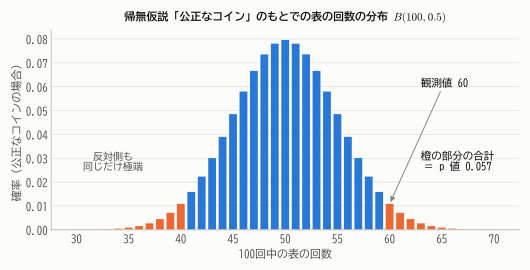
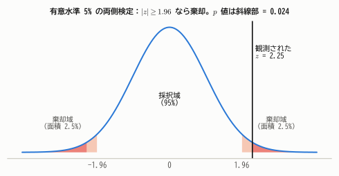
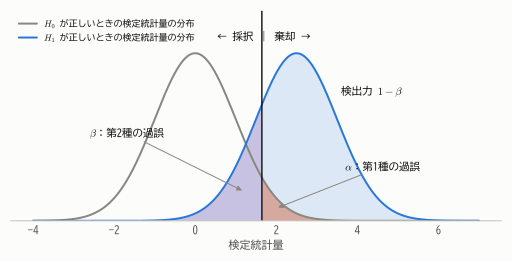
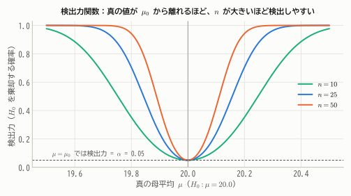
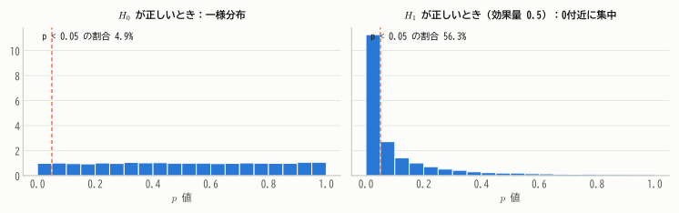
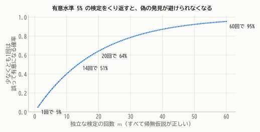

# 第16章 仮説検定の考え方

!!! abstract "この章で学ぶこと"
    - 仮説検定の論理：帰無仮説・対立仮説・検定統計量・棄却域・有意水準
    - **$p$ 値** の定義と正しい理解
    - **第1種の過誤・第2種の過誤** と **検出力**、必要な標本の大きさ
    - 検定と信頼区間の関係
    - $p$ 値の誤解と、多重検定の問題
    - 理論：**ネイマン・ピアソンの補題** と **尤度比検定**

「新薬は本当に効くのか」「コインは公正なのか」「新しい製造法で不良率は下がったのか」——データにもとづいて、このような問いに Yes/No の判断を下す方法が **仮説検定** です。
検定は統計学で最も広く使われ、同時に最も誤解されている手法でもあります。この章では、その論理を基礎からていねいに学びます。

## 16.1 検定の論理：「偶然では説明しにくい」かどうか

### コイン投げの例

あるコインを100回投げたら、表が60回出ました。このコインは歪んでいる（表が出やすい）のでしょうか。

公正なコインでも、ちょうど50回になるとは限りません。問題は「60回」が **公正なコインでも偶然起こりうる程度のずれなのか**、それとも **偶然では説明しにくいほど大きなずれなのか** です。

そこで、いったん「コインは公正である」と **仮定** して、そのもとで「60回以上の偏り」がどのくらい起こりやすいかを計算します。
公正なコインなら表の回数は $B(100, 0.5)$ に従うので、50回から10回以上ずれる確率は

$$
P(X \ge 60) + P(X \le 40) \approx 0.057
$$

です。

<figure markdown="span">
  { width="680" }
  <figcaption>図16.1 「公正なコイン」という仮定のもとでの表の回数の分布。観測された60回と同じかそれ以上に極端な結果（橙）が起こる確率は約5.7%。</figcaption>
</figure>

約5.7%、つまり20回に1回程度は、公正なコインでもこのくらいの偏りが偶然生じます。これを「めったに起こらない」とみなすかどうかが判断の分かれ目です。

!!! point "検定の論理は「確率的な背理法」"
    1. 否定したい仮説（「コインは公正」）を正しいと **仮定** する。
    2. その仮定のもとで、観測データ（またはそれ以上に極端なデータ）が得られる確率を計算する。
    3. その確率が非常に小さければ、「仮定が間違っていた」と判断する。

    数学の背理法は「矛盾が導かれたら仮定を否定する」ものでしたが、検定では「**ほとんど起こりえないこと** が起きたら仮定を否定する」のです。

## 16.2 検定の用語と手順

!!! definition "定義 16.1（仮説検定の用語）"
    - **帰無仮説** $H_0$：否定することを目指して立てる仮説。通常「差がない」「効果がない」という形。例：$H_0: p = 0.5$
    - **対立仮説** $H_1$：帰無仮説が否定されたときに採用する仮説。例：$H_1: p \ne 0.5$
    - **検定統計量**：データから計算し、判断に使う統計量。$H_0$ のもとでの分布がわかっているものを選ぶ。
    - **有意水準** $\alpha$：「めったに起こらない」とみなす確率の基準。通常 0.05 や 0.01。
    - **棄却域**：$H_0$ のもとで確率 $\alpha$ でしか入らない、検定統計量の極端な値の範囲。検定統計量がここに入れば $H_0$ を **棄却** する。

対立仮説の立て方には2通りあります。

- **両側検定**：$H_1: \mu \ne \mu_0$。どちらの方向へのずれも検出したいとき。棄却域は両側に $\alpha/2$ ずつ。
- **片側検定**：$H_1: \mu > \mu_0$（または $\mu < \mu_0$）。一方向のずれだけに関心があり、その方向が事前に決まっているとき。棄却域は片側に $\alpha$。

### 検定の手順

**例**：ある機械で作るネジの長さは、母平均 20.0 mm、標準偏差 0.4 mm の正規分布に従うように調整されています。
点検のため25本を測ったところ、平均は $\bar{x} = 20.18$ mm でした。母平均が 20.0 mm からずれたといえるでしょうか（標準偏差は変わらないとします）。

1. **仮説を立てる**：$H_0: \mu = 20.0$、$H_1: \mu \ne 20.0$（両側検定）
2. **有意水準を決める**：$\alpha = 0.05$（データを見る前に決めておく）
3. **検定統計量とその分布**：$H_0$ のもとで $Z = \dfrac{\bar{X} - 20.0}{0.4/\sqrt{25}} \sim N(0, 1)$
4. **棄却域**：$|Z| \ge z_{0.025} = 1.96$
5. **観測値を計算**：$z = \dfrac{20.18 - 20.0}{0.08} = 2.25$
6. **判断**：$|z| = 2.25 \ge 1.96$ なので $H_0$ を棄却する。「母平均は 20.0 mm から有意にずれている」と結論する。

<figure markdown="span">
  { width="680" }
  <figcaption>図16.2 有意水準5%の両側検定。$H_0$ のもとで検定統計量が棄却域（両端の各2.5%）に入る確率は5%。観測値 $z = 2.25$ は棄却域に入っている。</figcaption>
</figure>

このように母分散が既知のときに標準正規分布を使う検定を **$z$ 検定** といいます。

## 16.3 $p$ 値

上の手順では「棄却域に入るかどうか」だけで判断しましたが、実際には「どのくらい際どかったのか」も知りたいところです。それを表すのが $p$ 値です。

!!! definition "定義 16.2（$p$ 値）"
    帰無仮説 $H_0$ が正しいと仮定したとき、検定統計量が **実際に観測された値と同じか、それよりも極端な値** をとる確率を **$p$ 値**（有意確率）という。

    $p$ 値 $\le \alpha$ のとき $H_0$ を棄却する。これは「検定統計量が棄却域に入る」ことと同値である。

ネジの例では、両側検定なので両側の確率を合わせて

$$
p = P(|Z| \ge 2.25) = 2 \times (1 - \Phi(2.25)) \approx 0.024
$$

です（図16.2の斜線部）。$0.024 \le 0.05$ なので有意水準5%で棄却されますが、有意水準1%では棄却されません。
冒頭のコインの例では $p \approx 0.057 > 0.05$ なので、有意水準5%では「公正でない」とはいえません。

$p$ 値は「$H_0$ のもとで、今回のデータがどのくらい珍しいか」を表す尺度です。小さいほど、データは $H_0$ と矛盾しています。

## 16.4 2種類の過誤

検定は確率的な判断なので、誤りを完全には避けられません。誤りには2種類あります。

| | $H_0$ を棄却しない | $H_0$ を棄却する |
|---|---|---|
| **$H_0$ が正しい** | 正しい判断（確率 $1 - \alpha$） | **第1種の過誤**（確率 $\alpha$） |
| **$H_1$ が正しい** | **第2種の過誤**（確率 $\beta$） | 正しい判断（確率 $1 - \beta$ ＝ **検出力**） |

- **第1種の過誤**（偽陽性、あわてものの誤り）：本当は効果がないのに「効果あり」としてしまう。その確率は有意水準 $\alpha$ に等しい。
- **第2種の過誤**（偽陰性、ぼんやりものの誤り）：本当は効果があるのに見逃してしまう。その確率を $\beta$ と書く。
- **検出力**：$H_1$ が正しいときに、正しく $H_0$ を棄却できる確率 $1 - \beta$。

<figure markdown="span">
  { width="700" }
  <figcaption>図16.3 片側検定での2種類の過誤。棄却域の境界（縦線）を右にずらすと $\alpha$ は減るが $\beta$ は増える。両方を同時に減らすには、2つの分布の重なりを小さくする（標本を増やす）しかない。</figcaption>
</figure>

!!! point "裁判にたとえると"
    検定は「疑わしきは罰せず」の刑事裁判に似ています。帰無仮説「被告は無罪」を前提に、それを覆すだけの強い証拠（小さな $p$ 値）があるときだけ「有罪」（棄却）とします。

    - 第1種の過誤 ＝ 冤罪。これを避けることを最優先し、$\alpha$ を小さく固定する。
    - 第2種の過誤 ＝ 真犯人を逃すこと。証拠が不十分なら起こりうる。
    - 「無罪判決」は「無実が証明された」ことではなく、「有罪とするだけの証拠がなかった」ことを意味する。検定で $H_0$ を棄却しなかったときも、**$H_0$ が正しいと証明されたわけではありません**。

そのため、$H_0$ を棄却できなかったときは「$H_0$ を採択する」より「**$H_0$ を棄却できない**（有意差は認められない）」と表現する方が正確です。

## 16.5 検出力と標本の大きさ

検出力は、次の要素で決まります。

- **効果の大きさ**：真の値が $H_0$ から離れているほど、検出しやすい。
- **標本の大きさ $n$**：大きいほど検定統計量のばらつきが小さく、検出しやすい。
- **データのばらつき $\sigma$**：小さいほど検出しやすい。
- **有意水準 $\alpha$**：大きいほど棄却しやすい（その代わり第1種の過誤が増える）。

ネジの例で、真の母平均が 20.2 mm だったとすると、$n = 25$ での検出力は約 0.71 です。つまり、0.2 mm のずれがあっても約3割の確率で見逃してしまいます。

<figure markdown="span">
  { width="640" }
  <figcaption>図16.4 ネジの例での検出力関数（両側 $z$ 検定、$\alpha = 0.05$）。真の値が 20.0 から離れるほど、また $n$ が大きいほど、検出力は1に近づく。</figcaption>
</figure>

!!! demo "やってみよう：検出力を体感する"
    効果量（真の平均のずれを標準偏差で割ったもの）、標本の大きさ、有意水準を動かして、検出力がどう変わるか観察しましょう。

    

### 必要な標本の大きさ

片側 $z$ 検定で、真の平均が $\mu_0 + \delta$ のときに検出力 $1 - \beta$ を達成するには

$$
1 - \beta = P\left(Z \ge z_\alpha - \frac{\delta\sqrt{n}}{\sigma}\right) \quad\Longrightarrow\quad z_\alpha - \frac{\delta\sqrt{n}}{\sigma} = -z_\beta
$$

より

$$
n = \left(\frac{(z_\alpha + z_\beta)\,\sigma}{\delta}\right)^2
$$

が必要です（両側検定では $z_\alpha$ を $z_{\alpha/2}$ に置き換えると近似的に求まります）。

**例**：ネジの例（両側、$\alpha = 0.05$）で、0.2 mm のずれを検出力 80% で検出したいなら、$z_{0.025} = 1.96$、$z_{0.2} = 0.84$ より

$$
n = \left(\frac{(1.96 + 0.84) \times 0.4}{0.2}\right)^2 \approx 31.4
$$

32本調べる必要があります。臨床試験などでは、このように **事前に検出力を計算して標本の大きさを決める** ことが求められます。

## 16.6 検定と信頼区間の関係

ネジの例で母平均の95%信頼区間を作ると

$$
20.18 \pm 1.96 \times 0.08 = [20.02,\ 20.34]
$$

で、20.0 は区間に含まれていません。これは偶然ではありません。

!!! theorem "定理 16.1（検定と信頼区間の双対性）"
    $H_0: \theta = \theta_0$ を有意水準 $\alpha$ の両側検定で棄却する ⟺ $\theta_0$ が $\theta$ の $100(1 - \alpha)$% 信頼区間に含まれない

??? proof "証明（$z$ 検定の場合）"
    $H_0$ を棄却しない ⟺ $\left|\dfrac{\bar{x} - \theta_0}{\sigma/\sqrt{n}}\right| < z_{\alpha/2}$ ⟺ $\bar{x} - z_{\alpha/2}\dfrac{\sigma}{\sqrt{n}} < \theta_0 < \bar{x} + z_{\alpha/2}\dfrac{\sigma}{\sqrt{n}}$ ⟺ $\theta_0$ が信頼区間に含まれる。

信頼区間は「有意水準 $\alpha$ の検定で棄却されない $\theta_0$ を集めたもの」と見ることができます。
信頼区間は「有意かどうか」に加えて「効果の大きさ」と「推定の精度」も示してくれるので、検定の結果を報告するときは信頼区間も併記するのが望ましいとされています。

## 16.7 $p$ 値の誤解と注意点

$p$ 値は非常によく誤解されます。アメリカ統計学会（ASA）は2016年に、$p$ 値の使い方についての声明を発表したほどです。主な注意点をまとめます。

!!! warning "$p$ 値についてのよくある誤解"
    1. **$p$ 値は「帰無仮説が正しい確率」ではない。** $p$ 値は「$H_0$ が正しいと仮定したときの、データの珍しさ」です。$p = 0.03$ でも「$H_0$ が正しい確率が3%」ではありません（第4章の $P(A \mid B) \ne P(B \mid A)$ と同じ構造の誤りです）。
    2. **有意でないことは「効果がない」ことの証明ではない。** 標本が小さく検出力が低ければ、本当に効果があっても有意になりません。
    3. **有意であることは「効果が大きい・重要だ」ことを意味しない。** 標本が非常に大きければ、実用上意味のないごくわずかな差でも有意になります。効果の大きさは信頼区間や効果量で評価します。
    4. **$p = 0.049$ と $p = 0.051$ の間に本質的な違いはない。** 0.05 は便宜上の目安にすぎません。

### $p$ 値の分布

連続型の検定統計量では、**$H_0$ が正しいとき $p$ 値は $U(0, 1)$ に従います**（第10章の確率積分変換）。つまり、$H_0$ が正しくても、$p < 0.05$ は5%の確率で必ず起こります。

<figure markdown="span">
  { width="840" }
  <figcaption>図16.5 $t$ 検定を2万回行ったときの $p$ 値の分布。$H_0$ が正しいとき（左）は一様分布で、5%が有意になる（すべて第1種の過誤）。$H_1$ が正しいとき（右）は0付近に集中し、その割合が検出力。</figcaption>
</figure>

### 多重検定

有意水準5%の検定を、独立に $m$ 回くり返すと、すべての帰無仮説が正しくても、少なくとも1回は誤って有意になる確率は $1 - 0.95^m$ です。

<figure markdown="span">
  { width="600" }
  <figcaption>図16.6 検定を20回くり返すと、少なくとも1回「有意」になる確率は64%。「有意になるまで条件を変えて検定し直す」と、ほぼ確実に偽の発見が得られてしまう。</figcaption>
</figure>

たくさんの比較の中から有意になったものだけを報告するのは、偽の発見を量産する典型的な誤り（**$p$ ハッキング**）です。
複数の検定を行う場合は、たとえば有意水準を $\alpha/m$ に下げる **ボンフェローニ補正** などで、全体としての第1種の過誤の確率を制御します。

## 16.8 理論：最強力検定とネイマン・ピアソンの補題

ここからは、検定の数理的な理論に入ります。「有意水準 $\alpha$ を守ったうえで、検出力が最大になる検定はどれか」という問題を考えます。

### 単純仮説どうしの検定

$H_0: \theta = \theta_0$ と $H_1: \theta = \theta_1$ のように、母数の値を1つに特定する仮説を **単純仮説** といいます。
データ $\boldsymbol{x}$ の尤度を $L_0(\boldsymbol{x}) = f_n(\boldsymbol{x}; \theta_0)$、$L_1(\boldsymbol{x}) = f_n(\boldsymbol{x}; \theta_1)$ とします。

直感的には、「$H_1$ のもとでのデータの起こりやすさ」が「$H_0$ のもとでの起こりやすさ」に比べて大きいとき、$H_0$ を棄却するのが合理的です。

!!! theorem "定理 16.2（ネイマン・ピアソンの補題）"
    定数 $k > 0$ を、棄却域

    $$
    R^* = \left\{\boldsymbol{x} : \frac{L_1(\boldsymbol{x})}{L_0(\boldsymbol{x})} > k\right\}
    $$

    について $P_{\theta_0}(\boldsymbol{X} \in R^*) = \alpha$ となるように選ぶ。このとき、有意水準 $\alpha$ 以下のどんな検定（棄却域 $R$、$P_{\theta_0}(\boldsymbol{X} \in R) \le \alpha$）よりも、$R^*$ による検定の検出力は大きいか等しい。

    $$
    P_{\theta_1}(\boldsymbol{X} \in R^*) \ge P_{\theta_1}(\boldsymbol{X} \in R)
    $$

    すなわち、**尤度比** $L_1/L_0$ が大きいときに棄却する検定が **最強力検定** である。

??? proof "証明（連続型）"
    $R^*$ と $R$ の共通部分は両方で同じなので、差を考えると

    $$
    P_{\theta_1}(R^*) - P_{\theta_1}(R) = \int_{R^* \setminus R} L_1\,d\boldsymbol{x} - \int_{R \setminus R^*} L_1\,d\boldsymbol{x}
    $$

    $R^* \setminus R$ は $R^*$ の中なので $L_1 > kL_0$、$R \setminus R^*$ は $R^*$ の外なので $L_1 \le kL_0$ です。したがって

    $$
    P_{\theta_1}(R^*) - P_{\theta_1}(R) \ge k\int_{R^* \setminus R} L_0\,d\boldsymbol{x} - k\int_{R \setminus R^*} L_0\,d\boldsymbol{x} = k\big(P_{\theta_0}(R^*) - P_{\theta_0}(R)\big) = k\big(\alpha - P_{\theta_0}(R)\big) \ge 0
    $$

    （2つめの等号では、$P_{\theta_0}(R^*) - P_{\theta_0}(R)$ を計算すると共通部分 $R^* \cap R$ の積分が打ち消し合うことを使いました。）

直感的には、「$H_0$ のもとでの確率（$\alpha$ という予算）あたり、$H_1$ のもとでの確率（検出力）を最も多く稼げる点」から順に棄却域に入れていく、という戦略です。その効率の指標が尤度比 $L_1/L_0$ なのです。

### 例：正規分布の平均の片側検定

$X_1, \dots, X_n \sim N(\mu, \sigma^2)$（$\sigma$ 既知）で、$H_0: \mu = \mu_0$ と $H_1: \mu = \mu_1$（$\mu_1 > \mu_0$）を検定します。尤度比は

$$
\frac{L_1}{L_0} = \exp\left\{-\frac{\sum(x_i - \mu_1)^2 - \sum(x_i - \mu_0)^2}{2\sigma^2}\right\} = \exp\left\{\frac{n(\mu_1 - \mu_0)}{\sigma^2}\bar{x} - \frac{n(\mu_1^2 - \mu_0^2)}{2\sigma^2}\right\}
$$

で、$\mu_1 > \mu_0$ なので $\bar{x}$ の増加関数です。したがって「尤度比が大きい」⟺「$\bar{x}$ が大きい」であり、最強力検定は

$$
\bar{x} > \mu_0 + z_\alpha\frac{\sigma}{\sqrt{n}} \quad\text{のとき棄却}
$$

という、おなじみの片側 $z$ 検定になります。

しかもこの棄却域は $\mu_1$ の値によりません。つまり、この検定は $\mu_1 > \mu_0$ である **すべての** 対立仮説に対して同時に最強力です。このような検定を **一様最強力検定**（UMP 検定）といいます。
（両側の対立仮説 $\mu \ne \mu_0$ に対しては、一般に一様最強力検定は存在しません。）

## 16.9 尤度比検定

ネイマン・ピアソンの補題は単純仮説どうしにしか使えません。母数が複数あったり、仮説が範囲で与えられたりする一般の場合に使えるのが **尤度比検定** です。

!!! definition "定義 16.3（尤度比検定）"
    帰無仮説が母数空間の部分集合 $\Theta_0$ で与えられるとき

    $$
    \Lambda = \frac{\displaystyle\max_{\theta \in \Theta_0} L(\theta)}{\displaystyle\max_{\theta} L(\theta)} = \frac{L(\hat{\theta}_0)}{L(\hat{\theta})}
    $$

    を **尤度比** といい、$\Lambda$ が小さいときに $H_0$ を棄却する検定を **尤度比検定** という。
    分母は制約なしの最尤推定量 $\hat{\theta}$、分子は $H_0$ の制約のもとでの最尤推定量 $\hat{\theta}_0$ での尤度。

$0 < \Lambda \le 1$ で、$\Lambda$ が1に近ければ「$H_0$ の制約を課しても尤度はほとんど下がらない」、つまりデータは $H_0$ と整合的です。

!!! theorem "定理 16.3（ウィルクスの定理）"
    正則条件のもとで、$H_0$ が正しいとき

    $$
    -2\log\Lambda \xrightarrow{d} \chi^2(r)
    $$

    ここで $r$ は、$H_0$ によって減る自由な母数の個数（全体の母数の数 − $H_0$ のもとでの母数の数）である。

この定理により、どんなに複雑なモデルでも、$-2\log\Lambda$ をカイ二乗分布と比べることで近似的に検定できます。

**例**：$N(\mu, \sigma^2)$（$\sigma$ 既知）で $H_0: \mu = \mu_0$ を検定すると、$\hat{\mu} = \bar{x}$ なので

$$
-2\log\Lambda = \frac{\sum(x_i - \mu_0)^2 - \sum(x_i - \bar{x})^2}{\sigma^2} = \frac{n(\bar{x} - \mu_0)^2}{\sigma^2} = z^2
$$

で、$H_0$ のもとで正確に $\chi^2(1)$ に従います。両側 $z$ 検定と同じ検定です。

第17章で学ぶ $t$ 検定・カイ二乗検定・$F$ 検定の多くは、尤度比検定（またはそれと同値な検定）として導くことができます。尤度比検定は、検定を **作る** ための汎用的な原理なのです。

## まとめ

- 検定は「帰無仮説のもとでは起こりにくいデータが得られたら、帰無仮説を棄却する」確率的な背理法。
- **$p$ 値**：$H_0$ のもとで、観測値以上に極端な値が出る確率。$p \le \alpha$ なら棄却。$p$ 値は「$H_0$ が正しい確率」ではない。
- **第1種の過誤**（確率 $\alpha$）と **第2種の過誤**（確率 $\beta$）。**検出力** $1 - \beta$ は効果の大きさ・$n$・$\sigma$・$\alpha$ で決まる。
- 棄却できないことは $H_0$ の証明ではない。有意であることは効果が大きいことを意味しない。信頼区間を併記する。
- 多重検定では偽の発見が増える。ボンフェローニ補正などで対処する。
- **ネイマン・ピアソンの補題**：尤度比で棄却域を作る検定が最強力。**尤度比検定** とウィルクスの定理 $-2\log\Lambda \to \chi^2(r)$。

## 練習問題

!!! exercise "問題 16.1（$p$ 値の計算）"
    コインを100回投げたら表が62回出ました。「コインは公正」を帰無仮説として、両側検定の $p$ 値を正規近似（連続修正あり）で求め、有意水準5%で判断してください。

    ??? success "解答"
        $H_0$ のもとで $X \approx N(50, 25)$。$P(X \ge 62) \approx P\left(Z \ge \frac{61.5 - 50}{5}\right) = P(Z \ge 2.3) \approx 0.0107$。
        両側なので $p \approx 2 \times 0.0107 = 0.021 < 0.05$。有意水準5%で $H_0$ を棄却し、「コインは公正でない」と判断します。（二項分布での正確な $p$ 値も 0.021 です。）

!!! exercise "問題 16.2（2種類の過誤）"
    迷惑メールフィルタを「帰無仮説：このメールは通常のメール」の検定とみなします。第1種の過誤と第2種の過誤はそれぞれ何にあたりますか。また、どちらの過誤をより重く見るべきか考えてください。

    ??? success "解答"
        - 第1種の過誤：通常のメールを迷惑メールと判定してしまう（大事なメールが迷惑メールフォルダに入る）。
        - 第2種の過誤：迷惑メールを見逃して受信箱に入れてしまう。

        大事なメールを見落とす損害は大きいので、一般には第1種の過誤を小さく抑える（$\alpha$ を小さくする）設計が好まれます。どちらを重視するかは、誤りのコストによって決まります。

!!! exercise "問題 16.3（検出力の計算）"
    $N(\mu, 10^2)$ からの大きさ16の標本で、$H_0: \mu = 50$、$H_1: \mu > 50$ を有意水準5%の片側 $z$ 検定で検定します。真の平均が55のときの検出力を求めてください。

    ??? success "解答"
        棄却域は $\bar{x} > 50 + 1.645 \times \frac{10}{4} = 54.11$。真の平均が55のとき $\bar{X} \sim N(55, 2.5^2)$ なので

        $$
        P(\bar{X} > 54.11) = P\left(Z > \frac{54.11 - 55}{2.5}\right) = P(Z > -0.355) \approx 0.64
        $$

        検出力は約64%です。

!!! exercise "問題 16.4（標本の大きさ）"
    問題16.3で、検出力を90%にするには標本の大きさをいくつにすればよいですか（$z_{0.1} = 1.282$）。

    ??? success "解答"
        $$
        n = \left(\frac{(1.645 + 1.282) \times 10}{5}\right)^2 = (5.854)^2 \approx 34.3
        $$

        35以上にすればよいです。

!!! exercise "問題 16.5（ネイマン・ピアソンの補題）"
    $X_1, \dots, X_n$ が i.i.d. で $Po(\lambda)$ に従うとき、$H_0: \lambda = 1$、$H_1: \lambda = 2$ の最強力検定の棄却域はどのような形になりますか。

    ??? success "解答"
        $$
        \frac{L_1}{L_0} = \frac{\prod e^{-2}2^{x_i}/x_i!}{\prod e^{-1}1^{x_i}/x_i!} = e^{-n}\,2^{\sum x_i}
        $$

        これは $\sum x_i$ の増加関数なので、最強力検定は「$\sum x_i > c$ のとき棄却」という形です。$c$ は、$H_0$ のもとで $\sum X_i \sim Po(n)$（再生性）であることを使って、有意水準が $\alpha$ になるように決めます。

!!! exercise "問題 16.6（誤解を正す）"
    ある研究で新薬と偽薬を比べたところ $p = 0.20$ でした。研究者は「新薬には効果がないことが証明された」と結論しました。この結論の問題点を指摘してください。

    ??? success "解答"
        $p = 0.20$ は「$H_0$（効果なし）を棄却するだけの証拠がなかった」ことを示すだけで、$H_0$ が正しいことの証明ではありません。
        標本が小さく検出力が低かった可能性があります。効果の大きさの信頼区間を確認し、「効果がゼロから中程度まで幅広い可能性があり、この研究では判断できない」のか、「効果があるとしてもごく小さい」のかを区別すべきです。
