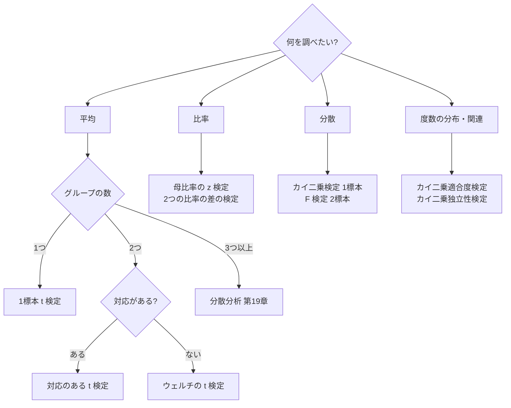
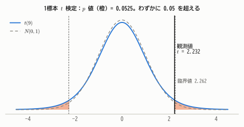
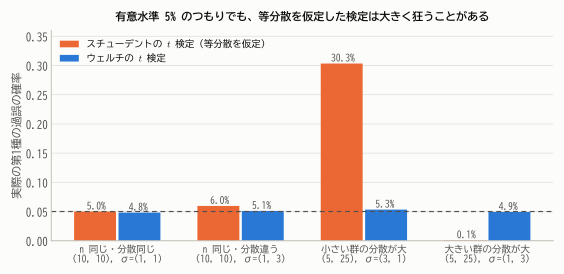
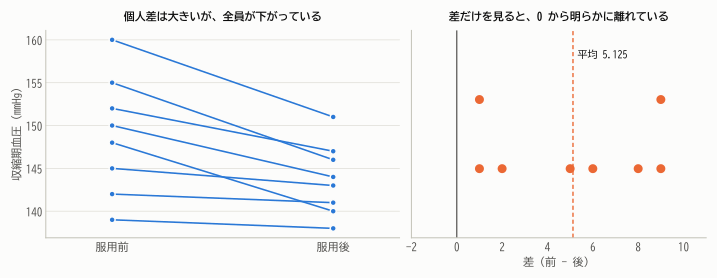
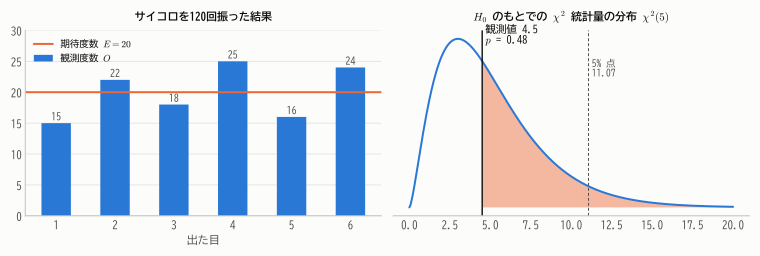
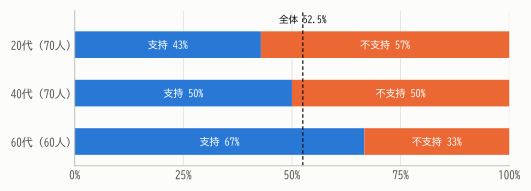
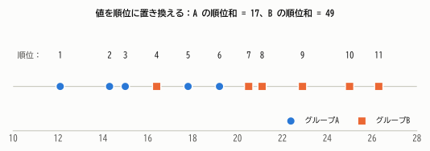
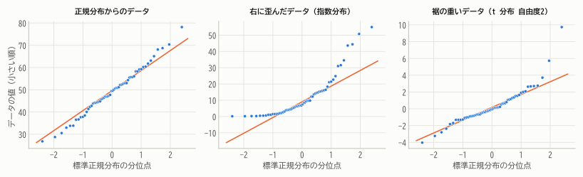

# 第17章 いろいろな検定

!!! abstract "この章で学ぶこと"
    - 目的とデータに応じた検定の選び方
    - **$t$ 検定**：1標本、2標本（スチューデント・ウェルチ）、対応のある場合
    - 母比率の検定、母分散の検定（カイ二乗検定・$F$ 検定）
    - **カイ二乗検定**：適合度検定と独立性の検定
    - **ノンパラメトリック検定** の考え方、正規性の確認（QQプロット）

第16章で検定の論理を学びました。この章では、実際によく使われる検定を一通り見ていきます。
どの検定も「帰無仮説のもとで分布がわかる検定統計量を作り、$p$ 値を計算する」という同じ枠組みでできていることに注目してください。

## 17.1 検定の選び方

正規分布の仮定が疑わしく標本も小さい場合には、17.6節の **ノンパラメトリック検定** を検討します。

## 17.2 $t$ 検定

### 1標本 $t$ 検定

母平均が特定の値 $\mu_0$ と等しいかどうかを、母分散が未知のときに検定します。

!!! theorem "1標本 $t$ 検定"
    - 仮説：$H_0: \mu = \mu_0$
    - 検定統計量：$T = \dfrac{\bar{X} - \mu_0}{S/\sqrt{n}}$
    - $H_0$ のもとでの分布：$t(n - 1)$（母集団が正規分布のとき）
    - 両側検定の棄却域：$|T| \ge t_{\alpha/2}(n - 1)$

**例**：第15章の袋詰めデータ（10袋、$\bar{x} = 101.0$、$s = 1.417$）で、「袋の重さの母平均は表示どおり 100 g」という帰無仮説を検定します。

$$
t = \frac{101.0 - 100}{1.417/\sqrt{10}} = 2.232
$$

自由度9の $t$ 分布で、両側 $p$ 値は 0.0525 です。有意水準5%の臨界値 $t_{0.025}(9) = 2.262$ をわずかに下回るので、**有意水準5%では $H_0$ を棄却できません**。
第15章の95%信頼区間 $[99.99, 102.01]$ がぎりぎり 100 を含んでいたことと整合しています（第16章 定理16.1）。

<figure markdown="span">
  { width="660" }
  <figcaption>図17.1 自由度9の $t$ 分布と観測値。$p$ 値は両側の橙の面積の合計で 0.0525。$\sigma$ が既知で $z$ 検定を使えるなら臨界値は 1.96 だが、$t$ 分布の裾が重いぶん、臨界値 2.262 を超えないと棄却できない。</figcaption>
</figure>

### 2標本 $t$ 検定

2つの独立なグループの母平均が等しいかを検定します。

!!! theorem "2標本 $t$ 検定"
    仮説：$H_0: \mu_1 = \mu_2$。大きさ $m, n$、標本平均 $\bar{X}, \bar{Y}$、不偏分散 $S_1^2, S_2^2$ とする。

    **スチューデントの $t$ 検定**（等分散を仮定）

    $$
    T = \frac{\bar{X} - \bar{Y}}{S_p\sqrt{\frac{1}{m} + \frac{1}{n}}} \sim t(m + n - 2), \qquad S_p^2 = \frac{(m - 1)S_1^2 + (n - 1)S_2^2}{m + n - 2}
    $$

    **ウェルチの $t$ 検定**（等分散を仮定しない）

    $$
    T = \frac{\bar{X} - \bar{Y}}{\sqrt{\frac{S_1^2}{m} + \frac{S_2^2}{n}}} \ \approx\ t(\nu), \qquad \nu = \frac{\left(\frac{S_1^2}{m} + \frac{S_2^2}{n}\right)^2}{\frac{(S_1^2/m)^2}{m - 1} + \frac{(S_2^2/n)^2}{n - 1}}
    $$

    （ウェルチの自由度 $\nu$ は一般に整数にならない。）

**例**：第15章の指導法の比較（A 法：12人、平均72.0、$s = 8.0$／B 法：10人、平均63.0、$s = 9.0$）では

- スチューデント：$t = 9.0/3.624 = 2.48$、自由度20、$p = 0.022$
- ウェルチ：$t = 9.0/3.665 = 2.46$、自由度 $\nu \approx 18.3$、$p = 0.024$

どちらでも有意水準5%で「平均点に差がある」と判断されます。

### どちらを使うべきか

スチューデントの $t$ 検定は、等分散の仮定が崩れると、特に2つのグループの大きさが違うときに、第1種の過誤の確率が大きく狂ってしまいます。

<figure markdown="span">
  { width="720" }
  <figcaption>図17.2 帰無仮説（平均は等しい）が正しい状況で、有意水準5%の検定を4万回行ったときの実際の第1種の過誤の確率。等分散を仮定する検定は、小さいグループの分散が大きいと30%も誤って有意になる。ウェルチの検定はどの場合もほぼ5%を保つ。</figcaption>
</figure>

ウェルチの検定は、分散が等しい場合でもスチューデントの検定とほとんど変わらない性能をもつので、**現在では、2標本の比較にはウェルチの $t$ 検定を標準的に使う** ことが推奨されています。
「まず等分散の検定を行い、その結果で $t$ 検定を使い分ける」という2段階の手順は、検定をくり返すことになり推奨されません。

### 対応のある $t$ 検定

同じ人の前後の測定のように、データがペアになっている場合は、ペアごとの差 $D_i = X_i - Y_i$ を1つの標本とみなし、$H_0: \mu_D = 0$ を1標本 $t$ 検定で検定します。

**例**：8人の患者に降圧薬を投与し、投与前後の血圧を測りました。

| 患者 | 1 | 2 | 3 | 4 | 5 | 6 | 7 | 8 |
|---|---|---|---|---|---|---|---|---|
| 投与前 | 148 | 152 | 139 | 160 | 145 | 155 | 142 | 150 |
| 投与後 | 140 | 147 | 138 | 151 | 143 | 146 | 141 | 144 |
| 差 | 8 | 5 | 1 | 9 | 2 | 9 | 1 | 6 |

差の平均は $\bar{d} = 5.125$、標準偏差は $s_d = 3.441$ なので

$$
t = \frac{5.125}{3.441/\sqrt{8}} = 4.21
$$

自由度7で $p = 0.004$。血圧は有意に下がったといえます。

<figure markdown="span">
  { width="800" }
  <figcaption>図17.3 左：患者ごとの血圧の変化。患者間の個人差（縦方向の散らばり）は大きいが、全員が下がっている。右：差だけを取り出すと、個人差が消えて効果がはっきり見える。</figcaption>
</figure>

!!! warning "対応を無視すると検出力が落ちる"
    同じデータを「独立な2群」として2標本 $t$ 検定にかけると、$t = 1.80$、$p = 0.094$ となり、有意になりません。
    患者間の大きな個人差がノイズとして残ってしまうからです。データに対応がある場合は、必ず対応のある検定を使いましょう。
    （逆に、対応のないデータに対応のある検定を使うのは誤りです。）

## 17.3 母比率の検定

### 1つの母比率

$H_0: p = p_0$ のもとで、$\hat{p}$ は近似的に $N\left(p_0, \frac{p_0(1 - p_0)}{n}\right)$ に従うので

$$
Z = \frac{\hat{p} - p_0}{\sqrt{p_0(1 - p_0)/n}} \approx N(0, 1)
$$

を使います。信頼区間（ワルド区間）と違い、分母には $\hat{p}$ ではなく **帰無仮説の値 $p_0$** を使う点に注意しましょう（$H_0$ のもとでの分布を考えるため）。

**例**：昨年の支持率は25%でした。今年400人に調査したら120人（30%）が支持しました。支持率は変わったといえるでしょうか。

$$
z = \frac{0.30 - 0.25}{\sqrt{0.25 \times 0.75/400}} = \frac{0.05}{0.02165} = 2.31
$$

両側 $p$ 値は 0.021 で、有意水準5%で「支持率は変化した」と判断されます。

### 2つの母比率の差

$H_0: p_1 = p_2$ のもとでは共通の比率を2つの標本を合わせて推定した $\hat{p} = \frac{X_1 + X_2}{m + n}$ を使い

$$
Z = \frac{\hat{p}_1 - \hat{p}_2}{\sqrt{\hat{p}(1 - \hat{p})\left(\frac{1}{m} + \frac{1}{n}\right)}} \approx N(0, 1)
$$

**例**：第15章の Web デザインの比較（新：56/200、旧：40/200）では、$\hat{p} = 96/400 = 0.24$ で

$$
z = \frac{0.28 - 0.20}{\sqrt{0.24 \times 0.76 \times \frac{2}{200}}} = \frac{0.08}{0.0427} = 1.87, \qquad p = 0.061
$$

有意水準5%では有意差なしです。これは2×2のクロス集計表に対するカイ二乗独立性検定（17.5節）と同じ検定で、$z^2 = \chi^2$ が成り立ちます。

## 17.4 母分散の検定

### 1つの母分散：カイ二乗検定

$H_0: \sigma^2 = \sigma_0^2$ のもとで $\chi^2 = \dfrac{(n - 1)S^2}{\sigma_0^2} \sim \chi^2(n - 1)$ を使います。

**例**：袋詰めの重さのばらつきは「分散1以下」に管理することになっています。10袋のデータでは $s^2 = 2.007$ でした。$H_0: \sigma^2 = 1$、$H_1: \sigma^2 > 1$ とすると

$$
\chi^2 = \frac{9 \times 2.007}{1} = 18.06 > \chi^2_{0.05}(9) = 16.92
$$

で、$p = 0.034$。有意水準5%で「ばらつきが基準を超えている」と判断されます。

### 2つの母分散の比：$F$ 検定

$H_0: \sigma_1^2 = \sigma_2^2$ のもとで $F = S_1^2/S_2^2 \sim F(m - 1, n - 1)$ を使います（第13章 定理13.6）。
ただし $F$ 検定は母集団の正規性の仮定に非常に敏感なので、実際の使用には注意が必要です。

## 17.5 カイ二乗検定

### 適合度検定

**例**：サイコロを120回振ったら、次の結果になりました。このサイコロは公正といえるでしょうか。

| 目 | 1 | 2 | 3 | 4 | 5 | 6 | 計 |
|---|---|---|---|---|---|---|---|
| 観測度数 $O_i$ | 15 | 22 | 18 | 25 | 16 | 24 | 120 |
| 期待度数 $E_i$ | 20 | 20 | 20 | 20 | 20 | 20 | 120 |

観測度数と、帰無仮説（公正なサイコロ）のもとでの期待度数のずれを、次の統計量で測ります。

!!! theorem "カイ二乗適合度検定"
    $k$ 個のカテゴリの観測度数を $O_i$、帰無仮説のもとでの期待度数を $E_i = np_i$ とすると

    $$
    \chi^2 = \sum_{i=1}^{k}\frac{(O_i - E_i)^2}{E_i}
    $$

    は、$H_0$ のもとで $n$ が大きいとき近似的に $\chi^2(k - 1)$ に従う（**ピアソンのカイ二乗統計量**）。
    データから $q$ 個の母数を推定して期待度数を求めた場合は、自由度は $k - 1 - q$ になる。

サイコロの例では

$$
\chi^2 = \frac{25 + 4 + 4 + 25 + 16 + 16}{20} = 4.5
$$

自由度 $6 - 1 = 5$ のカイ二乗分布で $p = 0.48$ なので、「公正でない」とはいえません。

<figure markdown="span">
  { width="840" }
  <figcaption>図17.4 左：観測度数と期待度数。右：帰無仮説のもとでの統計量の分布 $\chi^2(5)$。観測値 4.5 は分布の真ん中あたりで、まったく珍しくない。</figcaption>
</figure>

??? note "なぜ自由度が $k - 1$ なのか（直感的な説明）"
    $k = 2$（成功・失敗）の場合を考えると、$O_1 + O_2 = n$、$E_1 + E_2 = n$ なので $O_2 - E_2 = -(O_1 - E_1)$ で、

    $$
    \chi^2 = (O_1 - E_1)^2\left(\frac{1}{np_1} + \frac{1}{np_2}\right) = \frac{(O_1 - np_1)^2}{np_1(1 - p_1)} = \left(\frac{O_1 - np_1}{\sqrt{np_1(1 - p_1)}}\right)^2
    $$

    中心極限定理より括弧の中は近似的に $N(0, 1)$ なので、$\chi^2$ は近似的に $\chi^2(1)$ です。
    一般に、度数の合計が $n$ に固定されているという1つの制約のため、自由に動ける度数は $k - 1$ 個であり、自由度は $k - 1$ になります。
    なお、この検定は第16章の尤度比検定を多項分布に当てはめたものと漸近的に同値です。

**例（ポアソン分布への当てはまり）**：第7章の馬蹴り事故データで、ポアソン分布への当てはまりを検定します。期待度数が5未満のカテゴリは隣とまとめるのが慣例なので、「3人以上」をまとめると

| 死亡数 | 0 | 1 | 2 | 3以上 |
|---|---|---|---|---|
| 観測度数 | 109 | 65 | 22 | 4 |
| 期待度数（$\hat{\lambda} = 0.61$） | 108.7 | 66.3 | 20.2 | 4.8 |

$\chi^2 = 0.32$ です。$\lambda$ をデータから推定したので自由度は $4 - 1 - 1 = 2$ で、$p = 0.85$。ポアソン分布によく当てはまっています。

### 独立性の検定

2つの質的変数に関連があるかを、クロス集計表から検定します。

**例**：200人に、ある政策を支持するかどうかを年代別に聞きました。

| | 支持 | 不支持 | 計 |
|---|---|---|---|
| 20代 | 30 | 40 | 70 |
| 40代 | 35 | 35 | 70 |
| 60代 | 40 | 20 | 60 |
| 計 | 105 | 95 | 200 |

<figure markdown="span">
  { width="620" }
  <figcaption>図17.5 年代別の支持率。年代が上がるほど支持率が高いように見える。この差は偶然の範囲か？</figcaption>
</figure>

帰無仮説「年代と支持は独立」のもとでは、各セルの期待度数は（行の合計）×（列の合計）÷（総数）です。たとえば20代・支持のセルは $70 \times 105/200 = 36.75$ です。

!!! theorem "カイ二乗独立性検定"
    $r$ 行 $c$ 列のクロス集計表で、セル $(i, j)$ の観測度数を $O_{ij}$、期待度数を $E_{ij} = \dfrac{(\text{第 } i \text{ 行の合計})(\text{第 } j \text{ 列の合計})}{n}$ とすると

    $$
    \chi^2 = \sum_{i=1}^{r}\sum_{j=1}^{c}\frac{(O_{ij} - E_{ij})^2}{E_{ij}}
    $$

    は、独立性の帰無仮説のもとで近似的に $\chi^2\big((r - 1)(c - 1)\big)$ に従う。

この例では $\chi^2 = 7.61$、自由度 $(3 - 1)(2 - 1) = 2$ で、$p = 0.022$。有意水準5%で「年代と支持には関連がある」と判断されます。

自由度が $(r - 1)(c - 1)$ になるのは、行と列の合計を固定すると、自由に決められるセルが $(r - 1)(c - 1)$ 個しかないからです。

!!! warning "カイ二乗検定の注意点"
    - カイ二乗分布への近似は、期待度数がおおむね **5以上** でないと不正確になります。期待度数が小さいセルがある場合は、カテゴリをまとめるか、2×2表なら **フィッシャーの正確検定** を使います。
    - 2×2表では、近似を改善するために **イェーツの連続修正** を使うことがあります。
    - 独立性の検定で有意になっても、関連の **向き** や **強さ** はわかりません。また、関連は因果関係を意味しません（第3章）。

第3章の朝食と成績のクロス集計表（42, 38 / 8, 12）では $\chi^2 = 1.0$、自由度1で $p = 0.32$ となり、関連は有意ではありません。

## 17.6 ノンパラメトリック検定

$t$ 検定は母集団の正規性を仮定しています。標本が小さく、データが強く歪んでいたり外れ値があったりする場合には、分布の形を仮定しない **ノンパラメトリック検定** が使えます。
多くのノンパラメトリック検定は、データの値そのものではなく **順位** を使います。

### ウィルコクソンの順位和検定（マン・ホイットニーの $U$ 検定）

2つの独立なグループを比べる検定です。2つのグループを合わせて小さい順に順位をつけ、一方のグループの順位の合計を検定統計量にします。

<figure markdown="span">
  { width="720" }
  <figcaption>図17.6 2つのグループの値を合わせて順位をつける。グループAの順位が小さい方に偏っていれば、Aの値は全体的に小さいと考えられる。</figcaption>
</figure>

帰無仮説「2つのグループの分布は同じ」のもとでは、順位 $1, 2, \dots, m + n$ がどちらのグループに割り振られるかは完全にランダムなので、順位和の分布は（データの分布によらず）組合せの計算だけで求められます。
図の例では、Aの順位和は17です。Aの5人が1〜5位を独占した場合の最小値 $1 + 2 + 3 + 4 + 5 = 15$ にかなり近く、
このような偏りが偶然起こる確率は両側で $p = 0.017$ です。（順位和から最小値を引いた $17 - 15 = 2$ が、マン・ホイットニーの $U$ 統計量です。）

| パラメトリック検定 | 対応するノンパラメトリック検定 |
|---|---|
| 1標本・対応のある $t$ 検定 | 符号検定、ウィルコクソンの符号付き順位検定 |
| 2標本 $t$ 検定 | ウィルコクソンの順位和検定（マン・ホイットニーの $U$ 検定） |
| 一元配置分散分析（第19章） | クラスカル・ウォリス検定 |
| ピアソンの相関係数の検定 | スピアマンの順位相関係数の検定 |

順位を使うので外れ値に強い（頑健）のが利点です。正規分布が成り立つ場合でも、検出力の損失は意外に小さい（ウィルコクソン検定の $t$ 検定に対する漸近相対効率は約 0.955）ことが知られています。

### 正規性の確認：QQプロット

$t$ 検定を使ってよいかどうかを判断するには、データが正規分布に近いかを確認します。最も役立つのは **QQプロット**（正規確率プロット）です。

データを小さい順に並べ、それぞれを「標準正規分布で同じ順位にあたる値（分位点）」に対してプロットします。データが正規分布に従っていれば、点はほぼ一直線上に並びます。

<figure markdown="span">
  { width="900" }
  <figcaption>図17.7 QQプロット。正規分布からのデータ（左）は直線に沿う。右に歪んだデータ（中）は下に凸の弓なりに、裾の重いデータ（右）は両端が直線から外側に反り返る。</figcaption>
</figure>

シャピロ・ウィルク検定のような正規性の検定もありますが、標本が小さいと検出力が低く、大きいとわずかなずれでも有意になってしまうので、QQプロットで「どのくらい、どのように外れているか」を目で見る方が実用的です。

## まとめ

| 目的 | 検定 | 検定統計量 | 帰無分布 |
|---|---|---|---|
| 母平均 $= \mu_0$ | 1標本 $t$ 検定 | $\frac{\bar{X} - \mu_0}{S/\sqrt{n}}$ | $t(n-1)$ |
| 2つの母平均の差 | ウェルチの $t$ 検定 | $\frac{\bar{X} - \bar{Y}}{\sqrt{S_1^2/m + S_2^2/n}}$ | $t(\nu)$（近似） |
| 対応のある差 | 対応のある $t$ 検定 | $\frac{\bar{D}}{S_D/\sqrt{n}}$ | $t(n-1)$ |
| 母比率 $= p_0$ | $z$ 検定 | $\frac{\hat{p} - p_0}{\sqrt{p_0(1-p_0)/n}}$ | $N(0,1)$（近似） |
| 母分散 $= \sigma_0^2$ | カイ二乗検定 | $\frac{(n-1)S^2}{\sigma_0^2}$ | $\chi^2(n-1)$ |
| 分散の比 | $F$ 検定 | $S_1^2/S_2^2$ | $F(m-1, n-1)$ |
| 分布への当てはまり | 適合度検定 | $\sum\frac{(O-E)^2}{E}$ | $\chi^2(k-1-q)$（近似） |
| 2変数の関連 | 独立性の検定 | $\sum\frac{(O-E)^2}{E}$ | $\chi^2((r-1)(c-1))$（近似） |

- 2標本の比較には **ウェルチの $t$ 検定** を標準的に使う。対応のあるデータには対応のある検定を使う。
- カイ二乗検定は「観測度数と期待度数のずれ」を測る。期待度数が小さいときは注意。
- 正規性が疑わしく標本が小さいときは、**ノンパラメトリック検定** を検討する。正規性は QQプロットで確認する。

## 練習問題

!!! exercise "問題 17.1（1標本 $t$ 検定）"
    ある学習法を試した9人の点数の平均は 68、不偏分散の平方根は 6 でした。全国平均 63 点より高いといえるか、有意水準5%の片側検定で判断してください（$t_{0.05}(8) = 1.860$）。

    ??? success "解答"
        $H_0: \mu = 63$、$H_1: \mu > 63$。$t = \frac{68 - 63}{6/\sqrt{9}} = \frac{5}{2} = 2.5 > 1.860$ なので $H_0$ を棄却し、「全国平均より高い」と判断します。

!!! exercise "問題 17.2（適合度検定）"
    ある交差点で、1週間の曜日ごとの事故件数を数えたところ、月〜日の順に 12, 9, 11, 10, 14, 20, 22 件でした。事故の起こりやすさが曜日によらず一定かどうかを検定してください（$\chi^2_{0.05}(6) = 12.59$）。

    ??? success "解答"
        合計98件なので、期待度数は各曜日 14 件。

        $$
        \chi^2 = \frac{(-2)^2 + (-5)^2 + (-3)^2 + (-4)^2 + 0^2 + 6^2 + 8^2}{14} = \frac{4 + 25 + 9 + 16 + 0 + 36 + 64}{14} = \frac{154}{14} = 11.0
        $$

        $11.0 < 12.59$ なので、有意水準5%では「曜日によって違う」とはいえません（週末に多いように見えますが、この件数では偶然の範囲を超えるとは言い切れません）。

!!! exercise "問題 17.3（独立性の検定）"
    次の2×2表について、カイ二乗独立性検定の統計量を計算してください（連続修正なし）。

    | | 改善した | 改善しない | 計 |
    |---|---|---|---|
    | 新治療 | 40 | 10 | 50 |
    | 従来治療 | 28 | 22 | 50 |
    | 計 | 68 | 32 | 100 |

    ??? success "解答"
        期待度数は 新治療・改善 $50 \times 68/100 = 34$、新治療・非改善 16、従来・改善 34、従来・非改善 16。

        $$
        \chi^2 = \frac{6^2}{34} + \frac{6^2}{16} + \frac{6^2}{34} + \frac{6^2}{16} = 36\left(\frac{2}{34} + \frac{2}{16}\right) \approx 2.118 + 4.5 = 6.62
        $$

        自由度1の5%点 3.84 を超えるので、有意水準5%で「治療法と改善には関連がある」と判断されます（$p \approx 0.010$）。

!!! exercise "問題 17.4（検定の選択）"
    次の状況で使うべき検定を答えてください。

    (1) 同じ20人に、カフェイン入りと無しのコーヒーを別の日に飲んでもらい、反応時間を比べる。
    (2) 3つの地域の住民の血液型（A, B, O, AB）の分布が同じかどうかを調べる。
    (3) 男性15人と女性12人の睡眠時間を比べる（データは強く歪んでいて外れ値もある）。

    ??? success "解答"
        (1) 対応のある $t$ 検定（同じ人の2条件の比較）。
        (2) カイ二乗独立性検定（3×4のクロス集計表。地域と血液型の関連）。
        (3) ウィルコクソンの順位和検定（マン・ホイットニーの $U$ 検定）。正規性が疑わしく標本が小さいため。
