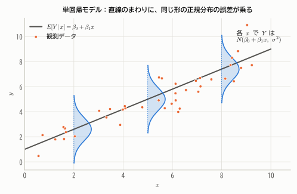
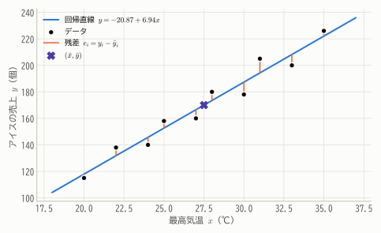
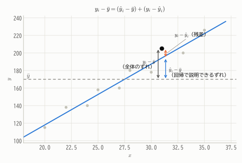
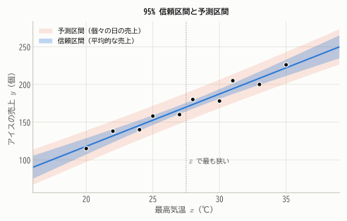
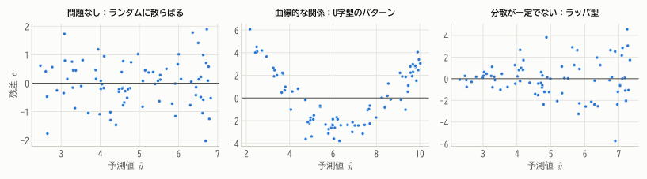
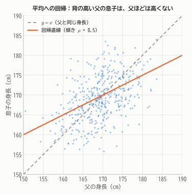
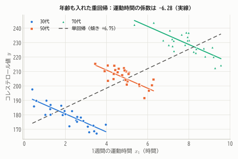

# 第18章 回帰分析

!!! abstract "この章で学ぶこと"
    - **単回帰モデル** と **最小二乗法** による回帰直線の導出
    - 残差の性質、平方和の分解と **決定係数**
    - 回帰係数の標本分布と、$t$ 検定・信頼区間・**予測区間**
    - 残差による回帰診断、**平均への回帰**
    - **重回帰分析** の行列表現と、交絡の調整

第3章で、2つの変数の関係を相関係数で要約しました。**回帰分析** は一歩進んで、「$x$ が変わると $y$ は平均的にどれだけ変わるか」をモデル化し、予測や要因の分析に使います。
回帰分析は、これまでに学んだ推定・検定の理論を総動員する、統計学で最も実用的な手法の1つです。

## 18.1 単回帰モデル

ある店で、10日間の最高気温 $x$（℃）とアイスクリームの売上 $y$（個）を記録しました。

| 気温 $x$ | 20 | 22 | 24 | 25 | 27 | 28 | 30 | 31 | 33 | 35 |
|---|---|---|---|---|---|---|---|---|---|---|
| 売上 $y$ | 115 | 138 | 140 | 158 | 160 | 180 | 178 | 205 | 200 | 226 |

気温が高いほど売上は多い傾向がありますが、同じ気温でも日によって売上はばらつきます。この関係を次のようにモデル化します。

!!! definition "定義 18.1（単回帰モデル）"
    $$
    Y_i = \beta_0 + \beta_1 x_i + \varepsilon_i \qquad (i = 1, \dots, n)
    $$

    - $x_i$：**説明変数**（独立変数）。確率変数ではなく、与えられた値とみなす。
    - $Y_i$：**目的変数**（従属変数、応答変数）。
    - $\beta_0, \beta_1$：**回帰係数**（切片と傾き）。未知の母数。
    - $\varepsilon_i$：**誤差項**。$\varepsilon_1, \dots, \varepsilon_n$ は i.i.d. で $N(0, \sigma^2)$ に従うと仮定する。

<figure markdown="span">
  { width="660" }
  <figcaption>図18.1 単回帰モデルのイメージ。$x$ の値ごとに、$Y$ は直線 $\beta_0 + \beta_1 x$ を中心とする正規分布に従う。ばらつきの大きさ $\sigma$ は $x$ によらず一定。</figcaption>
</figure>

このモデルは「$E[Y \mid x] = \beta_0 + \beta_1 x$」、つまり **$Y$ の条件付き期待値が $x$ の1次関数である** ことを表しています。
第9章で、2変量正規分布では条件付き期待値が直線になることを学びました（図9.3）。単回帰モデルはそれを一般化したものです。

## 18.2 最小二乗法

### 回帰直線の導出

データにいちばんよく当てはまる直線 $y = b_0 + b_1 x$ を求めます。各データの「実際の値 $y_i$」と「直線による予測値 $\hat{y}_i = b_0 + b_1 x_i$」の差を **残差** $e_i = y_i - \hat{y}_i$ といいます。
残差の2乗和

$$
S(b_0, b_1) = \sum_{i=1}^{n}(y_i - b_0 - b_1 x_i)^2
$$

を最小にする $b_0, b_1$ を選ぶのが **最小二乗法** です。第2章で「二乗誤差の和を最小にする代表値は平均」と学んだことの、直線版です。

!!! theorem "定理 18.1（最小二乗推定量）"
    $S_{xx} = \sum(x_i - \bar{x})^2$、$S_{xy} = \sum(x_i - \bar{x})(y_i - \bar{y})$ とすると、$S(b_0, b_1)$ を最小にするのは

    $$
    b_1 = \frac{S_{xy}}{S_{xx}} = r\frac{s_y}{s_x}, \qquad b_0 = \bar{y} - b_1\bar{x}
    $$

??? proof "証明"
    $S$ は $b_0, b_1$ の2次関数（下に凸）なので、偏微分が0になる点で最小になります。

    $$
    \frac{\partial S}{\partial b_0} = -2\sum(y_i - b_0 - b_1 x_i) = 0, \qquad \frac{\partial S}{\partial b_1} = -2\sum x_i(y_i - b_0 - b_1 x_i) = 0
    $$

    この連立方程式を **正規方程式** といいます。1つめの式を $n$ で割ると $\bar{y} = b_0 + b_1\bar{x}$、つまり $b_0 = \bar{y} - b_1\bar{x}$。これを2つめの式に代入すると

    $$
    \sum x_i\big\{(y_i - \bar{y}) - b_1(x_i - \bar{x})\big\} = 0 \quad\Longrightarrow\quad \sum x_i(y_i - \bar{y}) = b_1\sum x_i(x_i - \bar{x})
    $$

    $\sum\bar{x}(y_i - \bar{y}) = 0$、$\sum\bar{x}(x_i - \bar{x}) = 0$ なので、左辺は $S_{xy}$、右辺の和は $S_{xx}$ に等しく、$b_1 = S_{xy}/S_{xx}$ が得られます。

アイスクリームのデータでは、$\bar{x} = 27.5$、$\bar{y} = 170.0$、$S_{xx} = 210.5$、$S_{xy} = 1461$ なので

$$
b_1 = \frac{1461}{210.5} = 6.94, \qquad b_0 = 170.0 - 6.94 \times 27.5 = -20.87
$$

回帰直線は $\hat{y} = -20.87 + 6.94x$ です。「気温が1℃上がると、売上は平均して約6.9個増える」と解釈できます。
（切片 $-20.87$ は「気温0℃での売上」ですが、データの範囲から大きく外れた値なので意味のある解釈はできません。）

<figure markdown="span">
  { width="620" }
  <figcaption>図18.2 最小二乗法による回帰直線。橙の縦線が残差で、その2乗和が最小になるように直線が引かれている。直線は必ず点 $(\bar{x}, \bar{y})$ を通る。</figcaption>
</figure>

!!! demo "やってみよう：最小二乗法"
    スライダーで直線の切片と傾きを動かして、残差平方和（オレンジの正方形の面積の合計）をできるだけ小さくしてみましょう。
    「最小二乗法で当てはめる」を押すと答え合わせができます。グラフをクリックして点を追加すると、外れ値が直線に与える影響も確かめられます。

    

### 残差の性質

正規方程式から、残差について次のことがわかります。

1. $\sum e_i = 0$（残差の合計は0）
2. $\sum x_i e_i = 0$（残差と説明変数は無相関）
3. $\sum\hat{y}_i e_i = 0$（残差と予測値は無相関）
4. 回帰直線は点 $(\bar{x}, \bar{y})$ を通る

残差は「$x$ では説明しきれなかった部分」なので、$x$ や予測値と相関が残っていない、ということです。

## 18.3 決定係数

### 平方和の分解

回帰直線がデータにどのくらいよく当てはまっているかを測りましょう。各データの「平均からのずれ」を2つに分けます。

$$
\underbrace{y_i - \bar{y}}_{\text{全体のずれ}} = \underbrace{(\hat{y}_i - \bar{y})}_{\text{回帰で説明できるずれ}} + \underbrace{(y_i - \hat{y}_i)}_{\text{残差}}
$$

<figure markdown="span">
  { width="620" }
  <figcaption>図18.3 1つのデータについて、平均からのずれを「回帰直線で説明できる部分」と「残差」に分ける。</figcaption>
</figure>

!!! theorem "定理 18.2（平方和の分解）"
    $$
    \underbrace{\sum(y_i - \bar{y})^2}_{S_T\ (\text{総平方和})} = \underbrace{\sum(\hat{y}_i - \bar{y})^2}_{S_R\ (\text{回帰平方和})} + \underbrace{\sum(y_i - \hat{y}_i)^2}_{S_E\ (\text{残差平方和})}
    $$

??? proof "証明"
    $y_i - \bar{y} = (\hat{y}_i - \bar{y}) + e_i$ を2乗して足すと、交差項は

    $$
    2\sum(\hat{y}_i - \bar{y})e_i = 2\sum b_1(x_i - \bar{x})e_i = 2b_1\left(\sum x_i e_i - \bar{x}\sum e_i\right) = 0
    $$

    （$\hat{y}_i - \bar{y} = b_1(x_i - \bar{x})$ と残差の性質1, 2を使った。）

ずれの2乗和が「ピタゴラスの定理」のようにきれいに分解できるのは、残差が予測値と直交（無相関）しているからです。

!!! definition "定義 18.2（決定係数）"
    $$
    R^2 = \frac{S_R}{S_T} = 1 - \frac{S_E}{S_T}
    $$

    を **決定係数** という。$0 \le R^2 \le 1$ で、$y$ の変動のうち回帰で説明できる割合を表す。

アイスクリームのデータでは $S_T = 10618$、$S_R = 10140.2$、$S_E = 477.8$ なので $R^2 = 0.955$。売上の変動の95.5%が気温で説明できます。

単回帰では、決定係数は相関係数の2乗に等しくなります（$R^2 = r^2$）。実際、$S_R = b_1^2 S_{xx} = S_{xy}^2/S_{xx}$ なので $R^2 = \frac{S_{xy}^2}{S_{xx}S_{yy}} = r^2$ です。

## 18.4 回帰係数の推測

ここまでは記述統計としての回帰でした。誤差項に正規分布を仮定すると、回帰係数についての推定・検定ができます。

### 最小二乗推定量の性質

$b_1 = \frac{S_{xy}}{S_{xx}} = \sum_i\frac{(x_i - \bar{x})}{S_{xx}}Y_i$ は、$Y_i$ の1次式（重みつきの和）です。これを使うと、次のことがわかります。

!!! theorem "定理 18.3（回帰係数の標本分布）"
    単回帰モデルのもとで

    1. $b_1 \sim N\left(\beta_1,\ \dfrac{\sigma^2}{S_{xx}}\right)$、$b_0 \sim N\left(\beta_0,\ \sigma^2\left(\dfrac{1}{n} + \dfrac{\bar{x}^2}{S_{xx}}\right)\right)$
    2. $s^2 = \dfrac{S_E}{n - 2}$ は $\sigma^2$ の不偏推定量で、$\dfrac{(n - 2)s^2}{\sigma^2} \sim \chi^2(n - 2)$。$s^2$ は $b_0, b_1$ と独立。
    3. したがって $\dfrac{b_1 - \beta_1}{s/\sqrt{S_{xx}}} \sim t(n - 2)$

??? proof "証明（1の期待値と分散）"
    $\sum(x_i - \bar{x}) = 0$、$\sum(x_i - \bar{x})x_i = S_{xx}$ に注意すると

    $$
    E[b_1] = \sum_i\frac{x_i - \bar{x}}{S_{xx}}(\beta_0 + \beta_1 x_i) = \frac{\beta_0\cdot 0 + \beta_1 S_{xx}}{S_{xx}} = \beta_1
    $$

    $Y_i$ は独立で分散 $\sigma^2$ なので

    $$
    V[b_1] = \sum_i\frac{(x_i - \bar{x})^2}{S_{xx}^2}\sigma^2 = \frac{\sigma^2}{S_{xx}}
    $$

    $b_1$ は独立な正規確率変数の1次式なので正規分布に従います。2の証明は第13章の定理13.4と同様の考え方でできます（推定した母数が $\beta_0, \beta_1$ の2つなので、自由度は $n - 2$）。

$V[b_1] = \sigma^2/S_{xx}$ から、**$x$ の値を広い範囲にばらつかせて測定するほど、傾きは精度よく推定できる** ことがわかります。

### 傾きの検定と信頼区間

最もよく行われるのは、「$x$ は $y$ に影響しない」という帰無仮説 $H_0: \beta_1 = 0$ の検定です。

アイスクリームのデータでは $s^2 = 477.8/8 = 59.72$、$s = 7.73$、傾きの標準誤差は $s/\sqrt{S_{xx}} = 7.73/\sqrt{210.5} = 0.533$ なので

$$
t = \frac{6.94}{0.533} = 13.0
$$

自由度8で $p \approx 10^{-6}$。気温の効果は明らかに有意です。$\beta_1$ の95%信頼区間は（$t_{0.025}(8) = 2.306$）

$$
6.94 \pm 2.306 \times 0.533 = [5.71,\ 8.17]
$$

### 信頼区間と予測区間

気温 $x_0 = 29$℃ の日について考えます。予測値は $\hat{y}_0 = -20.87 + 6.94 \times 29 = 180.4$ 個です。ここで2種類の区間を区別することが大切です。

- **平均的な売上 $E[Y \mid x_0]$ の信頼区間**：「29℃の日の **平均** 売上」の推定の不確かさ。

    $$
    \hat{y}_0 \pm t_{\alpha/2}(n - 2)\cdot s\sqrt{\frac{1}{n} + \frac{(x_0 - \bar{x})^2}{S_{xx}}}
    $$

- **個々の日の売上 $Y_0$ の予測区間**：「ある29℃の日の売上」がどこに入るか。平均の推定の不確かさに、その日ごとのばらつき $\sigma^2$ が加わる。

    $$
    \hat{y}_0 \pm t_{\alpha/2}(n - 2)\cdot s\sqrt{1 + \frac{1}{n} + \frac{(x_0 - \bar{x})^2}{S_{xx}}}
    $$

29℃では、平均売上の95%信頼区間は $[174.5, 186.3]$、個々の日の95%予測区間は $[161.6, 199.2]$ です。

<figure markdown="span">
  { width="640" }
  <figcaption>図18.4 回帰直線の95%信頼区間（濃い帯）と95%予測区間（薄い帯）。どちらも $\bar{x}$ で最も狭く、データの中心から離れるほど広がる。予測区間は、データ数をいくら増やしても $\pm 1.96\sigma$ より狭くはならない。</figcaption>
</figure>

!!! warning "外挿は危険"
    データの範囲（20〜35℃）の外で予測することを **外挿** といいます。区間が広がるだけでなく、そもそも直線関係がその範囲でも成り立つ保証はありません（気温45℃なら暑すぎて客が来ないかもしれません）。

!!! note "最小二乗法と最尤法、ガウス・マルコフの定理"
    誤差が正規分布に従うとき、最小二乗推定量は最尤推定量に一致します（対数尤度が $-\frac{1}{2\sigma^2}\sum(y_i - \beta_0 - \beta_1 x_i)^2 + \text{定数}$ になるため）。

    さらに、正規分布を仮定しなくても、誤差が平均0・分散一定・無相関でありさえすれば、最小二乗推定量は「$Y_i$ の1次式で表される不偏推定量」の中で分散が最小になります。
    これを **ガウス・マルコフの定理** といい、最小二乗推定量は **最良線形不偏推定量**（BLUE）であるといいます。

## 18.5 回帰診断

回帰モデルの推測は、「直線関係」「誤差の分散が一定」「誤差が独立で正規分布」という仮定のもとで成り立ちます。仮定が妥当かどうかは、**残差プロット**（横軸に予測値、縦軸に残差）で確認します。

<figure markdown="span">
  { width="900" }
  <figcaption>図18.5 残差プロット。左：パターンのない理想的な状態。中：U字型のパターンは、直線では捉えきれない曲線的な関係を示す（2次の項を加えるなどの対処）。右：予測値が大きいほど残差が広がる（分散が一定でない）場合は、対数変換などを検討する。</figcaption>
</figure>

このほか、残差のQQプロット（第17章）で正規性を、1点だけで回帰直線を大きく動かしてしまう **影響点**（第3章のアンスコムの例 III, IV）がないかも確認します。

## 18.6 平均への回帰

回帰分析の「回帰」という名前は、19世紀の統計学者ゴルトンの研究に由来します。ゴルトンは親子の身長のデータから、「背の高い親の子は、平均すると親ほどは背が高くない」ことを発見し、これを「平均への回帰」と呼びました。

<figure markdown="span">
  { width="520" }
  <figcaption>図18.6 父と息子の身長（相関係数0.5のシミュレーション）。回帰直線（橙）は $y = x$ の線（点線）より傾きが緩やか。背の高い父の息子は平均に近づき、背の低い父の息子も平均に近づく。</figcaption>
</figure>

第3章で見たように、標準化した変数で考えると回帰直線の傾きは相関係数 $r$ で、$|r| < 1$ なので予測値は必ず平均の側に引き寄せられます。
これは遺伝の不思議な性質ではなく、**相関が完全でない2つの量の間で必ず起こる統計的な現象** です。

!!! warning "平均への回帰による錯覚"
    - 1回目のテストで成績が最も悪かった生徒たちに補習をしたら、2回目は平均して成績が上がった → 補習の効果とは限らない。1回目の極端な成績には「たまたま運が悪かった」分が含まれているので、補習をしなくても2回目は平均に近づく。
    - 事故が多発した交差点に対策をしたら事故が減った → 同様に、偶然多かった年の翌年は減りやすい。

    効果を正しく評価するには、対策をしない **対照群** と比較する必要があります。

## 18.7 重回帰分析

### 複数の説明変数

目的変数に影響する要因が複数ある場合は、説明変数を増やした **重回帰モデル** を使います。

$$
Y_i = \beta_0 + \beta_1 x_{i1} + \beta_2 x_{i2} + \cdots + \beta_p x_{ip} + \varepsilon_i
$$

### 行列による表現

重回帰は、行列を使うと見通しよく扱えます。

$$
\boldsymbol{y} = \begin{pmatrix} y_1 \\ \vdots \\ y_n \end{pmatrix}, \quad
X = \begin{pmatrix} 1 & x_{11} & \cdots & x_{1p} \\ \vdots & \vdots & & \vdots \\ 1 & x_{n1} & \cdots & x_{np} \end{pmatrix}, \quad
\boldsymbol{\beta} = \begin{pmatrix} \beta_0 \\ \vdots \\ \beta_p \end{pmatrix}
$$

とおくと、モデルは $\boldsymbol{y} = X\boldsymbol{\beta} + \boldsymbol{\varepsilon}$ と書けます。

!!! theorem "定理 18.4（重回帰の最小二乗推定量）"
    残差平方和 $S(\boldsymbol{b}) = (\boldsymbol{y} - X\boldsymbol{b})^\top(\boldsymbol{y} - X\boldsymbol{b})$ を最小にする $\boldsymbol{b}$ は、**正規方程式** $X^\top X\boldsymbol{b} = X^\top\boldsymbol{y}$ の解であり、$X^\top X$ が逆行列をもつとき

    $$
    \hat{\boldsymbol{\beta}} = (X^\top X)^{-1}X^\top\boldsymbol{y}
    $$

    また $E[\hat{\boldsymbol{\beta}}] = \boldsymbol{\beta}$、$V[\hat{\boldsymbol{\beta}}] = \sigma^2(X^\top X)^{-1}$（分散共分散行列）であり、$\sigma^2$ の不偏推定量は $s^2 = \dfrac{S_E}{n - p - 1}$。

??? proof "証明（正規方程式の導出）"
    $S(\boldsymbol{b}) = \boldsymbol{y}^\top\boldsymbol{y} - 2\boldsymbol{b}^\top X^\top\boldsymbol{y} + \boldsymbol{b}^\top X^\top X\boldsymbol{b}$ を $\boldsymbol{b}$ で微分（勾配をとる）すると

    $$
    \frac{\partial S}{\partial\boldsymbol{b}} = -2X^\top\boldsymbol{y} + 2X^\top X\boldsymbol{b} = \boldsymbol{0}
    $$

    よって $X^\top X\boldsymbol{b} = X^\top\boldsymbol{y}$。
    分散は、$\hat{\boldsymbol{\beta}} = A\boldsymbol{y}$（$A = (X^\top X)^{-1}X^\top$）が $\boldsymbol{y}$ の1次変換で、$V[\boldsymbol{y}] = \sigma^2 I$ なので
    $V[\hat{\boldsymbol{\beta}}] = A(\sigma^2 I)A^\top = \sigma^2(X^\top X)^{-1}X^\top X(X^\top X)^{-1} = \sigma^2(X^\top X)^{-1}$。

正規方程式 $X^\top(\boldsymbol{y} - X\hat{\boldsymbol{\beta}}) = \boldsymbol{0}$ は、「残差ベクトルが $X$ のすべての列と直交する」ことを意味します。
幾何学的には、予測値 $\hat{\boldsymbol{y}} = X\hat{\boldsymbol{\beta}}$ は、ベクトル $\boldsymbol{y}$ を「$X$ の列が張る空間」へ **正射影** したものです。平方和の分解がピタゴラスの定理になるのはこのためです。

### 偏回帰係数の意味：交絡の調整

重回帰の係数 $\beta_j$ は「**他の説明変数の値を一定に保ったまま**、$x_j$ だけを1増やしたときの $y$ の変化」を表し、**偏回帰係数** と呼ばれます。

第3章のシンプソンのパラドックスの例（運動時間とコレステロール値）を思い出しましょう。

- 運動時間 $x_1$ だけで単回帰すると、傾きは **$+6.75$**（運動するほどコレステロール値が高い？）
- 年齢 $x_2$ も説明変数に加えて重回帰すると、$\hat{y} = 118.2 - 6.28x_1 + 2.14x_2$ となり、運動時間の係数は **$-6.28$**

<figure markdown="span">
  { width="620" }
  <figcaption>図18.7 年齢を説明変数に加えると、「同じ年齢どうしで比べたとき」の運動時間の効果（実線の傾き）が推定され、単回帰（点線）とは逆に、運動するほどコレステロール値が低いという関係が現れる。</figcaption>
</figure>

年齢という交絡因子をモデルに含めることで、「同じ年齢の人どうしで比べたら」という比較ができるようになったのです。
ただし、重回帰で調整できるのは **モデルに含めた** 交絡因子だけです。測定していない交絡因子の影響は取り除けないので、因果関係の主張にはやはり慎重さが必要です。

### 重回帰で注意すること

- **自由度調整済み決定係数**：説明変数を増やすと $R^2$ は必ず増える（悪くはならない）ので、変数の数の影響を補正した $\bar{R}^2 = 1 - \frac{S_E/(n - p - 1)}{S_T/(n - 1)}$ を使う。
- **多重共線性**：説明変数どうしの相関が非常に強いと、$X^\top X$ が逆行列をもたない（またはそれに近い）状態になり、係数の推定が不安定になる。
- **質的な説明変数**：「男性なら1、女性なら0」のような **ダミー変数** を使えば、質的変数も説明変数にできる。

!!! point "さらに先へ"
    目的変数が「合格/不合格」のような2値なら **ロジスティック回帰**、カウントデータなら **ポアソン回帰** を使います。
    これらは回帰分析を、正規分布以外の分布に拡張した **一般化線形モデル**（GLM）としてまとめられ、推定には最尤法（第14章）が使われます。

## まとめ

- 単回帰モデル $Y_i = \beta_0 + \beta_1 x_i + \varepsilon_i$。最小二乗法で $b_1 = S_{xy}/S_{xx}$、$b_0 = \bar{y} - b_1\bar{x}$。
- 平方和の分解 $S_T = S_R + S_E$。決定係数 $R^2 = S_R/S_T$ は説明できる変動の割合で、単回帰では $r^2$。
- $b_1 \sim N(\beta_1, \sigma^2/S_{xx})$。$\sigma^2$ を $s^2 = S_E/(n-2)$ で推定すると $t(n-2)$ で推測できる。
- **予測区間** は **信頼区間** より広い。外挿は危険。残差プロットで仮定を確認する。
- 相関が完全でなければ **平均への回帰** が必ず起こる。
- 重回帰は $\hat{\boldsymbol{\beta}} = (X^\top X)^{-1}X^\top\boldsymbol{y}$。偏回帰係数は他の変数を固定したときの効果で、交絡の調整に使える。

## 練習問題

!!! exercise "問題 18.1（回帰直線の計算）"
    5組のデータ $(x, y) = (1, 2), (2, 4), (3, 5), (4, 4), (5, 5)$ について、回帰直線と決定係数を求めてください。

    ??? success "解答"
        $\bar{x} = 3$、$\bar{y} = 4$、$S_{xx} = 10$、$S_{xy} = 6$、$S_{yy} = 6$（第3章の計算を $n$ 倍したもの）。

        $b_1 = 6/10 = 0.6$、$b_0 = 4 - 0.6 \times 3 = 2.2$ なので $\hat{y} = 2.2 + 0.6x$。
        $R^2 = \frac{S_{xy}^2}{S_{xx}S_{yy}} = \frac{36}{60} = 0.6$。

!!! exercise "問題 18.2（回帰係数の検定）"
    $n = 20$ のデータで $S_{xx} = 50$、$S_{xy} = 120$、$S_{yy} = 400$ でした。

    (1) 回帰係数 $b_1$ と決定係数を求めてください。
    (2) $H_0: \beta_1 = 0$ を有意水準5%で検定してください（$t_{0.025}(18) = 2.101$）。

    ??? success "解答"
        (1) $b_1 = 120/50 = 2.4$。$S_R = b_1 S_{xy} = 288$ なので $R^2 = 288/400 = 0.72$。

        (2) $S_E = 400 - 288 = 112$、$s^2 = 112/18 = 6.22$、標準誤差は $\sqrt{6.22/50} = 0.353$。
        $t = 2.4/0.353 = 6.80 > 2.101$ なので $H_0$ を棄却します。

!!! exercise "問題 18.3（予測区間と信頼区間）"
    予測区間が信頼区間より必ず広くなる理由を、式の形から説明してください。また、$n \to \infty$ としたとき、それぞれの区間の幅はどうなりますか。

    ??? success "解答"
        予測区間の根号の中には、信頼区間にない「$1$」が加わっています。これは個々の観測値がもつ誤差 $\varepsilon_0$ の分散 $\sigma^2$ に由来します。
        $n \to \infty$ では $\frac{1}{n} \to 0$、$S_{xx} \to \infty$（$x$ がある程度散らばっていれば）なので、信頼区間の幅は 0 に近づきますが、予測区間の幅は $2 \times 1.96\sigma$ に近づき、それより狭くはなりません。
        平均はいくらでも正確に推定できますが、個々の値のばらつきはデータを増やしても消えないからです。

!!! exercise "問題 18.4（平均への回帰）"
    あるスポーツで、シーズン前半に打率が最も高かった10人の選手の後半の打率を調べると、10人の平均は前半より下がっていました。
    「前半に活躍した選手は油断して調子を落とす」という解釈は正しいでしょうか。

    ??? success "解答"
        必ずしも正しくありません。前半の打率は「実力」と「運」の和と考えられ、前半に最も高かった選手には、運が良かった選手が多く含まれます。
        後半には運の要素がリセットされるので、油断がなくても打率は平均に近づく（下がる）と予想されます。これは **平均への回帰** の典型例です。
        前半に打率が最も低かった選手たちの後半の打率は、逆に上がる傾向があるはずです。
