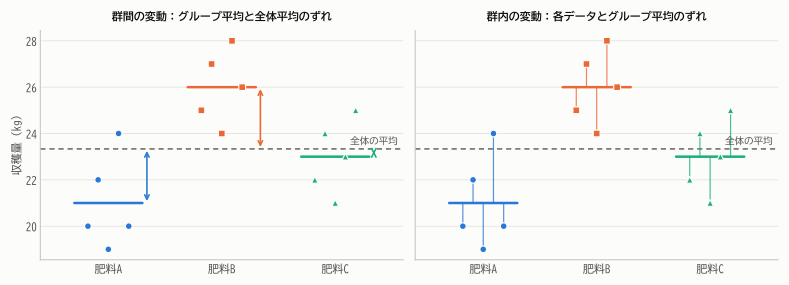
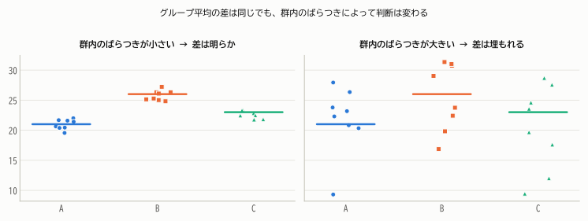
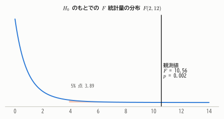
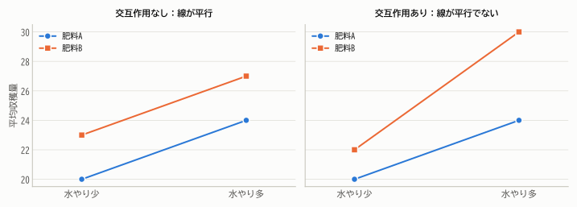

# 第19章 分散分析

!!! abstract "この章で学ぶこと"
    - 3つ以上のグループの平均を比べる **一元配置分散分析**（ANOVA）
    - 平方和の分解：全体の変動 ＝ **群間変動** ＋ **群内変動**
    - **$F$ 検定** の仕組みと分散分析表の読み方
    - 多重比較（どのグループ間に差があるか）
    - 二元配置分散分析と **交互作用** の考え方

3種類の肥料で収穫量に違いがあるか、4つの指導法で成績に違いがあるか——3つ以上のグループの平均を比べたいことはよくあります。
このとき使うのが **分散分析**（analysis of variance, ANOVA）です。名前に「分散」とありますが、目的は **平均の比較** です。統計学者フィッシャーが1920年代に農事試験のために考案しました。

## 19.1 なぜ $t$ 検定をくり返してはいけないのか

3つのグループ A, B, C を比べるのに、A と B、A と C、B と C の3回 $t$ 検定をすればよいと思うかもしれません。
しかし第16章で学んだように、検定をくり返すと「少なくとも1回は誤って有意になる確率」が増えてしまいます。有意水準5%の検定を3回行うと、その確率は最大で約 $1 - 0.95^3 = 14.3\%$ になります。

分散分析は「**すべてのグループの平均が等しい**」という1つの帰無仮説を、1回の検定で調べます。

## 19.2 一元配置分散分析のモデル

3種類の肥料 A, B, C をそれぞれ5区画の畑に使い、収穫量（kg）を測りました。

| 肥料 | 収穫量 | 平均 |
|---|---|---|
| A | 20, 22, 19, 24, 20 | 21.0 |
| B | 25, 27, 24, 28, 26 | 26.0 |
| C | 22, 24, 21, 23, 25 | 23.0 |

全体の平均は $\bar{y} = 350/15 = 23.33$ です。

!!! definition "定義 19.1（一元配置分散分析のモデル）"
    $k$ 個のグループがあり、グループ $i$ の $j$ 番目のデータを $Y_{ij}$（$i = 1, \dots, k$、$j = 1, \dots, n_i$）とする。

    $$
    Y_{ij} = \mu_i + \varepsilon_{ij}, \qquad \varepsilon_{ij} \sim N(0, \sigma^2)\ \text{（i.i.d.）}
    $$

    検定する仮説は

    $$
    H_0: \mu_1 = \mu_2 = \cdots = \mu_k, \qquad H_1: \text{少なくとも1組の } \mu_i \text{ が異なる}
    $$

各グループのデータは、それぞれの母平均 $\mu_i$ のまわりに、**共通の分散** $\sigma^2$ でばらついていると仮定します。

## 19.3 平方和の分解

データのばらつきを、2つの源泉に分けて考えます。

- **群間変動**：グループごとの平均が、全体の平均からどれだけずれているか（肥料の違いによる変動）
- **群内変動**：同じグループの中で、データがグループ平均からどれだけずれているか（偶然の変動）

<figure markdown="span">
  { width="880" }
  <figcaption>図19.1 左：グループ平均（太線）と全体平均（点線）のずれが群間変動。右：各データとグループ平均のずれが群内変動。</figcaption>
</figure>

!!! theorem "定理 19.1（一元配置の平方和の分解）"
    グループ $i$ の平均を $\bar{Y}_{i\cdot}$、全体の平均を $\bar{Y}$、総データ数を $N = \sum n_i$ とすると

    $$
    \underbrace{\sum_{i}\sum_{j}(Y_{ij} - \bar{Y})^2}_{S_T\ (\text{総平方和})} = \underbrace{\sum_{i} n_i(\bar{Y}_{i\cdot} - \bar{Y})^2}_{S_B\ (\text{群間平方和})} + \underbrace{\sum_{i}\sum_{j}(Y_{ij} - \bar{Y}_{i\cdot})^2}_{S_W\ (\text{群内平方和})}
    $$

??? proof "証明"
    $Y_{ij} - \bar{Y} = (\bar{Y}_{i\cdot} - \bar{Y}) + (Y_{ij} - \bar{Y}_{i\cdot})$ を2乗して足し合わせます。交差項は

    $$
    2\sum_i(\bar{Y}_{i\cdot} - \bar{Y})\sum_j(Y_{ij} - \bar{Y}_{i\cdot}) = 0
    $$

    （グループ内での偏差の和 $\sum_j(Y_{ij} - \bar{Y}_{i\cdot})$ は0だから。第2章の定理2.1と同じ。）

第2章の「平方和の分解」、第9章の全分散の公式、第18章の回帰の平方和の分解と、同じ形が何度も現れていることに気づくでしょう。

肥料の例では

- $S_B = 5\{(21 - 23.33)^2 + (26 - 23.33)^2 + (23 - 23.33)^2\} = 63.33$
- $S_W$：A のグループ内 $1 + 1 + 4 + 9 + 1 = 16$、B は $10$、C は $10$ で、合計 $36.00$
- $S_T = 63.33 + 36.00 = 99.33$

## 19.4 $F$ 検定

### 群間と群内の「分散」を比べる

平方和をそれぞれの自由度で割ったものを **平均平方** といいます。

- 群間の平均平方：$V_B = \dfrac{S_B}{k - 1}$
- 群内の平均平方：$V_W = \dfrac{S_W}{N - k}$

!!! theorem "定理 19.2（分散分析の $F$ 検定）"
    モデルの仮定のもとで

    1. $E[V_W] = \sigma^2$（$H_0$ が正しいかどうかによらない）
    2. $E[V_B] = \sigma^2 + \dfrac{1}{k - 1}\sum_i n_i(\mu_i - \bar{\mu})^2$（$\bar{\mu}$ は母平均の重みつき平均）
    3. $H_0$ が正しいとき、$F = \dfrac{V_B}{V_W} \sim F(k - 1,\ N - k)$

??? proof "証明の概略"
    **1と3**：グループ $i$ の中の平方和 $\sum_j(Y_{ij} - \bar{Y}_{i\cdot})^2$ を $\sigma^2$ で割ったものは、第13章の定理13.4より $\chi^2(n_i - 1)$ に従い、グループ平均と独立です。
    グループどうしは独立なので、再生性より $S_W/\sigma^2 \sim \chi^2(N - k)$。これより $E[V_W] = \sigma^2$。

    $H_0$ のもとでは、グループ平均 $\bar{Y}_{i\cdot} \sim N(\mu, \sigma^2/n_i)$ は互いに独立で、$S_B/\sigma^2 \sim \chi^2(k - 1)$ となり、$S_W$ とも独立です（$S_W$ はグループ平均と独立なため）。
    よって $F = \frac{(S_B/\sigma^2)/(k-1)}{(S_W/\sigma^2)/(N-k)} \sim F(k - 1, N - k)$。

    **2**：$\bar{Y}_{i\cdot} - \bar{Y}$ の期待値は $\mu_i - \bar{\mu}$ なので、群間平方和の期待値には母平均の差による項が加わります。

この定理が分散分析の本質を表しています。

- $V_W$ は、$H_0$ が正しくても正しくなくても、誤差の分散 $\sigma^2$ を推定している。
- $V_B$ は、$H_0$ が正しければ $\sigma^2$ を推定しているが、グループの母平均に差があるとそれより大きくなる。

したがって、$F = V_B/V_W$ が1より十分大きければ「グループ間に差がある」と判断できます。

<figure markdown="span">
  { width="820" }
  <figcaption>図19.2 グループ平均の差（群間変動）が同じでも、群内のばらつきが小さければ（左）差ははっきり見え、大きければ（右）差はノイズに埋もれる。$F$ は「信号（群間）÷ ノイズ（群内）」の比。</figcaption>
</figure>

### 分散分析表

計算結果は、次のような **分散分析表** にまとめるのが慣例です。

| 変動要因 | 平方和 | 自由度 | 平均平方 | $F$ 値 | $p$ 値 |
|---|---:|---:|---:|---:|---:|
| 群間（肥料） | 63.33 | 2 | 31.67 | 10.56 | 0.002 |
| 群内（誤差） | 36.00 | 12 | 3.00 | | |
| 全体 | 99.33 | 14 | | | |

$F = 31.67/3.00 = 10.56$ は、$F(2, 12)$ の5%点 3.89（1%点 6.93）を大きく超えており、$p = 0.002$ です。
「3種類の肥料で、平均収穫量に差がある」と結論できます。

<figure markdown="span">
  { width="620" }
  <figcaption>図19.3 帰無仮説のもとでの $F$ 統計量の分布と観測値。観測値 10.56 は分布の右裾の、ごくまれにしか起こらない位置にある。</figcaption>
</figure>

全体の変動のうち群間変動が占める割合 $\eta^2 = S_B/S_T = 63.33/99.33 = 0.64$ は **効果の大きさ** の指標で、回帰分析の決定係数 $R^2$ にあたります。

!!! note "2グループなら $t$ 検定と同じ"
    グループが2つ（$k = 2$）のとき、分散分析の $F$ 値は、等分散を仮定した2標本 $t$ 検定の $t$ 値の2乗に等しくなり（$F = t^2$）、同じ結論を与えます。
    分散分析は2標本 $t$ 検定の一般化なのです。

!!! note "分散分析は回帰分析の一種"
    グループを表すダミー変数（「肥料Bなら1、それ以外は0」など）を説明変数にした重回帰分析を行うと、一元配置分散分析と同じ結果が得られます。
    分散分析も回帰分析も、**線形モデル** という1つの枠組みの中の手法です。

## 19.5 多重比較

分散分析で有意になっても、わかるのは「どこかに差がある」ことだけで、**どのグループとどのグループの間に差があるのか** はわかりません。それを調べるのが **多重比較** です。

- **ボンフェローニ法**：$m$ 組の比較を行うとき、各比較の有意水準を $\alpha/m$ にする。どんな状況でも使えるが、やや保守的（検出力が低い）。
- **テューキーの方法**（HSD）：すべてのペアを比較するための方法で、ボンフェローニ法より検出力が高い。

肥料の例でテューキーの方法を使うと（5%水準）、「平均の差が 2.92 を超えるペアは有意」となります。

| ペア | 平均の差 | 判定 |
|---|---|---|
| B − A | 5.0 | 有意 |
| B − C | 3.0 | 有意 |
| C − A | 2.0 | 有意でない |

肥料 B が他の2つより収穫量が多いが、A と C の差ははっきりしない、と解釈できます。

## 19.6 二元配置分散分析と交互作用

要因が2つある場合（例：肥料の種類 × 水やりの量）は **二元配置分散分析** を使います。総平方和を「要因Aの主効果」「要因Bの主効果」「**交互作用**」「誤差」に分解します。

**交互作用** とは、一方の要因の効果が、もう一方の要因の水準によって変わることです。

<figure markdown="span">
  { width="800" }
  <figcaption>図19.4 交互作用プロット。左：水やりを増やす効果は肥料によらず同じ（線が平行）。右：水やりを増やす効果が肥料Bでずっと大きい（線が平行でない）＝交互作用がある。</figcaption>
</figure>

交互作用があるときは、「肥料Bの方が良い」と単純には言えず、「水やりが多いときには肥料Bの方がずっと良い」のように、もう一方の要因の条件をつけて解釈する必要があります。

## 19.7 分散分析の前提と代替手段

分散分析は次の前提に基づいています。

1. **独立性**：データは互いに独立（実験の無作為化で担保する）
2. **正規性**：各グループの誤差は正規分布に従う（グループの大きさがある程度あれば、多少外れても頑健）
3. **等分散性**：各グループの分散は等しい（グループの大きさが大きく異なる場合は特に重要）

等分散性が疑わしい場合は **ウェルチの分散分析**、正規性が疑わしく標本が小さい場合はノンパラメトリックな **クラスカル・ウォリス検定**（第17章の順位和検定の一般化）が使えます。

## まとめ

- 3つ以上のグループの平均の比較には、$t$ 検定のくり返しではなく **分散分析** を使う。
- 総平方和 ＝ **群間平方和** ＋ **群内平方和**。
- $F = \dfrac{S_B/(k-1)}{S_W/(N-k)}$ は「群間のばらつき ÷ 群内のばらつき」。$H_0$ のもとで $F(k-1, N-k)$ に従う。
- 有意なら **多重比較**（テューキー法、ボンフェローニ法）でどこに差があるかを調べる。
- 二元配置では **交互作用** に注意する。分散分析は回帰分析と同じ線形モデルの一種。

## 練習問題

!!! exercise "問題 19.1（分散分析表の完成）"
    4つのグループ（各6人、合計24人）のデータについて、群間平方和が 60、総平方和が 260 でした。分散分析表を完成させ、有意水準5%で判断してください（$F_{0.05}(3, 20) = 3.10$）。

    ??? success "解答"
        群内平方和 $= 260 - 60 = 200$。自由度は群間 $4 - 1 = 3$、群内 $24 - 4 = 20$、全体 23。

        | 変動要因 | 平方和 | 自由度 | 平均平方 | $F$ 値 |
        |---|---:|---:|---:|---:|
        | 群間 | 60 | 3 | 20 | 2.0 |
        | 群内 | 200 | 20 | 10 | |
        | 全体 | 260 | 23 | | |

        $F = 2.0 < 3.10$ なので、有意水準5%では「グループ間に差がある」とはいえません。

!!! exercise "問題 19.2（$t$ 検定の繰り返し）"
    5つのグループの平均を、すべてのペアについて有意水準5%の $t$ 検定で比べるとします。

    (1) 比較するペアは何組ですか。
    (2) 各検定が独立だと仮定すると、すべての帰無仮説が正しくても、少なくとも1つが有意になる確率はおよそいくらですか。
    (3) ボンフェローニ法を使うなら、各検定の有意水準をいくらにすればよいですか。

    ??? success "解答"
        (1) $\binom{5}{2} = 10$ 組。
        (2) $1 - 0.95^{10} \approx 0.40$。約40%です。
        (3) $0.05/10 = 0.005$。

!!! exercise "問題 19.3（期待値の意味）"
    定理19.2の2を使って、「グループの母平均がすべて等しいとき、$F$ 統計量はおよそ1になり、差があるときは1より大きくなりやすい」理由を説明してください。

    ??? success "解答"
        $H_0$ のもとでは $\mu_i = \bar{\mu}$ なので $E[V_B] = \sigma^2 = E[V_W]$ となり、分子と分母は同じ量を推定しているので、比 $F$ はおよそ1になります。
        母平均に差があると $\sum n_i(\mu_i - \bar{\mu})^2 > 0$ なので $E[V_B] > \sigma^2$ となり、分子だけが大きくなるので $F$ は1より大きくなりやすくなります。
        したがって、$F$ が1より十分大きいことが、母平均の差の証拠になります（右側だけの片側検定になるのはこのためです）。
