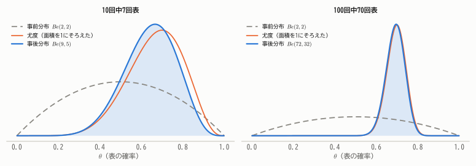
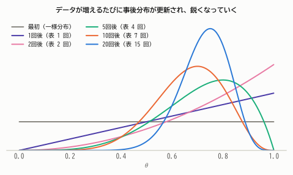
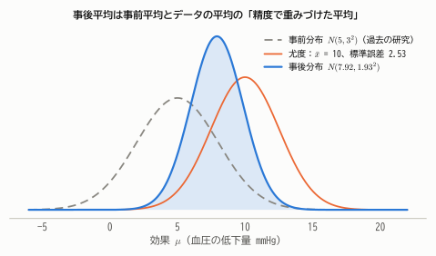
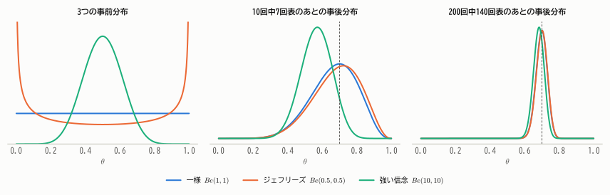

# 第20章 ベイズ統計入門

!!! abstract "この章で学ぶこと"
    - 頻度論とベイズ統計の考え方の違い
    - **事前分布 × 尤度 ∝ 事後分布** というベイズ推論の基本
    - **共役事前分布**：ベータ・二項モデル、ガンマ・ポアソンモデル、正規・正規モデル
    - 事後分布の要約：事後平均、MAP 推定値、**信用区間**
    - 事前分布の選び方と影響、予測分布
    - 計算法（MCMC）の考え方

これまで学んできた推測統計は **頻度論**（頻度主義）と呼ばれる立場に立っていました。この最終章では、もう1つの大きな流れである **ベイズ統計** を紹介します。
ベイズ統計は、第4章のベイズの定理を「母数の推定」に応用したもので、近年、機械学習やデータサイエンスの分野で特に重要になっています。

## 20.1 頻度論とベイズ統計

2つの立場の最大の違いは、**未知の母数 $\theta$ を確率変数とみなすかどうか** です。

| | 頻度論 | ベイズ統計 |
|---|---|---|
| 確率の意味 | くり返したときの相対頻度 | 不確かさ・信念の度合い |
| 母数 $\theta$ | 未知の **定数** | **確率変数**（分布をもつ） |
| データ | 確率変数（とり直せばばらつく） | 観測された値（条件として固定） |
| 推論の結果 | 推定量、信頼区間、$p$ 値 | 母数の **事後分布** |
| 区間の解釈 | 方法の信頼性（100回中95回含む） | $\theta$ がこの区間にある確率が95% |

第15章で、95%信頼区間を「母平均がこの区間に入る確率が95%」と解釈するのは誤りだと学びました。頻度論では $\theta$ は定数なので、確率を考えられないからです。
ベイズ統計では、$\theta$ についての不確かさを確率分布で表すので、まさに「$\theta$ がこの区間にある確率」を直接述べることができます。

## 20.2 ベイズの定理と事後分布

第4章のベイズの定理を、母数 $\theta$ とデータ $\boldsymbol{x}$ に当てはめます。

!!! theorem "定理 20.1（ベイズの定理：分布版）"
    母数の **事前分布**（データを見る前の信念）を $\pi(\theta)$、データの尤度を $f(\boldsymbol{x} \mid \theta)$ とすると、データを観測した後の $\theta$ の分布 ——**事後分布**—— は

    $$
    \pi(\theta \mid \boldsymbol{x}) = \frac{f(\boldsymbol{x} \mid \theta)\,\pi(\theta)}{\int f(\boldsymbol{x} \mid \theta')\,\pi(\theta')\,d\theta'}
    $$

分母は $\theta$ によらない定数（事後分布の面積を1にするための正規化定数）なので、本質は次の関係です。

$$
\underbrace{\pi(\theta \mid \boldsymbol{x})}_{\text{事後分布}} \ \propto\ \underbrace{f(\boldsymbol{x} \mid \theta)}_{\text{尤度}} \times \underbrace{\pi(\theta)}_{\text{事前分布}}
$$

（$\propto$ は「比例する」という意味です。）

**データを見る前の信念（事前分布）を、データが教えてくれる情報（尤度）で更新したものが、データを見た後の信念（事後分布）** です。
第4章の検査の例で「事前確率 1% → 陽性の結果 → 事後確率 9.2%」と更新したのと、まったく同じ構造です。

## 20.3 ベータ・二項モデル

### コインの表の確率を推定する

コインの表が出る確率 $\theta$ を推定します。事前分布として、第8章のベータ分布 $Be(a, b)$ を使います。

$$
\pi(\theta) \propto \theta^{a-1}(1 - \theta)^{b-1}
$$

$n$ 回投げて表が $k$ 回出たときの尤度は $f(k \mid \theta) \propto \theta^k(1 - \theta)^{n-k}$ なので

$$
\pi(\theta \mid k) \propto \theta^k(1 - \theta)^{n-k}\cdot\theta^{a-1}(1 - \theta)^{b-1} = \theta^{a+k-1}(1 - \theta)^{b+n-k-1}
$$

これはベータ分布の形そのものです。

!!! theorem "定理 20.2（ベータ・二項モデル）"
    事前分布が $Be(a, b)$ で、$n$ 回中 $k$ 回成功したとき、事後分布は

    $$
    \theta \mid k \ \sim\ Be(a + k,\ b + n - k)
    $$

事前分布のパラメータに「成功の回数」と「失敗の回数」をそれぞれ足すだけです。
事前分布の $a, b$ は、データの成功回数・失敗回数と同じ役割を果たすので、「データを見る前に、すでに成功 $a$ 回・失敗 $b$ 回ぶんの経験があった」と解釈できます（**仮想的なデータ**、擬似カウント）。
（第8章では「$a$ ＝ 成功の数 + 1」という見方を紹介しました。これは、何も知らない状態を一様分布 $Be(1, 1)$ で表し、そこから実際のデータで更新した場合の見方です。）

<figure markdown="span">
  { width="880" }
  <figcaption>図20.1 事前分布 $Be(2, 2)$（「たぶん表と裏は同じくらい」という弱い信念）からの更新。データが少ないと（左）事後分布は事前分布と尤度の中間になり、データが多いと（右）事後分布はほぼ尤度で決まる。</figcaption>
</figure>

### 逐次的な更新

ベイズ推論では、データが1つ得られるたびに事後分布を更新し、それを次の事前分布として使うことができます。
すべてのデータをまとめて一度に更新しても、1つずつ更新しても、結果は同じになります。

<figure markdown="span">
  { width="660" }
  <figcaption>図20.2 一様分布 $Be(1, 1)$ から出発し、コインを投げるたびに事後分布を更新していく様子。データが増えるほど分布は鋭くなり、$\theta$ についての不確かさが減っていく。</figcaption>
</figure>

!!! demo "やってみよう：ベイズ更新"
    事前分布のパラメータと「真の表の確率」を設定して、コインを投げてみましょう。事後分布が真の値のまわりに集中していく様子と、事前分布の影響がデータの増加とともに薄れていく様子が観察できます。

    

## 20.4 事後分布の要約

事後分布そのものが推論の結果ですが、要約した数値もよく使います。

### 点推定：事後平均と MAP 推定値

- **事後平均** $E[\theta \mid \boldsymbol{x}]$：事後分布の期待値。二乗誤差の意味で最良の推定値。
- **MAP 推定値**（事後確率最大推定値）：事後分布の密度が最大になる $\theta$（最頻値）。

ベータ・二項モデルでは、事後平均は

$$
E[\theta \mid k] = \frac{a + k}{a + b + n} = \underbrace{\frac{a + b}{a + b + n}}_{\text{重み}}\cdot\underbrace{\frac{a}{a + b}}_{\text{事前平均}} + \underbrace{\frac{n}{a + b + n}}_{\text{重み}}\cdot\underbrace{\frac{k}{n}}_{\text{最尤推定値}}
$$

と、**事前平均と最尤推定値の重みつき平均** になります。データ数 $n$ が大きくなると、重みは最尤推定値の方に移っていきます。
事前分布 $Be(2, 2)$、10回中7回表なら、事後分布は $Be(9, 5)$ で、事後平均は $9/14 = 0.643$（最尤推定値 0.7 より少し 0.5 寄り）です。

!!! note "MAP 推定と正則化"
    MAP 推定は「対数尤度 ＋ 対数事前分布」を最大化することにあたります。事前分布が「極端な値になりにくい」ことを表していると、
    最尤推定に「罰則項」を加えたものになります。機械学習でよく使われる **正則化**（リッジ回帰など）は、ベイズ統計では事前分布として解釈できます。

### 区間推定：信用区間

事後分布の確率が95%になる区間を **95%信用区間**（確信区間、credible interval）といいます。両端から2.5%ずつ除いた区間を使うのが一般的です。
$Be(9, 5)$ の95%信用区間は $[0.386, 0.861]$ で、これは文字どおり「**$\theta$ がこの区間にある（事後）確率が95%**」を意味します。

!!! point "信頼区間と信用区間"
    - **信頼区間**（頻度論）：「この方法で作った区間は、くり返せば95%の割合で真の値を含む」。ばらつくのは区間。
    - **信用区間**（ベイズ）：「事前分布とデータを前提とすると、$\theta$ がこの区間にある確率は95%」。確率的なのは $\theta$。

    データが多く、事前分布が弱い場合は、2つの区間はほぼ一致することが多いです。

## 20.5 共役事前分布

ベータ・二項モデルのように、**事後分布が事前分布と同じ種類の分布になる** 事前分布を **共役事前分布** といいます。計算が簡単なので、ベイズ統計の入門でよく使われます。

| データの分布 | 共役事前分布 | 事後分布 |
|---|---|---|
| 二項分布 $B(n, \theta)$ | ベータ $Be(a, b)$ | $Be(a + k,\ b + n - k)$ |
| ポアソン分布 $Po(\lambda)$ | ガンマ $Ga(\alpha, \beta)$ | $Ga(\alpha + \sum x_i,\ \beta + n)$ |
| 正規分布 $N(\mu, \sigma^2)$（$\sigma^2$ 既知） | 正規 $N(\mu_0, \tau_0^2)$ | 正規（下記） |

### ガンマ・ポアソンモデル

1か月の事故件数が $Po(\lambda)$ に従うとし、過去の経験から事前分布を $Ga(2, 1)$（平均2件）とします。5か月で合計14件の事故があったとすると、事後分布は $Ga(2 + 14,\ 1 + 5) = Ga(16, 6)$ で、事後平均は $16/6 \approx 2.67$ 件です。

### 正規・正規モデル

母分散 $\sigma^2$ が既知の正規分布で、母平均 $\mu$ の事前分布を $N(\mu_0, \tau_0^2)$ とします。$n$ 個のデータの平均を $\bar{x}$ とすると、事後分布も正規分布で

!!! theorem "定理 20.3（正規・正規モデル）"
    $$
    \mu \mid \boldsymbol{x} \ \sim\ N(\mu_n, \tau_n^2), \qquad \frac{1}{\tau_n^2} = \frac{1}{\tau_0^2} + \frac{n}{\sigma^2}, \qquad \mu_n = \tau_n^2\left(\frac{\mu_0}{\tau_0^2} + \frac{n\bar{x}}{\sigma^2}\right)
    $$

??? proof "証明"
    尤度は $\exp\left\{-\frac{n(\bar{x} - \mu)^2}{2\sigma^2}\right\}$ に比例し（$\bar{x}$ が十分統計量）、事前分布は $\exp\left\{-\frac{(\mu - \mu_0)^2}{2\tau_0^2}\right\}$ に比例します。積の指数部分を $\mu$ について平方完成すると

    $$
    -\frac{1}{2}\left(\frac{1}{\tau_0^2} + \frac{n}{\sigma^2}\right)\mu^2 + \left(\frac{\mu_0}{\tau_0^2} + \frac{n\bar{x}}{\sigma^2}\right)\mu + \text{定数} = -\frac{(\mu - \mu_n)^2}{2\tau_n^2} + \text{定数}
    $$

    これは $N(\mu_n, \tau_n^2)$ の密度の指数部分です。

分散の逆数 $1/\tau^2$ を **精度** と呼ぶと、この結果は次のように読めます。

- **事後の精度 ＝ 事前の精度 ＋ データの精度**（情報は足し算で増える）
- **事後平均 ＝ 事前平均とデータの平均を、それぞれの精度で重みづけた平均**

**例**：新しい降圧薬の効果（血圧の低下量）について、過去の類似薬の研究から事前分布を $N(5, 3^2)$ とします。10人の試験で平均 $\bar{x} = 10$ mmHg の低下がみられました（個人差の標準偏差 $\sigma = 8$ は既知とする）。
データの精度は $n/\sigma^2 = 10/64$、事前の精度は $1/9$ なので、事後分布は平均 7.92、標準偏差 1.93 の正規分布です。95%信用区間は $[4.13, 11.71]$ です。

<figure markdown="span">
  { width="660" }
  <figcaption>図20.3 事後分布（青）は、事前分布（点線）とデータ（橙）の間に位置し、どちらよりも鋭い。データの精度の方が高いので、事後平均はデータ寄りになっている。</figcaption>
</figure>

## 20.6 事前分布の選び方

ベイズ統計に対する最大の批判は「事前分布の選び方が主観的だ」というものです。これにはいくつかの答え方があります。

- **情報のある事前分布**：過去の研究や専門家の知識がある場合は、それを事前分布として積極的に取り入れる。上の降圧薬の例。
- **無情報事前分布**：特に情報がない場合は、なるべく偏りのない事前分布を使う。$\theta \in [0, 1]$ なら一様分布 $Be(1, 1)$ や、パラメータの変換に対して不変になるように作られた **ジェフリーズの事前分布** $Be(1/2, 1/2)$ など。
- **データが多ければ事前分布の影響は消える**：事後分布は、データが増えるにつれて事前分布によらず真の値のまわりに集中していきます。

<figure markdown="span">
  { width="900" }
  <figcaption>図20.4 3つの異なる事前分布（左）から出発しても、データが少ないうち（中央、10回）は事後分布に違いが残るが、データが多くなると（右、200回）ほとんど同じになる。</figcaption>
</figure>

実際、データが十分多いとき、事後分布は最尤推定量を中心とする正規分布 $N\left(\hat{\theta},\ \frac{1}{nI(\hat{\theta})}\right)$ に近づくことが知られています（**バーンスタイン・フォン・ミーゼスの定理**）。
第14章の最尤推定量の漸近正規性と同じ分布が現れ、大標本では頻度論とベイズ統計の結論はほぼ一致します。

!!! warning "事前分布は報告する"
    ベイズ分析の結果を報告するときは、どのような事前分布を使ったか、そして事前分布を変えると結論がどう変わるか（**感度分析**）を示すことが大切です。

## 20.7 予測分布

ベイズ統計では、次に得られるデータの予測も自然に行えます。$\theta$ の不確かさを事後分布で平均した

$$
p(x_{\text{new}} \mid \boldsymbol{x}) = \int f(x_{\text{new}} \mid \theta)\,\pi(\theta \mid \boldsymbol{x})\,d\theta
$$

を **事後予測分布** といいます。

ベータ・二項モデルで「次の1回が成功する確率」を求めると

$$
P(\text{次が成功} \mid k) = \int \theta\,\pi(\theta \mid k)\,d\theta = E[\theta \mid k] = \frac{a + k}{a + b + n}
$$

一様な事前分布 $a = b = 1$ では $\frac{k + 1}{n + 2}$ となり、これは **ラプラスの継承則** として知られています。
たとえば10回中10回成功していても、次の成功確率は $11/12$ で、1にはなりません。「これまで一度も失敗していないから、失敗の確率は0」とはしない、慎重な予測です。

## 20.8 ベイズ統計の計算

共役事前分布が使えない複雑なモデルでは、事後分布の正規化定数（分母の積分）を解析的に計算できません。
そこで、事後分布に従う乱数を大量に発生させ、その平均やパーセント点で事後分布を要約する、という方法がとられます（第11章のモンテカルロ法）。

事後分布から乱数を発生させる代表的な方法が **マルコフ連鎖モンテカルロ法**（MCMC）です。たとえば **メトロポリス法** は

1. 現在の値 $\theta$ の近くに候補 $\theta'$ をランダムに提案する（$\theta$ から $\theta'$ を提案する確率と、$\theta'$ から $\theta$ を提案する確率が等しい、対称な提案の仕方を使う）
2. 事後密度の比 $\pi(\theta' \mid \boldsymbol{x})/\pi(\theta \mid \boldsymbol{x})$ が大きければ移動し、小さければその比の確率で移動する

という手順をくり返します。比をとるので正規化定数は不要です。十分長くくり返すと、$\theta$ の値の分布は事後分布に近づきます。
Stan や PyMC といったソフトウェアを使えば、複雑なモデルのベイズ推論も手軽に行えるようになっています。

## まとめ

- ベイズ統計では母数を確率変数とみなし、**事後分布 ∝ 尤度 × 事前分布** で信念を更新する。
- **共役事前分布** を使うと事後分布が簡単に求まる（ベータ・二項、ガンマ・ポアソン、正規・正規）。
- 事後平均は「事前の情報」と「データ」の重みつき平均。データが増えるとデータの重みが大きくなる。
- **信用区間** は「$\theta$ がこの区間にある確率」を直接表す。
- データが多ければ事前分布の影響は消え、頻度論の結果とほぼ一致する。
- 複雑なモデルでは MCMC で事後分布を近似する。

## 練習問題

!!! exercise "問題 20.1（ベータ・二項モデル）"
    新しい Web 広告のクリック率 $\theta$ について、事前分布を $Be(1, 19)$（平均5%）とします。広告を200回表示したところ、14回クリックされました。

    (1) 事後分布を求めてください。
    (2) 事後平均を求め、最尤推定値と比べてください。

    ??? success "解答"
        (1) $Be(1 + 14,\ 19 + 186) = Be(15, 205)$。

        (2) 事後平均は $15/220 \approx 0.068$。最尤推定値は $14/200 = 0.07$ です。
        事前平均 0.05 の方向にわずかに引き寄せられていますが、データ（200回）が事前分布の仮想的なデータ（20回）より多いので、ほぼデータで決まっています。

!!! exercise "問題 20.2（ガンマ・ポアソンモデル）"
    1時間あたりの来客数 $X$ が $Po(\lambda)$ に従い、$\lambda$ の事前分布が $Ga(\alpha, \beta)$（密度 $\propto \lambda^{\alpha-1}e^{-\beta\lambda}$）であるとします。
    $n$ 時間で来客数 $x_1, \dots, x_n$ を観測したとき、事後分布が $Ga(\alpha + \sum x_i,\ \beta + n)$ になることを示してください。

    ??? success "解答"
        尤度は $\prod_i e^{-\lambda}\frac{\lambda^{x_i}}{x_i!} \propto \lambda^{\sum x_i}e^{-n\lambda}$ なので

        $$
        \pi(\lambda \mid \boldsymbol{x}) \propto \lambda^{\sum x_i}e^{-n\lambda}\cdot\lambda^{\alpha - 1}e^{-\beta\lambda} = \lambda^{(\alpha + \sum x_i) - 1}e^{-(\beta + n)\lambda}
        $$

        これは $Ga(\alpha + \sum x_i,\ \beta + n)$ の密度に比例します。

!!! exercise "問題 20.3（正規・正規モデル）"
    $\sigma = 10$ が既知の正規母集団の平均 $\mu$ について、事前分布を $N(50, 5^2)$ とします。大きさ $n = 25$ の標本の平均が $\bar{x} = 56$ でした。事後分布を求めてください。

    ??? success "解答"
        事前の精度 $1/25 = 0.04$、データの精度 $n/\sigma^2 = 25/100 = 0.25$。事後の精度は $0.29$、事後分散は $1/0.29 \approx 3.45$（標準偏差 1.86）。

        $$
        \mu_n = \frac{0.04 \times 50 + 0.25 \times 56}{0.29} = \frac{2 + 14}{0.29} \approx 55.17
        $$

        事後分布は $N(55.17,\ 1.86^2)$ です。

!!! exercise "問題 20.4（考察）"
    「ベイズ統計は事前分布という主観を含むので、客観的な科学には使えない」という意見に対して、反論を考えてください。

    ??? success "解答例"
        - 頻度論でも、モデル（正規分布の仮定など）や有意水準の選択には判断が入っており、完全に「客観的」な分析はない。
        - 事前分布を明示することで、仮定が透明になり、他の人が検証・批判できる。感度分析で事前分布の影響も評価できる。
        - データが十分多ければ事前分布の影響は消え、結論は事前分布によらなくなる（図20.4）。
        - 過去の研究など信頼できる情報があるなら、それを使わないことの方が非効率である。

        一方で、データが少なく事前分布の影響が大きい場面では、事前分布の選択に十分な根拠と注意が必要である、という指摘はもっともです。
